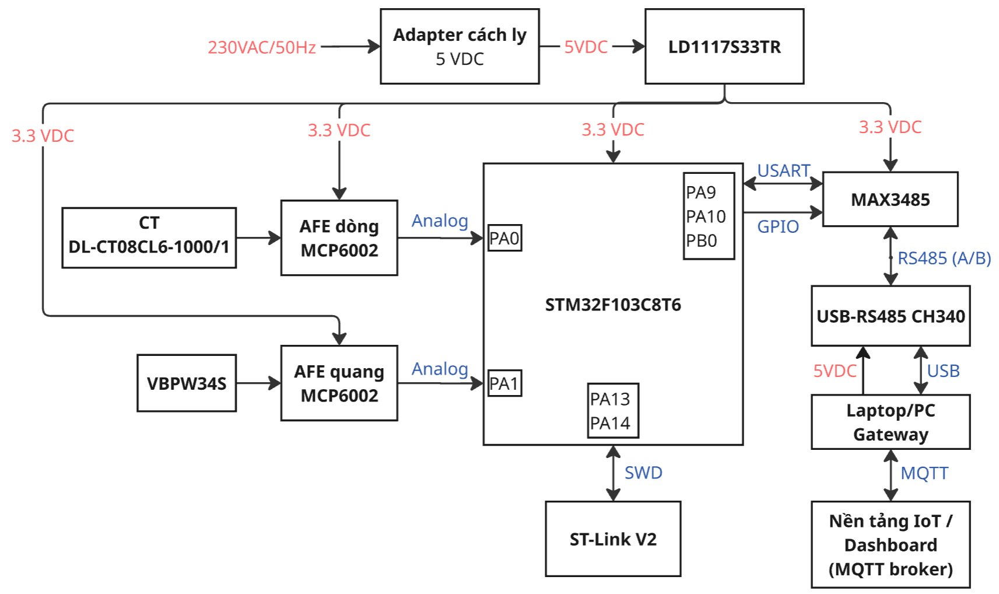

# Giải thích sơ đồ khối và phân vùng PCB

## 1. Sơ đồ khối hệ thống

Mạch thu **dòng điện bằng CT** và **ánh sáng bằng VBPW34S**. Mỗi cảm biến đi qua một mạch xử lý tương tự (AFE) dùng MCP6002 để tạo điện áp đưa vào STM32. STM32 đọc hai tín hiệu, xử lý bằng chương trình và gửi dữ liệu qua MAX3485 tới laptop bằng bộ USB–RS485. Laptop lưu và hiển thị dữ liệu; kết nối lên nền tảng IoT là phần dự kiến.

Adapter cấp **5 VDC**; LD1117S33TR hạ xuống **3,3 V** để nuôi STM32, hai MCP6002 và MAX3485. Bộ USB–RS485 lấy nguồn USB laptop riêng.

| Khối | Thành phần chính | Chức năng | Vị trí |
|---|---|---|---|
| Nguồn | LD1117S33TR | Tạo nguồn 3,3 V từ đầu vào 5 V. | Trên PCB; adapter ở ngoài |
| Dòng | CT, burden, MCP6002 | Biến dòng thành điện áp, đệm và lọc trước khi đưa vào PA0. | CT ở ngoài; AFE trên PCB |
| Quang | VBPW34S, MCP6002 | Biến ánh sáng thành điện áp đưa vào PA1. | Trên PCB |
| MCU | STM32F103C8T6 | Đọc hai kênh, xử lý và trao đổi dữ liệu với khối truyền thông. | Trên PCB |
| Truyền thông | MAX3485ESA+ | Chuyển UART của STM32 sang RS485 để nối bộ USB–RS485. | Trên PCB; bộ chuyển đổi ở ngoài |
| Nạp/reset | Header SWD, RESET | Cắm ST-Link để nạp/debug; nhấn RESET để khởi động lại MCU. | Header/nút trên PCB; ST-Link ở ngoài |

Hai MCP6002 là **hai IC riêng**, cùng cấp 3,3 V. BIAS là mức nền do AFE hiện có tạo ra, giúp hai nhánh làm việc phù hợp với ADC; không phải IC bổ sung.

**Đọc các nhãn trên hình:**

- **Analog → ADC:** điện áp từ AFE được STM32 chuyển thành số; PA0 đọc dòng, PA1 đọc quang.
- **USART / GPIO:** PA9 phát UART, PA10 nhận UART; PB0 điều khiển chung DE và /RE để chọn phát/nhận RS485.
- **RS485 / USB:** A/B nối tới bộ USB–RS485; USB nối bộ chuyển đổi với laptop.
- **SWD:** đường nạp/debug giữa ST-Link và STM32.
- **MQTT:** cách laptop/gateway dự kiến trao đổi dữ liệu qua máy chủ trung gian, gọi là broker [3].

“Phát hiện sớm” là phát hiện nhanh khi dấu hiệu xuất hiện, không phải dự báo. Hạ áp kiểm thử theo kế hoạch; trung áp chỉ phân tích ứng dụng. Sơ đồ chưa chứng minh khả năng hay thời gian phát hiện đã đạt yêu cầu.

## 2. Phân vùng PCB

**Đề xuất bố trí chức năng — chưa phải layout PCB đã chốt.**

Hai khối thu tín hiệu nằm bên trái, MCU ở giữa và truyền thông bên phải. Nguồn ở góc trên trái; RESET và header ST-Link ở phía dưới. Cách chia này giúp đi dây thuận tiện, giữ cụm nhạy gọn và dễ thao tác khi thử mạch.

| Vùng | Cụm chính | Vì sao đặt ở đó? |
|---|---|---|
| Nguồn — trên trái | Jack DC, LDO, tụ nguồn | Jack gần mép để cắm nguồn. Tụ gần LDO; dành vùng tản nhiệt cho LDO. |
| Dòng — giữa trái | Cầu đấu CT, burden, MCP6002 | Cầu đấu hướng về CT ngoài bo; cụm xử lý gần đầu vào, đường ra đi gọn tới PA0. |
| Quang — dưới trái | VBPW34S, MCP6002, hồi tiếp | Cảm biến gần mép, nhìn về vùng cần quan sát và không bị che. Mạng hồi tiếp sát op-amp để hạn chế ký sinh [2]. |
| MCU — ở giữa | STM32, thạch anh, tụ nguồn | Phía PA0/PA1 hướng về hai AFE. Thạch anh và tụ nguồn gần chân tương ứng [1]. |
| Truyền thông — bên phải | MAX3485, terminal J4 A/B/GND | IC gần terminal ở mép bo để đấu dây cáp; tránh đưa đường truyền thông qua đầu vào quang nhạy [1–2]. |
| Thao tác — phía dưới | RESET, header ST-Link | Dễ nhấn nút và cắm đầu nạp khi kiểm thử. |

**Nguồn tham khảo:**

1. [ST AN2586](https://www.st.com/resource/en/application_note/an2586-stm32-hardware-design-guidelines-stmicroelectronics.pdf): bố trí phần cứng STM32.
2. [TI SBOA122](https://www.ti.com/lit/an/sboa122/sboa122.pdf): điện dung và ký sinh trong mạch chuyển dòng quang thành áp.
3. [IBM — MQTT](https://www.ibm.com/docs/en/ibm-mq/9.3.x?topic=overview-mqtt-publishsubscribe-applications): truyền dữ liệu qua broker.

