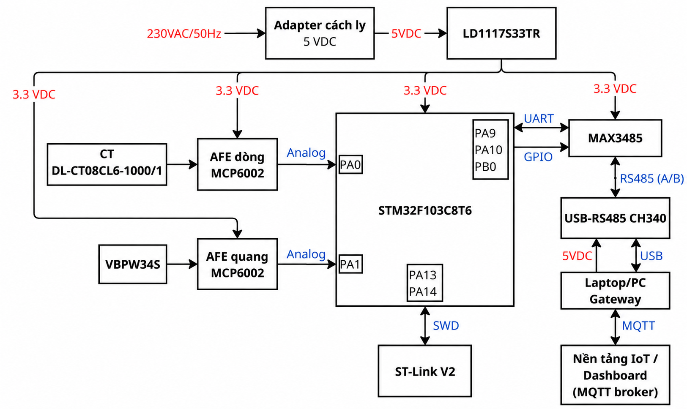
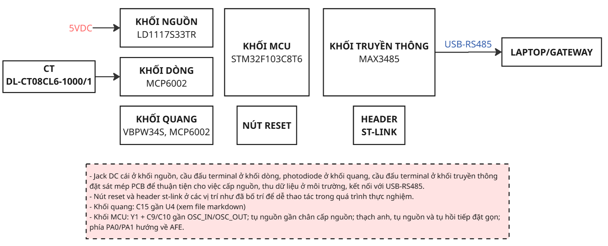

# Giải thích sơ đồ khối và phân vùng PCB

**Quy tắc đặt label:** chỉ đặt 6 Net Label tín hiệu nối giữa các khối: `ADC_CURRENT`, `ADC_LIGHT`, `BIAS_1V65`, `UART_TX`, `UART_RX`, `RS485_DIR`. Đặt cùng tên ở hai khối cần nối, label bám vào dây nối tới chân linh kiện. Nguồn dùng Power Port `+3V3`, `GND`; giữ ký hiệu `+5V` tại đầu vào như sơ đồ nguồn. Các điểm nội bộ nối dây trực tiếp, không đặt Net Label riêng. J2 và mạch reset thuộc cụm MCU; J3 thuộc khối dòng; J4 thuộc khối truyền thông. Thạch anh, BOOT0, reset/SWD tới J2, cầu chia BIAS, burden/đệm dòng, hồi tiếp quang và A/B tới J4 đều nối dây trực tiếp trong khối. Tên chân vẫn dùng để tra cứu, không phải yêu cầu đặt label. Chữ mô tả trên sơ đồ khối là chú thích chức năng, không phải danh sách Net Label phải đặt.

**Quy ước tụ dùng chung cho 4 file:** tụ gốm chọn 50 V; tụ tantalum C1/C2 chọn 16 V. Mã điện dung 3 chữ số tính theo pF: 27 pF (270), 47 pF (470), 100 pF (101), 10 nF (103), 100 nF (104), 1 µF (105), 10 µF (106), 22 µF (226). Đây là mã quy đổi điện dung, không khẳng định mọi tụ SMD đều in mã trên thân. Package/footprint phải đối chiếu đúng mã mua, đặc biệt tụ gốm 10 µF (106)–50 V; kích thước 0805 trong bảng là dự kiến cho đến khi xác nhận mã đáp ứng.

## 1. Sơ đồ khối hệ thống

Mạch thu **dòng điện bằng CT** và **ánh sáng bằng VBPW34S**. Mỗi cảm biến đi qua một mạch xử lý tương tự (AFE) dùng MCP6002 để tạo điện áp đưa vào STM32. STM32 đọc hai tín hiệu, xử lý bằng chương trình và gửi dữ liệu qua MAX3485 tới laptop bằng bộ USB–RS485. Laptop lưu và hiển thị dữ liệu; kết nối lên nền tảng IoT là phần dự kiến.

Adapter cấp **5 VDC**; LD1117S33TR hạ xuống **3,3 V** để nuôi STM32, hai MCP6002 và MAX3485. Bộ USB–RS485 lấy nguồn USB laptop riêng.

| Khối | Thành phần chính | Chức năng | Vị trí |
|---|---|---|---|
| Nguồn | LD1117S33TR | Tạo nguồn 3,3 V từ đầu vào 5 V. | Trên PCB; adapter ở ngoài |
| Dòng | CT, burden, MCP6002 | Biến dòng thành điện áp, đệm và lọc trước khi đưa vào PA0. | CT ở ngoài; AFE trên PCB |
| Quang | VBPW34S, MCP6002 | Biến ánh sáng thành điện áp đưa vào PA1. | Trên PCB |
| MCU | STM32F103C8T6 | Đọc hai kênh, xử lý và trao đổi dữ liệu với khối truyền thông. | Trên PCB |
| Truyền thông | MAX3485ESA+ | Chuyển UART của STM32 sang RS485 để nối bộ USB–RS485. | Trên PCB; bộ chuyển đổi ở ngoài |
| Nạp/reset | Header SWD, SW1 RESET 2 chân SMD 3 × 6 × 2,5 mm, thường hở, nhấn nhả | Cắm ST-Link để nạp/debug; nhấn RESET để khởi động lại MCU. | Header/nút trên PCB; ST-Link ở ngoài |

Hai MCP6002 là **hai IC riêng**, cùng cấp 3,3 V. BIAS là mức nền do AFE hiện có tạo ra, giúp hai nhánh làm việc phù hợp với ADC; không phải IC bổ sung.

### 1.1. Ý nghĩa các đường nối và chiều mũi tên

Chữ trên các đường nối mô tả loại tín hiệu, giao tiếp hoặc nguồn cấp. Đây là chú thích sơ đồ khối; không phải tất cả đều là Net Label trên schematic.

| Đường trên hình | Chiều và ý nghĩa | Kết nối trong mạch |
|---|---|---|
| 230 VAC → adapter → 5 VDC → LDO | Năng lượng đi một chiều từ nguồn vào tới mạch | Adapter cách ly cấp 5 VDC cho LD1117S33TR |
| LDO → các khối, 3,3 VDC | Một chiều cấp nguồn cho các IC trên PCB | STM32, MCP6002 dòng, MCP6002 quang và MAX3485 cùng dùng 3,3 V; CT là cảm biến thụ động, không lấy nguồn từ nhánh này |
| CT → AFE dòng → PA0, Analog | Tín hiệu đo đi từ cảm biến tới MCU | Burden biến dòng thứ cấp thành áp; MCP6002 đệm, RC lọc; PA0/ADC_IN0 nhận điện áp sau lọc |
| VBPW34S → AFE quang → PA1, Analog | Tín hiệu đo đi từ cảm biến tới MCU | MCP6002 chuyển dòng quang thành áp; PA1/ADC_IN1 nhận điện áp đầu ra |
| STM32 ↔ MAX3485, UART | Mũi tên hai chiều biểu diễn gộp hai dây dữ liệu riêng | PA9/TX → DI của MAX3485; RO của MAX3485 → PA10/RX. STM32 dùng ngoại vi USART1 ở chế độ bất đồng bộ (UART) |
| STM32 → MAX3485, GPIO | Một chiều điều khiển từ MCU tới bộ thu phát | PB0 nối chung DE và /RE; mức 0 chọn nhận, mức 1 chọn phát. GPIO không phải giao thức truyền bản tin |
| MAX3485 ↔ USB–RS485, RS485 (A/B) | Dữ liệu đi hai chiều, thay phiên trên cùng cặp A/B | MAX3485 chuyển giữa logic UART 3,3 V và tín hiệu vi sai RS485; bộ USB–RS485 nối bus với laptop |
| USB–RS485 ↔ laptop, USB | Dữ liệu USB đi hai chiều | Laptop gửi/nhận dữ liệu qua bộ chuyển đổi |
| Laptop → USB–RS485, 5 VDC | Cấp nguồn một chiều từ cổng USB laptop | Nguồn USB chỉ cấp bộ chuyển đổi; không nối song song với nguồn adapter của PCB |
| ST-Link ↔ STM32, SWD | Mũi tên hai chiều biểu diễn gộp giao tiếp nạp/debug | PA13/SWDIO truyền hai chiều; PA14/SWCLK nhận clock từ ST-Link. Header còn có GND, tham chiếu nguồn và NRST theo file 03 |
| Laptop/gateway ↔ nền tảng IoT, MQTT | Hướng phát triển dự kiến: gửi số liệu và nhận thông điệp nếu triển khai | MQTT làm việc qua broker [3]; kết nối mạng nằm phía laptop/gateway. Dashboard hiển thị dữ liệu; broker có thể là dịch vụ riêng |

MAX3485 không tự tạo bản tin hay xử lý số đo. Firmware STM32 tạo nội dung bản tin, cấu hình UART và điều khiển PB0; chỉ đưa PB0 về nhận sau khi USART1 đã phát hết bit cuối. RS485 quy định lớp tín hiệu điện; định dạng bản tin ứng dụng cần được thống nhất trong firmware và phần mềm laptop.

### 1.2. Đối chiếu với 6 Net Label trên schematic

| Net Label | Các điểm cần nối |
|---|---|
| `ADC_CURRENT` | Đầu ra lọc dòng tại R5.2/C13.1 ↔ U2.10 (PA0) |
| `ADC_LIGHT` | Đầu ra U4.1, cùng R6.1/C15.1 ↔ U2.11 (PA1) |
| `BIAS_1V65` | Đầu ra đệm U3.7, hồi tiếp U3.6, J3.2/R2.2 và các chân tham chiếu U4.3/U4.5 |
| `UART_TX` | U2.30 (PA9) → U5.4 (DI) |
| `UART_RX` | U5.1 (RO) → U2.31 (PA10) |
| `RS485_DIR` | U2.18 (PB0) → U5.2 (/RE), U5.3 (DE), cùng R7.1 |

Đây là 6 tên label, mỗi tên có thể xuất hiện tại nhiều điểm cần nối chung. Nguồn `+3V3`, `GND` và ký hiệu đầu vào `+5V` dùng Power Port. Dây nội bộ còn lại nối trực tiếp theo file 03. Các chữ Analog, UART, GPIO, RS485, USB, SWD và MQTT trên hình chỉ mô tả chức năng; không đặt chúng thành các net chung. Sơ đồ khối lược bớt GND, dây BIAS, mạch reset và linh kiện phụ trợ để dễ đọc; kết nối đầy đủ nằm ở bảng chân file 03.

“Phát hiện sớm” là phát hiện nhanh khi dấu hiệu xuất hiện, không phải dự báo. Hạ áp kiểm thử theo kế hoạch; trung áp chỉ phân tích ứng dụng. Sơ đồ chưa chứng minh khả năng hay thời gian phát hiện đã đạt yêu cầu.

## 2. Phân vùng PCB

**Đề xuất bố trí chức năng — chưa phải layout PCB đã chốt.**

Hai khối thu tín hiệu nằm bên trái, MCU ở giữa và truyền thông bên phải. Nguồn ở góc trên trái; RESET và header ST-Link ở phía dưới. Cách chia này giúp đi dây thuận tiện, giữ cụm nhạy gọn và dễ thao tác khi thử mạch.

| Vùng | Cụm chính | Vì sao đặt ở đó? |
|---|---|---|
| Nguồn — trên trái | Jack DC, LDO, tụ nguồn | Jack gần mép để cắm nguồn. Tụ gần LDO; dành vùng tản nhiệt cho LDO. |
| Dòng — giữa trái | Cầu đấu CT, burden, MCP6002 | Cầu đấu hướng về CT ngoài bo; cụm xử lý gần đầu vào, đường ra đi gọn tới PA0. |
| Quang — dưới trái | VBPW34S, MCP6002, hồi tiếp | Cảm biến gần mép, nhìn về vùng cần quan sát và không bị che. Mạng hồi tiếp sát op-amp để hạn chế ký sinh [2]. |
| MCU — ở giữa | STM32, thạch anh, tụ nguồn | Phía PA0/PA1 hướng về hai AFE. Thạch anh và tụ nguồn gần chân tương ứng [1]. |
| Truyền thông — bên phải | MAX3485, terminal J4 A/B/GND | IC gần terminal ở mép bo để đấu dây cáp; tránh đưa đường truyền thông qua đầu vào quang nhạy [1–2]. |
| Thao tác — phía dưới | RESET, header ST-Link | Dễ nhấn nút và cắm đầu nạp khi kiểm thử. SW1 dùng loại 2 chân SMD 3 × 6 × 2,5 mm; đối chiếu kích thước/khoảng cách pad với nút thực trước khi chốt footprint. |

**Nguồn tham khảo:**

1. [ST AN2586](https://www.st.com/resource/en/application_note/an2586-stm32-hardware-design-guidelines-stmicroelectronics.pdf): bố trí phần cứng STM32.
2. [TI SBOA122](https://www.ti.com/lit/an/sboa122/sboa122.pdf): điện dung và ký sinh trong mạch chuyển dòng quang thành áp.
3. [IBM — MQTT](https://www.ibm.com/docs/en/ibm-mq/9.3.x?topic=overview-mqtt-publishsubscribe-applications): truyền dữ liệu qua broker.

