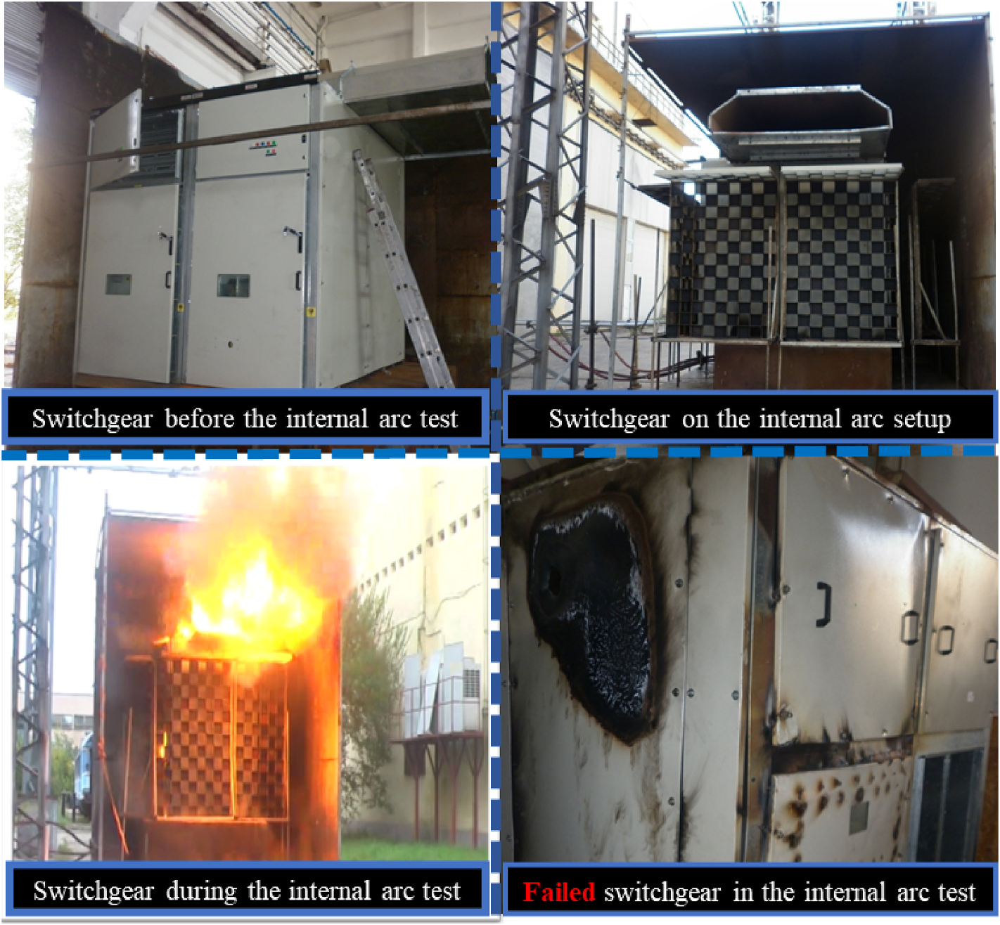
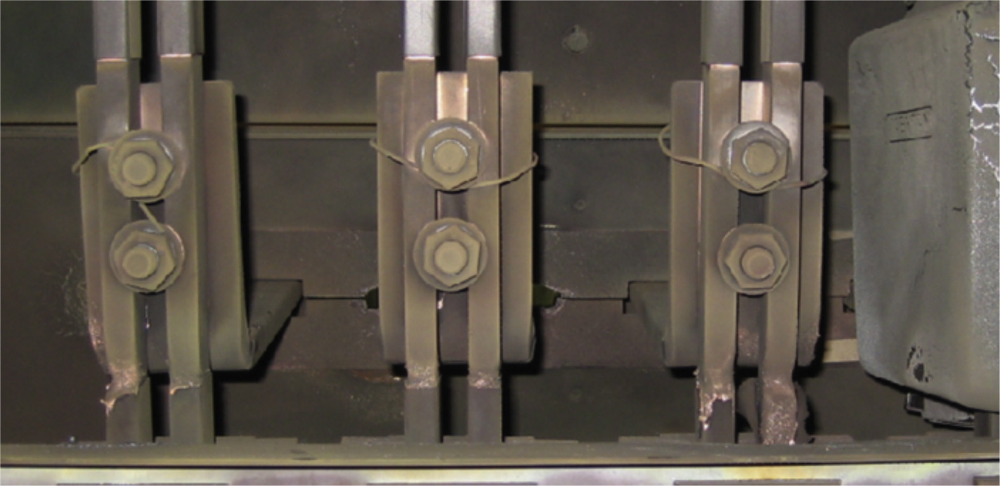
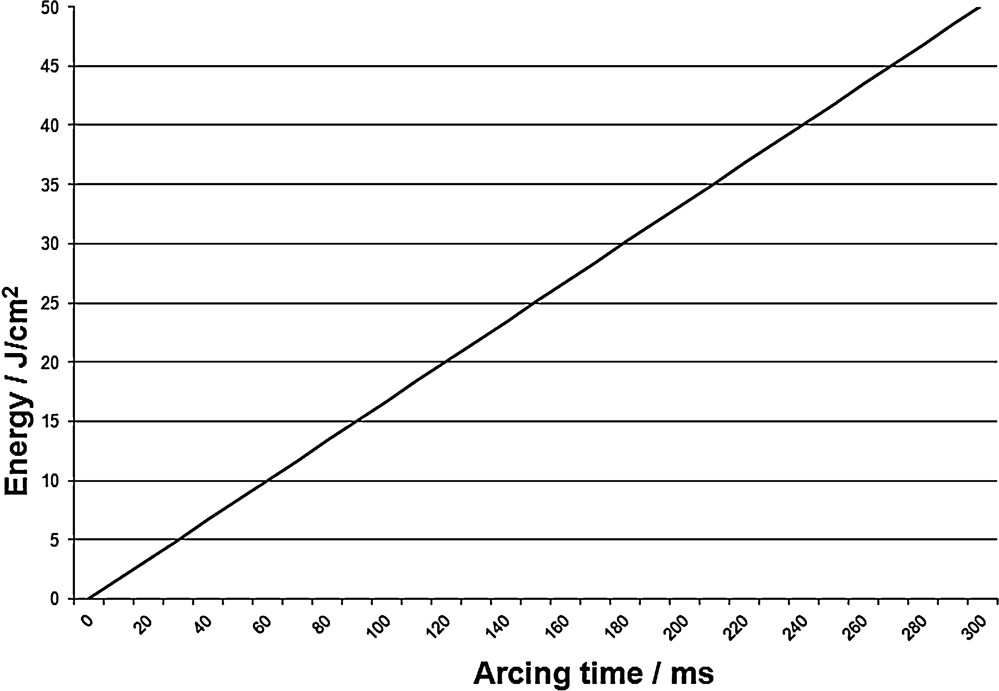
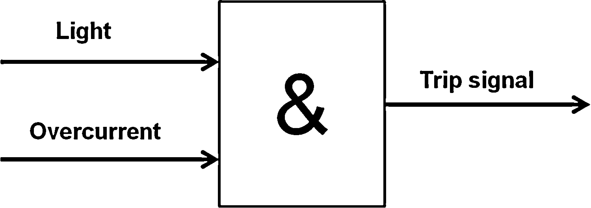
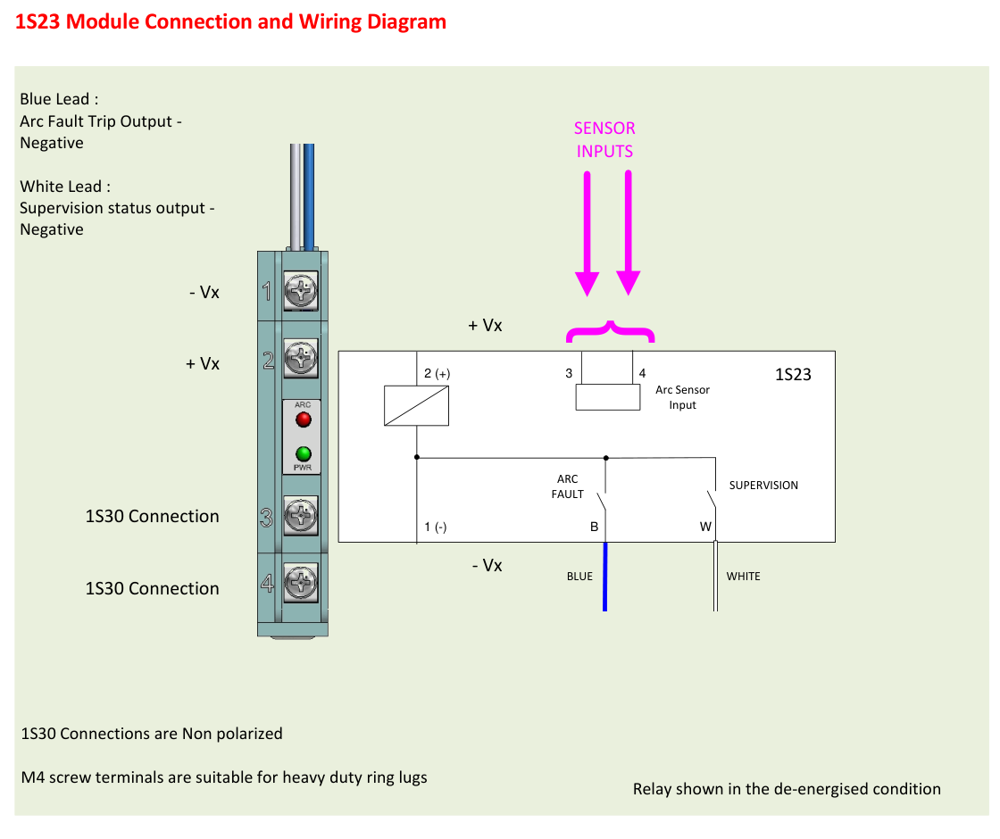
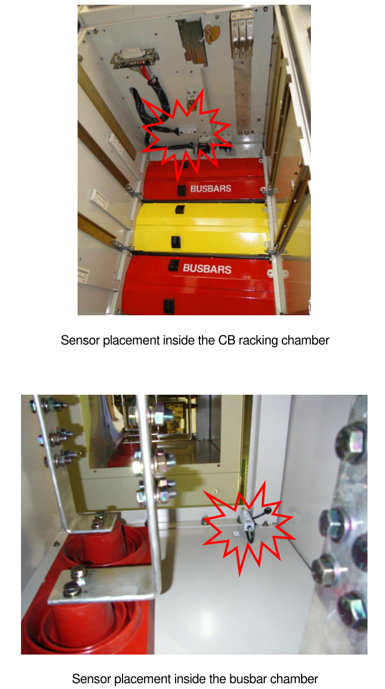

> **Đề tài:** Thiết kế hệ thống nhúng phát hiện chớp hồ quang điện (arc-flash) trong hệ thống điện hạ thế và trung thế.
>
> **Ghi chú bản thảo:** Nội dung hướng tới khoảng 10–14 trang A4 khi dàn bằng Times New Roman 13, giãn dòng khoảng 1,15. Số trang thực tế phụ thuộc cách dàn trang và kích thước hình.

Chương 1 trình bày bài toán phát hiện chớp hồ quang điện, các yêu cầu kỹ thuật của hệ thống và một trường hợp ứng dụng tại Nhà máy Nhiệt điện Quảng Ninh. Bên cạnh đó, chương khảo sát thiết bị Mors Smitt 1S23 để tìm hiểu cách thu nhận tín hiệu, phát hiện và phối hợp với thiết bị bảo vệ.

# 1.1. Tổng quan bài toán phát hiện chớp hồ quang điện

## 1.1.1. Đối tượng nghiên cứu và bối cảnh ứng dụng

Trong hệ thống cung cấp điện công nghiệp, tủ điện là nơi bố trí các thiết bị đóng cắt, đo lường và bảo vệ. Các bộ phận như thanh cái, đầu cáp, tiếp điểm và lớp cách điện cùng làm việc trong không gian giới hạn của tủ. Khi xảy ra sự cố hồ quang nội bộ, nhiệt, áp suất và vật chất nóng phát sinh có thể làm hư hỏng thiết bị, gây nguy hiểm cho người ở gần và gián đoạn cấp điện. [TL1, mục 1 và 3.2, tr. in 78; tr. PDF 2.]

Đề tài tập trung vào việc phát hiện chớp hồ quang trong tủ điện hạ thế và trung thế. Các bộ phận được xem xét gồm:

- **Thanh cái, mối nối và tiếp điểm:** Đây là các phần tử dẫn điện trong tủ. Tình trạng mối nối, lớp cách điện và khoảng cách giữa các phần dẫn điện có liên quan đến nguy cơ phát sinh sự cố nội bộ.
- **Đầu cáp và khoang đấu nối:** Là nơi kết nối cáp với thiết bị. Tổng quan kỹ thuật của Kumpulainen và cộng sự xem đầu cáp là một vị trí điển hình trong theo dõi sự cố hồ quang.
- **Khoang thiết bị đóng cắt và đo lường:** Gồm máy cắt, dao cách ly, dao tiếp địa và biến điện đo lường. Việc bố trí các bộ phận này cùng kết cấu vách ngăn quyết định không gian giám sát. [TL1, mục 3.2 và 4.3, tr. in 78–80; tr. PDF 2–4.]

Hình 1.1 cho thấy kết cấu của tủ trung thế KMZ_31 được sử dụng trong nghiên cứu về hồ quang nội bộ. Tủ có vách bao và đường thoát khí riêng. Phạm vi giám sát phụ thuộc từng khoang, các vật cản và khoảng cách giữa cảm biến với vị trí sự cố. [TL3, Hình 5, tr. in/PDF 7; W4, “Sensor Placement”, tr. in/PDF 25.]

*Hình 1.1. Kết cấu tủ trung thế KMZ_31 trong nghiên cứu nguồn; Exhaust Duct là đường thoát khí, Wall là vách tủ.*

*Nguồn: TL3, Hình 5, tr. in 7, tr. PDF 7. Trích ảnh từ tài liệu, giữ nguyên nhãn; bài báo phát hành theo CC BY 4.0.*

Phạm vi giám sát được xem xét từ toàn trạm, dãy tủ đến từng khoang tủ. Trong đó, việc phân tích vị trí đầu thu quang được thực hiện theo từng khoang tủ. Hướng dẫn của hãng yêu cầu cảm biến phải bao phủ các khoang được bảo vệ; một đầu thu không tự bảo đảm khả năng quan sát mọi khoang trong dãy tủ. [W4, “Sensor Placement”, tr. in/PDF 25.]

Đối với hệ thống nhúng, nhiệm vụ nghiên cứu là thu nhận dấu hiệu sự cố, xử lý để nhận biết sự kiện và đưa ra tín hiệu phản hồi. Việc cắt nguồn được thực hiện qua các phần tử bảo vệ và thiết bị đóng cắt bên ngoài. Trong phạm vi bộ phát hiện, đồ án phân tích tín hiệu đầu vào, thông tin đầu ra và quan hệ giữa các khối xử lý. [TL1, mục 2 và 6.2, tr. in 78–79, 84; tr. PDF 2–3, 8.]

## 1.1.2. Hiện tượng hồ quang điện và chớp hồ quang điện

Hồ quang điện là hiện tượng phóng điện phát sáng, trong đó dòng điện đi qua môi trường plasma nóng giữa các điện cực. Hình dạng và sự phát triển của hồ quang phụ thuộc vào thiết bị, môi trường và nguồn năng lượng duy trì phóng điện. Ba khái niệm được sử dụng trong chương gồm:

- **Hồ quang điện — electric arc:** Chỉ hiện tượng phóng điện. Hồ quang có thể xuất hiện trong một quá trình làm việc đã được thiết kế, chẳng hạn quá trình ngắt dòng của máy cắt.
- **Sự cố hồ quang — arc fault:** Chỉ sự cố có hồ quang phát sinh ngoài chức năng làm việc dự kiến của thiết bị.
- **Chớp hồ quang điện — arc flash:** Gắn với thành phần bức xạ nhiệt của hồ quang năng lượng lớn. Với đề tài này, nhiệm vụ phát hiện tập trung vào dấu hiệu của sự kiện, đặc biệt là phát sáng, để phục vụ việc nhận biết và phản hồi. [TL2, mục 1, tr. in 7; tr. PDF 1; TL1, mục 2, tr. in 78–79; tr. PDF 2–3.]

Trong thao tác đóng cắt bình thường, hồ quang được hình thành trong bộ phận có kết cấu chịu và dập hồ quang. Với sự cố nội bộ, phóng điện xảy ra tại nơi không được thiết kế cho quá trình đó, làm tác động đến những phần tử xung quanh. Sự khác nhau này có ý nghĩa đối với bộ phát hiện: tín hiệu xuất hiện trong quá trình làm việc bình thường là một nhóm tác động gây nhầm trong đánh giá bộ phát hiện. [TL2, mục 1, tr. in 7; tr. PDF 1.]

Những yếu tố liên quan đến sự cố được tài liệu tổng quan đề cập gồm tình trạng cách điện, các điểm đấu nối, tiếp điểm và công tác bảo trì. Theo dõi các dấu hiệu suy giảm trước sự cố có thể hỗ trợ phòng ngừa. Tuy nhiên, phát hiện hồ quang đã xuất hiện là một nhiệm vụ khác, đòi hỏi nhận biết và phản hồi trong thời gian ngắn. [TL1, mục 3 và 4, tr. in 78–81; tr. PDF 2–5.]

Tác động của hồ quang đến thiết bị và con người có thể chia thành các nhóm chính:

- **Tác động nhiệt:** Bức xạ và vật chất nóng có thể gây bỏng, làm hỏng cách điện và các phần dẫn điện.
- **Tác động áp suất:** Kênh hồ quang giãn nở tạo sóng áp suất; khí trong vỏ tủ được nung nóng còn gây tăng áp trong không gian bao kín. Hai quá trình này được phân biệt trong nghiên cứu về nổ hồ quang.
- **Hư hỏng và gián đoạn hoạt động:** Hư hỏng thiết bị có thể kéo theo thời gian ngừng cấp điện, sửa chữa và khôi phục hệ thống. [TL2, tóm tắt và mục 1, tr. in 7; tr. PDF 1; TL1, mục 1, tr. in 78; tr. PDF 2.]

Hình 1.2 ghi lại tủ KMZ_31 trước, trong và sau thử nghiệm tại phòng thí nghiệm công suất lớn ICMET, Romania. Ánh sáng phát ra trong quá trình thử và hư hỏng sau thử thể hiện hai khía cạnh của sự cố: dấu hiệu phục vụ phát hiện và tác động lên kết cấu tủ. [TL3, mục 1 và Hình 1, tr. in/PDF 1–2.]

*Hình 1.2. Thử nghiệm hồ quang nội bộ tủ KMZ_31 tại ICMET, Romania, gồm trạng thái trước thử và trạng thái hư hỏng sau thử.*

*Nguồn: TL3, Hình 1, tr. in 2, tr. PDF 2. Trích nguyên cụm ảnh và nhãn trong nguồn, CC BY 4.0; không phải ảnh tại nhà máy ở mục 1.3.*

Các nghiên cứu về hồ quang sử dụng nhiều loại tín hiệu khác nhau. Lezama và cộng sự nghiên cứu hồ quang nối tiếp trên mạch dân dụng 230 V AC–50 Hz bằng tương quan dòng điện giữa các chu kỳ. Lin và cộng sự nghiên cứu định vị hồ quang DC trong hệ thống quang điện từ bức xạ điện từ thu bằng anten. Đây là những bài toán có đối tượng, tín hiệu và điều kiện khác với phát hiện chớp hồ quang trong tủ điện. [TL4, tóm tắt, tr. in 227; tr. PDF 1; TL6, tóm tắt và mục 1, tr. PDF 1.]

Các công trình trên được sử dụng để phân biệt phạm vi và loại tín hiệu nghiên cứu. Kết quả nhận dạng trên một tập tải dân dụng không đại diện cho khả năng phát hiện trong tủ trung thế; độ chính xác định vị hồ quang DC cũng không thay thế cho độ nhạy đầu thu quang. Cơ chế thu nhận và xử lý từng loại tín hiệu sẽ được tìm hiểu ở Chương 2.

## 1.1.3. Số liệu minh chứng và tính cấp thiết

Mức độ nguy hiểm của sự cố thể hiện qua hư hỏng thiết bị và năng lượng tác động trong những điều kiện cụ thể. Hình 1.3 là ảnh thanh cái hạ thế sau một phép thử được công bố trong tài liệu tổng quan. Điều kiện của phép thử gồm điện áp U = 726 V, dòng ngắn mạch ký hiệu Ik = 77 kA và thời gian hồ quang 65 ms. Sau thử, thanh cái bị nóng chảy cục bộ tại ranh giới lớp cách điện. [TL1, Hình 2, tr. in 80; tr. PDF 4.]

*Hình 1.3. Thanh cái hạ thế nóng chảy cục bộ sau thử hồ quang tại ranh giới lớp cách điện.*

*Nguồn: TL1, Hình 2, tr. in 80, tr. PDF 4. Trích ảnh gốc; điều kiện nguồn: U = 726 V, Ik = 77 kA, thời gian hồ quang 65 ms.*

Phép thử cho thấy hư hỏng có thể hình thành trong khoảng thời gian ngắn. Bên cạnh đó, năng lượng tác động còn phụ thuộc vào thời gian hồ quang tồn tại. Hình 1.4 biểu diễn quan hệ này trong trường hợp tính toán với U = 15 kV, Ik = 50 kA, khe hở 152 mm và khoảng cách làm việc 910 mm. Khi các điều kiện của trường hợp tính giữ nguyên, năng lượng trên đơn vị diện tích tăng theo thời gian hồ quang. [TL1, mục 5.2–5.5 và Hình 5, tr. in 81–83; tr. PDF 5–7.]

*Hình 1.4. Năng lượng tác động theo thời gian hồ quang trong một trường hợp tính toán; trục tung là J/cm², trục hoành là ms.*

*Nguồn: TL1, Hình 5, tr. in 82, tr. PDF 6. Trích nguyên hình; điều kiện: U = 15 kV, Ik = 50 kA, khe hở 152 mm, khoảng cách làm việc 910 mm. Không phải đường đặc tính của nguyên mẫu.*

Từ những minh chứng trên, bài toán phát hiện đặt ra các nhu cầu sau:

- **Nhận biết sớm sự kiện:** Rút ngắn thời gian từ khi dấu hiệu hồ quang xuất hiện đến khi có tín hiệu phản hồi, tạo điều kiện cho khâu bảo vệ tiếp theo làm việc.
- **Phân biệt được tác động gây nhầm:** Xem xét tín hiệu sự cố cùng điều kiện làm việc bình thường, tránh đánh giá bộ phát hiện chỉ bằng một trường hợp kích thích thuận lợi.
- **Đánh giá được từng khâu:** Xác định thời gian thu nhận, xử lý và xuất tín hiệu; ở cấp toàn hệ thống, thời gian phản hồi còn bao gồm hoạt động của thiết bị bảo vệ và máy cắt. [TL1, mục 5.5–5.6 và 6.2, tr. in 83–84; tr. PDF 7–8; các nhu cầu trên được rút ra cho đề tài.]

Các giá trị thử nghiệm vừa nêu là điều kiện của tài liệu nguồn. Bộ tài liệu hiện có chưa cung cấp thống kê đủ phạm vi và thời gian quan sát để xác định tần suất sự cố tại Việt Nam. Do đó, tính cấp thiết ở đây được làm rõ từ hậu quả và nhu cầu phản hồi, thay vì ước lượng xác suất sự cố theo năm.

Nhiệm vụ của hệ thống nhúng gồm thu nhận tín hiệu, xử lý quyết định và cung cấp đầu ra để đánh giá. Đồ án phân tích điện áp, tần số, dòng điện, độ nhạy và thời gian phản hồi làm cơ sở lựa chọn giải pháp phần cứng.

# 1.2. Phân tích yêu cầu kỹ thuật của bài toán

## 1.2.1. Yêu cầu về điện áp

Yêu cầu điện áp liên quan đến cả hệ thống được giám sát và bản thân bộ phát hiện. Trong phân tích thiết kế, điện áp được chia thành ba nhóm để làm rõ điều kiện làm việc và giao diện của từng khối:

- **Điện áp hệ thống:** Là điện áp của thiết bị điện nằm trong phạm vi giám sát, gắn với bối cảnh ứng dụng hạ thế hoặc trung thế. Đại lượng này được phân biệt với mức điện áp tại giao diện bộ phát hiện.
- **Điện áp tín hiệu:** Là mức điện áp ở các giao diện đo và xử lý. Sơ đồ 1S23 cho thấy cảm biến kết nối với mô-đun, còn đầu ra mô-đun nối tới đầu vào trạng thái rơ-le; đặc tính giao diện gồm mức điện, cực tính và cách ly.
- **Nguồn phụ trợ:** Là nguồn nuôi thiết bị phát hiện. Với 1S23, nguồn này có các mức DC danh định theo biến thể sản phẩm, được trình bày ở mục 1.4. [W3, “Description”, “Auxiliary Supply” và “Connection and Wiring Diagram”, tr. PDF 2, 5, 7.]

Việc phân chia điện áp làm rõ giao diện giữa các khối trong thiết kế. Điện áp trung thế của thiết bị được giám sát không phải điện áp đưa trực tiếp vào bộ xử lý nhúng. Đặc tính mỗi cổng thu nhận hoặc xuất tín hiệu được mô tả bằng mức danh định, dải làm việc và điều kiện kết nối với thiết bị ngoài.

Đối với nguyên mẫu, dải nguồn và mức tín hiệu sẽ được xác định theo phương án thu nhận lựa chọn ở Chương 2. Nội dung đánh giá gồm kiểm tra nguồn cấp, đo mức tại đầu vào–đầu ra và đối chiếu với đặc tính các khối kết nối. Trạng thái cụ thể hóa yêu cầu được tổng hợp trong Bảng 1.1.

## 1.2.2. Yêu cầu về tần số

Đồ án phân tích tần số theo từng đại lượng vì tần số nguồn, băng thông và tốc độ lấy mẫu mô tả các đặc tính khác nhau. Ba nội dung liên quan trực tiếp gồm:

- **Tần số nguồn điện:** Là tần số của nguồn AC trong phạm vi nghiên cứu. Trong công trình của Lezama, nguồn làm việc ở 50 Hz; giá trị này mô tả điều kiện nguồn của nghiên cứu tham khảo, không phải tần số lấy mẫu.
- **Dải tần tín hiệu thu nhận:** Phụ thuộc vào dấu hiệu được sử dụng. Kênh chỉ tiếp nhận trạng thái dòng có nhu cầu khác với kênh đo dạng sóng; kênh quang theo dõi biến đổi ánh sáng phục vụ phát hiện.
- **Tần số lấy mẫu:** Là đặc tính của phương án số hóa tín hiệu. Trong nghiên cứu hồ quang nối tiếp của Lezama, mạch nguồn làm việc ở 50 Hz nhưng tín hiệu dòng được lấy mẫu 5 kHz. [TL4, tóm tắt, tr. in 227; tr. PDF 1.]

Ví dụ trên cho thấy tần số nguồn không quyết định trực tiếp tần số thu nhận. Việc lựa chọn băng thông và tốc độ xử lý dựa trên đặc điểm tín hiệu mà đồ án sử dụng. Nếu biến đổi mang dấu hiệu sự cố bị mất ở khâu thu nhận, việc tăng tốc xử lý phía sau không khôi phục được thông tin đó.

Phương pháp đánh giá đối chiếu dải đáp ứng của chuỗi thu nhận với tín hiệu tham chiếu và xét ảnh hưởng của các khối điều hòa, xử lý. Dải tần đo của nguyên mẫu sẽ phụ thuộc loại tín hiệu được lựa chọn, không lấy nguyên cấu hình của một nghiên cứu hồ quang nối tiếp làm yêu cầu cho kênh quang.

## 1.2.3. Yêu cầu về dòng điện

Dòng điện có thể được sử dụng để nhận biết sự cố hoặc xác nhận một dấu hiệu khác. Với bảo vệ dựa trên ánh sáng và quá dòng, tài liệu tổng quan mô tả việc phối hợp hai điều kiện để tăng tính chắc chắn của quyết định. Hình 1.5 trình bày nguyên lý này: tín hiệu tác động chỉ được hình thành theo tổ hợp ánh sáng và quá dòng của sơ đồ nguồn. [TL1, mục 5.6 và Hình 6, tr. in 83; tr. PDF 7.]

*Hình 1.5. Ví dụ phối hợp ánh sáng và quá dòng bằng phép AND; Trip signal là tín hiệu tác động của hệ thống bảo vệ trong nguồn.*

*Nguồn: TL1, Hình 6, tr. in 83, tr. PDF 7. Trích nguyên hình minh họa nguyên lý trong nghiên cứu nguồn.*

Đối với kênh dòng, đồ án phân biệt ba đại lượng:

- **Dòng định mức:** Gắn với chế độ làm việc của tải hoặc thiết bị.
- **Dòng sự cố:** Là dòng điện trong điều kiện sự cố. Dòng hồ quang có thể thấp hơn dòng sự cố kim loại, từ đó ảnh hưởng đến thời gian tác động của bảo vệ quá dòng.
- **Tín hiệu đưa vào bộ phát hiện:** Có thể là đại lượng thứ cấp của khối đo hoặc trạng thái do phần tử bảo vệ cung cấp, tùy cấu trúc hệ thống. Với 1S23, chức năng kiểm tra dòng thuộc rơ-le ngoài trong sơ đồ ứng dụng. [TL1, mục 5.3, tr. in 81–82; tr. PDF 5–6; W4, “Example Schematic”, tr. in/PDF 13.]

Kênh dòng được phân tích theo vị trí lấy thông tin, dạng tín hiệu và vai trò trong quyết định phát hiện. Với phương án dùng dòng xác nhận tín hiệu quang, điều kiện phối hợp và quan hệ thời gian giữa hai tín hiệu là cơ sở xây dựng logic xử lý. Nội dung này khác với việc chọn một ngưỡng từ dòng ngắn mạch của nguồn thử.

Cách đánh giá gồm kiểm tra riêng từng tín hiệu và kiểm tra tổ hợp được quy định hợp lệ. Ngưỡng, tỷ số biến dòng và giao diện cụ thể chưa được xác lập cho nguyên mẫu; các thông số này được xem xét cùng phương án thu nhận và logic xử lý của đồ án.

## 1.2.4. Yêu cầu về độ nhạy

Độ nhạy phản ánh khả năng nhận biết tín hiệu trong điều kiện xác định. Với kênh quang, độ nhạy được phân tích trên chuỗi từ đầu thu đến quyết định phát hiện, gồm ba nội dung:

- **Khả năng thu nhận của cảm biến:** Liên quan đến kích thích quang và tín hiệu điện thu được tại đầu ra cảm biến.
- **Ngưỡng tác động:** Là điều kiện mà mạch hoặc khối xử lý dùng để nhận biết sự kiện.
- **Khả năng phát hiện của hệ thống:** Được đánh giá bằng kết quả nhận đúng, bỏ sót và báo nhầm trên tập tình huống thử được mô tả rõ.

Vị trí đầu thu là một phần của điều kiện đánh giá. User Guide 1S23 yêu cầu bố trí cảm biến bao phủ các khoang được bảo vệ và dùng thêm đầu thu khi vùng giám sát lớn hơn vùng thu nhận. Hướng dẫn cũng đề cập ảnh hưởng của ánh sáng môi trường kéo dài đến chức năng thiết bị. [W4, “Sensor Installation”, tr. in/PDF 23–26; W3, “Arc Sensor Continuously Picked Up”, tr. in/PDF 3.]

Từ đó, điều kiện đánh giá độ nhạy gồm nguồn kích thích, khoảng cách, hướng thu, vật cản và ánh sáng nền. Một lần không phát hiện có thể xuất phát từ tín hiệu bị che khuất hoặc thu nhận không đủ, bên cạnh nguyên nhân về ngưỡng. Ngược lại, đánh giá chỉ bằng việc chiếu sáng mạnh trực tiếp vào đầu thu chưa phản ánh khả năng phân biệt sự kiện trong điều kiện sử dụng.

Trong đồ án, tình huống sự cố và tập tác động gây nhầm được xem xét cùng phương án thu nhận. Chỉ sau khi có các điều kiện này mới có thể đặt ngưỡng và đánh giá tỷ lệ phát hiện có ý nghĩa. Bảng 1.1 ghi nhận những thông số chưa xác lập, thay cho việc dùng một yêu cầu chung như độ nhạy cao.

## 1.2.5. Yêu cầu về thời gian phản hồi

Thời gian phản hồi có ý nghĩa khi xác định rõ mốc bắt đầu và kết thúc. Với mô-đun phát hiện, một cách đánh giá là đo từ lúc kích thích xuất hiện đến lúc đầu ra điện làm việc. Bulletin 1S23 v01.0 sử dụng đúng cách mô tả này cho thông số dưới 2 ms: từ chớp sáng đến đầu ra tác động. [W3, “Technical Data”, tr. in 5/11; tr. PDF 5.]

Đồ án phân tích thời gian phản hồi theo các khoảng sau:

- **Thời gian thu nhận:** Từ kích thích tham chiếu đến khi tín hiệu sẵn sàng cho khối xử lý.
- **Thời gian xử lý và xuất đầu ra:** Từ tín hiệu nhận được đến khi đầu ra đạt trạng thái tác động quy định.
- **Thời gian phối hợp bảo vệ và cắt:** Thuộc các phần tử phía sau bộ phát hiện, bao gồm rơ-le và thiết bị đóng cắt. Tài liệu tổng quan chỉ ra rằng khi phát hiện làm việc nhanh, thời gian loại trừ còn phụ thuộc đáng kể vào thiết bị sơ cấp. [TL1, mục 5.6 và 6.2, tr. in 83–84; tr. PDF 7–8.]

Ngoài độ trễ, đầu ra còn có độ rộng xung. Bulletin 1S23 ghi độ trễ dưới 2 ms và xung duy trì 110 ms ±10 ms. Độ rộng xung cho biết thời gian đầu ra ở trạng thái tác động; nó không phải khoảng thời gian chờ trước khi phát hiện. [W3, “Trip Output Circuit Operation” và “Technical Data”, tr. in/PDF 3, 5.]

Phương pháp đánh giá nguyên mẫu sử dụng kích thích tham chiếu và đầu ra trên cùng cơ sở thời gian. Vị trí đặt mốc, điều kiện kích thích và cách xác định trạng thái đầu ra là các điều kiện của phép đánh giá. Nếu sử dụng nguồn sáng thay thế, kết quả được dùng để đánh giá đáp ứng quang của bộ phát hiện trong điều kiện thử, không thay thế thời gian cắt sự cố của cả hệ thống.

## 1.2.6. Yêu cầu về chu kỳ lấy mẫu

Chu kỳ lấy mẫu là khoảng thời gian giữa hai lần thu nhận liên tiếp khi thực hiện số hóa đều. Quan hệ giữa chu kỳ và tần số lấy mẫu là $f_s = 1/T_s$. Việc lựa chọn chu kỳ dựa trên đặc điểm tín hiệu và thời gian dành cho quyết định phát hiện.

Nội dung đánh giá tương ứng với từng cách thu nhận như sau:

- **Kênh đo tương tự bằng ADC:** Các đại lượng được phân tích gồm dải thông tin giữ lại, chu kỳ lấy mẫu và ảnh hưởng của khối điều hòa tín hiệu trước ADC.
- **Kênh nhận trạng thái số:** Các đặc tính được đánh giá gồm khả năng nhận cạnh hoặc xung, độ trễ tiếp nhận và khả năng bắt sự kiện.
- **Kênh xử lý liên tục bằng mạch so sánh:** Đáp ứng của mạch và đường truyền tín hiệu tới bộ xử lý là các đặc tính được phân tích; chu kỳ ADC không mô tả cơ chế thu nhận này.

Trong công trình của Lezama, tín hiệu dòng trên nguồn 50 Hz được lấy mẫu 5 kHz để phục vụ phương pháp tương quan. Ví dụ này cho thấy tốc độ lấy mẫu gắn với phương pháp xử lý và đặc điểm tín hiệu. Vì vậy, chọn tần số thu nhận chỉ bằng cách lấy gấp đôi tần số điện lưới chưa đủ cho bài toán phát hiện biến đổi nhanh. [TL4, tóm tắt và mục 2, tr. in 227–229; tr. PDF 1–3.]

Yêu cầu của đề tài là xác định cơ chế thu nhận cho từng kênh trước khi chốt chu kỳ. Phương pháp kiểm tra đối chiếu thời điểm nhận sự kiện với tín hiệu tham chiếu, đồng thời đánh giá khả năng tiếp nhận khi bộ xử lý đang thực hiện nhiệm vụ khác. Tài liệu 1S23 được khảo sát chỉ công bố các đặc tính hoạt động liên quan, không cung cấp tần số lấy mẫu nội bộ để dùng làm thông số thiết kế của nguyên mẫu. [W3, “Technical Data”, tr. in/PDF 5.]

## 1.2.7. Tổng hợp yêu cầu kỹ thuật ban đầu

Bảng 1.1 tổng hợp yêu cầu và các thông số làm cơ sở thiết kế. Thông số từ nghiên cứu và thiết bị thương mại được dùng để đối chiếu; các giá trị chưa xác lập được trình bày theo trạng thái của phương án thiết kế.

*Bảng 1.1. Tổng hợp yêu cầu kỹ thuật ban đầu.*

| Mã yêu cầu | Nội dung | Giá trị/tiêu chí hoặc thông số chưa xác lập | Căn cứ | Cách đánh giá | Trạng thái |
|---|---|---|---|---|---|
| YC-01 | Điện áp | Ba nhóm: điện áp hệ thống, điện áp tín hiệu, nguồn phụ trợ; dải từng cổng theo phương án nguyên mẫu | Mục 1.2.1; W3, tr. 2, 5, 7 | Kiểm tra nguồn và đo mức đầu vào–đầu ra | Chưa chốt dải nguyên mẫu |
| YC-02 | Tần số | Phân biệt tần số nguồn, băng thông và lấy mẫu; nghiên cứu tham khảo dùng nguồn 50 Hz | Mục 1.2.2; TL4, tr. in 227/PDF 1 | Đối chiếu đáp ứng kênh thu nhận với tín hiệu tham chiếu | Có giá trị nguồn tham chiếu; chưa chốt băng thông |
| YC-03 | Dòng điện | Phân tích vị trí, dạng tín hiệu và điều kiện phối hợp; ngưỡng theo phương án thu nhận | Mục 1.2.3; TL1, mục 5.3, 5.6; W4, tr. 13 | Kiểm tra từng tín hiệu và tổ hợp hợp lệ | Chưa chốt giao diện, ngưỡng |
| YC-04 | Độ nhạy | Mô tả nguồn kích thích, bố trí thu nhận, ánh sáng nền và tình huống gây nhầm | Mục 1.2.4; W4, tr. 23–26; W3, tr. 3 | Ghi nhận đúng, bỏ sót, báo nhầm trên tập thử xác định | Chưa xác lập điều kiện đánh giá |
| YC-05 | Thời gian phản hồi | Đo từ kích thích tham chiếu đến đầu ra; phân biệt với độ rộng xung và thời gian cắt | Mục 1.2.5; W3, tr. 5; TL1, mục 5.6, 6.2 | Đo đồng thời tham chiếu và đầu ra | Đã xác định đại lượng; chưa chốt giới hạn |
| YC-06 | Chu kỳ lấy mẫu | Xác định kênh dùng ADC, nhận trạng thái hoặc xử lý liên tục trước khi chọn chu kỳ | Mục 1.2.6; TL4, mục 2 | Đo chu kỳ hoặc độ trễ nhận sự kiện theo cơ chế lựa chọn | Phụ thuộc thiết kế thu nhận |

Phạm vi thiết bị là cơ sở xem xét tiêu chuẩn áp dụng trong quá trình xác lập yêu cầu. Tài liệu tổng quan đề cập các tiêu chuẩn liên quan đến thiết bị đóng cắt, còn Bulletin 1S23 liệt kê những hạng mục kiểm tra của sản phẩm. Việc lựa chọn bộ tiêu chuẩn cho nguyên mẫu dựa trên đối tượng và điều kiện áp dụng cụ thể. [TL1, mục 3.2, tr. in 78; tr. PDF 2; W3, “Compliance”, tr. in/PDF 6.]

Sau phần phân tích yêu cầu kỹ thuật, mục 1.3 trình bày một trường hợp nghiên cứu riêng ở cấp hệ thống. Phần khảo sát 1S23 tiếp đó làm rõ cách triển khai chức năng ở cấp thiết bị.

# 1.3. Phân tích quy trình phát hiện và phối hợp bảo vệ hồ quang theo hồ sơ thiết kế tại Nhà máy Nhiệt điện Quảng Ninh

## 1.3.1. Giới thiệu nhà máy và cơ sở lựa chọn trường hợp nghiên cứu

Nhà máy Nhiệt điện Quảng Ninh do Công ty Cổ phần Nhiệt điện Quảng Ninh quản lý, vận hành, gồm bốn tổ máy với tổng công suất 1.200 MW. Đây là thông tin giới thiệu do doanh nghiệp công bố trên website của công ty. [W2, “Giới thiệu Công ty Cổ Phần Nhiệt Điện Quảng Ninh”, đoạn về quản lý và vận hành.]

Trong dự án nâng cấp, cải tạo hệ thống xử lý khí thải, hồ sơ *Điều chỉnh Báo cáo Nghiên cứu khả thi* có yêu cầu bảo vệ hồ quang đối với biến tần. Phần hồ sơ sử dụng mang tên chủ đầu tư Công ty Cổ phần Nhiệt điện Quảng Ninh và đơn vị tư vấn Viện Năng lượng. Nội dung liên quan nằm trong Chương 4, trang in 169–171/339, tương ứng trang PDF 252–254 của bản gộp. [W1, Chương 4, tr. in 169–171/339; tr. PDF 252–254.]

Trường hợp này được lựa chọn vì hồ sơ nêu rõ mối liên hệ giữa phát hiện hồ quang, thông tin dòng điện và tín hiệu gửi tới máy cắt. Qua đó có thể phân tích yêu cầu bảo vệ theo một phạm vi thiết bị cụ thể, thay vì chỉ mô tả chung về nguy cơ hồ quang. Nội dung dưới đây được trình bày theo yêu cầu thiết kế; giới hạn về dữ liệu hiện trạng được tập hợp tại mục 1.3.5.

## 1.3.2. Phạm vi hệ thống và thiết bị được phân tích

Phạm vi khảo sát là hệ biến tần phục vụ động cơ quạt khói mới trong dự án. Hồ sơ xem xét lựa chọn giải pháp truyền động và quy định các yêu cầu liên quan đến nguồn cấp, biến áp cách ly, thiết bị đóng cắt và bảo vệ. Các bộ phận có liên quan đến bài toán gồm:

- **Nguồn cấp và biến áp cách ly:** Biến tần được yêu cầu lắp sau biến áp cách ly để giảm ảnh hưởng tới mạng điện cung cấp. Thông số nguồn được lựa chọn là ba pha 6,6 kV ±10%, tần số 50 Hz ±5%.
- **Khối biến đổi công suất:** Hồ sơ đề cập phương án HV IGBT/LV IGBT. Trong yêu cầu an toàn, Power Cell và máy biến áp được nêu là các bộ phận thuộc phạm vi xem xét khi xảy ra phóng điện, ngắn mạch có hồ quang.
- **Máy cắt cấp nguồn:** Máy cắt đầu vào được yêu cầu tự động ngắt điện biến tần khi có sự cố. Hệ bảo vệ hồ quang phải có khả năng gửi tín hiệu điều khiển đến máy cắt cấp nguồn. [W1, Chương 4, tr. in 168–171/339; tr. PDF 251–254.]

Như vậy, bài toán tại đây thuộc phạm vi thiết bị trung thế 6,6 kV của hệ biến tần. Phạm vi phát hiện trong hồ sơ gắn với các bộ phận nêu trên và khả năng phối hợp cắt nguồn. Đối với đề tài, đây là trường hợp tham khảo phía trung thế; phạm vi hạ thế được phân tích theo các điều kiện ứng dụng tương ứng.

## 1.3.3. Yêu cầu phát hiện và phối hợp bảo vệ trong hồ sơ

Danh sách chức năng bảo vệ của biến tần có mục phát hiện hồ quang điện. Phần yêu cầu an toàn tiếp tục quy định thiết bị phải nhận biết, phản hồi nhanh, kết hợp đo dòng và gửi tín hiệu tới máy cắt. Bảng 1.2 tóm tắt từng nội dung và thông tin có thể sử dụng để phân tích. [W1, Chương 4, tr. in 170–171/339; tr. PDF 253–254.]

*Bảng 1.2. Yêu cầu bảo vệ hồ quang trong hồ sơ thiết kế.*

| Nội dung hồ sơ | Ý nghĩa chức năng | Trang/mục | Giới hạn thông tin |
|---|---|---|---|
| Có chức năng phát hiện hồ quang trong danh sách bảo vệ biến tần | Nhận biết sự cố có hồ quang là một yêu cầu của thiết bị | W1, Ch. 4, thông số biến tần, tr. in 170/339; PDF 253 | Chưa xác định thiết bị thực hiện |
| Phát hiện và phản hồi nhanh, kịp thời nhận biết sự cố | Có yêu cầu về thời gian trong chuỗi bảo vệ | W1, Ch. 4, “Tiêu chuẩn an toàn”, tr. in 171/339; PDF 254 | Không có giá trị thời gian định lượng trong đoạn này |
| Kết hợp công nghệ đo dòng để nâng cao tính tin cậy | Sử dụng thông tin dòng cùng chức năng phát hiện | Cùng vị trí, PDF 254 | Chưa nêu ngưỡng, vị trí đo hoặc phép logic |
| Gửi tín hiệu điều khiển tới máy cắt cấp nguồn | Liên kết khâu phát hiện với phần tử cắt nguồn | Cùng vị trí, PDF 254 | Chưa có giao diện và sơ đồ mạch chi tiết |
| Xét phóng điện, ngắn mạch tại Power Cell hoặc máy biến áp | Xác định bộ phận thuộc phạm vi sự cố | Cùng vị trí, PDF 254 | Không quy định vị trí cảm biến |
| Đáp ứng yêu cầu an toàn của thiết bị 6,6 kV, gồm phản hồi, cách điện và hạn chế ảnh hưởng hồ quang | Xem bảo vệ cùng kết cấu và đặc tính thiết bị | Cùng vị trí, PDF 254 | Chưa có kết quả thử hoặc nghiệm thu trong phần hồ sơ sử dụng |

Yêu cầu của hồ sơ có thể tập hợp thành ba nhóm:

- **Phát hiện sự cố:** Thiết bị nhận biết được hiện tượng hồ quang trong phạm vi bảo vệ và tạo phản hồi kịp thời.
- **Phối hợp thông tin:** Đo dòng điện được sử dụng để nâng cao tính tin cậy của chức năng bảo vệ.
- **Phối hợp tác động:** Tín hiệu bảo vệ được đưa đến máy cắt cấp nguồn để thực hiện cắt mạch khi có sự cố. [W1, Chương 4, “Tiêu chuẩn an toàn”, tr. in 171/339; tr. PDF 254.]

Các nhóm trên cho thấy bộ phát hiện là một phần trong hệ bảo vệ. Chức năng nhận biết chỉ có ý nghĩa trong phối hợp hệ thống khi tín hiệu được đưa tới đúng phần tử tác động và đáp ứng giao diện yêu cầu.

## 1.3.4. Trình tự chức năng phát hiện và phối hợp tác động

Từ yêu cầu thiết kế, trình tự chức năng được diễn giải thành các bước dưới đây. Đây là quan hệ giữa các chức năng bảo vệ, không phải quy trình thao tác của nhân viên vận hành.

1. **Nhận biết sự cố có hồ quang.** Thiết bị phát hiện theo dõi dấu hiệu sự cố trong phạm vi hệ biến tần. Hồ sơ yêu cầu có chức năng này và nêu Power Cell hoặc máy biến áp trong các trường hợp phóng điện, ngắn mạch được xét. [W1, Chương 4, tr. in 170–171/339; tr. PDF 253–254.]

2. **Kết hợp thông tin dòng điện.** Thông tin dòng tham gia quá trình bảo vệ để nâng cao tính tin cậy. Hồ sơ chưa xác định đây là phép AND, điều kiện ngưỡng hay một cách xử lý khác, nên bước này được giữ ở mức phối hợp chức năng. [W1, Chương 4, tr. in 171/339; tr. PDF 254.]

3. **Gửi tín hiệu điều khiển tới máy cắt.** Khi xử lý sự cố thuộc phạm vi bảo vệ, hệ thống phải có khả năng tạo tín hiệu đến máy cắt cấp nguồn. Khả năng này đòi hỏi xem xét giao diện giữa khối bảo vệ và mạch điều khiển máy cắt. [W1, Chương 4, tr. in 171/339; tr. PDF 254.]

4. **Cắt nguồn cấp cho phần thiết bị sự cố.** Máy cắt thực hiện chức năng ngắt mạch theo yêu cầu bảo vệ. Kết quả ở bước này còn phụ thuộc thiết bị đóng cắt và mạch phối hợp; thời gian phát hiện không đại diện cho toàn bộ thời gian cắt. [W1, Chương 4, tr. in 169 và 171/339; tr. PDF 252, 254; TL1, mục 6.2, tr. in 84; tr. PDF 8.]

Hồ sơ có mô tả tích hợp điều khiển biến tần với DCS ở phần trước. Tuy nhiên, đoạn yêu cầu bảo vệ hồ quang chỉ xác định tín hiệu gửi tới máy cắt cấp nguồn. Vì vậy, chưa thể xác định đường truyền của tín hiệu này qua DCS hoặc bổ sung các bước xác nhận, ghi sự kiện và khôi phục từ phần mô tả điều khiển chung. [W1, Chương 4, tr. in 168–169 và 171/339; tr. PDF 251–252, 254.]

## 1.3.5. Đối chiếu với yêu cầu của đề tài và giới hạn thông tin

Trường hợp Quảng Ninh bổ sung những dữ liệu liên quan trực tiếp đến các yêu cầu trong Bảng 1.1:

- **Điện áp và tần số:** Nguồn biến tần được quy định ba pha 6,6 kV ±10%, 50 Hz ±5%, cung cấp bối cảnh để phân tích ứng dụng trung thế.
- **Dòng điện:** Có yêu cầu kết hợp đo dòng với chức năng bảo vệ hồ quang.
- **Thời gian phản hồi:** Có yêu cầu phản hồi nhanh và phối hợp máy cắt, nhưng chưa có giới hạn mili giây trong đoạn được sử dụng. [W1, Chương 4, tr. in 169–171/339; tr. PDF 252–254.]

Những thông tin còn thiếu để xác định hệ thống thực tế gồm:

- Danh mục, mã và số lượng thiết bị phát hiện được cung cấp; loại cảm biến và vị trí lắp.
- Sơ đồ đấu dây, giao diện gửi tín hiệu đến máy cắt, ngưỡng và logic phối hợp dòng.
- Biên bản thử, bản vẽ hoàn công, tài liệu nghiệm thu và dữ liệu vận hành.

Tài liệu sử dụng là bản hồ sơ lưu công khai, chưa được đối chiếu với cùng tệp tải từ doanh nghiệp hoặc HNX. Vì vậy, kết quả khảo sát xác lập được yêu cầu thiết kế, chưa xác nhận hệ bảo vệ đã được lắp đặt và vận hành như thế nào. Xuất xứ bản đọc được ghi tại W1 trong danh mục tài liệu.

Trường hợp này làm rõ yêu cầu phối hợp ở cấp hệ thống. Để tìm hiểu cách triển khai ở cấp thiết bị, phần tiếp theo khảo sát Mors Smitt 1S23 từ tài liệu sản phẩm và hướng dẫn của hãng. Đây là đối tượng tham khảo độc lập; chưa có bằng chứng xác nhận nhà máy sử dụng 1S23.

# 1.4. Khảo sát thiết bị phát hiện hồ quang điện Mors Smitt 1S23

## 1.4.1. Giới thiệu thiết bị và phạm vi ứng dụng

Mors Smitt 1S23 là mô-đun giao diện phát hiện hồ quang, sử dụng cảm biến quang 1S30 và đưa tín hiệu tới đầu vào trạng thái của rơ-le bảo vệ. Hãng mô tả ứng dụng của thiết bị trong tủ điện vỏ kim loại, cách điện bằng không khí. [W3, “Introduction”, tr. in/PDF 2.]

Trang sản phẩm KMET trong bộ nguồn giới thiệu thiết bị dưới tên *1S23 Arc Flash Module – 2 point sensors / 1 zone*. KMET là đơn vị giới thiệu, phân phối; các thông số được đối chiếu với tài liệu RMS Mors Smitt. Hình 1.6 trình bày ảnh sản phẩm từ bản lưu trang KMET. [TL5, tiêu đề và phần giới thiệu sản phẩm.]

*Hình 1.6. Ảnh giới thiệu mô-đun 1S23 cùng cảm biến, dùng để nhận dạng sản phẩm khảo sát.*

*Nguồn: TL5, ảnh chính trang sản phẩm KMET lưu trong MHTML; [trang gốc](https://kmet.com.vn/1s23-arc-flash-monitor-2-point-sensors-1-zone), [ảnh gốc](https://cdn4283.cdn4s8.io.vn/media/anhsanpham/smitt/1s23-3.png). Đối chiếu bản lưu ngày 24/10/2026; giữ nguyên nội dung, trang không nêu giấy phép mở.*

Thiết bị được khảo sát qua hai tài liệu chính:

- **Technical Bulletin v01.0, ngày 24/03/2025:** Trình bày chức năng, đặc tính kỹ thuật, giao diện và sơ đồ đấu nối.
- **User Guide Iss C, ngày 06/06/2022:** Trình bày trạng thái chỉ thị, phối hợp với rơ-le, bố trí cảm biến và kiểm tra chức năng. [W3, chân trang PDF 1–11; W4, “About This Manual”, tr. in/PDF 2 và mục lục tr. 3–4.]

Đối với bài toán của đồ án, 1S23 là ví dụ về một thiết bị thực hiện chức năng phát hiện và xuất tín hiệu, còn quyết định kiểm tra dòng, tác động rơ-le và cắt nguồn được phối hợp với thiết bị bên ngoài. Cách phân chia này giúp xác định rõ phạm vi chức năng của nguyên mẫu và phương pháp đánh giá. [W4, “Example Schematic” và “Over Current Relay Configuration”, tr. in/PDF 13–14.]

## 1.4.2. Cấu hình và giao diện chức năng

Các thành phần và giao diện chính của 1S23 gồm:

- **Đầu vào cảm biến:** Kết nối một hoặc hai cảm biến 1S30 theo biến thể đặt hàng. Hướng dẫn yêu cầu số cảm biến đấu nối phù hợp với loại mô-đun; dùng sai số lượng có thể tạo tình trạng lỗi cảm biến.
- **Nguồn phụ trợ:** Có các mức điện áp DC danh định theo biến thể. Nguồn này cấp cho mô-đun, tách với điện áp của hệ thống được giám sát.
- **Đầu ra ARC FAULT:** Đưa thông tin phát hiện sự cố tới đầu vào trạng thái rơ-le bảo vệ.
- **Đầu ra SUPERVISION:** Đưa thông tin giám sát tình trạng hệ thống và cảm biến tới thiết bị tiếp nhận. [W3, “Description”, tr. 2; “Technical Data”, tr. 5; W4, “1S23 Connection diagram”, tr. 12.]

Sản phẩm một hoặc hai cảm biến có đầu ra sự cố chung trong sơ đồ được khảo sát. Vì vậy, số đầu thu không đồng nghĩa số vùng tác động độc lập. Cấu hình giới thiệu trong TL5 được gọi là một vùng giám sát. [W4, sơ đồ đấu nối, tr. in/PDF 12; TL5, tiêu đề sản phẩm.]

Hình 1.7 cho thấy đầu nguồn, đầu cảm biến và hai dây đầu ra. Các đầu ra sử dụng khóa bán dẫn có phân cực, chuyển mạch phía âm nguồn. Cực tính và cấu trúc đầu vào thiết bị nhận quyết định tính tương thích của kết nối. [W3, “Connection and Wiring Diagram”, tr. in 7/11; tr. PDF 7.]

*Hình 1.7. Sơ đồ đấu nối 1S23: dây xanh là đầu ra sự cố, dây trắng là đầu ra giám sát; các đầu ra chuyển mạch phía âm.*

*Nguồn: W3, “1S23 Module Connection and Wiring Diagram”, tr. in 7/11, tr. PDF 7. Cắt vùng sơ đồ gốc, giữ nguyên ký hiệu và ghi chú; đây là sơ đồ sản phẩm hãng.*

Trên mặt mô-đun, trạng thái được thể hiện bằng đèn PWR và ARC:

- **PWR:** Liên quan đến nguồn và tình trạng làm việc, bao gồm giám sát cảm biến.
- **ARC:** Chỉ thị tín hiệu quang vượt điều kiện phát hiện.

Mô-đun còn có giám sát tính liên tục mạch cảm biến và watchdog cho hệ thống. Nhờ đó, thiết bị phân biệt được trạng thái làm việc bình thường với lỗi thu nhận, thay vì chỉ cung cấp thông tin có hoặc không có sự kiện. [W3, “System Supervision”, “Arc Sensor Supervision” và “Front Panel Layout and LED Indications”, tr. in/PDF 3.]

## 1.4.3. Nguyên lý phát hiện và phối hợp với rơ-le bảo vệ

Chuỗi xử lý của 1S23 bắt đầu từ tín hiệu quang. Khi cường độ sáng vượt ngưỡng tác động, khóa bán dẫn đầu ra sự cố dẫn, đưa phía âm nguồn tới đầu vào trạng thái của rơ-le. Tín hiệu SUPERVISION được đưa đến đầu vào riêng để thông báo tình trạng giám sát. [W3, “Trip Output Circuit Operation” và “System Supervision and Sensor Supervision Output Circuit Operation”, tr. in/PDF 3.]

Trong cấu hình có kiểm tra dòng, nhiệm vụ của các phần tử được phân chia như sau:

- **Cảm biến 1S30:** Thu nhận ánh sáng trong vùng được bố trí giám sát.
- **Mô-đun 1S23:** Theo dõi cảm biến, phát hiện điều kiện quang và xuất tín hiệu sự cố, giám sát.
- **Rơ-le bảo vệ ngoài:** Nhận các trạng thái từ 1S23, thực hiện phối hợp với phần tử quá dòng và đưa đầu ra tới mạch điều khiển cắt.
- **Máy cắt:** Thực hiện ngắt mạch theo tín hiệu bảo vệ. [W3, “Description” và “Application”, tr. 2; W4, “Example Schematic”, tr. 13.]

Sự phân chia này có ý nghĩa khi đánh giá thời gian. Độ trễ từ ánh sáng đến đầu ra 1S23 chỉ thuộc phần đầu chuỗi; thời gian cắt toàn hệ thống còn phụ thuộc đặc tính của rơ-le, mạch tác động và máy cắt.

Hướng dẫn hãng nêu hai yêu cầu quan trọng khi đấu nối:

- **Đúng loại đầu vào:** ARC FAULT và SUPERVISION sử dụng chuyển mạch âm, phải đưa tới đầu vào số cách ly phù hợp; các đầu vào liên quan không dùng chung cực âm với đầu vào khác theo sơ đồ mẫu.
- **Đúng chức năng đầu ra:** Đầu ra 1S23 được thiết kế cho đầu vào trạng thái rơ-le bảo vệ, không phù hợp để tác động trực tiếp rơ-le phụ hoặc cuộn cắt máy cắt. [W4, “Example Schematic” và “Over Current Relay Configuration”, tr. in/PDF 13–14.]

Định mức điện của 1S23 được đối chiếu cùng sơ đồ ứng dụng và giới hạn đấu nối. Một trị số dòng lớn nhất trong bảng thông số không đủ để kết luận đầu ra có thể điều khiển trực tiếp mọi tải chấp hành.

## 1.4.4. Thông số kỹ thuật liên quan đến đề tài

Bảng 1.3 tập hợp những thông số của 1S23 liên quan đến yêu cầu điện áp, thời gian và giao diện. Các giá trị theo Bulletin v01.0 là thông số sản phẩm dùng để đối chiếu, chưa phải chỉ tiêu của nguyên mẫu.

*Bảng 1.3. Thông số kỹ thuật tham khảo của Mors Smitt 1S23.*

| Thông số | Giá trị | Điều kiện/biến thể/phiên bản | Ý nghĩa với bài toán | Nguồn, trang |
|---|---|---|---|---|
| Cảm biến tương thích | Một hoặc hai cảm biến 1S30 | Theo biến thể đặt hàng | Đối chiếu số đầu thu với cấu hình thiết bị | W3 v01.0, tr. 2–3; W4 Iss C, tr. 12 |
| Điện áp phụ trợ danh định | 24; 32; 48; 110; 125; 220; 240; 250 VDC | Các mức điện áp của từng biến thể | Xác định đúng nguồn cho thiết bị | W3 v01.0, tr. 5 |
| Dải làm việc của nguồn | ±20% điện áp danh định | Với mức danh định tương ứng | Không hiểu thành một dải liên tục 24–250 VDC | W3 v01.0, tr. 5 |
| Công suất tiêu thụ | Dưới 0,75 W khi giám sát; dưới 1,5 W trong 2 s ở mức lớn nhất | Tại nguồn 110 VDC | Tham khảo yêu cầu nguồn trong điều kiện công bố | W3 v01.0, tr. 5 |
| Thời gian tác động đầu ra | Dưới 2 ms | Từ chớp sáng đến đầu ra, Bulletin 24/03/2025 | Phân biệt với thời gian cắt toàn hệ | W3 v01.0, tr. 5 |
| Độ rộng xung sự cố | 110 ms ±10 ms | Xung cố định | Thời gian duy trì trạng thái đầu ra | W3 v01.0, tr. 3, 5 |
| Kiểu đầu ra | Khóa bán dẫn phân cực, chuyển mạch âm | Đầu ra giao diện trạng thái | Kiểm tra cực tính và cách ly đầu vào nhận | W3 v01.0, tr. 5; W4 Iss C, tr. 13–14 |
| Dòng lớn nhất đầu ra sự cố | 3,1 A; 1,6 A; 0,75 A | Theo nhóm nguồn 24/32/48 V; 110/125 V; 220/240/250 V | Đọc cùng giới hạn sử dụng đầu ra | W3 v01.0, tr. 5; W4 Iss C, tr. 14 |
| Đầu ra giám sát | 70 mA trong 60 ms; 30 mA liên tục | Mọi biến thể trong bảng hãng | Phân biệt khả năng ngắn hạn và liên tục | W3 v01.0, tr. 5 |
| Giám sát cảm biến | Dòng giám sát 2 mA; mất dòng thì bỏ trạng thái healthy sau 1 s | Giám sát tính liên tục | Tách thời gian báo lỗi khỏi thời gian phát hiện sự cố | W3 v01.0, tr. 3 |
| Cảm biến bị kích thích sáng kéo dài | Vô hiệu chức năng trip khi kích thích hơn 500 ms | Đồng thời bỏ trạng thái giám sát bình thường | Xét ảnh hưởng ánh sáng nền đến khả năng sẵn sàng | W3 v01.0, tr. 3 |

Đối chiếu các phiên bản tài liệu cho thấy hai khác biệt sau:

- **Thời gian tác động giữa các bản Bulletin:** Bản K ngày 13/06/2024 ghi dưới 1,5 ms, còn v01.0 ngày 24/03/2025 ghi dưới 2 ms và nêu mốc từ chớp sáng đến đầu ra. Bảng 1.3 dùng bản v01.0; nguyên nhân thay đổi thông số không được suy ra chỉ từ hai bảng dữ liệu. [W5, “Technical Data”, tr. 5; W3, “Technical Data”, tr. 5.]
- **Độ rộng xung giữa Bulletin và User Guide:** User Guide Iss C ghi 100 ms trong bảng chỉ thị và xấp xỉ 100 ms trong phần kiểm tra; Bulletin v01.0 ghi 110 ms ±10 ms. User Guide quy định ưu tiên thông tin của Technical Bulletin, nên giá trị có dung sai trong Bảng 1.3 được lấy theo Bulletin. [W4, “Documentation”, tr. 5; “Summary of Indications”, tr. 9; “Arc Trip Testing”, tr. 33; W3, tr. 3, 5.]

TL5 cũng ghi dưới 2 ms và xung 110 ms ±10 ms, phù hợp các mục tương ứng của Bulletin v01.0. Nguồn phụ trợ được phân loại theo từng mức danh định, không diễn giải cách viết rút gọn 24–250 VDC thành một dải làm việc liên tục. Mã hàng và tài liệu đi kèm xác định biến thể của thiết bị cụ thể. [TL5, phần giới thiệu và bảng thông số; W3, tr. 5.]

## 1.4.5. Bố trí cảm biến và kiểm tra chức năng theo hướng dẫn hãng

Bố trí cảm biến phải bảo đảm thu nhận ánh sáng trong những khoang được bảo vệ. User Guide đưa ví dụ ở khoang máy cắt, thanh cái và đầu cáp, đồng thời yêu cầu bổ sung đầu thu nếu vùng giám sát vượt vùng bao phủ. Hình 1.8 minh họa hai vị trí trong hướng dẫn: khoang máy cắt và khoang thanh cái. [W4, “Sensor Placement” và “Example Sensor Placement”, tr. in/PDF 25–27.]

*Hình 1.8. Ví dụ bố trí cảm biến theo User Guide: trên là khoang máy cắt, dưới là khoang thanh cái.*

*Nguồn: W4, “Example Sensor Placement”, tr. in/PDF 26. Cắt hai ảnh cùng chú giải gốc, giữ nguyên dấu đánh dấu; đây là ví dụ bố trí trong hướng dẫn hãng.*

Với cảm biến 1S30A, hãng khuyến nghị khoảng cách bố trí xấp xỉ 5–6 m để tạo chồng lấn vùng nhận biết trong minh họa của hướng dẫn. Giá trị này gắn với hình học bố trí và điều kiện quan sát. Đối với tủ có vách ngăn, phân tích bao phủ được thực hiện theo từng khoang và đường truyền ánh sáng. [W4, “Sensor Spacing”, tr. in/PDF 23; “Sensor Placement”, tr. in/PDF 25.]

Nội dung kiểm tra chức năng trong hướng dẫn được chia thành các nhóm:

- **Kiểm tra trước cấp nguồn:** Xem tình trạng mô-đun, thông tin định mức, số lượng cảm biến và đấu nối theo sơ đồ.
- **Kiểm tra trạng thái giám sát:** Xác nhận chỉ thị và đầu ra SUPERVISION, kiểm tra phản ứng khi mạch cảm biến bị gián đoạn hoặc có lỗi theo hướng dẫn.
- **Kiểm tra phát hiện:** Dùng nguồn chớp sáng thích hợp để kích thích cảm biến và theo dõi đầu ra sự cố. Với cấu hình có kiểm tra dòng, hướng dẫn hãng quy định kích thích quang đồng thời với điều kiện dòng liên quan.
- **Kiểm tra phối hợp đầu ra:** Xác nhận rơ-le nhận đúng tín hiệu và tạo đầu ra theo sơ đồ bảo vệ được kiểm tra. [W4, “Commissioning”, “Site Commissioning Verification Checklist”, “SUPERVISION Output Verification” và “Arc Trip Testing”, tr. in/PDF 30–33.]

Các nội dung trên là kiểm tra chức năng bằng kích thích thử, không phải yêu cầu tạo hồ quang trung thế. Hãng lưu ý một số đèn chớp nhỏ có thể không đủ công suất kích hoạt cảm biến. Điều kiện nguồn sáng là một phần thông tin của phép đánh giá; kết quả tác động hay không tác động chỉ có ý nghĩa khi biết điều kiện đã sử dụng. [W4, “ARC Trip Verification”, tr. in/PDF 30.]

Đối với đề tài, cách kiểm tra này gợi ra việc đánh giá cả sự kiện và trạng thái sẵn sàng. Phạm vi đánh giá gồm phản ứng với kích thích và trạng thái lỗi đầu thu, đường tín hiệu có thể làm mất khả năng phát hiện.

## 1.4.6. Nội dung tham khảo cho hệ thống nhúng của đồ án

Qua khảo sát 1S23, những nội dung có thể tham khảo cho hệ thống nhúng gồm:

- **Xác định rõ giao diện:** Mô tả loại tín hiệu vào, nguồn phụ trợ, cực tính và đặc tính đầu ra. Nội dung này liên quan trực tiếp YC-01 và YC-03.
- **Đánh giá trọn chuỗi phát hiện:** Đặt mốc từ kích thích tham chiếu đến đầu ra, phân biệt thời gian phản hồi với độ rộng xung. Đây là căn cứ hoàn thiện cách đánh giá YC-05.
- **Xét vùng quan sát và tác động gây nhầm:** Đánh giá độ nhạy của YC-04 gắn với bố trí đầu thu, ánh sáng nền và điều kiện kích thích.
- **Theo dõi khả năng sẵn sàng:** Phân biệt tín hiệu sự cố với trạng thái lỗi cảm biến hoặc hệ thống. [W3, tr. 2–5; W4, tr. 12–14, 23–26, 30–33; đối chiếu các yêu cầu trong Bảng 1.1.]

Tài liệu sản phẩm không cung cấp đầy đủ thuật toán, tần số lấy mẫu và phần cứng xử lý để tái tạo thiết bị. Do đó, băng thông và chu kỳ thu nhận của đồ án được xác lập dựa trên tín hiệu và phương pháp xử lý được lựa chọn. Số cảm biến, mức nguồn và định mức đầu ra của 1S23 được dùng để tham khảo cách mô tả thiết bị, không tự trở thành cấu hình nguyên mẫu. [W3, “Technical Data”, tr. in/PDF 5; W4, “Documentation”, tr. in/PDF 5.]

Việc khảo sát đã làm rõ mối liên hệ giữa phát hiện, giao diện và phối hợp bảo vệ ở cấp mô-đun. Các nội dung này là cơ sở phân tích chức năng và giao diện của hệ thống nhúng trước khi thiết kế chi tiết.

# 1.5. Kết luận chương

Chương 1 đã trình bày đối tượng nghiên cứu, hiện tượng chớp hồ quang và các hậu quả liên quan đến thiết bị, con người. Các minh chứng thử nghiệm cho thấy ý nghĩa của việc phát hiện và phản hồi trong thời gian ngắn. Từ đó, chương xác định sáu nhóm yêu cầu về điện áp, tần số, dòng điện, độ nhạy, thời gian phản hồi và chu kỳ lấy mẫu.

Hồ sơ thiết kế tại Nhà máy Nhiệt điện Quảng Ninh đặt ra yêu cầu phát hiện hồ quang, kết hợp đo dòng và gửi tín hiệu tới máy cắt trong phạm vi hệ biến tần trung thế. Khảo sát độc lập 1S23 bổ sung cách tổ chức giao diện, giám sát cảm biến và phối hợp với rơ-le ngoài. Dữ liệu hiện có chưa xác nhận hiện trạng hệ bảo vệ tại nhà máy và chưa đủ để chốt toàn bộ thông số của nguyên mẫu.

Trên cơ sở đó, Chương 2 sẽ trình bày cơ sở lý thuyết về phát hiện, thu nhận và xử lý tín hiệu, đồng thời phân tích, lựa chọn linh kiện. Những thông số chưa xác lập trong Bảng 1.1 được phân tích cùng phương án thiết kế và điều kiện đánh giá của hệ thống.

# Tài liệu tham khảo của Chương 1

**TL1 —** Lauri Kumpulainen, G. Amjad Hussain, Marc Rival, Matti Lehtonen, Kimmo Kauhaniemi, *Aspects of arc-flash protection and prediction*, Electric Power Systems Research 116, 2014, tr. 77–86. DOI: 10.1016/j.epsr.2014.05.011. Tệp: [Aspects of arc-flash protection and prediction.pdf](<Tham khảo/Aspects of arc-flash protection and prediction.pdf>).

**TL2 —** Vytenis Babrauskas, *Electric arc explosions—A review*, Fire Safety Journal 89, 2017, tr. 7–15. DOI: 10.1016/j.firesaf.2017.02.006. Tệp: [Electric arc explosions—A review.pdf](<Tham khảo/Electric arc explosions—A review.pdf>).

**TL3 —** Mahmood Matin, Amir Dehghanian, Mohammad Dastranj, Hossein Darijani, *Explainable artificial intelligence modeling of internal arc in a medium voltage switchgear based on different CFD simulations*, Heliyon 10, 2024, e29594. DOI: 10.1016/j.heliyon.2024.e29594. Tệp: [Explainable artificial intelligence modeling of internal arc in a medium voltage switchgear based on different CFD simulations.pdf](<Tham khảo/Explainable artificial intelligence modeling of internal arc in a medium voltage switchgear based on different CFD simulations.pdf>). CC BY 4.0 ghi tại trang PDF 1.

**TL4 —** Jinmi Lezama, Patrick Schweitzer, Etienne Tisserand, Jean-Baptiste Humbert, Serge Weber, Patrice Joyeux, *An embedded system for AC series arc detection by inter-period correlations of current*, Electric Power Systems Research 129, 2015, tr. 227–234. Tệp: [An embedded system for AC series arc detection by inter-period correlations of current.pdf](<Tham khảo/An embedded system for AC series arc detection by inter-period correlations of current.pdf>).

**TL5 —** KMET, *1S23 Arc Flash Module – 2 point sensors / 1 zone*, trang giới thiệu sản phẩm, không ghi ngày xuất bản trong phần sử dụng. Tệp: [1S23 Arc Flash Module – 2 point sensors _ 1 zone.mhtml](<Tham khảo/1S23 Arc Flash Module – 2 point sensors _ 1 zone.mhtml>). [URL nhận dạng trang nguồn](https://kmet.com.vn/1s23-arc-flash-monitor-2-point-sensors-1-zone). Nội dung trích từ MHTML đã đọc ngày 24/10/2026; thông số đối chiếu W3–W4.

**TL6 —** Liangshi Lin, Wei Gao, Gengjie Yang, *A DC arc fault location method for PV systems based on redundant antenna array and ellipse algorithm*, Solar Energy 274, 2024, 112588. DOI: 10.1016/j.solener.2024.112588. Tệp: [A DC arc fault location method for PV systems based on redundant antenna array and ellipse algorithm.pdf](<Tham khảo/A DC arc fault location method for PV systems based on redundant antenna array and ellipse algorithm.pdf>).

**W1 —** Công ty Cổ phần Nhiệt điện Quảng Ninh; Viện Năng lượng (tư vấn), *Dự án nâng cấp, cải tạo hệ thống xử lý khí thải Nhà máy Nhiệt điện Quảng Ninh — Điều chỉnh Báo cáo Nghiên cứu khả thi*, Chương 4 trong tệp gộp công khai có thông tin hiển thị ký số 11/06/2026 tại trang PDF 1. [Bản sao đã đọc tại CafeF](https://cafef1.mediacdn.vn/download/110626/qtp-tai-lieu-hop-ai-hoi-dong-co-dong-3-619481.pdf); [bản lưu kiểm chứng](nguon_web/qtp-full.pdf). Tệp có 688 trang; trang in 167–171/339 của Chương 4 tương ứng PDF 250–254. Truy cập 24/10/2026. Chưa đối chiếu được cùng tệp tại doanh nghiệp/HNX; CafeF là nơi lưu bản sao, không phải tác giả hồ sơ.

**W2 —** Công ty Cổ phần Nhiệt điện Quảng Ninh, *Giới thiệu Công ty Cổ Phần Nhiệt Điện Quảng Ninh*, trang “Giới thiệu chung”, hiển thị ngày 23/03/2017. [Trang doanh nghiệp đã đọc](https://quangninhtpc.com.vn/c3/gioi-thieu-f/Gioi-thieu-chung-2-204). Truy cập 24/10/2026. Dùng cho bối cảnh doanh nghiệp, không xác nhận hiện trạng bảo vệ hồ quang.

**W3 —** RMS Mors Smitt, *1S23 — ARC Fault Interface Module*, Technical Bulletin v01.0, 24/03/2025, 11 trang. [Trang sản phẩm hãng](https://morssmitt.com/product/1s23/); [PDF qua liên kết tải trên trang hãng](https://wabtecnl.katanapim.com/AttachmentDownload/Download/58?name=1s23-v01-0.pdf); [bản lưu đã đọc](nguon_web/1s23-v01-0-xac-minh.pdf). Truy cập, tải 24/10/2026; phiên bản kiểm tra ở chân trang PDF.

**W4 —** RMS Mors Smitt, *1S23 User Guide*, Iss C, 06/06/2022, 40 trang. [PDF qua liên kết tải trên trang hãng](https://wabtecnl.katanapim.com/AttachmentDownload/Download/568?name=user-guide-1s23-iss-c.pdf); [bản lưu đã đọc](nguon_web/user-guide-1s23-iss-c-xac-minh.pdf). Truy cập, tải 24/10/2026. Trang in trùng trang PDF; phiên bản và phạm vi ở trang 2, thứ tự ưu tiên tài liệu ở trang 5.

**W5 —** RMS Mors Smitt, *1S23 — ARC Fault Interface Module*, Technical Bulletin bản K, 13/06/2024, 11 trang. [Bản tài liệu hãng tại RI-TECH](https://www.ri-tech.cz/wp-content/uploads/2016/12/1s23-k.pdf); [bản lưu đã đọc](nguon_web/1s23-k.pdf). Truy cập, tải 24/10/2026. Chỉ dùng đối chiếu phiên bản với W3; ngày thư mục URL không được dùng thay ngày phiên bản trong PDF.
