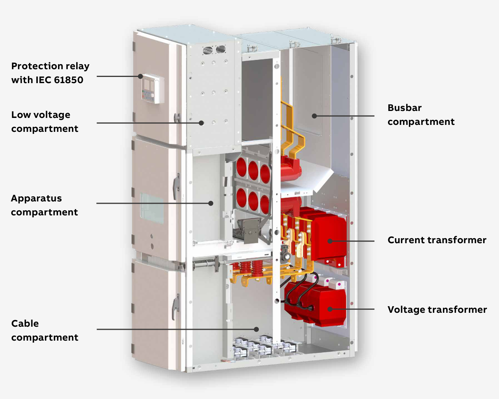
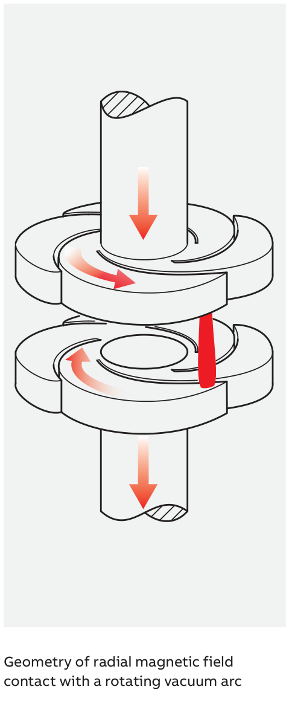
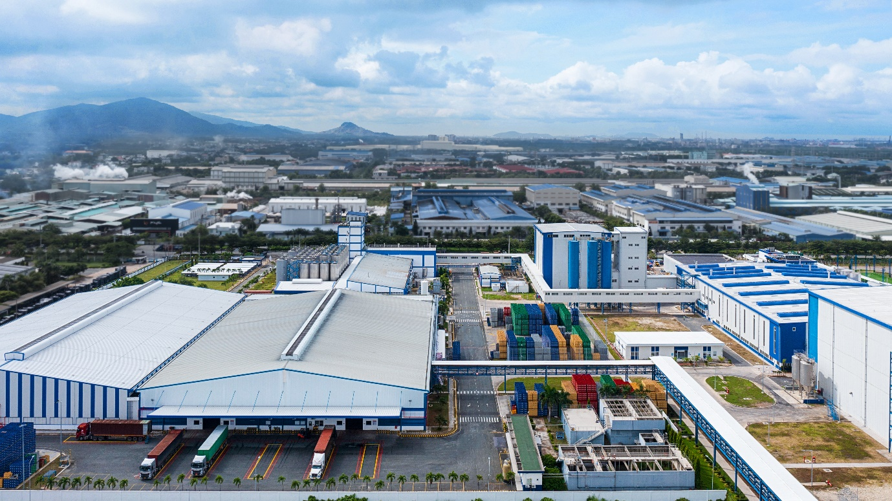

> **Đề tài:** Thiết kế hệ thống nhúng phát hiện chớp hồ quang điện (arc-flash) trong hệ thống điện hạ thế và trung thế.
>
> **Ghi chú bản thảo:** Nội dung hướng tới khoảng 10–14 trang A4 khi dàn bằng Times New Roman 13, giãn dòng khoảng 1,15. Số trang thực tế phụ thuộc cách dàn trang và kích thước hình.

Chương 1 trình bày bài toán phát hiện chớp hồ quang điện, phân tích các yêu cầu kỹ thuật và khảo sát bối cảnh ứng dụng tại hệ thống tủ điện của Nhà máy HEINEKEN Vũng Tàu. Kết quả phân tích là cơ sở cho phần lý thuyết và thiết kế hệ thống ở Chương 2.

# 1.1. Tổng quan bài toán phát hiện chớp hồ quang điện

## 1.1.1. Đặt vấn đề

### 1.1.1.1. Đối tượng nghiên cứu

Trong hệ thống cung cấp điện công nghiệp, tủ điện là nơi bố trí các thiết bị đóng cắt, đo lường và bảo vệ. Các bộ phận như thanh cái, đầu cáp, tiếp điểm và lớp cách điện cùng làm việc trong không gian giới hạn của tủ. Khi xảy ra sự cố hồ quang nội bộ, nhiệt, áp suất và vật chất nóng phát sinh có thể làm hư hỏng thiết bị, gây nguy hiểm cho người ở gần và gián đoạn cấp điện. [1]

Nguy cơ hư hỏng và mất an toàn do hồ quang nội bộ đặt ra nhu cầu phát hiện sớm sự cố trong tủ điện hạ thế và trung thế. Tủ điện gồm phần dẫn điện, thiết bị đóng cắt, thiết bị đo lường và bảo vệ, được đặt trong vỏ tủ có cách điện và vách ngăn. Hình 1.1 minh họa dòng tủ UniGear ZS1 do tập đoàn ABB sản xuất. UniGear ZS1 là tên dòng tủ điện trung thế cách điện bằng không khí; ABB là tập đoàn công nghệ điện và tự động hóa có trụ sở chính tại Zürich, Thụy Sĩ. [2], [3], [4] Các khoang và thiết bị chính được ghi nhãn trong hình; cách bố trí cụ thể thay đổi theo loại tủ. [2]

*Hình 1.1. Cấu tạo tủ UniGear ZS1 của ABB.*

*Nguồn: [2]. Cắt từ hình gốc, giữ nguyên nhãn.*

Các nhãn trong Hình 1.1 được giải thích như sau:

- **Khoang thanh cái (Busbar compartment):** Nằm phía trên, bên phải hình. Đây là nơi đặt các thanh kim loại dẫn điện để phân phối điện trong tủ và giữa các ngăn tủ.
- **Khoang thiết bị đóng cắt (Apparatus compartment):** Nằm giữa tủ, phía trước, là nơi lắp máy cắt để đóng hoặc ngắt mạch điện. Hình minh họa khoang không có máy cắt, để lộ không gian bên trong và các vị trí kết nối phía sau.
- **Khoang cáp (Cable compartment):** Nằm phía dưới tủ, là nơi đưa cáp điện vào và đấu nối với thiết bị. Đầu cáp là phần kết thúc của cáp tại điểm đấu nối này.
- **Khoang hạ áp (Low voltage compartment):** Nằm phía trên, bên trái hình, chứa các thiết bị điều khiển, đo lường và bảo vệ cùng dây đấu nối của chúng.
- **Rơ-le bảo vệ có truyền thông IEC 61850 (Protection relay with IEC 61850):** Là thiết bị nhỏ có màn hình trên mặt trước khoang hạ áp. Rơ-le nhận tín hiệu đo, phát hiện tình trạng bất thường và phát lệnh bảo vệ.
- **Biến dòng (Current transformer):** Là cụm màu đỏ ở giữa, bên phải hình. Thiết bị biến đổi dòng điện lớn trong mạch điện thành tín hiệu dòng nhỏ để đo lường và bảo vệ.
- **Biến điện áp (Voltage transformer):** Là cụm màu đỏ ở phía dưới, bên phải hình. Thiết bị hạ điện áp của mạch điện xuống mức phù hợp cho đo lường và bảo vệ. [2]

### 1.1.1.2. Bối cảnh ứng dụng

Thanh cái, đầu cáp và tiếp điểm là những vị trí có thể phát sinh sự cố hồ quang khi mối nối hoặc cách điện bị hư hỏng. Sự cố xảy ra bên trong tủ có thể làm hỏng các bộ phận xung quanh và gián đoạn cấp điện. Vì vậy, phát hiện sớm sự cố là một khâu quan trọng để hệ thống bảo vệ kịp thời xử lý, hạn chế hư hỏng. [1]

Để phát hiện sớm sự cố và đưa thông tin đến người theo dõi, hệ thống dự kiến được thiết kế theo mô hình nút giám sát – thiết bị trung tâm (node–gateway). Mô hình nguyên mẫu gồm một nút giám sát, một thiết bị trung tâm và máy tính chạy phần mềm máy chủ, với vai trò như sau:

- **Nút giám sát (node):** Là thiết bị nhúng thực hiện thu nhận và xử lý tín hiệu tại tủ điện để phát hiện chớp hồ quang, sau đó gửi thông tin sự cố đến thiết bị trung tâm.
- **Thiết bị trung tâm (gateway):** Là thiết bị nhúng nhận thông tin từ nút giám sát và chuyển đến máy chủ.
- **Máy chủ (server):** Là nơi chạy phần mềm tiếp nhận, hiển thị thông tin giám sát và cảnh báo khi có hồ quang.

Thông tin được truyền theo thứ tự: **nút giám sát → thiết bị trung tâm → máy chủ**. Phạm vi chức năng của nguyên mẫu là phát hiện và cảnh báo khi có chớp hồ quang điện. Giao thức kết nối và linh kiện được phân tích ở Chương 2. Hoạt động của hệ thống được đánh giá theo các nội dung sau:

- **Nhận biết sớm sự kiện:** Rút ngắn thời gian từ khi dấu hiệu hồ quang xuất hiện đến khi nút giám sát tạo thông tin báo sự cố để gửi cảnh báo đến người theo dõi.
- **Phân biệt được tác động gây nhầm:** Xem xét tín hiệu sự cố cùng điều kiện làm việc bình thường, tránh đánh giá bộ phát hiện chỉ bằng một trường hợp kích thích thuận lợi.
- **Đánh giá được từng khâu:** Xác định thời gian thu nhận, xử lý và tạo thông tin báo sự cố tại nút giám sát; đánh giá riêng thời gian truyền và hiển thị cảnh báo trên máy chủ.
- **Truyền thông tin đến máy chủ:** Kiểm tra thông tin sự cố từ nút giám sát được chuyển qua thiết bị trung tâm và hiển thị trên máy chủ. Thời gian truyền được đánh giá riêng với thời gian phát hiện tại nút giám sát.

## 1.1.2. Hiện tượng hồ quang điện và chớp hồ quang điện

### 1.1.2.1. Khái niệm và tác động

Hồ quang điện là hiện tượng phóng điện phát sáng, trong đó dòng điện đi qua môi trường plasma nóng giữa các điện cực. Hình dạng và sự phát triển của hồ quang phụ thuộc vào thiết bị, môi trường và nguồn năng lượng duy trì phóng điện. Ba khái niệm được sử dụng trong chương gồm:

- **Hồ quang điện — electric arc:** Chỉ hiện tượng phóng điện. Hồ quang có thể xuất hiện trong một quá trình làm việc đã được thiết kế, chẳng hạn quá trình ngắt dòng của máy cắt.
- **Sự cố hồ quang — arc fault:** Chỉ sự cố có hồ quang phát sinh ngoài chức năng làm việc dự kiến của thiết bị.
- **Chớp hồ quang điện — arc flash:** Gắn với thành phần bức xạ nhiệt của hồ quang năng lượng lớn. Trong bài toán phát hiện, ánh sáng phát ra khi xảy ra sự cố là một dấu hiệu để nhận biết sự kiện và tạo tín hiệu phản hồi. [5], [1]

Khi máy cắt ngắt mạch đang có dòng điện, hồ quang có thể xuất hiện giữa các tiếp điểm đang tách ra. Đây là hiện tượng đã được tính đến trong thiết kế; buồng cắt có nhiệm vụ kiểm soát và dập tắt hồ quang trong điều kiện làm việc quy định. Với máy cắt chân không, hồ quang được dập khi dòng điện xoay chiều đi qua giá trị không, sau đó cách điện giữa các tiếp điểm được phục hồi. Hồ quang này khác với hồ quang sự cố tại điểm đấu nối hoặc vùng cách điện bị hỏng trong tủ. [5], [6]

Hình 1.2 minh họa vùng tiếp điểm bên trong buồng cắt khi máy cắt ngắt dòng. Hai đĩa là hai tiếp điểm; dải màu đỏ nối giữa chúng là hồ quang, còn các mũi tên cong biểu diễn chiều quay của hồ quang. Đây là hồ quang được kiểm soát và dập tắt theo thiết kế, khác với hồ quang sự cố trong tủ ở Hình 1.3. [6], [7]

*Hình 1.2. Hồ quang giữa các tiếp điểm máy cắt.*

*Nguồn: [6]. Cắt vùng hình minh họa từ catalogue ABB, giữ nguyên nội dung và chú thích tiếng Anh; không phải ảnh chụp sự cố.*

Hình 1.3 ghi lại thử nghiệm hồ quang nội bộ tủ KMZ_31 tại ICMET. Đây là Viện Nghiên cứu, Phát triển và Thử nghiệm quốc gia về kỹ thuật điện, đặt tại thành phố Craiova, Romania. [7], [8] Hai ảnh phía trên cho thấy tủ và bố trí trước thử; ảnh dưới bên trái cho thấy chớp sáng khi xảy ra hồ quang; ảnh dưới bên phải cho thấy tủ bị cháy hỏng sau thử. Chớp sáng là dấu hiệu phục vụ phát hiện, còn hư hỏng cho thấy hậu quả của sự cố. [7]

*Hình 1.3. Thử nghiệm hồ quang nội bộ tủ KMZ_31 tại ICMET, Romania.*

*Nguồn: [7]. Trích nguyên cụm ảnh và nhãn trong nguồn, CC BY 4.0; không phải ảnh tại nhà máy ở mục 1.3.*

Nguy cơ phát sinh sự cố liên quan đến tình trạng cách điện, các điểm đấu nối, tiếp điểm và công tác bảo trì. Theo dõi các dấu hiệu suy giảm trước sự cố có thể hỗ trợ phòng ngừa. Tuy nhiên, phát hiện hồ quang đã xuất hiện là một nhiệm vụ khác, đòi hỏi nhận biết và phản hồi trong thời gian ngắn. [1]

Tác động của hồ quang đến thiết bị và con người có thể chia thành các nhóm chính:

- **Tác động nhiệt:** Bức xạ và vật chất nóng có thể gây bỏng, làm hỏng cách điện và các phần dẫn điện.
- **Tác động áp suất:** Kênh hồ quang giãn nở tạo sóng áp suất; khí trong vỏ tủ được nung nóng còn gây tăng áp trong không gian bao kín.
- **Hư hỏng và gián đoạn hoạt động:** Hư hỏng thiết bị có thể kéo theo thời gian ngừng cấp điện, sửa chữa và khôi phục hệ thống. [5], [1]

Hình 1.4 cho thấy thanh cái hạ thế bị nóng chảy tại một số vị trí ở mép lớp cách điện sau thử nghiệm hồ quang. Phép thử được thực hiện ở điện áp U = 726 V, dòng ngắn mạch Ik = 77 kA và thời gian hồ quang 65 ms. Trong điều kiện này, hồ quang chỉ tồn tại 65 ms đã gây hư hỏng thanh cái, cho thấy sự cố có thể gây thiệt hại trong thời gian rất ngắn. [1]

*Hình 1.4. Thanh cái hạ thế sau thử hồ quang.*

*Nguồn: [1]. Trích ảnh gốc; điều kiện nguồn: U = 726 V, Ik = 77 kA, thời gian hồ quang 65 ms.*

Hồ quang tồn tại càng lâu thì năng lượng tác động lên người hoặc thiết bị ở gần càng lớn. Hình 1.5 biểu diễn năng lượng trên một đơn vị diện tích tại khoảng cách làm việc 910 mm, với điện áp U = 15 kV, dòng ngắn mạch Ik = 50 kA và khe hở giữa các điện cực 152 mm. Trục ngang là thời gian hồ quang tồn tại, tính bằng ms; trục đứng là năng lượng tác động, tính bằng J/cm². [1]

Khi dòng điện, khoảng cách và các điều kiện còn lại giữ nguyên, năng lượng tác động tỷ lệ thuận với thời gian hồ quang. Quan hệ này được viết dưới dạng: [1]

$$
E_2 = E_1\frac{t_2}{t_1}
$$

Trong đó, $E_1$, $E_2$ là năng lượng tác động trên một đơn vị diện tích tại thời gian hồ quang $t_1$, $t_2$ tương ứng; hai giá trị thời gian dùng cùng đơn vị. Chẳng hạn, đọc xấp xỉ từ Hình 1.5, tại $t_1 = 60$ ms có $E_1 \approx 10$ J/cm². Nếu thời gian tăng lên $t_2 = 120$ ms thì $E_2 \approx 10 \times 120/60 = 20$ J/cm², tức tăng gấp đôi. Đường thẳng đi lên cho thấy hồ quang kéo dài làm tăng mức năng lượng tác động và nguy cơ gây hại. Thời gian trong hình là thời gian hồ quang tồn tại, không phải thời gian phát hiện hoặc hiển thị cảnh báo của nguyên mẫu. [1]

*Hình 1.5. Năng lượng tác động theo thời gian hồ quang.*

*Nguồn: [1]. Trích nguyên hình; điều kiện: U = 15 kV, Ik = 50 kA, khe hở 152 mm, khoảng cách làm việc 910 mm. Không phải đường đặc tính của nguyên mẫu.*

### 1.1.2.2. Các trường hợp thực tế

**a) Tại Việt Nam**

Tình trạng xuống cấp của tủ điện hạ thế đã được ghi nhận tại khu đô thị Cao Xanh – Hà Khánh A, thành phố Hạ Long. Năm 2020, hơn 800 tủ hạ thế tại đây bị hư hỏng nặng; nhiều chân đế mục nát, tủ xô lệch, tiềm ẩn nguy cơ rò điện và cháy nổ. Hệ thống hạ thế của khu đô thị có điện áp 0,4 kV. Đây là trường hợp mất an toàn của tủ điện, chưa có kết luận xác định đã xảy ra chớp hồ quang. [9]

Số vụ và tần suất chớp hồ quang trong tủ hạ thế tại Việt Nam chưa được xác định do thiếu dữ liệu đồng thời về điện áp, vị trí hồ quang và diễn biến sự cố. Chưa đủ dữ liệu thống kê không đồng nghĩa với việc sự cố chưa từng xảy ra. Phép thử 726 V ở Hình 1.4 cho thấy hồ quang ở cấp điện áp hạ thế có thể gây hư hỏng thanh cái trong thời gian ngắn. [1]

**b) Trên thế giới**

Tại Hoa Kỳ, Cơ quan Quản lý An toàn và Sức khỏe nghề nghiệp (Occupational Safety and Health Administration – OSHA), thuộc Bộ Lao động Hoa Kỳ, đã ghi nhận các vụ chớp hồ quang trong tủ điện hạ thế:

- **Ngày 10/11/2017, hệ thống 480 V:** Trong lúc thay máy cắt nhánh 15 A tại tủ Square D Power Style của hệ thống ba pha 480 V, 2.000 A chưa được cắt điện, dụng cụ của người thợ chạm vào tủ khi đấu dây, gây ngắn mạch và chớp hồ quang. Người bị nạn bị thương nặng và tử vong sau khi được đưa vào bệnh viện. [10]
- **Ngày 01/10/2019, tủ điện 480 V:** Khi tháo tấm che nhựa ở phía tải đã được cắt điện, dụng cụ của người thợ trượt và chạm vào phần tủ vẫn còn điện. Chớp hồ quang xuất hiện bên trong tủ, gây bỏng độ ba ở đầu và da đầu, phải nhập viện. [11]

Hai vụ việc cho thấy chớp hồ quang có thể gây thương tích nghiêm trọng ngay trong tủ hạ thế. Phần tủ còn mang điện vẫn có thể gây sự cố dù khu vực đang thao tác đã được cắt điện. [10], [11]

Đặc điểm hiện tượng và hậu quả của sự cố là cơ sở xác định các yêu cầu kỹ thuật về thu nhận và xử lý tín hiệu, được phân tích trong mục 1.2.

# 1.2. Phân tích yêu cầu kỹ thuật của bài toán

Hệ thống phát hiện và cảnh báo được đánh giá theo khả năng nhận biết sự kiện, thời gian phản hồi và khả năng đưa thông tin đến người theo dõi. Các yêu cầu chung đối với rơ-le đo lường, thiết bị bảo vệ và thiết bị giám sát trong hệ thống bảo vệ phân tán thuộc phạm vi IEC 60255-1:2022. [12]

Các mục dưới đây trình bày yêu cầu kỹ thuật và căn cứ liên quan. Phần tổng hợp cuối mục xác định những yêu cầu được lựa chọn cho mô hình một nút giám sát, một thiết bị trung tâm và máy tính chạy phần mềm máy chủ. Phạm vi chức năng gồm phát hiện và cảnh báo, không điều khiển cắt điện.

## 1.2.1. Yêu cầu về điện áp

Điện áp của tủ điện và điện áp làm việc của thiết bị nhúng là hai đại lượng khác nhau:

- **Điện áp tủ điện:** IEC 61439-1:2020 có phạm vi áp dụng cho các bộ tủ hạ áp với điện áp định mức không vượt quá 1.000 V AC hoặc 1.500 V DC, theo tiêu chuẩn sản phẩm tương ứng. IEC 62271-200:2021 áp dụng cho tủ đóng cắt xoay chiều có vỏ kim loại, điện áp trên 1 kV đến 52 kV. Các mức này mô tả đối tượng tủ, không phải điện áp cấp vào bộ xử lý. [13], [14]
- **Điện áp thiết bị nhúng:** Gồm nguồn nuôi node, gateway và mức tín hiệu giữa cảm biến với bộ xử lý. Các mức này được lựa chọn theo linh kiện; nếu có đo điện trực tiếp từ hệ thống, giao diện đo và cách ly được thiết kế riêng.

An toàn điện của rơ-le và thiết bị bảo vệ thuộc phạm vi IEC 60255-27:2023; tiêu chuẩn này xét nguy cơ điện giật, cháy và thương tích, không đánh giá hiệu năng phát hiện. [15] Với nguyên mẫu, phép kiểm tra gồm đo nguồn nuôi, mức tín hiệu đầu vào–đầu ra và đối chiếu giới hạn của linh kiện. Thử nghiệm chức năng trên mô hình không chứng minh thiết bị có thể lắp trực tiếp trong tủ trung thế.

## 1.2.2. Yêu cầu về tần số

Tần số nguồn điện cho biết số chu kỳ điện xoay chiều trong một giây. Tủ thuộc phạm vi IEC 62271-200:2021 có tần số làm việc đến 60 Hz. Với nguồn 50 Hz, một chu kỳ kéo dài $T = 1/f = 20$ ms. Giá trị này không phải chu kỳ mà bộ xử lý được phép chờ trước khi nhận biết chớp sáng. [14]

Tín hiệu từ cảm biến có thể thay đổi nhanh hơn một chu kỳ điện. Vì vậy, dải đáp ứng của cảm biến và mạch xử lý được lựa chọn theo biến đổi tín hiệu cần nhận biết; tần số lấy mẫu được phân tích riêng ở mục 1.2.6. Nhiễu điện từ cũng có thể ảnh hưởng đến thiết bị giám sát và truyền thông; IEC 60255-26:2023 quy định yêu cầu tương thích điện từ cho các thiết bị này trong hệ thống bảo vệ. [16]

Trong mô hình thử nghiệm, việc đánh giá xét khả năng nhận biết kích thích tham chiếu khi có ánh sáng nền và khi node đang truyền dữ liệu. Các phép thử chức năng này chưa tương đương thử nghiệm miễn nhiễm điện từ theo tiêu chuẩn.

## 1.2.3. Yêu cầu về dòng điện

Dòng hồ quang có thể nhỏ hơn dòng ngắn mạch kim loại, tức dòng khi các phần dẫn điện chạm trực tiếp với nhau. Vì vậy, bảo vệ quá dòng có thể không loại trừ hồ quang đủ nhanh trong một số điều kiện. Phối hợp tín hiệu ánh sáng và dòng điện là một phương án để xác nhận sự cố, hạn chế tác động do nguồn sáng không liên quan. [1]

Hình 1.6 minh họa phép phối hợp AND: cả ánh sáng và quá dòng cùng thỏa điều kiện thì hệ thống bảo vệ mới tạo tín hiệu tác động. Nhãn **Trip signal** là tín hiệu ra lệnh cắt trong hệ bảo vệ được minh họa, không phải chức năng của nguyên mẫu cảnh báo. [1]

*Hình 1.6. Phối hợp ánh sáng và quá dòng.*

*Nguồn: [1]. Trích hình gốc.*

Dòng ngắn mạch 77 kA trong phép thử ở Hình 1.4 mô tả điều kiện thử gây hư hỏng, không phải ngưỡng phát hiện được dùng chung. [1] Nguyên mẫu chưa mặc định có kênh đo dòng; việc bổ sung kênh này phụ thuộc phương án thu nhận ở Chương 2. Nếu có sử dụng, ngưỡng và thời gian phối hợp được xác lập theo tín hiệu đo, thay vì lấy trực tiếp dòng ngắn mạch của phép thử.

## 1.2.4. Yêu cầu về độ nhạy

Độ nhạy thể hiện khả năng nhận biết tín hiệu yếu đến mức nào trong điều kiện xác định. Với đầu thu ánh sáng, kết quả phụ thuộc nguồn sáng, khoảng cách, hướng thu và vật che khuất; cách bố trí cảm biến ảnh hưởng đến vùng phát hiện. Vì vậy, một giá trị ngưỡng riêng lẻ chưa mô tả đầy đủ khả năng nhận biết hồ quang. [1]

Đánh giá độ nhạy đồng thời xét ba kết quả:

- **Nhận đúng:** Có kích thích thử và hệ thống phát hiện được.
- **Bỏ sót:** Có kích thích thử nhưng hệ thống không phát hiện.
- **Báo nhầm:** Không có kích thích thử đại diện sự cố nhưng hệ thống vẫn cảnh báo.

Phép thử nguyên mẫu ghi rõ nguồn kích thích, khoảng cách, góc chiếu và ánh sáng nền, sau đó đếm các kết quả trên. Ngưỡng phát hiện được lựa chọn cùng cảm biến ở Chương 2. Nếu dùng nguồn sáng mô phỏng, kết quả chỉ thể hiện khả năng nhận biết nguồn sáng trong điều kiện thử, chưa xác nhận khả năng phát hiện mọi sự cố hồ quang thực tế.

## 1.2.5. Yêu cầu về thời gian phản hồi

Thời gian hồ quang tồn tại càng dài thì năng lượng tác động càng lớn khi các điều kiện khác giữ nguyên. Phép thử hạ thế ở Hình 1.4 đã gây nóng chảy cục bộ thanh cái trong 65 ms, cho thấy sự cố có thể gây hư hỏng trong thời gian ngắn. Giá trị 65 ms là thời gian hồ quang của phép thử, không phải thời gian cho phép để nguyên mẫu đưa ra cảnh báo. [1]

Với mô hình node–gateway, thời gian từ khi kích thích xuất hiện đến khi cảnh báo hiển thị được phân chia như sau:

$$
t_{\mathrm{cảnh\ báo}} = t_{\mathrm{phát\ hiện}} + t_{\mathrm{truyền}} + t_{\mathrm{hiển\ thị}}
$$

Trong đó, $t_{\mathrm{phát\ hiện}}$ gồm thời gian thu nhận và xử lý tại node; $t_{\mathrm{truyền}}$ là thời gian chuyển thông tin qua gateway đến máy chủ; $t_{\mathrm{hiển\ thị}}$ là thời gian phần mềm đưa cảnh báo lên giao diện. Đây là cách phân chia để đo nguyên mẫu, không phải công thức tính thời gian dập hồ quang.

Phép đo ghi nhận mốc kích thích, mốc node xác nhận sự kiện và mốc cảnh báo xuất hiện, bằng thiết bị đo hoặc đồng hồ có quan hệ thời gian đã xác định. Kết quả báo cáo gồm thời gian trung bình và lớn nhất trong tập thử; giới hạn chấp nhận được xác lập cùng phương án phần cứng và truyền thông ở Chương 2. Cảnh báo trên máy chủ phục vụ người theo dõi, không thay thế chức năng cắt nhanh của hệ thống bảo vệ.

## 1.2.6. Yêu cầu về chu kỳ lấy mẫu

Chu kỳ lấy mẫu $T_s$ là khoảng thời gian giữa hai lần số hóa tín hiệu liên tiếp; tần số lấy mẫu $f_s = 1/T_s$. Với tín hiệu tương tự đã giới hạn băng thông, điều kiện lý thuyết để tái tạo tín hiệu là $f_s > 2f_{\max}$, trong đó $f_{\max}$ là thành phần tần số cao nhất cần giữ lại. Điều kiện này không có nghĩa lấy mẫu gấp đôi tần số điện lưới là đủ để phát hiện chớp sáng. [17]

Ví dụ minh họa: nếu lấy mẫu 5.000 lần/giây thì $T_s = 0,2$ ms; một xung dài 1 ms chỉ kéo dài bằng năm chu kỳ lấy mẫu. Hai giá trị này dùng để giải thích quan hệ thời gian, chưa phải thông số được chọn cho nguyên mẫu.

Phương án thu nhận quyết định đại lượng được kiểm tra: kênh dùng bộ chuyển đổi tương tự–số (ADC) được đánh giá chu kỳ lấy mẫu; kênh nhận trạng thái số hoặc ngắt được đánh giá khả năng bắt xung và độ trễ tiếp nhận. Node thực hiện phát hiện tại chỗ; chu kỳ lấy mẫu không đồng nhất với chu kỳ gửi dữ liệu hay chu kỳ cập nhật giao diện.

## 1.2.7. Yêu cầu về truyền thông và cảnh báo

Truyền thông giúp chuyển kết quả phát hiện đến nơi giám sát. Các yêu cầu truyền thông giữa thiết bị điện tử thông minh trong tự động hóa hệ thống điện thuộc phạm vi IEC 61850-5:2013. [18] Giao thức của nguyên mẫu được lựa chọn theo chức năng và khả năng kết nối của node, gateway và máy chủ ở Chương 2.

Mô hình dự kiến truyền thông tin theo đường **node → gateway → máy chủ**. Node nhận biết sự kiện; gateway tiếp nhận và chuyển thông tin; phần mềm máy chủ có thể chạy trên laptop để hiển thị cảnh báo. Các yêu cầu được lựa chọn gồm:

- **Thông tin rõ ràng:** Bản tin có thông tin nhận diện node và trạng thái sự kiện để phần mềm xác định nguồn cảnh báo.
- **Đối chiếu được kết quả:** Sự kiện tạo tại node được so sánh với thông tin nhận ở gateway và cảnh báo trên máy chủ, qua đó phát hiện trường hợp thiếu hoặc sai thông tin trong tập thử.
- **Phân biệt trạng thái kết nối:** Giao diện phân biệt mất kết nối với trạng thái không phát hiện sự kiện; việc không nhận được dữ liệu không được diễn giải thành hệ thống đang bình thường.

Giao thức, cấu trúc bản tin và cách kiểm tra kết nối được lựa chọn ở Chương 2. Việc dùng máy chủ không tự đồng nghĩa với sử dụng Internet hoặc dịch vụ đám mây. Cảnh báo không kèm lệnh điều khiển máy cắt.

## 1.2.8. Tổng hợp yêu cầu kỹ thuật ban đầu

Trên cơ sở các yêu cầu đã phân tích và điều kiện triển khai của đồ án tốt nghiệp, các yêu cầu thiết kế cho nguyên mẫu được lựa chọn trong Bảng 1.1. Phạm vi đánh giá gồm phát hiện, truyền thông tin và hiển thị cảnh báo trong điều kiện thử nghiệm xác định. Các tiêu chí này không thể hiện việc hệ thống đã đáp ứng đầy đủ tiêu chuẩn của thiết bị bảo vệ công nghiệp.

*Bảng 1.1. Các yêu cầu thiết kế được lựa chọn cho nguyên mẫu.*

| Nội dung | Yêu cầu nhóm lựa chọn | Căn cứ lựa chọn | Cách kiểm tra |
|---|---|---|---|
| Điện áp | Node và gateway sử dụng nguồn, mức tín hiệu phù hợp linh kiện; dải cụ thể xác lập ở Chương 2 | Phân biệt điện áp tủ và thiết bị nhúng; mục 1.2.1 | Đo nguồn và các mức tín hiệu, đối chiếu giới hạn linh kiện |
| Tần số | Chuỗi thu nhận nhận biết được kích thích thử; xét ảnh hưởng của ánh sáng nền và hoạt động truyền dữ liệu | Đặc điểm tín hiệu; mục 1.2.2 | Tạo kích thích trong các điều kiện đã mô tả, ghi kết quả nhận biết |
| Dòng điện | Chưa đưa đo dòng thành chức năng bắt buộc; đánh giá khả năng bổ sung khi lựa chọn phương án thu nhận | Vai trò xác nhận sự cố, chưa chốt kênh đo; mục 1.2.3 | Nếu triển khai, kiểm tra riêng kênh dòng và điều kiện phối hợp |
| Độ nhạy | Phát hiện kích thích tham chiếu trong bố trí thử xác định; ghi nhận bỏ sót và báo nhầm | Phạm vi mô hình thử; mục 1.2.4 | Lặp phép thử với nguồn kích thích và ánh sáng nền, thống kê từng loại kết quả |
| Thời gian phản hồi | Đo riêng thời gian phát hiện tại node và thời gian đến khi cảnh báo hiển thị; giới hạn định lượng xác lập ở Chương 2 | Chuỗi node–gateway–máy chủ; mục 1.2.5 | Đo các mốc thời gian, báo cáo giá trị trung bình và lớn nhất |
| Chu kỳ lấy mẫu | Chọn theo cơ chế thu nhận và độ dài tín hiệu thử; tách khỏi chu kỳ truyền dữ liệu | Quan hệ giữa tín hiệu và thu nhận; mục 1.2.6 | Đo chu kỳ hoặc độ trễ bắt xung, đối chiếu kích thích tham chiếu |
| Truyền thông | Một node gửi thông tin sự kiện qua một gateway đến máy chủ; bản tin nhận đúng nguồn và trạng thái | Mô hình thiết kế dự kiến; mục 1.2.7 | Tạo sự kiện tại node, so sánh thông tin tại ba khối |
| Cảnh báo | Máy chủ hiển thị sự kiện và trạng thái kết nối; không phát lệnh cắt điện | Phạm vi chức năng nguyên mẫu; mục 1.2.7 | Thử có sự kiện, không có sự kiện và gián đoạn kết nối |

Các yêu cầu chức năng trên là cơ sở triển khai nguyên mẫu. Ngưỡng, nguồn nuôi, chu kỳ lấy mẫu và giới hạn thời gian được cụ thể hóa khi lựa chọn linh kiện, phương án thu nhận và truyền thông ở Chương 2, trước khi đánh giá kết quả thử nghiệm.

Bối cảnh phân phối điện trong nhà máy và nhu cầu giám sát hồ quang tại tủ điện được trình bày ở mục 1.3.

# 1.3. Khảo sát hệ thống tủ điện tại Nhà máy HEINEKEN Vũng Tàu

## 1.3.1. Giới thiệu nhà máy

Nhà máy HEINEKEN Việt Nam – Vũng Tàu nằm trong Khu công nghiệp Mỹ Xuân A. Tại thời điểm khánh thành dự án mở rộng ngày 24/9/2022, nhà máy có diện tích 40 ha và công suất 11 triệu hectolit bia/năm, tương đương 1,1 tỷ lít/năm. Các công đoạn nhập nguyên liệu, nấu, lên men và lọc bia có mức độ tự động hóa cao, gắn với nhu cầu cấp điện cho sản xuất. [19]

*Hình 1.7. Nhà máy HEINEKEN Vũng Tàu.*

*Nguồn: [19]. Ảnh nhà máy trong thông cáo khánh thành năm 2022 của HEINEKEN Việt Nam.*

## 1.3.2. Phạm vi hệ thống tủ điện

Hệ thống tủ điện được xem xét gồm tủ trung thế 22 kV và tủ hạ thế 0,4 kV trong gói cung cấp thiết bị của ABB cho dự án mở rộng nhà máy năm 2018. Hai nhóm tủ phục vụ phân phối điện ở các cấp điện áp khác nhau. [20]

- **Tủ trung thế 22 kV:** Thực hiện đóng cắt và phân phối điện ở cấp trung thế, gắn với hệ thống trạm điện của nhà máy.
- **Tủ hạ thế 0,4 kV:** Phân phối điện đến các nhánh phụ tải hạ thế phục vụ sản xuất.

Phạm vi cung cấp đi kèm có một trạm điện chính, năm trạm phụ và máy biến áp khô. [20] Ngoài hệ tủ phân phối, hạng mục lắp đặt của Sea Power còn có tủ hòa đồng bộ phục vụ hệ thống máy phát. [21] Trong phần giám sát hồ quang điện, đối tượng được xem xét là hai nhóm tủ phân phối trung thế và hạ thế nêu trên.

## 1.3.3. Nhu cầu giám sát hồ quang điện

### 1.3.3.1. Các vị trí có nguy cơ

Trong tủ điện công nghiệp, sự cố hồ quang có thể liên quan đến hư hỏng cách điện, đầu cáp, mối nối thanh cái và tiếp điểm. Nhiệt và áp suất do hồ quang có thể gây hư hỏng thiết bị, nguy hiểm cho người ở gần và gián đoạn cấp điện. [1]

Khi xem xét hệ tủ của nhà máy, các vị trí giám sát được phân tích theo ba nhóm sau:

- **Thanh cái và mối nối:** Là các phần dẫn điện phân phối nguồn trong tủ; sự cố tại đây có thể ảnh hưởng đến nhiều nhánh được cấp điện.
- **Thiết bị đóng cắt:** Vùng tiếp điểm và các đầu nối liên quan được xem xét để phân biệt hồ quang sự cố với hồ quang đóng cắt được kiểm soát trong thiết bị.
- **Đầu cáp:** Là nơi cáp kết nối với thiết bị; hư hỏng cách điện hoặc điểm đấu nối có thể dẫn đến sự cố. [1], [6]

Số lượng và vị trí cảm biến phụ thuộc cấu tạo, vách ngăn và vùng quan sát của từng tủ. Vị trí lắp đặt thực tế tại nhà máy chưa được xác minh.

### 1.3.3.2. Ý nghĩa của phát hiện và cảnh báo

Ánh sáng phát ra khi xảy ra hồ quang là một dấu hiệu phục vụ phát hiện. Trong hệ bảo vệ có chức năng cắt điện, tín hiệu ánh sáng có thể phối hợp với thông tin dòng điện để tăng độ tin cậy của quyết định tác động. [1]

Với nguyên mẫu cảnh báo, nhiệm vụ là nhận biết sự kiện tại tủ và chuyển thông tin đến người giám sát. Cảnh báo giúp thông báo tình trạng bất thường; bản thân cảnh báo không dập hồ quang và không thay thế thiết bị bảo vệ cắt nguồn. Không suy ra yêu cầu lắp một sản phẩm cụ thể chỉ từ việc nhà máy có tủ trung thế và hạ thế.

## 1.3.4. Liên hệ với hệ thống thiết kế

### 1.3.4.1. Chuỗi phát hiện và cảnh báo

Từ bối cảnh phân phối điện trong nhà máy, phương án nguyên mẫu được xem xét theo chuỗi chức năng sau:

1. **Thu nhận và phát hiện tại node:** Nút giám sát tiếp nhận tín hiệu, xử lý để nhận biết sự kiện trong vùng thử nghiệm đã xác định.
2. **Chuyển thông tin qua gateway:** Thiết bị trung tâm nhận thông tin sự kiện từ node và gửi đến máy chủ.
3. **Hiển thị cảnh báo:** Phần mềm máy chủ hiển thị nguồn phát hiện và trạng thái sự kiện để người theo dõi nhận biết.

Chuỗi trên là phương án thiết kế của nhóm, không phải mô tả hệ thống đã được lắp tại HEINEKEN Vũng Tàu. Mô hình gồm một node, một gateway và máy tính chạy phần mềm máy chủ; không phát lệnh điều khiển máy cắt.

### 1.3.4.2. Nội dung đánh giá nguyên mẫu

Các nội dung đánh giá gồm khả năng nhận biết kích thích tham chiếu, bỏ sót, báo nhầm, truyền đúng thông tin và thời gian đến khi cảnh báo xuất hiện. Điều kiện thử được mô tả rõ để đối chiếu với các yêu cầu trong Bảng 1.1. Thử nghiệm bằng nguồn sáng mô phỏng chỉ xác nhận đáp ứng trong điều kiện thử, chưa chứng minh nguyên mẫu đủ điều kiện lắp đặt trong tủ điện đang vận hành.

# 1.4. Kết luận chương

Chương 1 đã trình bày đối tượng nghiên cứu, hiện tượng chớp hồ quang và các hậu quả liên quan đến thiết bị, con người. Các minh chứng thử nghiệm cho thấy ý nghĩa của việc phát hiện và phản hồi trong thời gian ngắn. Từ đó, chương xác định sáu nhóm yêu cầu về điện áp, tần số, dòng điện, độ nhạy, thời gian phản hồi và chu kỳ lấy mẫu.

Mô hình thiết kế dự kiến gồm một nút giám sát phát hiện chớp hồ quang, một thiết bị trung tâm chuyển thông tin và phần mềm máy chủ tiếp nhận, hiển thị cảnh báo. Phần mềm máy chủ có thể chạy trên laptop trong mô hình thử nghiệm. Phạm vi nguyên mẫu là phát hiện và cảnh báo; thời gian đánh giá gồm thời gian phát hiện tại nút và thời gian truyền, hiển thị cảnh báo trên máy chủ.

Gói cung cấp thiết bị cho Nhà máy HEINEKEN Vũng Tàu gồm tủ trung thế 22 kV và hạ thế 0,4 kV. [20] Các phần dẫn điện và điểm đấu nối trong tủ là những vị trí xem xét giám sát hồ quang. Cấu hình bảo vệ hồ quang hiện tại của nhà máy chưa được xác minh; phương án nguyên mẫu chỉ thực hiện phát hiện và cảnh báo trong điều kiện thử nghiệm xác định.

Trên cơ sở đó, Chương 2 trình bày cơ sở lý thuyết về phát hiện, thu nhận và xử lý tín hiệu, khảo sát thiết bị thương mại, phân tích lựa chọn linh kiện và phương án kết nối node–gateway–máy chủ. Những thông số chưa xác lập trong Bảng 1.1 được xem xét cùng phương án thiết kế và điều kiện đánh giá của hệ thống.

# Tài liệu tham khảo

[1] Lauri Kumpulainen, G. Amjad Hussain, Marc Rival, Matti Lehtonen, Kimmo Kauhaniemi, *Aspects of arc-flash protection and prediction*, Electric Power Systems Research 116, 2014, tr. 77–86. DOI: 10.1016/j.epsr.2014.05.011. Tệp: [Aspects of arc-flash protection and prediction.pdf](<Tham khảo/Aspects of arc-flash protection and prediction.pdf>). Vị trí hình sử dụng: Hình 2, 5, 6 tại tr. in 80, 82, 83 (tr. PDF 4, 6, 7). Quan hệ năng lượng–thời gian: mục 5.5, tr. in 83 (tr. PDF 7).

[2] ABB, *UniGear ZS1 — Medium-voltage air-insulated switchgear up to 24 kV*, catalogue kỹ thuật. Các mục sử dụng: “Description” và “Design features”, tr. in 10, 14–15; tr. PDF 9, 13–14. [Bản catalogue ABB tại kho lưu Electrika](https://storage.electrika.com/manu/man-9031/pdftech/9031-unigr-zs1-17.pdf); [bản lưu đã đọc](nguon_web/ABB_UniGear_ZS1_catalogue.pdf). Truy cập 25/10/2026. Hình cấu tạo được trích tại tr. in 15 (tr. PDF 14).

[3] ABB, “Provider information/Impressum.” [Trực tuyến]. Có tại: [Thông tin pháp nhân và địa chỉ ABB](https://www.abb.com/global/en/company/provider-information). [Truy cập ngày 25/10/2026].

[4] ABB, “ABB to build new headquarters in Zurich.” [Trực tuyến]. Có tại: [Thông tin trụ sở chính](https://www.abb.com/global/en/news/132920/abb-to-build-new-headquarters-in-zurich). [Truy cập ngày 25/10/2026].

[5] Vytenis Babrauskas, *Electric arc explosions—A review*, Fire Safety Journal 89, 2017, tr. 7–15. DOI: 10.1016/j.firesaf.2017.02.006. Tệp: [Electric arc explosions—A review.pdf](<Tham khảo/Electric arc explosions—A review.pdf>).

[6] ABB, *VD4/R — MV vacuum circuit breakers for secondary distribution*, catalogue kỹ thuật 1VCP000263, Rev. L, 05/2022. Mục “Description”, tr. in/PDF 9–10; hình “Geometry of radial magnetic field contact with a rotating vacuum arc” tại tr. in/PDF 10. [Trực tuyến]. Có tại: [Catalogue gốc ABB](https://library.e.abb.com/public/1f2a1025b5a848058668dbac32d15ec3/CA_VD4-R%28EN%29L_1VCP000263.pdf); [bản lưu đã đọc](nguon_web/ABB_VD4_R.pdf). [Truy cập ngày 25/10/2026].

[7] Mahmood Matin, Amir Dehghanian, Mohammad Dastranj, Hossein Darijani, *Explainable artificial intelligence modeling of internal arc in a medium voltage switchgear based on different CFD simulations*, Heliyon 10, 2024, e29594. DOI: 10.1016/j.heliyon.2024.e29594. Tệp: [Explainable artificial intelligence modeling of internal arc in a medium voltage switchgear based on different CFD simulations.pdf](<Tham khảo/Explainable artificial intelligence modeling of internal arc in a medium voltage switchgear based on different CFD simulations.pdf>). CC BY 4.0 ghi tại trang PDF 1. Vị trí hình sử dụng: Hình 1 tại tr. in/PDF 2.

[8] ICMET Craiova, “About ICMET.” [Trực tuyến]. Có tại: [Trang giới thiệu của viện](https://icmet.ro/en/despre-icmet/). [Truy cập ngày 25/10/2026].

[9] Hoàng Nga, “Nhiều khó khăn trong bàn giao tài sản cho ngành Điện,” Báo Quảng Ninh, 30/06/2020. [Trực tuyến]. Có tại: [Bài phản ánh hiện trạng tủ điện hạ thế](https://baoquangninh.vn/nhieu-kho-khan-trong-ban-giao-tai-san-cho-nganh-dien-post2489686.html). [Truy cập ngày 25/10/2026].

[10] Occupational Safety and Health Administration (OSHA), U.S. Department of Labor, “Employee is killed by arc flash,” Accident Summary Nr. 101176.015, sự cố ngày 10/11/2017. [Trực tuyến]. Có tại: [Hồ sơ tai nạn OSHA](https://www.osha.gov/ords/imis/accidentsearch.accident_detail?id=101176.015). [Truy cập ngày 25/10/2026].

[11] Occupational Safety and Health Administration (OSHA), U.S. Department of Labor, “Employee incurs third degree burns from arc flash,” Accident Summary Nr. 120813.015, sự cố ngày 01/10/2019. [Trực tuyến]. Có tại: [Hồ sơ tai nạn OSHA](https://www.osha.gov/ords/imis/accidentsearch.accident_detail?id=120813.015). [Truy cập ngày 25/10/2026].

[12] International Electrotechnical Commission (IEC), *IEC 60255-1:2022 — Measuring relays and protection equipment – Part 1: Common requirements*. [Trực tuyến]. Có tại: [Nguồn IEC](https://webstore.iec.ch/en/publication/59762). [Truy cập ngày 25/10/2026]. Trang giới thiệu chính thức về phạm vi tiêu chuẩn; không thay thế toàn văn tiêu chuẩn.

[13] International Electrotechnical Commission (IEC), *IEC 61439-1:2020 — Low-voltage switchgear and controlgear assemblies – Part 1: General rules*. [Trực tuyến]. Có tại: [Nguồn IEC](https://preview.sist.si/sist-preview/21953/f3660106d5b948f38f3dc2a8562ef036/IEC-61439-1-2020.pdf). [Truy cập ngày 25/10/2026]. Bản xem trước, mục 1, tr. in 11 (PDF 13).

[14] International Electrotechnical Commission (IEC), *IEC 62271-200:2021 — High-voltage switchgear and controlgear – Part 200: AC metal-enclosed switchgear and controlgear for rated voltages above 1 kV and up to and including 52 kV*. [Trực tuyến]. Có tại: [Nguồn IEC](https://webstore.iec.ch/en/publication/63466). [Truy cập ngày 25/10/2026]. Trang giới thiệu chính thức về phạm vi tiêu chuẩn; không thay thế toàn văn tiêu chuẩn.

[15] International Electrotechnical Commission (IEC), *IEC 60255-27:2023 — Measuring relays and protection equipment – Part 27: Product safety requirements*. [Trực tuyến]. Có tại: [Nguồn IEC](https://webstore.iec.ch/en/publication/63370). [Truy cập ngày 25/10/2026]. Trang giới thiệu chính thức về phạm vi tiêu chuẩn; không thay thế toàn văn tiêu chuẩn.

[16] International Electrotechnical Commission (IEC), *IEC 60255-26:2023 — Measuring relays and protection equipment – Part 26: Electromagnetic compatibility requirements*. [Trực tuyến]. Có tại: [Nguồn IEC](https://webstore.iec.ch/en/publication/62084). [Truy cập ngày 25/10/2026]. Trang giới thiệu chính thức về phạm vi tiêu chuẩn; không thay thế toàn văn tiêu chuẩn.

[17] Beckhoff Automation, “Notes on analog aspects – dynamic signals,” tài liệu kỹ thuật về thu nhận tín hiệu tương tự, phần định lý lấy mẫu. [Trực tuyến]. Có tại: [Tài liệu kỹ thuật Beckhoff](https://infosys.beckhoff.com/content/1033/ioanalogmanual/8708976267.html). [Truy cập ngày 25/10/2026].

[18] International Electrotechnical Commission (IEC), *IEC 61850-5:2013 — Communication networks and systems for power utility automation – Part 5: Communication requirements for functions and device models*. [Trực tuyến]. Có tại: [Nguồn IEC](https://webstore.iec.ch/en/publication/6012). [Truy cập ngày 25/10/2026]. Trang giới thiệu chính thức về phạm vi tiêu chuẩn; không thay thế toàn văn tiêu chuẩn.

[19] HEINEKEN Việt Nam, “HEINEKEN Việt Nam khánh thành nhà máy bia lớn nhất Đông Nam Á tại Bà Rịa - Vũng Tàu,” thông cáo báo chí ngày 24/9/2022. [Trực tuyến]. Có tại: [Thông cáo chính thức](https://heineken-vietnam.com.vn/tin-tuc-su-kien/thong-cao-bao-chi/heineken-viet-nam-khanh-thanh-nha-may-bia-lon-nhat-dong-nam-a-tai-ba-ria-vung-tau.html); [bản lưu](nguon_web/Heineken_Vung_Tau_Khanh_thanh_2022.html). Hình 1.7 là ảnh đầu tiên trong nội dung thông cáo: [ảnh gốc](https://heineken-vietnam.com.vn/images/sukien/vt_grand_opening_-_press_release_vietnamese_final_html_6bd663be7ff848e3.jpg). Trang không ghi riêng tác giả ảnh hoặc giấy phép. [Truy cập ngày 25/10/2026].

[20] ABB, “Powering Heineken’s new brewery in Vietnam,” 21/5/2018. [Trực tuyến]. Có tại: [Thông tin hợp đồng của ABB](https://new.abb.com/news/detail/28460/powering-heinekens-new-brewery-in-vietnam). Dùng nội dung phạm vi cung cấp thiết bị; không dùng ảnh trong bài vì chú thích ảnh là nhà máy tại Campuchia. [Truy cập ngày 25/10/2026].

[21] Sea Power Co., Ltd., “Project,” mục “Heineken Vung Tau Brewery.” [Trực tuyến]. Có tại: [Danh mục dự án của Sea Power](https://seapower.vn/en/project); [bản lưu](nguon_web/SeaPower_Du_an_Heineken.html). Dùng mô tả hạng mục lắp đặt do nhà thầu công bố; trang không nêu ngày hoàn thành hoặc cấu hình bảo vệ hồ quang. [Truy cập ngày 25/10/2026].
