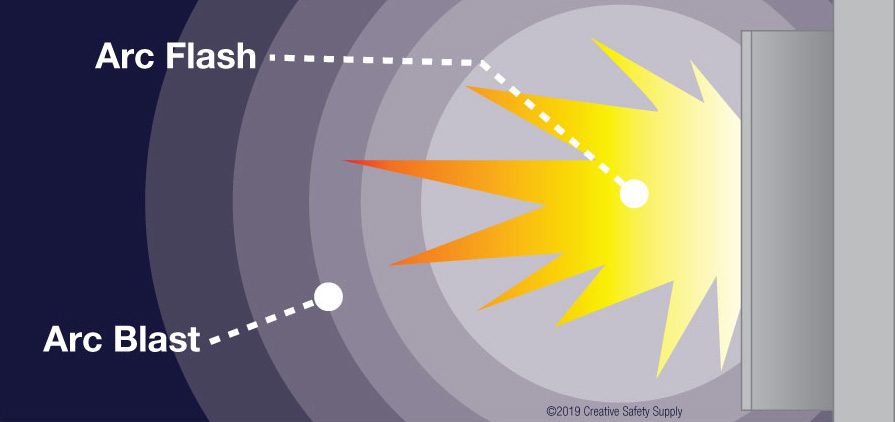
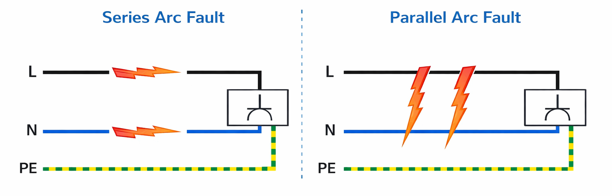
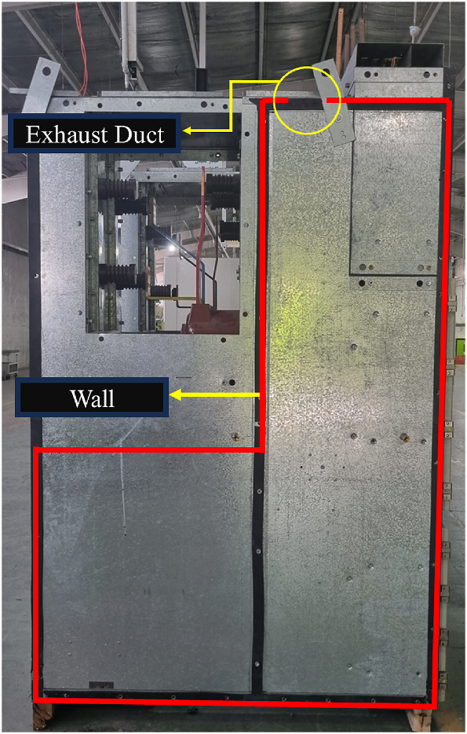
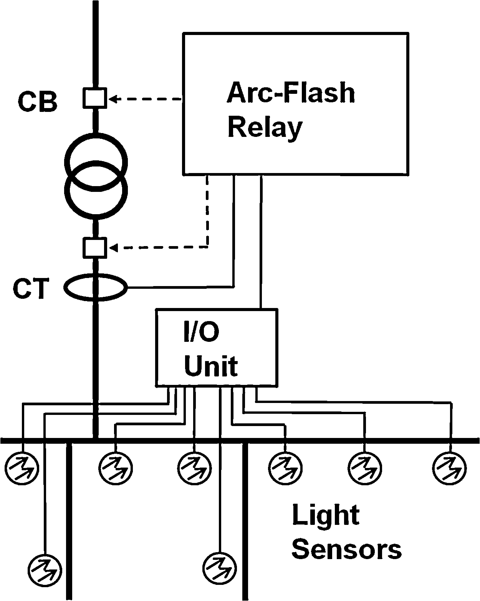
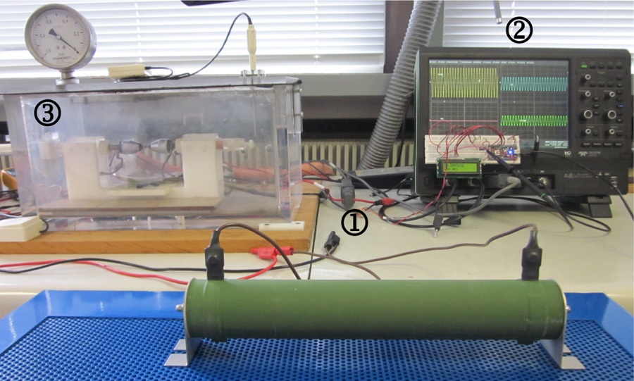
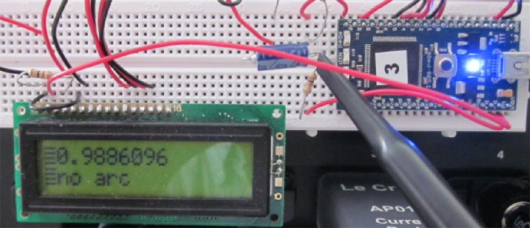
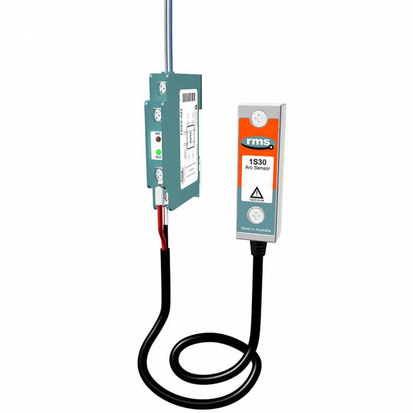
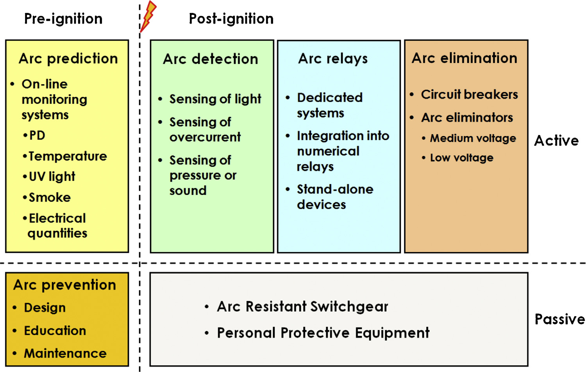
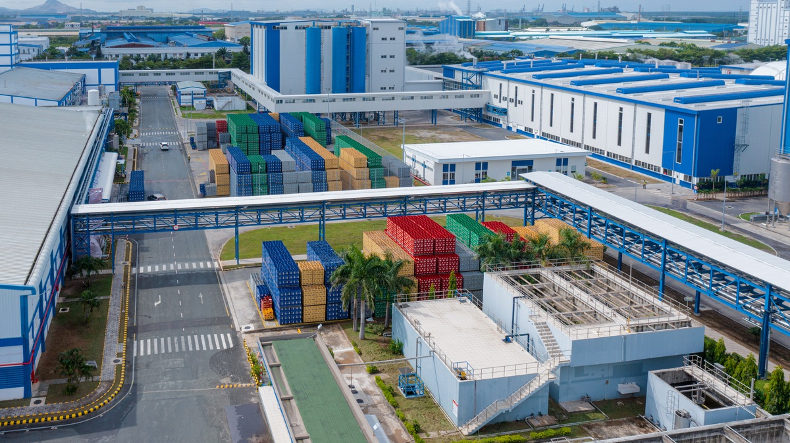

> **Đề tài:** Thiết kế hệ thống nhúng phát hiện chớp hồ quang điện (arc-flash) trong hệ thống điện hạ thế và trung thế.
>
> **Ghi chú bản thảo:** Nội dung hướng tới khoảng 10–14 trang A4 khi dàn trang bằng Times New Roman 13, giãn dòng khoảng 1,15; số trang thực tế phụ thuộc lề và kích thước hình. Markdown không quy định trực tiếp phông chữ và số trang.
>
> **Quy ước kiểm tra:** **[Nguồn: …]** chỉ tài liệu trong danh mục cuối chương; **[Nhận định/Suy luận]** là phân tích của đề tài; **[Đề xuất thiết kế]** là cấu hình hoặc chỉ tiêu chưa được kiểm chứng; **[Cần xác minh]** là dữ liệu còn thiếu. Các ghi chú này được giữ để rà soát trước khi hoàn thiện báo cáo chính thức.

# 1.1. Tổng quan về chớp hồ quang điện

## 1.1.1. Khái niệm, quá trình hình thành và các thuật ngữ liên quan

### 1.1.1.1. Khái niệm hồ quang điện

Hồ quang điện (electric arc) là hiện tượng phóng điện liên tục, có phát sáng, trong đó dòng điện đi qua môi trường plasma giữa hai điện cực có chênh lệch điện thế. Plasma là trạng thái khí bị ion hóa, chứa các hạt mang điện có khả năng tham gia dẫn điện. Trong hồ quang, môi trường khí vốn có tính cách điện trở thành đường dẫn dòng điện và được nung nóng mạnh. [TL2, mục 1, trang 7.]

Hồ quang không có hình dạng cố định. Hình dạng và vị trí của kênh hồ quang phụ thuộc vào cấu trúc nơi phóng điện và có thể thay đổi theo thời gian. Khi nguồn tiếp tục cung cấp năng lượng, hồ quang có thể duy trì và gây phát nóng, phát sáng, nóng chảy hoặc hóa hơi vật liệu điện cực. [TL2, mục 1, trang 7–8.]

Hồ quang cũng có thể xuất hiện trong hoạt động đóng cắt bình thường của máy cắt. Khi đó, thiết bị được thiết kế để chịu và kiểm soát các tác động của hồ quang. Đối với sự cố xảy ra ngoài vùng làm việc được thiết kế, các tác động nhiệt và áp lực có thể vượt quá khả năng chịu đựng của thiết bị. Vì vậy, khi xem xét việc phát hiện chớp hồ quang trong tủ điện, cần phân biệt ánh sáng do sự cố với ánh sáng có thể phát sinh khi thiết bị đóng cắt hoạt động bình thường. [TL2, mục 1, trang 7; TL1, mục 5.6, trang 83.]

*Hình 1.1. Hồ quang điện giữa hai điện cực, thể hiện kênh phóng điện phát sáng qua khe hở.*

*Nguồn: Achim Grochowski, “Lichtbogen 3000 Volt.jpg”, 27/06/2005, [Wikimedia Commons](https://commons.wikimedia.org/wiki/File:Lichtbogen_3000_Volt.jpg), [CC BY 3.0](https://creativecommons.org/licenses/by/3.0/). Ảnh có sẵn, giữ nguyên nội dung; truy cập 23/10/2026.*

### 1.1.1.2. Quá trình hình thành hồ quang điện

Trong tủ điện, sự suy giảm cách điện và tiếp xúc lỏng là những điều kiện có thể dẫn đến sự cố hồ quang. Tại mối nối tiếp xúc không tốt, điện trở tiếp xúc tăng gây phát nóng cục bộ; tại vùng cách điện suy giảm, có thể xuất hiện phóng điện cục bộ. Các biểu hiện này có thể phát triển theo thời gian trước khi hình thành sự cố hồ quang công suất lớn. Tuy nhiên, một số sự cố do vật thể lạ, thao tác của con người hoặc hoạt động không đúng của thiết bị có thể xuất hiện đột ngột. [TL1, mục 3.2, 4.1 và 4.4, trang 78–80.]

Khi phóng điện được khởi phát, môi trường khí trong vùng phóng điện bị ion hóa và hình thành kênh dẫn điện. Năng lượng điện đưa vào kênh hồ quang được chuyển thành nhiều dạng, bao gồm năng lượng làm nóng khí, bức xạ nhiệt và năng lượng truyền vào điện cực. Quá trình nung nóng nhanh có thể làm một phần kim loại điện cực hóa hơi, đồng thời làm khí giãn nở và tăng áp suất. [TL2, mục 1 và 6, trang 8, 13.]

Với nguồn xoay chiều, dòng điện đi qua giá trị không theo chu kỳ nên hồ quang có thể tắt rồi tái mồi ngay sau đó. Với nguồn một chiều, không có điểm không dòng điện tự nhiên theo chu kỳ; hồ quang có thể tiếp tục duy trì nếu nguồn và điều kiện phóng điện còn phù hợp. Sự khác biệt này cần được lưu ý khi sử dụng kết quả nghiên cứu hồ quang AC hoặc DC làm tài liệu tham khảo. [TL2, mục 1, trang 7–8.]

Đối với phạm vi đồ án, đặc điểm cần quan tâm là quá trình hồ quang phát ra ánh sáng để hệ thống cảm biến có thể thu nhận và nhận biết sự kiện. Các nội dung về khí nóng, áp suất và sự phá hủy vật liệu được trình bày nhằm giải thích hiện tượng chớp hồ quang và ý nghĩa của việc phát hiện. [Định hướng nghiên cứu của đồ án trên cơ sở TL1, mục 5.6.]

*Hình 1.2. Tủ KMZ_31 trước thử nghiệm, trên hệ thử, trong quá trình thử và sau thử nghiệm hồ quang nội bộ.*

*Nguồn: TL3, Hình 1, trang PDF 2. Ảnh thử nghiệm tại phòng thí nghiệm công suất lớn ICMET, Romania, được trích nguyên ảnh từ tài liệu; không phải ảnh tại nhà máy khảo sát trong đồ án.*

### 1.1.1.3. Phân biệt các thuật ngữ liên quan đến hồ quang điện

**Hồ quang điện — electric arc (arc).** Thuật ngữ này chỉ hiện tượng phóng điện và kênh plasma dẫn dòng điện giữa các điện cực. Đây là khái niệm vật lý cơ bản để giải thích các hiện tượng phát sáng, phát nhiệt và tăng áp suất liên quan. [TL2, mục 1, trang 7.]

**Chớp hồ quang điện — arc flash.** Thuật ngữ này nhấn mạnh sự giải phóng năng lượng nhiệt và bức xạ gắn với hồ quang. Bức xạ nhiệt từ hồ quang năng lượng cao có thể gây bỏng nghiêm trọng. Vì vậy, chớp hồ quang không chỉ có ý nghĩa là ánh sáng nhìn thấy; ánh sáng là dấu hiệu có thể sử dụng để phát hiện sự kiện. [TL2, mục 1, trang 7; TL1, mục 5.6, trang 83.]

**Nổ hồ quang điện — arc blast.** Thuật ngữ này được dùng trong báo cáo để chỉ tác động áp lực và cơ học đi kèm sự cố hồ quang. Cần phân biệt sóng áp lực lan truyền từ kênh hồ quang với sự tăng áp suất trong vỏ thiết bị kín. Hai tác động này có cơ chế và mức độ phụ thuộc môi trường khác nhau. Nổ hồ quang chủ yếu là quá trình chuyển đổi nhanh năng lượng điện thành nhiệt và áp lực; cần phân biệt với trường hợp tia lửa điện mồi cháy hỗn hợp khí hoặc bụi dễ cháy. [TL2, phần tóm tắt, mục 1 và 6, trang 7–8, 13.]

**Sự cố hồ quang — arc fault.** Thuật ngữ này chỉ tình trạng sự cố có đường phóng điện hồ quang ngoài ý muốn. Trong tủ điện, sự cố có thể tạo ra tác động nhiệt, sóng áp lực và các hạt vật liệu văng ra. Arc fault mô tả tình trạng sự cố, còn arc flash và arc blast nhấn mạnh các dạng tác động liên quan. [TL1, mục 1, trang 78; phần phân biệt là tổng hợp của đồ án.]

**Hồ quang nội bộ — internal arc.** Thuật ngữ này mô tả hồ quang xảy ra bên trong thiết bị hoặc vỏ tủ điện. Nhiệt sinh ra có thể làm tăng áp suất khí bên trong; mức tăng áp phụ thuộc vào hình học khoang, đường thoát khí và điều kiện ban đầu. Đây là cách mô tả vị trí xảy ra hồ quang, không đồng nghĩa với một mức năng lượng hoặc một mức độ nguy hiểm cố định. [TL3, mục 1 và 3, trang PDF 1–3, 13–19.]

**Phóng điện cục bộ — partial discharge (PD).** Trong nghiên cứu giám sát tình trạng tủ điện, phóng điện cục bộ được xem xét như một biểu hiện có thể liên quan đến sự suy giảm cách điện và sự cố đang phát triển. Nó có thể tạo tín hiệu điện từ, siêu âm và quang. Việc giám sát các dấu hiệu phát triển trước sự cố khác với việc phát hiện chớp hồ quang khi sự kiện đã xuất hiện. [TL1, mục 4.1, 4.4 và 5.1, trang 79–81.]

Như vậy, nội dung nghiên cứu của đồ án là nhận biết sự xuất hiện của **chớp hồ quang điện**. Các thuật ngữ về nổ hồ quang, hồ quang nội bộ và phóng điện cục bộ được sử dụng để làm rõ bối cảnh vật lý và tránh nhầm lẫn về đối tượng phát hiện.

*Hình 1.3. Minh họa phân biệt arc flash (ánh sáng và nhiệt) với arc blast (sóng áp lực).*

*Nguồn: Creative Safety Supply, “What is the difference between an arc flash and an arc blast?”, [trang nguồn](https://www.creativesafetysupply.com/qa/arc-flash/what-is-the-difference-between-arc-flash-and-arc-blast). Hình có sẵn, bản quyền Creative Safety Supply 2019, giữ nguyên nội dung; truy cập 23/10/2026.*

## 1.1.2. Các dạng sự cố hồ quang và phạm vi phát hiện của đồ án

### 1.1.2.1. Các dạng sự cố hồ quang

Xét theo quan hệ với tải, có thể phân biệt hồ quang nối tiếp và hồ quang song song. Hồ quang nối tiếp xuất hiện tại vị trí gián đoạn trên đường dẫn dòng điện, chẳng hạn mối nối lỏng hoặc dây dẫn bị hư hỏng. Dòng điện qua hồ quang chịu giới hạn của tải nên có thể không tăng đến mức làm bảo vệ quá dòng tác động. Hồ quang song song tạo đường phóng điện giữa các phần dẫn có điện thế khác nhau, chẳng hạn giữa dây pha với dây trung tính hoặc đất. [TL5, mục 1, trang 35.]

Trong tủ điện phân phối, vị trí xảy ra hồ quang cũng là yếu tố cần quan tâm. Các vị trí có thể phát sinh sự cố gồm khoang đấu nối, bộ phận đóng cắt, mối nối bắt bu lông, tiếp điểm, máy biến đổi đo lường và máy cắt. Vị trí sự cố cùng cấu trúc khoang tủ ảnh hưởng đến vùng mà cảm biến quang có thể giám sát. [TL1, mục 3.2 và 5.6, trang 78, 83.]

*Hình 1.4. Minh họa hồ quang nối tiếp trên đường dẫn dòng điện và hồ quang song song giữa các dây dẫn. L: dây pha; N: dây trung tính; PE: dây bảo vệ. Các điểm phóng điện minh họa những vị trí có thể xảy ra sự cố, không hàm ý các sự cố phải xuất hiện đồng thời.*

*Nguồn: CNC Electric, “What Causes Arc Faults in Electrical Systems? Common Reasons Explained”, [trang nguồn](https://www.cncele.com/blog/what-causes-arc-faults-in-electrical-systems/), [ảnh gốc](https://www.cncele.com/uploads/Series-Arc-Fault-Parallel-Arc-Fault.png); truy cập 23/10/2026. Hình được lưu từ nguồn, không tự tạo.*

### 1.1.2.2. Phạm vi phát hiện của đồ án

Đồ án tập trung phát hiện chớp hồ quang trong bối cảnh hệ thống điện hạ thế và trung thế. Những nghiên cứu nhận dạng hồ quang nối tiếp bằng dòng điện được sử dụng để tham khảo đặc trưng tín hiệu và cách đánh giá phương pháp phát hiện. Kết quả của các nghiên cứu đó cần được xem xét theo đúng điều kiện thử, không được sử dụng trực tiếp để khẳng định khả năng phát hiện chớp hồ quang trong tủ điện của nguyên mẫu. [Phạm vi nghiên cứu của đồ án; đối tượng tham khảo tại TL4, mục 1 và TL5, mục 1.]

## 1.1.3. Nguyên nhân phát sinh và các yếu tố ảnh hưởng

### 1.1.3.1. Nguyên nhân phát sinh sự cố

Các nguyên nhân có thể dẫn đến sự cố hồ quang trong tủ điện gồm tiếp xúc lỏng, suy giảm cách điện, nhiễm bẩn, ăn mòn và tác động của vật thể lạ. Các yếu tố như rung động hoặc hoạt động bảo trì không phù hợp có thể góp phần làm tình trạng thiết bị suy giảm. Ngoài các quá trình diễn biến từ từ, sự cố còn có thể xuất hiện do thao tác trực tiếp hoặc hoạt động bất thường của thiết bị đóng cắt. [TL1, mục 2, 3.2, 3.5 và 4.1, trang 78–79.]

### 1.1.3.2. Các yếu tố ảnh hưởng đến tác động nhiệt và áp suất

Mức năng lượng tác động của chớp hồ quang phụ thuộc vào nhiều yếu tố, trong đó có dòng điện hồ quang, thời gian tồn tại và khoảng cách đến vùng hồ quang. Dòng điện thấp hơn không luôn dẫn đến tác động nhiệt nhỏ hơn, vì thời gian tác động của thiết bị bảo vệ có thể kéo dài khi dòng sự cố giảm. Do đó, các số liệu về mức độ nguy hiểm phải được gắn với điều kiện của hệ thống điện và thời gian sự cố cụ thể. [TL1, mục 5.2–5.5, trang 81–83.]

*Hình 1.5. Năng lượng tác động tăng theo thời gian tồn tại hồ quang trong điều kiện tính toán của nguồn. Trục hoành: thời gian hồ quang (ms); trục tung: năng lượng trên đơn vị diện tích (J/cm²).*

*Nguồn: TL1, Hình 5, trang in 82 (trang PDF 6), trích nguyên hình từ tài liệu. Điều kiện: U = 15 kV, Ik = 50 kA, khe hở 152 mm, khoảng cách làm việc 910 mm. Đồ thị minh họa ảnh hưởng của thời gian trong điều kiện đã nêu; không phải kết quả thử nghiệm hoặc đường đặc tính chung của nguyên mẫu.*

Đối với áp suất trong tủ điện, hình học khoang và khả năng thoát khí có ảnh hưởng đáng kể. Áp suất cực đại phụ thuộc vào chiều rộng, số lượng và cách bố trí đường thoát khí, chiều cao tủ, áp suất và nhiệt độ ban đầu. Các giá trị tính toán hoặc thử nghiệm chỉ có ý nghĩa trong điều kiện hình học và môi trường tương ứng. [TL3, mục 2–4, trang PDF 3–24.]

### 1.1.3.3. Các yếu tố ảnh hưởng đến khả năng phát hiện

Đối với hệ thống phát hiện, các yếu tố cần xem xét gồm vị trí cảm biến, phạm vi quan sát và ánh sáng phát sinh trong quá trình vận hành bình thường. Cảm biến điểm thích hợp với một vùng giới hạn, còn cảm biến dạng sợi có thể giám sát vùng rộng hơn. Việc lựa chọn và bố trí cảm biến phải gắn với vùng cần phát hiện. [TL1, mục 5.6, trang 83.]

## 1.1.4. Biểu hiện và hậu quả của chớp hồ quang điện

### 1.1.4.1. Biểu hiện quang và nhiệt

Khi hồ quang xuất hiện, vùng phóng điện phát sáng và giải phóng nhiệt mạnh. Bức xạ nhiệt có thể gây bỏng; vật liệu điện cực nóng chảy hoặc hóa hơi có thể gây hư hại thêm cho các bộ phận lân cận. Ánh sáng phát ra là dấu hiệu được khai thác trong phương pháp phát hiện bằng cảm biến quang. [TL2, mục 1, trang 7–8; TL1, mục 1 và 5.6, trang 78, 83.]

### 1.1.4.2. Biểu hiện áp lực và cơ học

Sự nung nóng nhanh làm môi trường khí giãn nở, tạo dao động áp suất và sóng âm. Nếu hồ quang xảy ra trong vỏ kín, áp suất tích tụ có thể làm hư hỏng kết cấu hoặc khiến các bộ phận văng ra. Tác động áp lực trong môi trường hở và trong thể tích kín khác nhau, nên không thể mô tả mọi sự kiện bằng một giá trị áp suất duy nhất. [TL2, mục 1, 4–6, trang 7–8, 10–13.]

### 1.1.4.3. Hậu quả đối với con người và thiết bị

Sự cố có thể gây tổn thương nhiệt, tác động cơ học và hư hỏng các phần dẫn điện hoặc cách điện. Hư hỏng thiết bị còn có thể dẫn đến gián đoạn cấp điện. Hình 1.6 minh họa thanh cái hạ thế bị nóng chảy cục bộ sau một thử nghiệm hồ quang thời gian ngắn, cho thấy hư hại có thể xuất hiện ngay cả khi thời gian hồ quang chỉ kéo dài vài chục mili giây. [TL1, mục 1, 3.4 và Hình 2, trang 78–80.]

*Hình 1.6. Thanh cái hạ thế bị nóng chảy cục bộ tại ranh giới lớp cách điện sau thử nghiệm hồ quang.*

*Nguồn: TL1, Hình 2, trang in 80, tương ứng trang PDF 4. Điều kiện ghi trong tài liệu: U = 726 V, Ik = 77 kA, thời gian hồ quang 65 ms. Đây là điều kiện của thử nghiệm nguồn, không phải thông số thiết kế hoặc kết quả thử của đồ án.*

## 1.1.5. Các dấu hiệu phục vụ phát hiện chớp hồ quang điện

### 1.1.5.1. Tín hiệu quang

Phương pháp quang thu nhận ánh sáng phát ra khi có hồ quang. Cảm biến điểm giám sát một vùng giới hạn, còn cảm biến sợi có thể theo dõi vùng lớn hơn như khu vực thanh cái hoặc nhiều khoang máy cắt. Đối với đồ án, đây là cơ sở để nghiên cứu thu nhận và xử lý dấu hiệu chớp sáng tại vùng giám sát. [TL1, mục 5.6, trang 83; phần liên hệ là định hướng của đồ án.]

### 1.1.5.2. Tín hiệu điện hỗ trợ xác nhận

Dòng điện có thể cung cấp thông tin bổ sung cho tín hiệu quang. Việc phối hợp điều kiện ánh sáng với quá dòng giúp nhận biết sự cố nhanh và hạn chế tác động nhầm do nguồn sáng không phải sự cố. Trong đồ án, khả năng sử dụng một tín hiệu điện xác nhận cần được lựa chọn và kiểm chứng theo cấu hình nghiên cứu; phần tổng quan chưa coi đây là giải pháp đã chốt. [TL1, mục 5.6, trang 83.]

*Hình 1.7. Nguyên lý phối hợp điều kiện ánh sáng (Light) và quá dòng (Overcurrent) bằng phép AND trong hệ thống bảo vệ chớp hồ quang.*

*Nguồn: TL1, Hình 6, trang in 83 (trang PDF 7), trích nguyên hình từ tài liệu. Trip signal là tín hiệu tác động cắt của hệ thống bảo vệ trong nguồn. Hình được sử dụng để minh họa cách phối hợp hai dấu hiệu; đồ án chỉ nghiên cứu phát hiện chớp hồ quang, không khẳng định chức năng điều khiển cắt hoặc loại trừ sự cố.*

### 1.1.5.3. Các dấu hiệu vật lý khác

Âm thanh, áp suất và phát nhiệt giúp giải thích các tác động đi kèm hồ quang. Tuy nhiên, việc một đại lượng xuất hiện trong sự cố chưa đủ để kết luận đại lượng đó phù hợp làm tín hiệu phát hiện của nguyên mẫu. Khả năng sử dụng còn phụ thuộc cảm biến, vị trí đo và thời gian đáp ứng. [TL2, mục 5–6, trang 12–13; nhận xét về lựa chọn tín hiệu là suy luận của đồ án.]

### 1.1.5.4. Định hướng sử dụng dấu hiệu trong đồ án

Trên cơ sở đó, nội dung tiếp theo của báo cáo tập trung vào khả năng nhận biết chớp hồ quang, thời gian phát hiện và khả năng phân biệt với các tác động quang không phải sự cố. Ánh sáng phát hiện được cần được đánh giá trong điều kiện thử xác định. Chức năng phát hiện của đồ án không bao gồm dự báo sự cố, tính năng lượng hồ quang, đánh giá áp suất nổ hoặc tự động dập và loại trừ hồ quang.

**Thông tin nguồn trực tiếp sử dụng trong mục 1.1**

- **TL1:** L. Kumpulainen, G. A. Hussain, M. Rival, M. Lehtonen và K. Kauhaniemi, “Aspects of arc-flash protection and prediction,” *Electric Power Systems Research*, tập 116, tr. 77–86, 2014. DOI: 10.1016/j.epsr.2014.05.011. Tệp trong thư mục Tham khảo: *Aspects of arc-flash protection and prediction.pdf*.
- **TL2:** V. Babrauskas, “Electric arc explosions—A review,” *Fire Safety Journal*, tập 89, tr. 7–15, 2017. DOI: 10.1016/j.firesaf.2017.02.006. Tệp trong thư mục Tham khảo: *Electric arc explosions—A review.pdf*.
- **TL3:** M. Matin, A. Dehghanian, M. Dastranj và H. Darijani, “Explainable artificial intelligence modeling of internal arc in a medium voltage switchgear based on different CFD simulations,” *Heliyon*, tập 10, bài e29594, 2024. DOI: 10.1016/j.heliyon.2024.e29594. Tệp trong thư mục Tham khảo có cùng tên bài báo.
- **TL4:** J. Lezama, P. Schweitzer, E. Tisserand, J.-B. Humbert, S. Weber và P. Joyeux, “An embedded system for AC series arc detection by inter-period correlations of current,” *Electric Power Systems Research*, tập 129, tr. 227–234, 2015. DOI: 10.1016/j.epsr.2015.08.005. Tệp trong thư mục Tham khảo có cùng tên bài báo.
- **TL5:** J. E. Siegel, S. Pratt, Y. Sun và S. E. Sarma, “Real-time Deep Neural Networks for internet-enabled arc-fault detection,” *Engineering Applications of Artificial Intelligence*, tập 74, tr. 35–42, 2018. DOI: 10.1016/j.engappai.2018.05.009. Tệp trong thư mục Tham khảo có cùng tên bài báo.

# 1.2. Đối tượng ứng dụng và các giải pháp phát hiện hồ quang điện hiện có

## 1.2.1. Đặc điểm hệ thống điện hạ thế và trung thế trong công nghiệp

### 1.2.1.1. Cấu trúc cấp điện và đối tượng giám sát

Hệ thống cung cấp điện công nghiệp thường gồm các khâu tiếp nhận nguồn, phân phối trung thế, biến đổi điện áp và phân phối hạ thế đến phụ tải. Trong phạm vi đề tài, hệ thống trung thế được xem xét tại các tủ phân phối và các nhánh cấp cho máy biến áp; hệ thống hạ thế được xem xét tại tủ tổng, tủ phân phối và tủ điều khiển động cơ.

### 1.2.1.2. Đặc điểm kết cấu và yêu cầu tích hợp

Mỗi nhóm thiết bị có chức năng và điều kiện giám sát riêng. Tủ trung thế thường phân chia các bộ phận chức năng theo khoang, trong khi tủ hạ thế có thể có nhiều ngăn phân phối hoặc ngăn động lực đặt gần nhau. Cách phân chia này ảnh hưởng đến số lượng cảm biến, phạm vi giám sát và khả năng xác định vùng sự kiện.

Từ góc độ thiết kế, hệ thống phát hiện cần tương thích với cấu trúc cấp điện và phương án bảo vệ. Việc bổ sung một cảm biến vào tủ chưa đủ tạo thành giải pháp bảo vệ hoàn chỉnh nếu chưa xác định đầu ra, liên động và thiết bị nhận lệnh.

**[Nguồn: TL1. Phần liên hệ đến yêu cầu hệ thống nhúng là phân tích thiết kế.]**

*Hình 1.8. Kết cấu tủ trung thế KMZ_31 với vỏ tủ và đường thoát khí. Exhaust Duct: đường thoát khí; Wall: vách tủ. Kết cấu kín và các vách ngăn là những đặc điểm cần xét khi xác định vùng quan sát của cảm biến.*

*Nguồn: TL3, Hình 5, trang PDF 7, trích nguyên ảnh từ tài liệu. Hình minh họa một cấu hình tủ trung thế trong nghiên cứu nguồn, không đại diện cho mọi tủ hạ thế hoặc trung thế.*

## 1.2.2. Các vị trí cần giám sát chớp hồ quang

### 1.2.2.1. Vị trí giám sát trong tủ trung thế

Trong tủ trung thế, các vị trí cần xem xét gồm khoang thanh cái, khoang máy cắt và khoang đầu cáp. Những khu vực này có các phần mang điện, đầu nối hoặc bộ phận đóng cắt, đồng thời có thể bị che khuất bởi vách ngăn. Một cảm biến đặt ngoài khoang không chắc chắn quan sát được ánh sáng phát sinh trong khoang kín.

### 1.2.2.2. Vị trí giám sát trong tủ hạ thế

Trong tủ hạ thế, các vị trí xem xét gồm thanh cái chính, máy cắt tổng, đầu nối cáp và ngăn chức năng. Việc bố trí cảm biến cần tính đến vùng phát sáng khi thiết bị đóng cắt làm việc bình thường để tránh đồng nhất mọi ánh sáng trong tủ với sự cố nguy hiểm.

### 1.2.2.3. Nguyên tắc xác định vùng giám sát

Do đó, vùng giám sát nên được xác định từ cấu trúc thực của thiết bị. Cần khảo sát hướng nhìn, vật cản, đường dây và khả năng kiểm tra cảm biến sau lắp đặt. Số lượng cảm biến không chỉ phụ thuộc kích thước tủ mà còn phụ thuộc sự phân chia khoang và yêu cầu xác định vị trí.

**[Nguồn: TL1, TL6. Nhận định về bố trí cụ thể cần được kiểm chứng bằng khảo sát và thử nghiệm.]**

*Hình 1.9. Ví dụ bố trí nhiều cảm biến quang tại các nhánh và thanh cái, kết nối qua khối vào/ra đến rơ-le chớp hồ quang. CT: biến dòng; CB: máy cắt; I/O Unit: khối vào/ra; Light Sensors: cảm biến quang.*

*Nguồn: TL1, Hình 7, trang in 83 (trang PDF 7), trích nguyên hình. Sơ đồ minh họa vị trí thu nhận tín hiệu và cấu trúc liên kết; vị trí lắp thực tế cần xác định theo khoang tủ, vật cản và vùng giám sát. Chức năng cắt trong hình thuộc hệ thống bảo vệ của nguồn.*

## 1.2.3. Các phương pháp phát hiện hồ quang

### 1.2.3.1. Phát hiện dựa trên tín hiệu điện

Phương pháp dựa trên tín hiệu điện sử dụng biến đổi của dòng điện hoặc điện áp để nhận biết sự kiện. Các bước xử lý có thể gồm lọc, tính đặc trưng, phân tích tương quan hoặc phân loại bằng mô hình học máy. Ưu điểm là có khả năng tận dụng tín hiệu đo điện; khó khăn nằm ở việc phân biệt hồ quang với thay đổi tải và quá độ bình thường.

*Hình 1.10. Hệ thử nghiệm phát hiện hồ quang nối tiếp AC, gồm vùng tạo hồ quang, thiết bị đo và mạch thử. Hình minh họa việc thu nhận tín hiệu và kiểm tra phương pháp trong điều kiện thực nghiệm xác định.*

*Nguồn: TL4, Hình 5, trang in 230 (trang PDF 4), trích nguyên ảnh. Đây là hệ thử hồ quang nối tiếp phục vụ phương pháp dựa trên dòng điện, không phải hệ thử chớp hồ quang nội bộ trung thế của đồ án.*

### 1.2.3.2. Phát hiện dựa trên tín hiệu quang

Phương pháp quang sử dụng ánh sáng làm dấu hiệu phát hiện. Cảm biến có thể được đặt gần vùng cần giám sát và kết nối về bộ xử lý. Phương pháp này cần đánh giá khả năng quan sát, đáp ứng cảm biến và ảnh hưởng của nguồn sáng ngoài sự cố.

### 1.2.3.3. Phối hợp tín hiệu quang và điện

Phương pháp phối hợp quang và điện sử dụng hai nhóm thông tin để xác nhận sự kiện. Trong bảo vệ chớp hồ quang ở tủ điện, tín hiệu quang có thể được phối hợp với điều kiện dòng điện để tăng tính chọn lọc đối với các tác động ánh sáng. Tuy nhiên, việc thêm điều kiện xác nhận cũng tạo thêm yêu cầu về thời gian đáp ứng.

### 1.2.3.4. Các dấu hiệu bổ sung và so sánh phương pháp

Các phương pháp dựa trên nhiệt, âm thanh, áp suất hoặc điện từ có thể được xem xét theo đối tượng. Trong chương này, chúng được giới thiệu để làm rõ khả năng quan sát hiện tượng, chưa được lựa chọn làm kênh chính của nguyên mẫu.

**[Nguồn: TL1, TL4, TL5.]**

**Bảng 1.1. So sánh định tính các nhóm phương pháp**

| Phương pháp | Ưu điểm cần xem xét | Hạn chế cần đánh giá |
|---|---|---|
| Tín hiệu điện | Phù hợp phân tích đặc trưng và triển khai số | Phụ thuộc tải, dạng sự cố và cửa sổ dữ liệu |
| Tín hiệu quang | Quan sát dấu hiệu phát sáng tại vùng giám sát | Vật cản, ánh sáng ngoài và tình trạng cảm biến |
| Kết hợp quang và điện | Bổ sung điều kiện xác nhận | Tăng yêu cầu phối hợp và đồng bộ thời gian |
| Dấu hiệu vật lý khác | Cung cấp thông tin bổ sung | Phụ thuộc đặc tính cảm biến và môi trường |

**[Bảng tổng hợp của đề tài từ các tài liệu; không phải kết quả thử nghiệm so sánh trực tiếp.]**

Hệ thống kiểm tra điều kiện quang và điều kiện điện, sau đó xác định sự kiện theo logic phối hợp. Khi chưa đủ điều kiện, hệ thống tiếp tục giám sát; khi đủ điều kiện, hệ thống xuất tín hiệu phát hiện. Ngưỡng và cửa sổ phối hợp thời gian được xác định ở bước lựa chọn giải pháp. [Đề xuất chức năng của đồ án.]

## 1.2.4. Tổng quan các nghiên cứu liên quan

### 1.2.4.1. Tình hình nghiên cứu trong nước

Tại Việt Nam, hướng phát hiện hồ quang nối tiếp AC bằng đặc trưng dòng điện đã được triển khai trên phần cứng nhúng. Một phương pháp công bố năm 2026 kết hợp đặc trưng thống kê, đặc trưng phổ và học máy trên STM32F407, với sự tham gia của các đơn vị PTIT và Rạng Đông. [W1]

Ý nghĩa tham khảo đối với đồ án nằm ở cách tổ chức chuỗi thu nhận, trích xuất đặc trưng và thực thi trên bộ xử lý có tài nguyên hạn chế. Tuy nhiên, đối tượng phát hiện là hồ quang nối tiếp trong các cấu hình tải dân dụng; kết quả này chưa đủ để xác nhận khả năng phát hiện chớp hồ quang nội bộ trung thế. [W1]

Việc đánh giá phương pháp phát hiện cần kết hợp chất lượng nhận dạng với khả năng thực thi trên phần cứng nhúng. Việc chỉ báo cáo độ chính xác của mô hình trên máy tính chưa phản ánh đầy đủ hành vi của nguyên mẫu khi phải thu nhận, xử lý và xuất đầu ra liên tục.

**[Nguồn: W1. Đây là nhận xét trong phạm vi tài liệu đã khảo sát, không khẳng định đại diện cho toàn bộ tình hình nghiên cứu trong nước.]**

### 1.2.4.2. Tình hình nghiên cứu ngoài nước

Các hướng nghiên cứu quốc tế về chớp hồ quang bao gồm thiết kế tủ điện, phát hiện sự kiện, phối hợp bảo vệ và loại trừ sự cố. Các giải pháp được phân chia theo mục đích: phòng ngừa, nhận biết dấu hiệu sự cố đang phát triển và phản ứng sau khi hồ quang xuất hiện. [TL1]

Đối với hồ quang nội bộ, mô phỏng động lực học chất lưu kết hợp học máy cho phép phân tích áp suất cực đại theo các tham số kết cấu và môi trường. Hướng nghiên cứu này phục vụ giải thích hiện tượng và đánh giá kết cấu tủ; kết quả dự đoán áp suất không xác nhận khả năng phát hiện chớp hồ quang của một hệ thống nhúng. [TL3]

Ở hướng phân tích dòng điện, hệ số tương quan giữa các chu kỳ được sử dụng để nhận biết biến đổi do hồ quang nối tiếp. Thuật toán đã được triển khai trên vi điều khiển ARM Cortex-M3 với tần số lấy mẫu 5 kHz và kiểm tra bằng các tải dân dụng. Cách tiếp cận này cho thấy khả năng sử dụng đặc trưng tín hiệu để xây dựng thuật toán phù hợp với phần cứng nhúng. [TL4]

Mạng nơ-ron sâu cũng được sử dụng trong hệ thống phát hiện có kết nối. Với cửa sổ dữ liệu khoảng 200 ms, một cấu hình thử nghiệm đạt độ trễ từ kích hoạt đến cắt dưới 220 ms. Thời gian này bao gồm nhiều khâu nên cần được phân biệt với thời gian suy luận riêng của mô hình. [TL5]

**[Nguồn: TL1, TL3, TL4, TL5. Các thông số thuộc điều kiện của từng công trình.]**

*Hình 1.11. Nguyên mẫu nhúng sử dụng đặc trưng tương quan dòng điện để phát hiện hồ quang nối tiếp AC, có hiển thị hệ số và trạng thái nhận dạng.*

*Nguồn: TL4, Hình 14, trang in 231 (trang PDF 5), trích nguyên ảnh. Hình minh họa triển khai thuật toán trên phần cứng nhúng của công trình nguồn; khả năng phát hiện chớp hồ quang của đồ án phải được kiểm chứng riêng.*

**Bảng 1.2. Tổng hợp các nghiên cứu tiêu biểu**

| Nhóm | Tài liệu | Nội dung có thể kế thừa | Giới hạn |
|---|---|---|---|
| Trong nước | W1 | Đặc trưng gọn, triển khai MCU | Hồ quang nối tiếp dân dụng |
| Ngoài nước | TL1 | Tổng quan phát hiện và bảo vệ | Không phải nguyên mẫu của đồ án |
| Ngoài nước | TL3 | Hiện tượng nội bộ và ảnh hưởng kết cấu | Mô phỏng áp suất |
| Ngoài nước | TL4 | Tương quan dòng điện, triển khai nhúng | Điều kiện thử AC dân dụng |
| Ngoài nước | TL5 | Chuỗi xử lý và đánh giá độ trễ | Cửa sổ dữ liệu và cấu hình riêng |

### 1.2.4.3. Nhận xét và khả năng kế thừa

Các kết quả không nên được so sánh chỉ bằng một giá trị độ chính xác hoặc thời gian xử lý. Cần xét dạng sự cố, điều kiện tín hiệu, khoảng thời gian quan sát và thiết bị đầu ra. Đối với đồ án, trọng tâm là xây dựng một nguyên mẫu có chuỗi chức năng rõ ràng, thời gian đáp ứng đo được và phạm vi kiểm chứng được mô tả trung thực.

**[Nhận định tổng hợp của đề tài.]**

## 1.2.5. Các thiết bị và giải pháp thương mại tham khảo

### 1.2.5.1. Thiết bị tham khảo và vai trò trong hệ thống

Thiết bị thương mại được lựa chọn để tham khảo là **Mors Smitt 1S23 kết hợp cảm biến quang 1S30**. Mô-đun tiếp nhận tín hiệu quang và cung cấp tín hiệu hồ quang cho rơ-le bảo vệ bên ngoài. [TL6, W4]

*Hình 1.12. Mô-đun Mors Smitt 1S23.*

**[Nguồn ảnh: trang KMET được lưu trong TL6.]**

### 1.2.5.2. Cấu trúc và chức năng

1S23 kết nối với một hoặc hai cảm biến 1S30 tùy phiên bản. Mô-đun cung cấp tín hiệu hồ quang đến đầu vào trạng thái của rơ-le bảo vệ và có chức năng giám sát cảm biến. Cấu trúc này cho phép tách phần thu nhận quang khỏi logic bảo vệ và thiết bị đóng cắt [W4].

Trong phân tích hệ thống, cần phân biệt hai cảm biến với hai vùng bảo vệ độc lập. Việc tăng số đầu vào không tự động đồng nghĩa tăng số vùng có đầu ra riêng. Đồng thời, tín hiệu được gọi là “trip” ở mô-đun phải được sử dụng theo sơ đồ đấu nối và định mức của hãng.

**[Nguồn: TL6 và tài liệu chính hãng W4. Nhận xét về phân vùng là phân tích cấu trúc chức năng.]**

### 1.2.5.3. Thông số kỹ thuật

**Bảng 1.3. Một số thông số tham khảo của 1S23**

| Thông số | Giá trị |
|---|---|
| Cảm biến tương thích | 1S30 |
| Số đầu vào | Một hoặc hai, tùy phiên bản |
| Vùng giám sát | Một vùng |
| Thời gian từ chớp sáng đến đầu ra | Dưới 2 ms |
| Xung đầu ra trip | 110 ms ± 10 ms |
| Nguồn danh định | 24/32/48/110/125/220/240/250 VDC, tùy phiên bản |
| Dải làm việc nguồn | ±20% điện áp danh định |
| Công suất giám sát | Dưới 0,75 W tại 110 VDC |
| Đầu ra | Bán dẫn có cực tính |
| Nhiệt độ hoạt động | −10 đến +55 °C |
| Lắp đặt | DIN rail 35 mm |

**[Nguồn: TL6; đối chiếu Technical Bulletin 1S23 ngày 24/03/2025, W4. Đây là thông số nhà sản xuất, không phải kết quả đo của đồ án.]**

Các mức điện áp nguồn là những lựa chọn theo mã sản phẩm. Không được diễn giải thành một thiết bị duy nhất có dải đầu vào liên tục từ 24 đến 250 VDC. Tương tự, công suất nêu tại 110 VDC không nên tự động áp dụng cho mọi phiên bản.

### 1.2.5.4. Phối hợp với hệ thống bảo vệ

Cảm biến quang 1S30 truyền tín hiệu về mô-đun 1S23. Mô-đun cung cấp tín hiệu hồ quang và tín hiệu giám sát cảm biến; rơ-le bảo vệ bên ngoài tiếp nhận tín hiệu hồ quang, phối hợp với điều kiện dòng điện và thực hiện chức năng bảo vệ theo cấu hình của hệ thống. [TL6, W4]

Thời gian dưới 2 ms được hiểu theo điểm đo từ chớp sáng đến đầu ra mô-đun. Thời gian rơ-le tiếp nhận, thực hiện logic và máy cắt ngắt dòng cần được xét riêng. Đây là cơ sở quan trọng để đồ án quy định rõ điểm bắt đầu và kết thúc khi đo thời gian đáp ứng.

### 1.2.5.5. Ưu điểm, hạn chế và nội dung kế thừa

Ưu điểm đáng chú ý là cấu trúc gọn, đầu vào cảm biến xác định, chỉ thị trạng thái và giám sát tình trạng cảm biến. Tuy nhiên, giải pháp còn phụ thuộc rơ-le ngoài, thiết bị cắt và bố trí cảm biến. Tốc độ cao của mô-đun không loại bỏ nhu cầu kiểm tra toàn chuỗi.

Đồ án có thể kế thừa cách tổ chức chức năng và tiêu chí kiểm tra, thay vì sao chép thông số của thiết bị thương mại. Các nội dung nên đưa vào nguyên mẫu gồm nhận biết trạng thái sẵn sàng, phân biệt cảnh báo sự kiện với lỗi thiết bị và ghi lại kết quả kiểm tra.

**[Nhận định thiết kế trên cơ sở tài liệu thiết bị.]**

## 1.2.6. Nhận xét và định hướng của đề tài

### 1.2.6.1. Vị trí của chức năng phát hiện trong hệ thống

Tổng quan cho thấy phát hiện chớp hồ quang cần gắn với đối tượng cụ thể và cách sử dụng đầu ra. Đối với tủ điện, tín hiệu quang là một hướng đáng xem xét; tín hiệu điện có thể bổ sung điều kiện xác nhận khi phù hợp dạng sự cố.

*Hình 1.13. Phân biệt dự báo trước khi hồ quang xuất hiện, phát hiện hồ quang, rơ-le bảo vệ và loại trừ hồ quang. Arc detection là nhóm chức năng liên quan trực tiếp đến phạm vi phát hiện chớp hồ quang của đồ án.*

*Nguồn: TL1, Hình 1, trang in 79 (trang PDF 3), trích nguyên hình. Các nhánh dự báo, phòng ngừa và loại trừ trong hình được giữ để làm rõ quan hệ chức năng, không phải các chức năng mà đồ án cam kết triển khai.*

### 1.2.6.2. Định hướng xây dựng và kiểm chứng nguyên mẫu

Đề tài định hướng xây dựng nguyên mẫu hệ thống nhúng có khả năng thu nhận tín hiệu, ra quyết định, cảnh báo và ghi sự kiện. Phần giao tiếp bảo vệ được đánh giá ở mức giao diện nguyên mẫu; việc sử dụng trực tiếp trong hệ thống điện thực cần thêm kiểm chứng tương ứng.

**[Đề xuất định hướng, chưa chốt cảm biến, thuật toán hoặc linh kiện.]**

# 1.3. Khảo sát hệ thống điện nhà máy thực tế

## 1.3.1. Giới thiệu nhà máy, mục tiêu và phương pháp khảo sát

Đối tượng lựa chọn là nhà máy bia HEINEKEN Vũng Tàu tại Khu công nghiệp Mỹ Xuân A. Năm 2022, nhà máy có diện tích 40 ha, công suất công bố 11 triệu hectolit mỗi năm và mức độ tự động hóa cao trong các công đoạn sản xuất. [W2]

*Hình 1.14. Nhà máy bia HEINEKEN Vũng Tàu.*

**[Nguồn ảnh: Tuổi Trẻ Online, “HEINEKEN Việt Nam khánh thành nhà máy bia lớn nhất Đông Nam Á”, 26/09/2022. Ảnh có sẵn, tìm qua tìm kiếm hình ảnh, truy cập ngày 23/10/2026.](https://tuoitre.vn/heineken-viet-nam-khanh-thanh-nha-may-bia-lon-nhat-dong-nam-a-2022092615262806.htm)**

Mục tiêu khảo sát là tìm hiểu bối cảnh cấp điện để xây dựng yêu cầu cho hệ thống phát hiện. Phương pháp sử dụng là khảo sát tài liệu công khai của doanh nghiệp và nhà cung cấp hệ thống điện, chưa phải khảo sát trực tiếp tại hiện trường.

**[Phạm vi nghiên cứu do đề tài xác lập. Chưa có xác nhận cho phép lắp thử hoặc hồ sơ nội bộ của nhà máy.]**

## 1.3.2. Cấu trúc hệ thống cung cấp điện của nhà máy

Gói cung cấp hệ thống điện cho dự án mở rộng năm 2018 gồm một trạm chính và năm trạm phụ, các tủ trung thế 22 kV, tủ hạ thế 0,4 kV, trạm hợp bộ, máy biến áp khô và thiết bị đo có truyền thông số. Dữ liệu này phản ánh phạm vi dự án tại thời điểm đó; sơ đồ liên kết chi tiết và hiện trạng toàn bộ hệ thống năm 2026 chưa được xác minh. [W3]

Các nhóm thiết bị trên cho phép xác định các khâu phân phối điện chính. Dạng mạng vòng, mức dự phòng, số lượng máy biến áp và cách liên lạc thanh cái chưa được xác minh.

Ở mức chức năng, điện năng được phân phối từ phía trung thế qua máy biến áp đến phía hạ thế, sau đó cấp cho các tủ động lực, tủ điều khiển và phụ tải. Quan hệ này chỉ dùng để phân tích các nhóm thiết bị; cấu trúc liên kết thực tế của nhà máy cần được xác minh bằng bản vẽ điện. [Nhận định/Suy luận từ W3.]

## 1.3.3. Khảo sát thiết bị và điều kiện tại các vị trí dự kiến giám sát

Đối với phía trung thế, đề tài xem xét các khoang thanh cái, máy cắt và đầu cáp như những vị trí ứng viên để bố trí cảm biến. Đối với phía hạ thế, các ứng viên gồm tủ tổng và các ngăn phân phối động lực. Danh sách này phục vụ lập yêu cầu khảo sát, chưa xác nhận model hay cấu tạo thực tế của từng tủ.

Các dữ liệu cần bổ sung gồm kích thước khoang, vách ngăn, vị trí phần mang điện, đường dây cảm biến và nguồn phụ trợ. Ngoài ra, cần xác định tín hiệu nào có thể tiếp cận qua giao diện đo hoặc rơ-le hiện có, tránh mặc định có thể nối trực tiếp vào mạch lực.

**[Nhận định/Suy luận: phân tích theo nhóm thiết bị. Cần xác minh bằng bản vẽ và khảo sát hiện trường.]**

**Bảng 1.4. Dữ liệu khảo sát cần bổ sung**

| Nhóm dữ liệu | Nội dung cần xác định | Mục đích |
|---|---|---|
| Kết cấu tủ | Khoang, vách ngăn, vật cản | Xác định vùng quan sát |
| Điện lực | Sơ đồ, dòng sự cố, bảo vệ hiện có | Đánh giá logic phối hợp |
| Nguồn phụ trợ | Điện áp, dự phòng, cách nối đất | Thiết kế nguồn |
| Giao diện | Đầu vào/ra của thiết bị nhận tín hiệu | Thiết kế kết nối |
| Vận hành | Trạng thái đóng cắt và nguồn sáng | Lập thử nghiệm gây nhầm |

Chưa có ảnh xác thực các tủ điện nội bộ cần giám sát tại nhà máy Vũng Tàu. Việc xác định vị trí lắp cảm biến cần được bổ sung bằng ảnh và bản vẽ đúng hiện trường. [Cần xác minh.]

## 1.3.4. Phân tích nguy cơ và nhu cầu phát hiện chớp hồ quang

Từ góc độ kỹ thuật, sự cố tại thanh cái hoặc đầu nối của một tủ phân phối có thể ảnh hưởng đến nhiều nhánh phụ tải. Mức độ ảnh hưởng phụ thuộc sơ đồ cấp điện, khả năng chuyển nguồn và phối hợp bảo vệ. Vì chưa có các dữ liệu này, đề tài chỉ phân tích nhu cầu giám sát định tính, chưa tính toán năng lượng sự cố hoặc thời gian cắt tại nhà máy.

Nhu cầu giám sát được xem xét theo ba nội dung: nhận biết sự kiện nhanh, chỉ thị vùng phát hiện và cung cấp dữ liệu để kiểm tra sau sự kiện. Bên cạnh khả năng phát hiện, cần đánh giá những tác động không phải sự cố như ánh sáng khi mở cửa, chiếu sáng kiểm tra hoặc hoạt động đóng cắt.

Không có dữ liệu trong phạm vi khảo sát chứng minh nhà máy đã xảy ra chớp hồ quang hoặc thiếu bảo vệ. Vì vậy, việc chọn nhà máy là để xây dựng trường hợp ứng dụng có cơ sở, không phải kết luận về mức độ an toàn hiện hữu.

**[Toàn bộ phần này là nhận định kỹ thuật của đề tài; chưa phải đánh giá rủi ro đã được nhà máy xác nhận.]**

## 1.3.5. Đề xuất phạm vi ứng dụng hệ thống nhúng

Đề tài đề xuất nghiên cứu vùng giám sát đại diện ở cấp khoang tủ, thay vì bao phủ toàn bộ nhà máy. Cách tiếp cận này giúp kiểm soát được vị trí cảm biến, đầu vào và tiêu chí thử nghiệm.

Nguyên mẫu được phát triển và kiểm chứng trong môi trường phòng thí nghiệm. Kết quả về nguyên lý phát hiện, thời gian đáp ứng và quản lý trạng thái là cơ sở cho bước nghiên cứu tích hợp sau này. Việc hướng tới cả hạ thế và trung thế được thể hiện ở yêu cầu giao diện và bố trí; mức độ được xác nhận phải tương ứng với thử nghiệm thực tế đã thực hiện.

**[Đề xuất thiết kế. Không khẳng định nguyên mẫu đã được phép vận hành trong tủ trung thế.]**

# 1.4. Xác định yêu cầu thiết kế hệ thống nhúng phát hiện chớp hồ quang điện

## 1.4.1. Mục tiêu, đối tượng và phạm vi thiết kế

Mục tiêu là xây dựng nguyên mẫu có khả năng tiếp nhận dấu hiệu quang, xử lý theo logic xác định, cảnh báo và ghi sự kiện. Một đầu vào điện xác nhận được xem xét để thử nghiệm chế độ phối hợp.

Để hình thành bộ yêu cầu cụ thể, chương này sử dụng cấu hình làm việc ban đầu gồm hai kênh quang trong một vùng giám sát, nguồn phụ trợ 24 VDC và giao diện cảnh báo tại chỗ. Các lựa chọn này giúp giới hạn quy mô nguyên mẫu, không phải yêu cầu do HEINEKEN cung cấp.

Phạm vi kiểm chứng gồm tín hiệu điện mô phỏng, kích thích quang có kiểm soát và các kịch bản lỗi. Nếu sử dụng nguồn sáng thay thế, kết quả chỉ xác nhận đáp ứng với kích thích đó; việc mở rộng kết luận sang hồ quang thực cần thêm dữ liệu tương ứng.

**[Đề xuất thiết kế để kiểm tra và chốt trước Chương 2.]**

## 1.4.2. Yêu cầu chức năng

Hệ thống phải thu nhận hai kênh quang và lưu được kênh đã kích hoạt. Trong cấu hình một vùng, sự kiện hợp lệ tại một trong hai kênh có thể kích hoạt cảnh báo chung; thông tin từng kênh vẫn được giữ để kiểm tra.

Phần mềm cần hỗ trợ chế độ phát hiện quang và chế độ phối hợp với đầu vào xác nhận. Chế độ được chọn phải được hiển thị hoặc ghi trong cấu hình, tránh thay đổi không được nhận biết trong quá trình thử nghiệm.

Đầu ra gồm chỉ thị sẵn sàng, cảnh báo sự kiện và báo lỗi. Khi có sự kiện, hệ thống ghi thời điểm, kênh và trạng thái điều kiện xác nhận. Lệnh xóa cảnh báo chỉ được chấp nhận khi điều kiện khôi phục đã thỏa mãn.

Đầu ra phục vụ bảo vệ, nếu triển khai, được kiểm tra bằng tải mô phỏng hoặc bộ ghi. Chưa sử dụng nguyên mẫu để điều khiển máy cắt đang vận hành.

**[Các yêu cầu trong mục này là đề xuất của đồ án.]**

## 1.4.3. Yêu cầu về khả năng phát hiện và thời gian đáp ứng

Thời gian phản ứng của nguyên mẫu cần được xác định bằng điểm đo rõ ràng:

$$
t_{\mathrm{đáp\ ứng}}=t_{\mathrm{đầu\ ra}}-t_{\mathrm{sự\ kiện\ chuẩn}}
$$

Trong thử nghiệm kích thích quang, thời điểm sự kiện chuẩn được lấy từ tín hiệu tham chiếu của hệ thử. Nếu chỉ đo từ đầu ra cảm biến, phải ghi kết quả là thời gian của khối xử lý và đầu ra, chưa bao gồm trễ cảm biến.

Đề xuất mục tiêu ban đầu không quá **5 ms** từ sự kiện chuẩn đến đầu ra điện tử trong điều kiện thử được quy định. Đây là mục tiêu để phân bổ ngân sách thời gian, không phải thông số đã đạt hoặc yêu cầu của tiêu chuẩn.

Đối với chế độ phối hợp, cần quy định quan hệ thời gian giữa hai điều kiện. Không được cộng một khoảng chờ không xác định rồi vẫn báo cáo thời gian của chế độ quang là thời gian toàn hệ thống.

Chất lượng phát hiện được đánh giá theo sự kiện, với số lần phát hiện đúng, bỏ sót và kích hoạt nhầm được thống kê riêng. Thời gian hiển thị hoặc ghi dữ liệu không được làm chậm nhánh xuất đầu ra.

**[Đề xuất thiết kế. Mục tiêu 5 ms cần kiểm tra tính khả thi ở Chương 2.]**

## 1.4.4. Yêu cầu về phần cứng, phần mềm và giao tiếp

Nguồn phụ trợ dự kiến là 24 VDC, với dải thử ban đầu 19,2–28,8 VDC. Mạch nguồn cần bảo vệ đầu vào và cung cấp các mức điện áp phù hợp cho cảm biến, bộ xử lý và đầu ra.

Hai kênh quang cần có giao diện thu nhận và điểm đo kiểm. Nếu số hóa tín hiệu, dải điện áp và tốc độ lấy mẫu phải được lựa chọn theo đặc tính cảm biến và ngân sách thời gian. Chưa có cơ sở để quy định ngưỡng quang bằng lux khi chưa chốt phổ đáp ứng, hình học đo và nguồn hiệu chuẩn.

Đầu vào xác nhận được đề xuất ở dạng tín hiệu nhị phân qua cách ly, thay vì nối trực tiếp mạch đo dòng công suất vào nguyên mẫu. Nếu bổ sung đo dòng analog, cần lập yêu cầu riêng cho cảm biến, dải đo và băng thông.

Phần mềm phải ưu tiên đường phát hiện và đầu ra, đồng thời quản lý cảnh báo, cấu hình và ghi sự kiện. Giao tiếp máy tính được dùng phục vụ thử nghiệm; mất kết nối máy tính không được làm dừng chức năng phát hiện.

**[Đề xuất thiết kế. Dải quang, ngưỡng, tốc độ lấy mẫu và định mức đầu ra còn cần chốt trước thiết kế mạch.]**

## 1.4.5. Yêu cầu về độ tin cậy và an toàn

Hệ thống phải phân biệt trạng thái sự kiện với lỗi cảm biến hoặc lỗi nội bộ. Trong thời gian khởi động và tự kiểm tra, thiết bị chưa được chỉ thị là sẵn sàng. Khi phát hiện lỗi, đầu ra phải chuyển về trạng thái đã quy định và thông tin lỗi phải được giữ đủ để người thử nhận biết.

Mạch giao tiếp ngoài cần có bảo vệ và cách ly phù hợp. Việc có linh kiện cách ly không đồng nghĩa toàn bộ thiết bị đã đáp ứng yêu cầu cách điện trung thế; thiết kế cơ khí, khoảng cách và môi trường lắp đặt phải được đánh giá riêng.

Đề xuất thử hoạt động liên tục trong tám giờ tại điều kiện phòng thí nghiệm, theo dõi mất dữ liệu, treo chương trình và cảnh báo ngoài ý muốn. Thử nghiệm này đánh giá tính ổn định ban đầu, không thay thế thử tuổi thọ hoặc thử môi trường công nghiệp.

**[Đề xuất kiểm chứng nguyên mẫu; chưa công bố đáp ứng tiêu chuẩn công nghiệp.]**

## 1.4.6. Tổng hợp yêu cầu và phương pháp kiểm chứng

**Bảng 1.5. Bộ yêu cầu thiết kế đề xuất**

| Mã | Yêu cầu/mục tiêu ban đầu | Phương pháp kiểm chứng |
|---|---|---|
| YC-01 | Hai kênh quang, một vùng; lưu kênh kích hoạt | Kích thích từng kênh và đồng thời |
| YC-02 | Một đầu vào điện xác nhận qua cách ly | Tạo các tổ hợp tín hiệu |
| YC-03 | Nguồn 24 VDC; thử 19,2–28,8 VDC | Thay đổi nguồn, kiểm tra chức năng |
| YC-04 | Trễ đến đầu ra điện tử ≤5 ms trong điều kiện quy định | Đo tín hiệu tham chiếu và đầu ra |
| YC-05 | Phát hiện ít nhất 95/100 sự kiện chuẩn ở mỗi cấu hình thử đã xác định | Thử lặp và đếm bỏ sót |
| YC-06 | Không kích hoạt nhầm trong 100 tác động gây nhầm đã quy định | Thống kê riêng từng tác động |
| YC-07 | Chỉ thị sẵn sàng, sự kiện và lỗi | Kiểm tra từng trạng thái |
| YC-08 | Lưu tối thiểu 100 bản ghi sự kiện | Tạo sự kiện, đọc và đối chiếu |
| YC-09 | Mất giao tiếp máy tính không dừng phát hiện | Ngắt kết nối khi đang thử |
| YC-10 | Chạy liên tục tám giờ không treo hoặc tự khởi động lại ngoài dự kiến | Ghi nhật ký thử |
| YC-11 | Đầu ra không kích hoạt ngoài quy định khi khởi động | Thử bật/tắt và biến thiên nguồn |

**[Toàn bộ giá trị trong bảng là mục tiêu đề xuất, chưa phải kết quả và chưa được giảng viên xác nhận.]**

Chỉ tiêu 95/100 và 0/100 là tiêu chí sàng lọc nguyên mẫu trong tập thử xác định. Chúng không chứng minh độ tin cậy cho mọi sự cố ngoài thực tế. Báo cáo thực nghiệm cần nêu số mẫu, điều kiện và từng trường hợp không đạt, thay vì chỉ đưa một tỷ lệ tổng.

Các thông số còn thiếu trước khi chốt thiết kế gồm ngưỡng quang, phạm vi quan sát, chiều dài dây cảm biến và định mức giao diện đầu ra. Những nội dung này phải được bổ sung từ cảm biến lựa chọn và hệ thử; không nên điền số chỉ để hoàn chỉnh hình thức bảng.

## 1.4.7. Định hướng thiết kế và kế hoạch đánh giá sơ bộ

Kiến trúc chức năng dự kiến gồm hai kênh quang, một đầu vào điện xác nhận, khối thu nhận và bảo vệ đầu vào, bộ xử lý nhúng, nguồn và chức năng giám sát lỗi. Bộ xử lý thực hiện phát hiện, cảnh báo tại chỗ, ghi sự kiện, giao tiếp và xuất tín hiệu điện tử thử nghiệm. [Đề xuất thiết kế.]

Kế hoạch đánh giá được chia thành bốn nhóm. Nhóm thứ nhất kiểm tra thu nhận và các trạng thái cơ bản. Nhóm thứ hai sử dụng kích thích chuẩn để đo phát hiện và thời gian phản ứng. Nhóm thứ ba kiểm tra ánh sáng nền, tác động gây nhầm và các tổ hợp không đủ điều kiện xác nhận. Nhóm cuối kiểm tra lỗi cảm biến, nguồn, giao tiếp và hoạt động liên tục.

Khi sử dụng nguồn sáng thay thế, cần mô tả loại nguồn, vị trí, khoảng cách và tín hiệu tham chiếu. Kết quả phải được gọi đúng là thử đáp ứng quang mô phỏng. Nếu có thử hồ quang thực tại cơ sở phù hợp, dữ liệu đó được trình bày thành nhóm riêng.

Khi khởi động, hệ thống tự kiểm tra trước khi chuyển sang trạng thái sẵn sàng. Trong quá trình giám sát, sự kiện hợp lệ được xử lý để xuất đầu ra và giữ cảnh báo, đồng thời ghi thông tin sự kiện. Cảnh báo được xóa khi có lệnh và đã thỏa điều kiện khôi phục. Ghi dữ liệu không được tạo trễ cho nhánh phát hiện. [Đề xuất chức năng của đồ án.]

# Kết luận Chương 1

Chương 1 đã trình bày hiện tượng hồ quang, các hậu quả liên quan và các nhóm tín hiệu có thể sử dụng để phát hiện. Tổng quan nghiên cứu và thiết bị thương mại cho thấy cần đánh giá toàn bộ chuỗi thu nhận, xử lý và đầu ra, đồng thời phân biệt khả năng phát hiện với khả năng loại trừ sự cố.

Trường hợp HEINEKEN Vũng Tàu cung cấp bối cảnh ứng dụng có cả phân phối trung thế và hạ thế. Tuy nhiên, khảo sát hiện tại dựa trên tài liệu công khai nên chưa đủ để thiết kế vị trí lắp đặt chi tiết hoặc xác nhận phối hợp bảo vệ tại nhà máy.

Trên cơ sở đó, chương đã đề xuất phạm vi nguyên mẫu và bộ yêu cầu ban đầu. Các yêu cầu này là đầu vào cho việc lựa chọn cảm biến, bộ xử lý, kiến trúc phần cứng và phương pháp phát hiện ở chương tiếp theo. Kết quả đạt được chỉ được kết luận sau khi hoàn thành các thử nghiệm tương ứng.

# Tài liệu tham khảo của Chương 1

**TL1 — Bài báo trong bộ nguồn:** *Aspects of arc-flash protection and prediction*, Electric Power Systems Research, 2014. Dùng cho tổng quan bảo vệ, cảm biến quang, phối hợp dòng điện và phân biệt thời gian phát hiện với thời gian cắt. Tên tệp nguồn: `05-Aspects-of-arc-flash-protection-and-prediction.pdf`.

**TL2 — Bài báo trong bộ nguồn:** *Electric arc explosions—A review*, Fire Safety Journal, 2017. Dùng cho phân biệt tác động nhiệt, sóng áp lực và tăng áp suất trong vỏ bao. Tên tệp nguồn: `07-Electric-arc-explosions-A-review.pdf`.

**TL3 — Bài báo trong bộ nguồn:** *Explainable artificial intelligence modeling of internal arc in a medium voltage switchgear based on different CFD simulations*, Heliyon, 2024. Dùng cho hiện tượng hồ quang nội bộ, nghiên cứu áp suất và hình thử nghiệm. Tên tệp nguồn: `08-Explainable-artificial-intelligence-modeling-of-internal-arc-in-a-medium-voltage-switchgear-based-on-different-CFD-simulations.pdf`.

**TL4 — Bài báo trong bộ nguồn:** *An embedded system for AC series arc detection by inter-period correlations of current*, Electric Power Systems Research, 2015. Dùng cho tổng quan phát hiện dựa trên dòng điện và triển khai nhúng. Tên tệp nguồn: `03-An-embedded-system-for-AC-series-arc-detection-by-inter-period-correlations-of-current.pdf`.

**TL5 — Bài báo trong bộ nguồn:** *Real-time Deep Neural Networks for internet-enabled arc-fault detection*, Engineering Applications of Artificial Intelligence, 2018. Dùng cho hình dạng sóng và phân biệt thời gian suy luận với độ trễ toàn chuỗi. Tên tệp nguồn: `15-Real-time-Deep-Neural-Networks-for-internet-enabled-arc-fault-detection.pdf`.

**TL6 — Tài liệu sản phẩm trong bộ nguồn:** *1S23 Arc Flash Module – 2 point sensors / 1 zone*. Đây là trang nhà phân phối KMET được lưu lại, không phải bài báo khoa học. Tên tệp nguồn: `20-1S23-Arc-Flash-Module-2-point-sensors-_-1-zone.mhtml`. [Trang sản phẩm KMET](https://kmet.com.vn/1s23-arc-flash-monitor-2-point-sensors-1-zone).

**W1 — Bài báo tìm thêm trên web:** *Practical Real-Time AC Arc Fault Detection using Lightweight Features on Embedded Hardware*, E3S Web of Conferences, 2026. [DOI: 10.1051/e3sconf/202672301015](https://doi.org/10.1051/e3sconf/202672301015).

**W2 — Nguồn chính thức của doanh nghiệp:** [HEINEKEN Việt Nam khánh thành nhà máy tại Bà Rịa – Vũng Tàu](https://heineken-vietnam.com.vn/tin-tuc-su-kien/thong-cao-bao-chi/heineken-viet-nam-khanh-thanh-nha-may-bia-lon-nhat-dong-nam-a-tai-ba-ria-vung-tau.html), thông cáo năm 2022.

**W3 — Nguồn chính thức của nhà cung cấp hệ thống điện:** [ABB — Powering Heineken’s new brewery in Vietnam](https://new.abb.com/news/detail/28460/powering-heinekens-new-brewery-in-vietnam), ngày 21/05/2018.

**W4 — Nguồn chính hãng thiết bị:** [Mors Smitt — 1S23](https://www.morssmitt.com/products/201547/1s23-arc-flash-module-2-point-sensors-1-zone?catId=201302), kèm [Technical Bulletin ngày 24/03/2025](https://www.morssmitt.com/uploads/files/catalog/products/1s23-v01-0.pdf) và hướng dẫn sử dụng.

---

**Ghi chú rà soát bản thảo — không phải đề mục nội dung của đồ án:**

- Cấu hình hai kênh quang, một vùng và đầu vào điện xác nhận là đề xuất trong bản thảo.
- Các mục tiêu 5 ms, 95/100 sự kiện, 100 bản ghi và tám giờ chạy thử chưa phải thông số đã đạt.
- Chưa có bản vẽ điện nội bộ, dữ liệu dòng sự cố hoặc xác nhận vị trí lắp đặt tại HEINEKEN.
- Ngưỡng quang, phạm vi quan sát và định mức đầu ra cần được chốt khi lựa chọn giải pháp.
- Các ghi chú nguồn và suy luận được giữ để rà soát; khi hoàn thiện có thể chuyển thành trích dẫn và giới hạn nghiên cứu theo mẫu của khoa.
- Ảnh minh họa được lưu tại thư mục `hinh_minh_hoa/` và chèn bằng cú pháp Markdown. Chỉ sử dụng ảnh trích từ tài liệu trong `Tham khảo/` hoặc ảnh tìm trên Google, kèm nguồn; không tự tạo ảnh.
