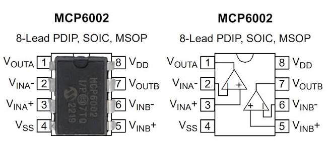
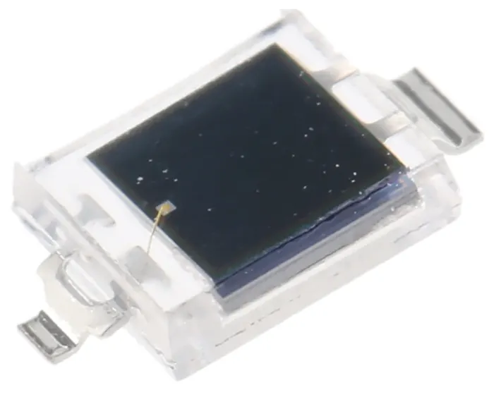
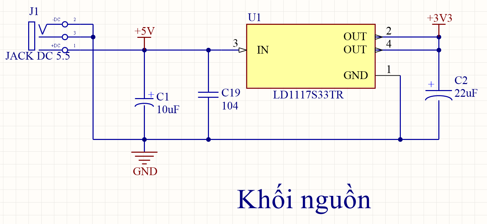
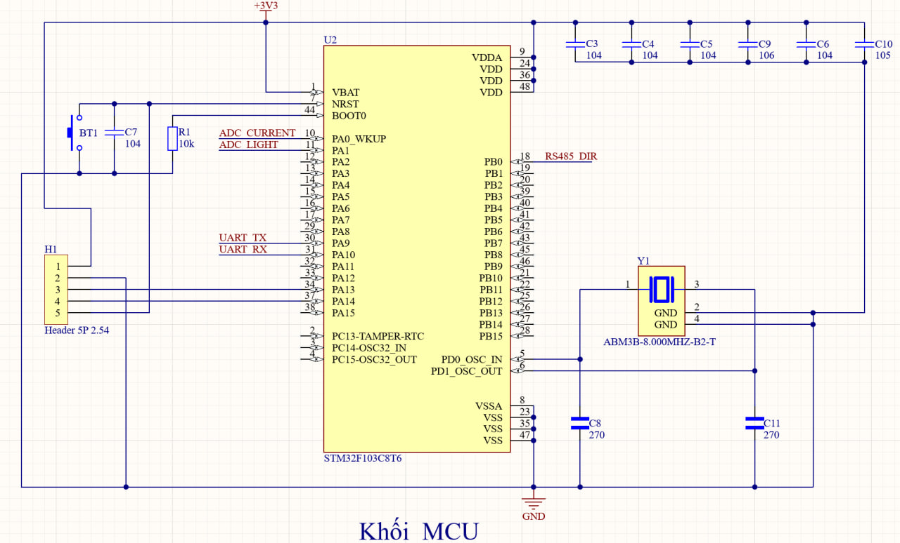
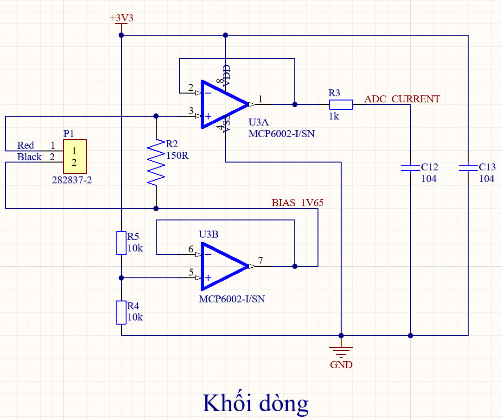
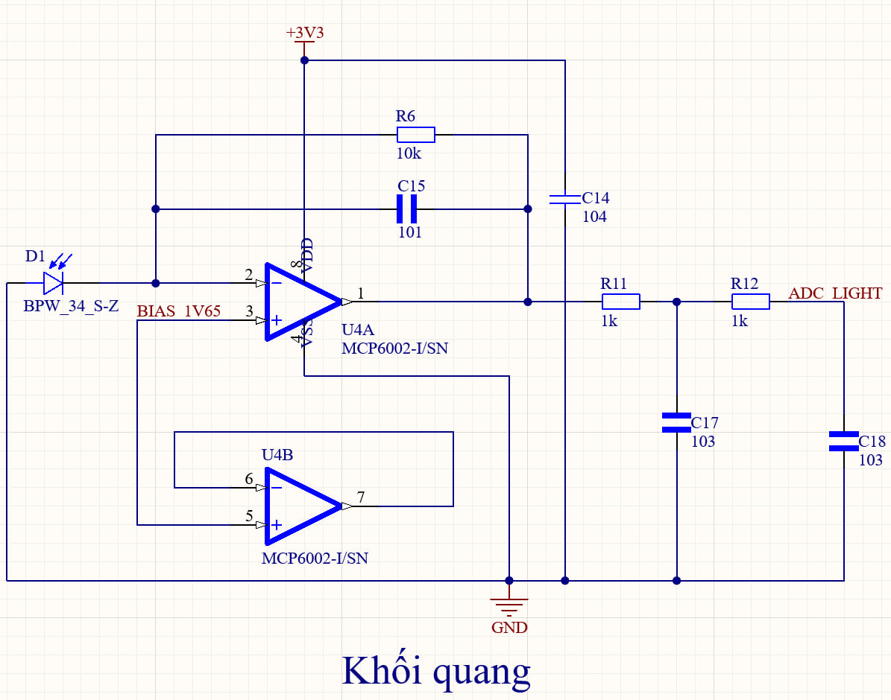
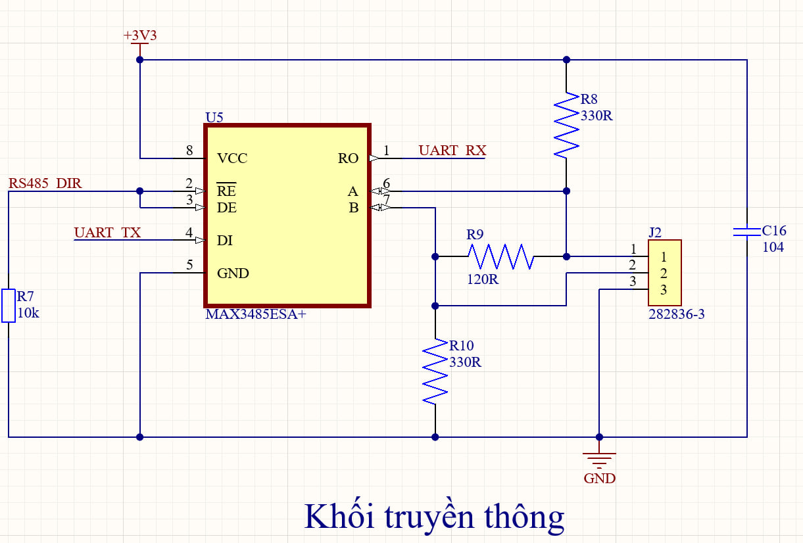
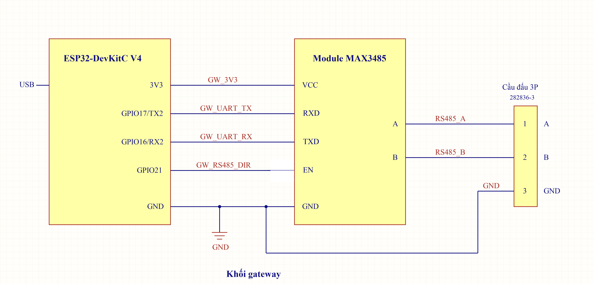

# 1. Bảng linh kiện PCB

## 1.1. Node

### 1.1.1. Khối nguồn

| Mã  | Linh kiện                | Package |  SL | Ghi chú                 |
| --- | ------------------------ | ------- | --: | ----------------------- |
| J1  | Jack DC cái 5,5 × 2,1 mm | THT     |   1 | Nhận nguồn 5 V từ adapter |
| U1  | LDO LD1117S33TR, 3,3 V   | SOT-223 |   1 | Hạ 5 V xuống 3,3 V [1]  |
| C1  | Tụ tantalum 10 µF, 16 V  | 3528    |   1 | Giảm biến động nguồn đầu vào U1; có phân cực |
| C19 | Tụ gốm 100 nF (104), X7R, 50 V | 0805 | 1 | Lọc nhiễu tần số cao tại đầu vào U1 |
| C2  | Tụ tantalum 22 µF, 16 V  | 6032    |   1 | Ổn định đầu ra 3,3 V của U1; có phân cực |

### 1.1.2. Khối MCU

| Mã      | Linh kiện                          | Package            |  SL | Ghi chú                                                      |
| ------- | ---------------------------------- | ------------------ | --: | ------------------------------------------------------------ |
| U2      | STM32F103C8T6                      | LQFP-48            |   1 | Đọc tín hiệu dòng, quang và trao đổi dữ liệu với gateway [2] |
| C3–C5   | Tụ gốm 100 nF (104), X7R, 50 V     | 0805               |   3 | Lọc từng chân VDD                                            |
| C9      | Tụ gốm 10 µF (106), X7R, 16 V      | 0805               |   1 | Dự trữ điện tích trên nguồn MCU                              |
| C6      | Tụ gốm 100 nF (104), X7R, 50 V     | 0805               |   1 | Giảm nhiễu nguồn analog VDDA                                 |
| C10     | Tụ gốm 1 µF (105), X7R, 50 V       | 0805               |   1 | Lọc nguồn analog VDDA cùng C6                                |
| Y1      | ABM3B-8.000MHZ-B2-T, 8 MHz         | 5,0 × 3,2 mm       |   1 | Tạo xung clock ngoài 8 MHz                                   |
| C8, C11 | Tụ gốm 27 pF (270), ±5%, C0G, 50 V | 0805               |   2 | Tụ tải thạch anh                                             |
| R1      | Điện trở 10 kΩ, 1%, 0,125 W        | 0805               |   1 | Kéo BOOT0 xuống GND                                          |
| C7      | Tụ gốm 100 nF (104), X7R, 50 V     | 0805               |   1 | Giảm nhiễu trên chân reset NRST                              |
| BT1     | Nút RESET 2 chân, 3 × 6 × 2,5 mm   | SMD 3 × 6 × 2,5 mm |   1 | Nút nhấn reset, thường hở                                    |
| H1      | Header SWD 1×5, 2,54 mm            | Header             |   1 | Kết nối ST-Link để nạp và gỡ lỗi chương trình                |

### 1.1.3. Khối dòng

| Mã | Linh kiện | Package | SL | Ghi chú |
|---|---|---|---:|---|
| P1 | Terminal TE 282837-2, 2 cực, 5,08 mm | THT | 1 | Đầu nối CT |
| U3 | MCP6002-I/SN | SOIC-8 | 1 | Đệm tín hiệu dòng và điện áp nền 1,65 V [3] |
| R2 | Điện trở 150 Ω, 1%, 0,125 W | 0805 | 1 | Chuyển dòng thứ cấp CT thành điện áp |
| R5, R4 | Điện trở 10 kΩ, 1%, 0,125 W | 0805 | 2 | Chia nguồn 3,3 V để tạo điện áp nền 1,65 V |
| C13 | Tụ gốm 100 nF (104), X7R, 50 V | 0805 | 1 | Giảm nhiễu nguồn U3 |
| R3 | Điện trở 1 kΩ, 1%, 0,125 W | 0805 | 1 | Cùng C12 lọc nhiễu trước ADC dòng |
| C12 | Tụ gốm 100 nF (104), X7R, 50 V | 0805 | 1 | Cùng R3 lọc nhiễu trước ADC dòng |

### 1.1.4. Khối quang

| Mã | Linh kiện | Package | SL | Ghi chú |
|---|---|---|---:|---|
| D1 | BPW 34 S-Z | SMD gullwing | 1 | Chuyển ánh sáng thành dòng điện |
| U4 | MCP6002-I/SN | SOIC-8 | 1 | Chuyển dòng quang thành điện áp; kênh B không nối tải ngoài [3] |
| R6 | Điện trở 10 kΩ, 1%, 0,125 W | 0805 | 1 | Đặt hệ số chuyển dòng quang thành điện áp |
| C15 | Tụ gốm 100 pF (101), ±5%, C0G, 50 V | 0805 | 1 | Mắc song song R6, hỗ trợ ổn định mạch TIA |
| C14 | Tụ gốm 100 nF (104), X7R, 50 V | 0805 | 1 | Giảm nhiễu nguồn U4 |
| R11, R12 | Điện trở 1 kΩ, 1%, 0,125 W | 0805 | 2 | Cùng C17/C18 tạo hai tầng lọc nhiễu trước ADC quang |
| C17, C18 | Tụ gốm 10 nF (103), ±10%, X7R, 50 V | 0805 | 2 | Cùng R11/R12 tạo hai tầng lọc quang lắp cố định |

### 1.1.5. Khối truyền thông

| Mã | Linh kiện | Package | SL | Ghi chú |
|---|---|---|---:|---|
| U5 | MAX3485ESA+ | SOIC-8 | 1 | UART–RS485, nguồn 3,3 V [4] |
| C16 | Tụ gốm 100 nF (104), X7R, 50 V | 0805 | 1 | Giảm nhiễu nguồn U5 |
| R7 | Điện trở 10 kΩ, 1%, 0,125 W | 0805 | 1 | Kéo chân điều khiển xuống GND để mặc định nhận |
| J2 | Terminal TE 282836-3, 3 cực, 5 mm | THT | 1 | Đầu nối A/B/GND |
| R9 | Điện trở 120 Ω, 1%, 0,25 W | 1206 | 1 | Điện trở kết thúc đường truyền RS485 |
| R8, R10 | Điện trở 330 Ω, 1%, 0,125 W | 0805 | 2 | Kéo A lên và B xuống để tạo mức chờ cho bus |

## 1.2. Gateway

- **ESP32-DevKitC V4, WROOM-32E:** giao tiếp với node, nhận nguồn và truyền dữ liệu qua USB laptop. [11]
- **Module MAX3485:** chuyển đổi UART–RS485, nguồn 3,3 V từ bo ESP32; GPIO21 điều khiển phát/nhận. [4]
- **Cầu đấu TE 282836-3, 3 cực, bước chân 5 mm: 1 cái**, kẹp cáp A/B/GND phía gateway.

## 1.3. Thiết bị ngoại vi và dụng cụ kiểm thử

### 1.3.1. Biến dòng CT

| Linh kiện | Số lượng | Vị trí sử dụng | Ghi chú |
|---|---|---|---|
| CT DL-CT08CL6-1000/1 | 1 | Dây tải đi qua lỗ CT; hai dây thứ cấp nối P1 | Đo dòng tải, tỷ số biến dòng 1000:1 |

### 1.3.2. Nguồn cấp ngoài, dây và đầu nối

| Linh kiện | Số lượng | Vị trí sử dụng | Ghi chú |
|---|---:|---|---|
| Adapter cách ly 5 VDC–2 A, phích 5,5 × 2,1 mm | 1 | Jack J1 của node | Cấp nguồn 5 V riêng cho node |
| Cáp USB Micro-B có dữ liệu | 1 | Giữa gateway và laptop | Cấp nguồn gateway và truyền dữ liệu |
| Cáp RS485 RBTF 2P22L2, 4 lõi, dài khoảng 1 m | 1 | Giữa J2 của node và gateway | Trở kháng đặc trưng 120 Ω; truyền A/B và nối GND tham chiếu |
| Bộ ST-Link V2 và dây SWD | 1 | Giữa laptop và đầu H1 của node | Nạp và gỡ lỗi chương trình; node nhận nguồn từ adapter |
| USB–RS485 CH340 | 1 | Giữa laptop và cổng RS485 của node | Gửi, nhận bản tin để kiểm tra giao tiếp RS485 |

### 1.3.3. Bộ tải thử CT

| Linh kiện | Số lượng | Vị trí sử dụng | Ghi chú |
|---|---|---|---|
| Nguồn cách ly 12 VAC–1,5 A | 1 | Hai đầu mạch tải điện trở | Tạo dòng AC để kiểm thử CT |
| Điện trở sứ 50 Ω–25 W | 3 | Các nhánh song song của mạch tải 12 VAC | Tạo ba mức dòng thử bằng 1, 2 hoặc 3 nhánh |
| Bộ dây silicone 20 AWG, cọc vít và đế chịu nhiệt | 1 | Mạch tải 12 VAC bên ngoài node | Nối dây tải, cố định đầu nối và đỡ điện trở nóng |

### 1.3.4. Nguồn sáng và dụng cụ đo

| Linh kiện                            | Số lượng | Vị trí sử dụng                                     | Ghi chú                                                 |
| ------------------------------------ | -------: | -------------------------------------------------- | ------------------------------------------------------- |
| Đồng hồ AC/DC                        |        1 | Đường nguồn node và mạch tải 12 VAC                | Đo điện áp nguồn và dòng tải 0,24–0,72 A                |
| Oscilloscope ≥2 kênh, kèm 2 probe    |        1 | Các điểm trước và sau bộ lọc dòng, quang           | So sánh dạng sóng, đo biên độ và thời gian đáp ứng      |
| Bộ đèn pin, tấm che và thước         |        1 | Trước cảm biến BPW 34 S-Z                          | Tạo ánh sáng liên tục, che sáng và đo khoảng cách chiếu |
| LED trắng 5 mm                       |        1 | Trước cảm biến BPW 34 S-Z                          | Tạo chớp sáng ngắn để kiểm thử khối quang               |
| Điện trở 330 Ω, ≥0,125 W             |        1 | Mắc nối tiếp LED thử                               | Hạn dòng qua LED                                        |
| ESP32 DevKit tạo xung LED            |        1 | GPIO nối LED thử qua điện trở 330 Ω                | Điều chỉnh thời gian LED sáng cỡ ms và chu kỳ nháy      |
| Củ sạc USB 5 V dự phòng, kèm cáp USB |        1 | Cổng USB của ESP32 tạo xung LED                    | Cấp nguồn riêng cho bộ tạo chớp sáng                    |
| Laptop, phần mềm nạp và Excel        |        1 | Kết nối ST-Link khi nạp và gateway khi thu dữ liệu | Nạp chương trình, xem và lưu dữ liệu bằng Excel         |

# 2. Thiết kế và nối dây từng phần

## 2.1. Nhận diện hai MCP6002 DIP-8

Mỗi MCP6002 có hai kênh khuếch đại A và B trong cùng một IC. [3]

Hình bên trái là IC thật; hình bên phải là sơ đồ hai kênh bên trong. Cả hai đều nhìn **từ mặt trên**, với rãnh định hướng ở cạnh trên. [3]

1. Đặt IC sao cho rãnh định hướng ở phía trên như hình.
2. Chân 1 ở góc trên bên trái; bên trái đếm xuống chân 4, bên phải đếm từ chân 5 lên chân 8. [3]
3. Đối chiếu số chân và tên tín hiệu trong bảng trước khi cắm dây.

| Từ linh kiện/chân | Đến linh kiện/chân | Giải thích ngắn |
|---|---|---|
| Chân 1 | OUT A | Đầu ra kênh A |
| Chân 2 | IN− A | Đầu vào đảo A |
| Chân 3 | IN+ A | Đầu vào không đảo A |
| Chân 4 | VSS | Nối GND khi cấp một nguồn 3,3 V |
| Chân 5 | IN+ B | Đầu vào không đảo B |
| Chân 6 | IN− B | Đầu vào đảo B |
| Chân 7 | OUT B | Đầu ra B |
| Chân 8 | VDD | Nối 3V3 |

**Kiểm tra trước khi làm tiếp**

- [ ] Đã nhận đúng dấu định hướng.
- [ ] Không lấy số chân nhìn từ mặt dưới.

## 2.2. Nhận diện anode và cathode của BPW34

BPW34 là photodiode: khi nhận ánh sáng, nó sinh ra dòng điện nhỏ. Hai chân là **anode (A)** và **cathode (K)**; cần xác định đúng trước khi nối vào mạch quang. [9], [22]

**Đo bằng chế độ diode của đồng hồ**

1. Tháo BPW34 khỏi mạch và che tối cảm biến để ánh sáng không ảnh hưởng phép đo.
2. Cắm que đen vào COM, que đỏ vào cổng V/Ω; chọn nấc có ký hiệu diode. Nếu dùng chung nấc với đo thông mạch, chọn đúng chế độ diode.
3. Chạm hai que vào hai chân, đọc số rồi đảo chiều hai que để đo lại.

- Nếu một chiều hiện khoảng **500–800 mV** (hoặc **0,500–0,800 V**), còn chiều ngược hiện **1 hoặc OL** báo quá thang, chiều có điện áp thuận cho biết: **que đỏ chạm A, que đen chạm K**. Giá trị thực tùy đồng hồ và linh kiện. [15]
- **Không cần có tiếng bíp.** Khi đo diode, đọc số trên màn hình để nhận biết chiều dẫn.

> [!NOTE] Nhận diện theo chấm trắng:
> Với linh kiện trong ảnh, dùng phép đo trên để kiểm chân phía có chấm trắng. Nếu que đỏ đặt ở chân phía chấm trắng và que đen ở chân còn lại cho điện áp thuận, thì **phía có chấm trắng là anode**. Không dùng riêng màu chấm để kết luận cho mọi BPW34; dấu nhận diện phụ thuộc nhà sản xuất và kiểu vỏ. Ví dụ, [datasheet BPW34 của Vishay](https://www.vishay.com/docs/81521/bpw34.pdf) có dấu nhận diện cathode trên bản vẽ vỏ. [22]

**Vai trò trong mạch TIA**

Khối quang dùng mạch **TIA (Transimpedance Amplifier — bộ khuếch đại chuyển dòng thành điện áp)**. Có thể hiểu TIA là “phiên dịch viên”: chuyển dòng điện nhỏ do BPW34 sinh ra thành mức điện áp để ADC của vi điều khiển đọc được. Trong mạch đang dùng, **A nối GND, K nối chân 2 (IN−) của MCP6002 quang**; cách hoạt động và mạng hồi tiếp được giải thích ở khối quang trong mục 2.4. [8], [9]

## 2.3. Nối dây bộ tải thử dòng

Bộ tải ngoài gồm **nguồn cách ly 12 VAC–1,5 A, điện trở sứ 50 Ω–25 W và dây dẫn**. Nó tạo dòng đi qua CT để thử khối dòng.

1. Tắt nguồn 12 VAC trước khi đấu dây. Đặt điện trở tải trên đế chịu nhiệt.
2. Nối **đầu ra thứ nhất của nguồn 12 VAC** vào một dây, luồn dây này **một lượt qua lỗ CT**, rồi nối đến một đầu điện trở 50 Ω–25 W.
3. Nối đầu còn lại của điện trở về **đầu ra thứ hai của nguồn 12 VAC**, tạo thành vòng kín. Dây về đi ngoài lỗ CT; không luồn cả dây đi và dây về cùng qua CT.
4. Nối **hai dây thứ cấp của CT** vào khối dòng node theo mục 2.4. Điện trở burden 150 Ω phải mắc kín vào thứ cấp CT trước khi bật tải; không tháo dây CT khi dòng sơ cấp đang chạy.

| Từ | Đến | Ghi chú |
|---|---|---|
| Đầu ra 1 của nguồn 12 VAC | Một đầu điện trở tải | Dây nối đi qua lỗ CT một lượt |
| Đầu còn lại của điện trở tải | Đầu ra 2 của nguồn 12 VAC | Dây về đi ngoài CT |
| Hai dây thứ cấp CT | Hai đầu burden 150 Ω của mạch dòng | Đây là đường tín hiệu về node |

Bài kiểm ở phần 3 tăng lần lượt từ **1 → 2 → 3 điện trở 50 Ω–25 W mắc song song**. Đặt dây xuyên CT **trước chỗ chia nhánh** để đo tổng dòng. **Đo tổng dòng tải bằng đồng hồ ở từng mức 1–2–3 tải để kiểm tra: dòng thực tăng thì biên độ tín hiệu CT tại PA0 cũng tăng.**

Không dẫn dòng tải qua breadboard hoặc đưa 12 VAC vào các chân nguồn/ADC của node.

> [!note] Cách đo dòng tải bằng đồng hồ vạn năng (nguồn cách ly 12 VAC)
>
> 1. Kiểm đồng hồ có chế độ **A~ (đo dòng xoay chiều)**; chỉ có V~ thì không đo trực tiếp dòng AC theo cách này được.
> 2. **Tắt nguồn tải.** Cắm que đen vào **COM**, que đỏ vào cổng **A/10A** theo hướng dẫn đồng hồ; chọn đo **A~**, thang đủ lớn hơn 0,72 A (thường bắt đầu ở thang 10 A). Không dùng cổng mA nếu giới hạn cổng thấp hơn dòng tải.
> 3. Tháo một đầu dây cấp chung khỏi đầu ra 1 của nguồn 12 VAC. Nối que đỏ vào đầu ra 1, que đen vào đầu dây vừa tháo; dùng kẹp giữ chắc. Đồng hồ lúc này nằm **nối tiếp**, toàn bộ dòng tải đi qua đồng hồ.
> 4. Đường nối: **đầu ra 1 nguồn → que đỏ → đồng hồ → que đen → dây qua CT → các tải song song → đầu ra 2 nguồn**. Không chạm hai que trực tiếp vào hai đầu nguồn khi đang chọn đo dòng, vì sẽ gây ngắn mạch.
> 5. Bật nguồn, đọc số ở đơn vị **A** và ghi vào bảng 3.3. Tuân thủ giới hạn thời gian đo ở cổng A/10A ghi trên đồng hồ; tắt nguồn trước mỗi lần thêm tải hoặc đổi thang/cổng que.
> 6. Đo xong, tắt nguồn, tháo đồng hồ và nối lại dây cấp tải. Chuyển que đỏ về cổng **V/Ω** để tránh nhầm khi đo điện áp lần sau.

## 2.4. Thiết kế sơ đồ nguyên lý node

**Nhãn tín hiệu**

| Nhãn (chân MCU) | Ý nghĩa | Giải thích tên nhãn bằng tiếng Anh | Chân U5 MAX3485 liên quan |
|---|---|---|---|
| **ADC_CURRENT (PA0)** | Đọc điện áp dòng sau lọc bằng ADC. | **ADC = Analog-to-Digital Converter:** bộ chuyển đổi tương tự sang số; **Current:** dòng điện. | —  [2] |
| **ADC_LIGHT (PA1)** | Đọc điện áp quang sau hai tầng lọc bằng ADC. | **ADC = Analog-to-Digital Converter:** bộ chuyển đổi tương tự sang số; **Light:** ánh sáng. | —  [2] |
| **UART_TX (PA9)** | Phát dữ liệu tới DI U5 MAX3485. | **UART = Universal Asynchronous Receiver/Transmitter:** bộ thu/phát nối tiếp không đồng bộ; **TX = Transmit:** phát dữ liệu. | **DI (Driver Input):** dữ liệu từ UART TX đưa vào U5.  [2], [7], [4] |
| **UART_RX (PA10)** | Nhận dữ liệu từ RO U5 MAX3485. | **UART = Universal Asynchronous Receiver/Transmitter:** bộ thu/phát nối tiếp không đồng bộ; **RX = Receive:** nhận dữ liệu. | **RO (Receiver Output):** dữ liệu từ U5 đưa về UART RX.  [2], [4] |
| **RS485_DIR (PB0)** | Điều khiển DE và /RE để chọn phát hoặc nhận. | **RS = Recommended Standard:** tên gọi tiêu chuẩn; **485:** số hiệu tiêu chuẩn giao tiếp điện; **DIR = Direction:** chiều truyền dữ liệu. | **DE (Driver Enable):** cho phép truyền dữ liệu khi **chân DE ở mức HIGH (logic 1)**. **/RE (Receiver Enable):** cho phép nhận dữ liệu khi **chân /RE ở mức LOW (logic 0)**.  [4] |
| **SWDIO (PA13), SWCLK (PA14)** | Dữ liệu và xung nhịp để nạp, gỡ lỗi bằng ST-Link. | **SWDIO = Serial Wire Debug Input/Output:** đường dữ liệu vào/ra của giao diện gỡ lỗi SWD; **SWCLK = Serial Wire Clock:** đường xung nhịp của giao diện này. | —  [2] |

### 2.4.1. Khối nguồn

#### 2.4.1.1. Jack cấp nguồn J1

Jack J1 nhận nguồn 5 V từ adapter để cấp cho bộ ổn áp U1, tạo nguồn 3,3 V cho node. Chân 1 nối +5V; chân 2 và chân 3 nối chung GND vì hai chân này đã được kiểm tra thực tế là thông nhau trên jack sử dụng.

#### 2.4.1.2. Bộ ổn áp U1

U1 LD1117S33TR là IC ổn áp tuyến tính sụt áp thấp (LDO — *Low Dropout*) của STMicroelectronics, có đầu ra cố định 3,3 V. Trong mạch node, U1 hạ nguồn 5 V xuống 3,3 V để cấp cho các khối chức năng. [1]

Bên trong IC, bộ khuếch đại sai lệch so sánh điện áp đầu ra lấy mẫu qua cầu chia điện trở với điện áp chuẩn, rồi điều khiển transistor công suất NPN mắc nối tiếp giữa đầu vào và đầu ra. [1], [27], [28]

- **Khi điện áp đầu ra giảm:** bộ khuếch đại tăng dòng điều khiển transistor, làm transistor dẫn mạnh hơn để đưa điện áp đầu ra tăng trở lại.
- **Khi điện áp đầu ra tăng:** bộ khuếch đại giảm dòng điều khiển, làm transistor giảm dẫn để đưa điện áp đầu ra giảm về mức đặt. [27], [28]

Quá trình điều chỉnh này giữ đầu ra gần 3,3 V khi nguồn hoặc tải thay đổi trong phạm vi làm việc. Cầu chia và mạch điều khiển đều tích hợp trong IC. [27], [28]

**Dropout** là mức điện áp mà đầu vào phải cao hơn đầu ra để IC giữ được điện áp ổn định. Với LD1117 bản 3,3 V, mức này điển hình là 1,1 V và tối đa 1,2 V tại dòng tải 800 mA trong điều kiện thử quy định. Trong mạch, nguồn vào 5 V cao hơn đầu ra 3,3 V một khoảng 1,7 V, lớn hơn mức dropout trên. Nếu nguồn vào giảm đến mức không còn đủ chênh lệch, điện áp đầu ra cũng giảm và không giữ được 3,3 V. [1] Vì vậy, nguồn 5 V cấp cho U1 phải duy trì ổn định, tránh sụt áp quá thấp làm mất khả năng ổn áp đầu ra.

IC cấp được dòng tải đến 800 mA khi điều kiện làm việc và tản nhiệt cho phép. Mạch giới hạn dòng và bảo vệ nhiệt bên trong giúp bảo vệ IC khi quá tải hoặc quá nóng. [1]

U1 hạ áp bằng phần tử dẫn tuyến tính nên phần chênh lệch điện áp giữa đầu vào và đầu ra chuyển thành nhiệt. Bỏ qua dòng tĩnh, công suất tỏa nhiệt được tính gần đúng:

$$
P_{U1}\approx(V_{\mathrm{in}}-V_{\mathrm{out}})I_{\mathrm{out}}.
$$

Với ví dụ tính tại dòng tải 0,2 A:

$$
P_{U1}\approx(5-3{,}3)\times0{,}2=0{,}34\,\mathrm{W}.
$$

Dòng tải càng lớn, U1 càng tỏa nhiều nhiệt. Vùng đồng nối với tab OUT giúp phân tán nhiệt từ IC ra PCB. Nếu tản nhiệt kém, U1 có thể quá nóng và kích hoạt bảo vệ nhiệt, làm gián đoạn nguồn 3,3 V cấp cho node. [1] Vì vậy, khi bố trí PCB cần chú ý diện tích đồng tản nhiệt quanh U1 để hạn chế nhiệt tích tụ tại IC.

#### 2.4.1.3. Tụ lọc đầu vào C1 và C19

C1 có điện dung 10 µF, mắc giữa +5V và GND, gần đầu vào U1. Khi tải đột ngột cần thêm dòng, tụ cấp bù trong thời gian ngắn để giảm sụt áp đầu vào.

Các thông số của tụ lọc nguồn đầu vào có ý nghĩa như sau:

- **Điện dung 10 µF:** tham khảo khối nguồn trên bo **STEVAL-HILE1G4K1 của ST**, trang **6/8** của sơ đồ nguyên lý. Khối này dùng **U13 LD1117S33TR** hạ 5 V xuống 3,3 V và đặt **C137 10 µF** tại đầu vào để dự trữ điện tích trên đường 5 V. C1 của node chọn cùng giá trị cho chức năng này. [21]
- **Điện áp định mức:** là điện áp tối đa được phép đặt liên tục lên tụ trong điều kiện nhà sản xuất quy định. Với tụ tantalum rắn thông dụng, chọn điện áp định mức ít nhất gấp đôi điện áp làm việc. [20]

  Nguồn cấp là 5 V nên điện áp định mức của tụ phải ít nhất gấp đôi:

  $$
  \text{Điện áp định mức tối thiểu}=2\times5=10\,\mathrm{V}.
  $$

  Tụ 10 V vừa đáp ứng mức này. Chọn tụ 16 V để có thêm dự phòng; khi nối vào nguồn 5 V, tỷ lệ điện áp sử dụng là:

  $$
  \text{Tỷ lệ sử dụng}=\frac{5}{16}\times100\%=31{,}25\%.
  $$

  Như vậy, **tụ 16 V trên nguồn 5 V chỉ sử dụng 31,25% điện áp định mức**, thấp hơn mức một nửa nêu trên. [20] Chọn tụ tantalum 16 V để có dự phòng điện áp cho nguồn 5 V. [20]
- **Loại tụ tantalum:** chọn vì kết hợp điện dung ổn định theo điện áp DC, điện phân rắn và kích thước nhỏ. So với **tụ hóa nhôm điện phân lỏng**, việc dùng điện phân rắn giúp hạn chế suy giảm đặc tính do hao hụt dung dịch: điện dung giảm và điện trở bên trong tăng. [20], [24] So với **tụ gốm X5R/X7R**, điện dung ít suy giảm khi đặt điện áp DC. [23] **Tụ màng** có đặc tính ổn định nhưng thường lớn hơn ở mức 10 µF, kém thuận tiện cho bố trí gọn sát U1. [26]

  > [!note] Điện phân rắn và lỏng
  > **Tụ tantalum và tụ hóa nhôm đều là tụ hóa**, khác nhau ở kim loại làm cực dương: tantalum hoặc nhôm. Cấu tạo tại lớp tích điện có thể hình dung là: **kim loại cực dương | lớp oxit cách điện | chất điện phân dẫn điện**. Lớp oxit phủ trên kim loại cực dương; chất điện phân áp sát phía ngoài lớp oxit, tạo phần dẫn điện của cực âm và được nối ra chân âm qua lớp dẫn điện hoặc lá kim loại thu dòng. Vì vậy, chất điện phân nằm ở phía cực âm, không phải lớp cách điện nằm giữa hai cực. Lớp oxit ngăn hai phía dẫn điện tiếp xúc trực tiếp, giúp tụ tích điện mà không bị nối tắt. [20], [24]
  >
  > **Điện phân lỏng:** tụ hóa nhôm thông thường chứa dung dịch dẫn điện thấm trong giấy ngăn bên trong vỏ tụ. Theo thời gian, dung dịch có thể hao hụt, nhất là khi nóng, khiến điện dung giảm và điện trở bên trong tăng; khả năng lọc nguồn vì thế suy giảm. [24]
  >
  > **Điện phân rắn:** tụ tantalum rắn loại MnO₂ dùng lớp chất rắn dẫn điện thay cho dung dịch, nên không bị khô do mất dung dịch như loại trên. [20], [24]

- **Kích thước 3528:** tương ứng thân 3,5 × 2,8 mm, có lựa chọn tụ tantalum 10 µF–16 V đáp ứng C1, bố trí gọn sát U1. [19] Vỏ lớn hơn chiếm thêm diện tích PCB; vỏ nhỏ hơn chỉ phù hợp khi linh kiện vẫn đáp ứng điện dung, điện áp định mức và các thông số điện cần thiết.

Tụ C19 100 nF (104), vỏ 0805, mắc song song C1 và đặt sát chân IN của U1 để lọc nhiễu cao tần ở nguồn đầu vào.

#### 2.4.1.4. Tụ ổn định đầu ra C2

Tụ C2 22 µF–16 V mắc giữa +3V3 và GND, gần chân OUT của U1. Khi các khối của node đột ngột cần thêm dòng, C2 cấp bù điện tích trong thời gian U1 điều chỉnh, giúp hạn chế sụt áp trên đường 3,3 V. Tụ còn tham gia duy trì ổn định bộ ổn áp, hạn chế hiện tượng điện áp đầu ra tự dao động. [1], [28]

Các thông số của tụ đầu ra được chọn như sau:

- **Điện dung 22 µF:** LD1117 yêu cầu tụ đầu ra tối thiểu 10 µF để duy trì ổn định. C2 chọn 22 µF, cao hơn mức tối thiểu và dự trữ được nhiều điện tích hơn tại cùng điện áp. [1] Với cùng lượng điện tích cấp bù cho tải, mức giảm điện áp trên tụ được tính theo:

  $$
  \Delta V=\frac{\Delta Q}{C}.
  $$

  Trong đó, $\Delta Q$ là lượng điện tích tụ cấp ra, $C$ là điện dung và $\Delta V$ là mức giảm điện áp. Vì vậy, điện dung lớn hơn giúp điện áp giảm ít hơn khi tụ cấp cùng một lượng điện tích. 

- **Điện áp định mức 16 V:** C2 làm việc trên đường 3,3 V. Áp dụng hướng dẫn giảm tải điện áp 50% cho tụ tantalum rắn thông dụng, điện áp định mức tối thiểu được tính là: [20]

  $$
  V_{\mathrm{định\ mức,min}}=2\times3{,}3=6{,}6\,\mathrm{V}.
  $$

  Tụ 16 V đáp ứng mức này và có thêm dự phòng điện áp. Tỷ lệ điện áp sử dụng là:

  $$
  \frac{3{,}3}{16}\times100\%=20{,}625\%.
  $$

  Như vậy, C2 chỉ làm việc ở khoảng 20,6% điện áp định mức. 

- **Loại tụ tantalum:** chọn vì kết hợp điện dung ổn định theo điện áp DC, điện phân rắn và kích thước nhỏ. So với **tụ hóa nhôm điện phân lỏng**, việc dùng điện phân rắn giúp hạn chế suy giảm đặc tính do hao hụt dung dịch: điện dung giảm và điện trở bên trong tăng. [20], [24] So với **tụ gốm X5R/X7R**, điện dung ít suy giảm khi đặt điện áp DC, giúp duy trì khả năng dự trữ điện tích ở đầu ra U1. [23] **Tụ màng** có đặc tính ổn định nhưng thường lớn hơn ở mức 22 µF, kém thuận tiện cho bố trí gọn sát U1. [26]

- **Kích thước 6032:** thân khoảng 6,0 × 3,2 mm. C1 cấp bù ở phía 5 V để giữ nguồn vào U1; U1 tiếp tục điều chỉnh nguồn này thành 3,3 V khi còn đủ chênh lệch vào–ra. C2 cấp bù trực tiếp cho các khối dùng nguồn 3,3 V trong lúc U1 chưa tăng kịp dòng cấp khi tải tăng. Vì vậy, sụt áp tại C2 ảnh hưởng trực tiếp đến điện áp cấp cho các khối của node. [1], [28] C2 chọn vỏ 6032 để ưu tiên giảm sụt áp khi cấp bù và có thêm khả năng chịu dòng nạp–xả, chấp nhận chiếm thêm diện tích so với vỏ 3528. Căn cứ so sánh là hai bản tụ 22 µF–16 V dòng AVX TAJ: [19]

  - **ESR là điện trở tổn hao bên trong tụ.** Khi C2 cấp bù dòng, điện trở này gây thêm sụt áp trên đường 3,3 V; ESR thấp giúp giảm phần sụt áp đó. Bản 6032 có ESR tối đa 1 Ω, thấp hơn mức 2,3 Ω của bản 3528 tại 100 kHz. [19]
  - **Dòng gợn là thành phần dòng điện biến thiên qua tụ khi nạp và xả.** C2 xả điện tích để cấp bù khi tải tăng và được nạp lại khi U1 đáp ứng. Khả năng chịu dòng gợn cao hơn tạo thêm dự phòng về phát nóng trong quá trình này. Bản 6032 cho phép 332 mA, so với 192 mA của bản 3528 tại 100 kHz, 25°C. [19]

### 2.4.2. Khối MCU

#### 2.4.2.1. Vi điều khiển U2

U2 STM32F103C8T6, vỏ LQFP-48, là bộ xử lý của node. U2 đọc tín hiệu dòng và quang qua hai kênh ADC, xử lý dữ liệu, rồi trao đổi với khối RS485 qua UART và chân điều khiển chiều truyền. [2]

Các đặc tính của U2 phù hợp với yêu cầu phần cứng của node:

- **ADC 12 bit:** chuyển điện áp từ khối dòng và khối quang thành số từ 0 đến 4095. Với điện áp tham chiếu 3,3 V, một bước lượng tử lý tưởng khoảng $3{,}3/4096\approx0{,}806\,\mathrm{mV}$. [2]
- **USART tích hợp:** thực hiện thu/phát dữ liệu nối tiếp bằng phần cứng. U2 xử lý dữ liệu số, còn MAX3485 chuyển mức tín hiệu sang đường truyền RS485. [2], [4]
- **Nguồn 2,0–3,6 V:** cho phép U2 làm việc với nguồn 3,3 V của node, cùng mức nguồn với MCP6002 và MAX3485. [2], [3], [4]
- **Lõi Cortex-M3 32 bit:** Cortex-M3 là lõi xử lý do Arm thiết kế, thực hiện lệnh chương trình bên trong U2. “32 bit” nghĩa là các thanh ghi làm việc chính và phép toán số nguyên cơ bản xử lý dữ liệu rộng 32 bit, tương đương 4 byte. Lõi này thực hiện tính toán từ mẫu ADC và điều khiển trao đổi dữ liệu của node. [2]
- **Flash 64 KB:** bộ nhớ chương trình bên trong U2, giữ nội dung khi mất điện. Flash lưu chương trình điều khiển node và các hằng số; khi chạy, lõi xử lý đọc lệnh từ bộ nhớ này để thực hiện. [2]
- **SRAM 20 KB:** bộ nhớ làm việc tạm thời bên trong U2, mất nội dung khi mất điện. SRAM chứa các biến, mẫu ADC và bộ đệm dữ liệu truyền/nhận trong lúc chương trình hoạt động. KB biểu thị dung lượng bộ nhớ; trong các thông số này, 1 KB bằng 1024 byte. [2]

#### 2.4.2.2. Mạch reset BT1 và C7

- **BT1 thường hở, nhấn nhả:** khi không nhấn, điện trở kéo lên bên trong U2 giữ NRST ở mức cao để MCU chạy bình thường. Nhấn BT1 đưa NRST xuống thấp để reset; thả nút, MCU được phép chạy lại. Kiểu nhấn nhả giúp thực hiện reset bằng tay mà không giữ MCU liên tục trong trạng thái reset. [2]

- **C7 100 nF:** chọn đúng giá trị 0,1 µF trong mạch bảo vệ NRST do ST khuyến nghị. [2, Hình 31] Tụ giúp điện áp NRST ít bị thay đổi đột ngột bởi nhiễu, hạn chế reset ngoài ý muốn. [2] Khi thả BT1, điện trở kéo lên nội nạp lại C7 để NRST tăng về mức cao. Điện trở kéo lên NRST có giá trị điển hình 40 kΩ, tối thiểu 30 kΩ và tối đa 50 kΩ. [2, Bảng 39, mục 5.3.14] Tính hằng số thời gian nạp:

  $$
  \tau=R_{\mathrm{PU}}C_7=40\,\mathrm{k\Omega}\times100\,\mathrm{nF}=4\,\mathrm{ms}.
  $$

  Với cùng điện trở 40 kΩ, tụ 10 nF cho hằng số thời gian 0,4 ms, tụ 100 nF cho 4 ms và tụ 1 µF cho 40 ms. So với 10 nF, tụ 100 nF làm điện áp NRST biến động ít hơn 10 lần khi chịu cùng một lượng điện tích nhiễu, theo $\Delta V=\Delta Q/C$. So với 1 µF, tụ 100 nF nạp trở lại cùng một mức điện áp nhanh hơn 10 lần sau khi thả nút. Vì vậy, chọn 100 nF theo khuyến nghị ST để kết hợp khả năng hạn chế nhiễu với thời gian nhả reset ở mức vài mili giây. [2, Hình 31]

> [!note] Chân reset NRST và điện trở kéo lên
> **NRST:** chân reset của U2; mức thấp giữ MCU trong trạng thái reset, trở lại mức cao thì MCU được phép chạy lại. [2]
>
> **Điện trở kéo lên:** điện trở nối chân tín hiệu với nguồn dương để giữ mức cao khi không bị kéo xuống thấp. U2 có sẵn điện trở này bên trong để giữ NRST ở mức cao khi không nhấn BT1. [2]

#### 2.4.2.3. Nhóm tụ nguồn C3–C6, C9 và C10

U2 lấy dòng thay đổi nhanh khi các mạch bên trong chuyển trạng thái. Đường mạch từ bộ nguồn đến MCU có điện trở và điện cảm nên điện áp tại chân IC có thể sụt trong thời gian ngắn. Nhóm tụ này dự trữ điện tích ngay gần U2 để cấp bù, gồm ba phần:

- **C3, C4, C5 — mỗi tụ 100 nF:** U2 vỏ LQFP-48 có ba chân VDD nên dùng ba tụ, mỗi tụ phục vụ một vị trí cấp nguồn. [2] ST khuyến nghị một tụ gốm 100 nF cho mỗi chân VDD và đặt gần chân nguồn để đường cấp dòng tức thời ngắn. [29, mục 2.2 và 5.4] Vì vậy, số lượng ba tụ được xác định theo ba chân nguồn, thay vì gộp thành một tụ ở xa các chân còn lại.

- **C9 — 10 µF:** dự trữ điện tích chung gần MCU, bổ trợ cho ba tụ C3, C4, C5. Ba tụ 100 nF cấp bù cho biến động nhanh tại từng chân VDD; C9 cấp bù khi nhu cầu dòng kéo dài hơn, giúp hạn chế sụt áp nguồn MCU. Chọn 10 µF theo giá trị điển hình ST khuyến nghị cho tụ dự trữ nguồn số. [29, mục 2.2]

- **C6 — 100 nF và C10 — 1 µF:** dùng cặp tụ 100 nF + 1 µF để ổn định nguồn analog VDDA theo khuyến nghị ST. C6 cấp bù cho biến động nhanh; C10 dự trữ điện tích để cấp bù lâu hơn. [29, mục 2.2] VDDA đồng thời là điện áp tham chiếu ADC trên U2 vỏ LQFP-48, nên ổn định nguồn này giúp hạn chế sai lệch kết quả chuyển đổi. [2]

> [!note] Phân biệt nguồn số VDD và nguồn analog VDDA
> U2 vỏ LQFP-48 có **ba chân VDD và một chân VDDA**. Cả hai nhóm đều cấp nguồn cho các phần bên trong U2:
>
> - **VDD nuôi phần số:** phần xử lý, bộ nhớ thông qua bộ ổn áp nội, cùng mạch giao tiếp của các chân vào/ra. Ba chân VDD phân bố ở các vị trí khác nhau trên IC, mỗi chân có một tụ 100 nF gần nó. [2], [29]
> - **VDDA nuôi phần analog:** ADC, mạch reset và một số mạch tạo xung nhịp. Trên U2, VDDA còn làm điện áp tham chiếu ADC nên dùng riêng cặp tụ C6/C10 để hạn chế biến động nguồn tại phần đo. [2], [29]
>
> Trong node, cả VDD và VDDA đều dùng nguồn 3,3 V; các nhóm tụ được bố trí riêng để hỗ trợ từng phần của MCU.

#### 2.4.2.4. Thạch anh Y1 và tụ tải C8, C11

**Thạch anh Y1:** chọn **ABM3B-8.000MHZ-B2-T, 8 MHz** để tạo xung nhịp cho vi điều khiển STM32F103C8T6. Xung nhịp là tín hiệu lặp lại đều đặn, làm mốc thời gian cho vi điều khiển thực hiện lệnh, lấy mẫu tín hiệu và truyền dữ liệu nối tiếp qua UART. Y1 cùng hai tụ C8, C11 và mạch dao động bên trong STM32 tạo nguồn xung **HSE (High-Speed External — xung nhịp tốc độ cao dùng linh kiện bên ngoài)**. Các lý do chọn thạch anh ABM3B-8.000MHZ-B2-T:

- **Tần số 8 MHz:** tương ứng 8 triệu chu kỳ dao động mỗi giây, nằm trong dải 4–16 MHz mà mạch dao động ngoài của STM32F103C8T6 hỗ trợ. Bên trong STM32 có **PLL (Phase-Locked Loop — vòng khóa pha)**, dùng để nhân tần số xung nhịp đầu vào. Vòng khóa pha là mạch liên tục so sánh và điều chỉnh nhịp dao động tạo ra để giữ đồng bộ với nhịp tham chiếu đầu vào. Chương trình có thể chọn xung từ Y1 làm đầu vào PLL, đặt hệ số nhân bằng 9, rồi dùng đầu ra PLL làm xung nhịp hệ thống:

  $$
  f_{\mathrm{hệ\ thống}}=8\,\mathrm{MHz}\times9=72\,\mathrm{MHz}.
  $$

  Chọn thạch anh 8 MHz vì tần số này phù hợp với mạch dao động của STM32F103C8T6 và cho phép PLL nhân 9 tạo xung hệ thống 72 MHz. Cấu hình này khai thác tốc độ xử lý tối đa của vi điều khiển để thực hiện tính toán từ mẫu ADC và xử lý dữ liệu truyền nhận của node. [2]
- **Dung sai ban đầu ±20 ppm tại 25°C:** dung sai tần số là mức chênh lệch cho phép giữa tần số thực của thạch anh và tần số danh định ghi trên linh kiện. Với Y1, tần số danh định là **8 MHz**, tức **8.000.000 chu kỳ mỗi giây**. Ký hiệu `2` trong mã ABM3B-8.000MHZ-B2-T quy định dung sai ban đầu ±20 ppm tại 25°C, với tải danh định 18 pF. [6]  **ppm là phần triệu:** 20 ppm nghĩa là sai lệch 20 phần trên một triệu phần, tương đương 0,002%. Dấu **±** cho biết tần số thực có thể cao hơn hoặc thấp hơn tần số danh định. Mức sai lệch tương ứng ở 8 MHz là:

  $$
  \Delta f_{\max}=8.000.000\times\frac{20}{1.000.000}=160\,\mathrm{Hz}.
  $$

  Vì 1 Hz tương ứng một chu kỳ mỗi giây, kết quả 160 Hz nghĩa là tần số thực được phép lệch tối đa 160 chu kỳ mỗi giây về mỗi phía so với 8.000.000 Hz. Khoảng tần số cho phép trong điều kiện trên là:

  $$
  8.000.000-160\leq f\leq8.000.000+160,
  $$

  tức **7.999.840–8.000.160 Hz**. Dung sai nhỏ giúp nhịp thực bám sát nhịp thiết kế, nhờ đó thời điểm lấy mẫu và tốc độ truyền UART bám sát giá trị chương trình đặt. Đây là lý do chọn phiên bản có dung sai ban đầu ±20 ppm. [6]
- **Vỏ SMD 5,0 × 3,2 mm:** phù hợp kích thước đã chọn trong BOM, thuận tiện bố trí gần chân dao động MCU để giảm chiều dài đường mạch. [6], [29, mục 3.1.2]

**Tụ tải C8, C11:** mỗi tụ nối từ một đầu Y1 xuống GND, cùng thạch anh và mạch khuếch đại trong STM32 tạo dao động. Hai tụ tạo điện dung tác động lên thạch anh để đặt tần số dao động. [29], [30]

Để tính C8, C11, trước hết cần biết **điện dung tải mà thạch anh yêu cầu**, vì tần số dao động phụ thuộc điện dung của mạch nối vào hai đầu nó. Nhà sản xuất quy định thông số **điện dung tải $C_L$** để người thiết kế tái tạo điều kiện thạch anh đạt tần số danh định. Với **ABM3B-8.000MHZ-B2-T**, giá trị này là **18 pF**, ứng với tần số **8 MHz**. Trên PCB, tổng tải 18 pF được tạo bởi C8, C11 quy đổi như hai tụ nối tiếp và điện dung ký sinh của chân STM32, pad, đường mạch: [6], [30, mục 3.3]

$$
C_L\approx\frac{C_8C_{11}}{C_8+C_{11}}+C_{\mathrm{ký\ sinh}}.
$$

**Mục tiêu ký sinh khi thiết kế PCB:** chọn ban đầu **C8 = C11 = 27 pF** theo BOM. Hai tụ tạo phần tải tương đương $27/2=13{,}5\,\mathrm{pF}$. Để tổng tải đạt 18 pF, phần ký sinh tương đương mục tiêu là:

$$
C_{\mathrm{ký\ sinh,mục\ tiêu}}=18-\frac{27}{2}=4{,}5\,\mathrm{pF}.
$$

**4,5 pF là mục tiêu thiết kế cho tổng ký sinh của chân MCU và PCB.** Bố trí Y1 và hai tụ sát chân dao động STM32, dùng đường nối ngắn để hạn chế ký sinh. Giá trị ký sinh ước lượng từ layout là cơ sở đánh giá cặp 27 pF; nếu khác mục tiêu, tính lại mỗi tụ theo $C_8=C_{11}\approx2(18\,\mathrm{pF}-C_{\mathrm{ký\ sinh}})$. Giá trị cuối cùng được chốt qua kiểm chứng tần số và khả năng khởi động dao động trên bo. [2, mục 5.3.6], [30, mục 4.2]

#### 2.4.2.5. Điện trở chọn chế độ khởi động R1

**BOOT0 là chân chọn nơi STM32 bắt đầu chạy chương trình sau reset.** R1 nối chân này xuống GND để chọn chương trình trong Flash. Dùng **10 kΩ theo mạch ví dụ của ST**, với hai tác dụng sau: [29, mục 4.2, Hình 10]

1. **Giữ BOOT0 gần 0 V khi có nhiễu.** Giả sử có dòng nhỏ ngoài ý muốn đi vào chân, lấy 1 µA để minh họa. Dòng này chạy qua R1 xuống GND, làm điện áp chân tăng lên:

   $$
   V=IR=1\,\mathrm{\mu A}\times10\,\mathrm{k\Omega}=0{,}01\,\mathrm{V}.
   $$

   Kết quả 0,01 V nghĩa là chân vẫn gần 0 V. Nếu dùng 100 kΩ, cùng dòng đó sẽ làm điện áp tăng lên 0,1 V. **10 kΩ giữ chân gần GND hơn 100 kΩ trong cùng điều kiện.**

2. **Hạn chế dòng khi đưa BOOT0 lên 3,3 V để chọn chế độ khởi động khác.** Khi đó, dòng qua R1 xuống GND là:

   $$
   I=\frac{V}{R}=\frac{3{,}3\,\mathrm{V}}{10\,\mathrm{k\Omega}}=0{,}33\,\mathrm{mA}.
   $$

   Nếu dùng 1 kΩ, dòng tăng thành 3,3 mA. **10 kΩ giảm dòng này 10 lần so với 1 kΩ.** Trên node hiện tại, BOOT0 được giữ ở mức 0 để chạy chương trình trong Flash.

#### 2.4.2.6. Đầu nạp và gỡ lỗi H1

H1 là header SWD 1×5, bước chân 2,54 mm, kết nối ST-Link để nạp và gỡ lỗi chương trình cho U2.

### 2.4.3. Khối dòng

#### 2.4.3.1. Biến dòng CT và điện trở gánh R2

Biến dòng (CT) loại DL-CT08CL6-1000/1 có tỷ số biến dòng là 1000:1. Khi có dòng điện chạy qua cuộn sơ cấp, cuộn thứ cấp sẽ sinh ra một dòng điện nhỏ hơn 1000 lần. Dòng thứ cấp này đi qua điện trở gánh R2 có giá trị 150 Ω, biến đổi thành một điện áp xoay chiều:

$$I_{\mathrm{s,rms}} = \frac{I_{\mathrm{p,rms}}}{1000}$$
$$V_{\mathrm{R2,rms}} = I_{\mathrm{s,rms}} \times 150\,\Omega$$

Ví dụ, nếu dòng thứ cấp là 1 mA, điện áp sinh ra giữa hai đầu R2 sẽ là 0,15 V RMS. Vì là điện xoay chiều, giá trị này sẽ liên tục đảo chiều âm dương.

#### 2.4.3.2. Cầu chia điện áp nền R4, R5

**ADC (Analog-to-Digital Converter — bộ chuyển đổi tương tự sang số)** bên trong vi điều khiển STM32 chuyển điện áp đầu vào thành giá trị số để chương trình xử lý. Trong mạch này, ADC đo điện áp từ 0 đến 3,3 V, không đo trực tiếp được điện áp âm. Trong khi đó, điện áp xoay chiều trên R2 có cả nửa chu kỳ dương và âm. Vì vậy, mạch dùng điện áp nền để tín hiệu thay đổi quanh 1,65 V thay vì quanh 0 V. Hai điện trở R4 và R5, cùng giá trị 10 kΩ, chia nguồn 3,3 V để tạo mức nền này: [2], [14]

**Xem thêm:** [Phụ lục — Điện áp BIAS](Dien_ap_BIAS.md).

$$V_M = 3{,}3 \times \frac{R4}{R5 + R4} = 3{,}3 \times \frac{10}{10 + 10} = 1{,}65\,\mathrm{V}$$

Mức 1,65 V nằm giữa dải đo của ADC, tạo khoảng điện áp bằng nhau ở hai phía của mức nền. Ví dụ, tín hiệu ban đầu từ −0,5 đến +0,5 V sẽ thành 1,15–2,15 V sau khi cộng mức nền. Nhờ đó, ADC đo được cả hai nửa chu kỳ, miễn là điện áp sau khi cộng nền vẫn nằm trong dải đo. [2], [14]

#### 2.4.3.3. Bộ đệm điện áp nền U3B

Cầu chia áp R4 và R5 có điện trở tương đương là $10\,\mathrm{k}\Omega \parallel 10\,\mathrm{k}\Omega = 5\,\mathrm{k}\Omega$. Nếu tải phía sau tiêu thụ một dòng điện rất nhỏ, ví dụ 10 µA, điện áp nền sẽ bị sụt giảm:

$$\Delta V = 10\,\mathrm{\mu A} \times 5\,\mathrm{k}\Omega = 0{,}05\,\mathrm{V}$$

> [!NOTE] Lý do dùng Op-Amp làm bộ đệm để ngăn tải làm sụt áp cầu chia
> Trong lý thuyết, **Op-Amp lý tưởng không có dòng điện đi vào hoặc đi ra từ hai chân đầu vào (I₊ = I₋ = 0)** ==do trở kháng đầu vào của nó có giá trị **vô cùng lớn**== [13]
> 
> Tuy nhiên, trong thực tế, Op-Amp **vẫn dẫn một lượng dòng điện cực kỳ nhỏ** (gọi là dòng phân cực đầu vào - _input bias current_), thường chỉ ở mức nano-ampere (nA) hoặc pico-ampere (pA), chứ không hoàn toàn bằng không tuyệt đối. [3]

Để khắc phục, điện áp 1,65 V từ cầu chia được đưa vào chân không đảo (chân số 5) của Op-amp U3B. Chân đầu ra (chân số 7) được nối hồi tiếp âm trực tiếp về chân đảo (chân số 6), tạo thành một bộ đệm có hệ số khuếch đại xấp xỉ 1: [3], [13]

$$\frac{V_{\mathrm{out}}}{V_+} = \frac{A}{1+A} \approx 1$$

U3B giữ cho mức nền BIAS_1V65 luôn cố định ở 1,65 V, cung cấp dòng điện cần thiết cho tải mà không làm sai lệch điện áp của cầu chia ban đầu.

> [!note] Giải thích hồi tiếp âm trong mạch đệm Op-Amp
> 
> Op-amp khuếch đại sự chênh lệch điện áp giữa hai đầu vào theo công thức: [13]
> 
> $$V_{\mathrm{out}} = A \times (V_+ - V_-)$$
> 
> Trong đó, $A$ là hệ số khuếch đại vòng hở (open-loop gain) do nhà sản xuất chế tạo, thường có giá trị cực kỳ lớn (khoảng $10^5$ đến $10^6$); $V_+$ và $V_-$ là điện áp tại chân không đảo và chân đảo.
> 
> Ở U3B, đầu ra chân 7 nối trực tiếp về chân đảo 6 nên $V_- = V_{\mathrm{out}}$. Thay vào công thức trên và thu gọn:
> 
> 
> $$V_{\mathrm{out}} = A \times (V_+ - V_{\mathrm{out}})$$
> 
> $$\frac{V_{\mathrm{out}}}{V_+} = \frac{A}{1 + A} \approx 1$$
> 
> Vì $A$ rất lớn so với 1, điện áp đầu ra gần bằng điện áp đầu vào. Khi mạch hoạt động tuyến tính và ổn định, chân 5 (+) nhận khoảng 1,65 V thì đầu ra chân 7 cũng bám theo mức này. Cách mắc đó gọi là bộ đệm điện áp (voltage follower). [3], [13]
>
> **Xem thêm:** [Phụ lục — Hồi tiếp âm trong op-amp](Hoi_tiep_am_trong_op_amp.md).

#### 2.4.3.4. Mạch ghép tín hiệu R2 và BIAS_1V65

Đầu dưới của điện trở R2 được nối trực tiếp với đường BIAS_1V65. Điều này có nghĩa là điểm tham chiếu của tín hiệu đo đã được nâng lên 1,65 V so với GND. Gọi $v_{\mathrm{R2}}(t)$ là điện áp tức thời sinh ra giữa hai đầu R2, điện áp tại đầu trên của R2 sẽ là:

$$V_{\text{đầu trên R2}} \approx 1{,}65\,\mathrm{V} + v_{\mathrm{R2}}(t)$$

Nếu điện áp tức thời trên R2 là +0,10 V, đầu trên sẽ đạt 1,75 V. Nếu điện áp tức thời là -0,10 V, đầu trên sẽ giảm xuống 1,55 V. Toàn bộ tín hiệu đo luôn được đảm bảo ở mức dương.

#### 2.4.3.5. Bộ đệm tín hiệu dòng U3A

Điện áp tại đầu trên của R2 được đưa vào chân không đảo (chân số 3) của Op-amp U3A. Tương tự như U3B, U3A cũng được cấu hình làm bộ đệm tín hiệu:

$$V_{\mathrm{outA}} \approx V_{\text{đầu trên R2}} \approx 1{,}65\,\mathrm{V} + v_{\mathrm{R2}}(t)$$

Op-amp U3A làm bộ đệm giữa mạch biến dòng (CT và R2) với các khối phía sau, hạn chế dòng điện cấp cho bộ lọc và đầu vào ADC làm thay đổi điện áp đo trên R2. [3], [13]

#### 2.4.3.6. Bộ lọc trước ADC R3, C12

Tín hiệu đầu ra từ U3A đi qua mạch lọc thông thấp gồm điện trở R3 (1 kΩ) và tụ C12 (100 nF) để loại bỏ các nhiễu tần số cao. Tần số cắt của bộ lọc này là: [16]

$$f_c = \frac{1}{2\pi \times R3 \times C12} \approx 1{,}59\,\mathrm{kHz}$$

==Thành phần tín hiệu 50/60 Hz== gần như giữ nguyên biên độ sau lọc. Các thành phần nhiễu trên 1,59 kHz bị suy giảm trước khi tín hiệu vào PA0 (ADC_CURRENT); tần số càng cao, mức suy giảm càng lớn.

#### 2.4.3.7. Tụ lọc nguồn C13

Tụ C13 (100 nF) mắc giữa chân nguồn 3V3 và GND của MCP6002 để giảm nhiễu trên đường cấp nguồn. [16], [18]
> [!note] Lý do chọn tụ 100 nF để lọc nhiễu nguồn
> **Tụ 104 (Ký hiệu 104 = 100 nF) - Lọc nhiễu nguồn (Decoupling Capacitor)**
> **100 nF là giá trị nằm trong dải khuyến nghị của Microchip cho MCP6002.** Datasheet **MCP6001/1R/1U/2/4, DS20001733L**, mục **4.4 “Supply Bypass”**, khuyến nghị tụ lọc nguồn cục bộ **0,01–0,1 µF (10–100 nF)**, đặt cách chân nguồn không quá **2 mm** [3].
>
> Với tụ lý tưởng, độ lớn dung kháng là:
>
> $$
> |Z_C|=\frac{1}{2\pi fC}
> $$
>
> Ở 1 MHz, tụ 100 nF có dung kháng khoảng **1,59 Ω**, tạo đường có trở kháng thấp cho dòng nhiễu cao tần về GND, giúp giảm nhiễu tại chân nguồn. Trong khối dòng, tụ này là **C13**; hiệu quả thực tế còn phụ thuộc đặc tính tụ và cách đi dây.

### 2.4.4. Khối quang

#### 2.4.4.1. Photodiode D1 BPW34

BPW34 chuyển ánh sáng thành một dòng điện nhỏ gọi là **dòng quang**. Trong cùng điều kiện phổ ánh sáng, ánh sáng càng mạnh thì dòng quang thường càng lớn. [9], [22]

Trong mạch, anode của D1 nối GND, cathode nối chân đảo 2 (−) của U4A. Chân không đảo 3 (+) nhận điện áp BIAS khoảng 1,65 V. Khi hồi tiếp âm hoạt động ổn định, U4A giữ chân 2 gần bằng 1,65 V. Như vậy, cathode cao hơn anode khoảng 1,65 V, tạo phân cực ngược cho photodiode. [9]

Dòng quang có chiều quy ước từ cathode qua D1 xuống anode rồi về GND. Có thể hiểu rằng khi nhận ánh sáng, D1 lấy một dòng điện nhỏ từ điểm nối tại chân 2 xuống GND. [9]

> [!NOTE] Bản chất dòng quang và điều kiện phân cực của BPW34
>
> - **Chiều dòng quang:** Ánh sáng được hấp thụ trong linh kiện tạo ra các cặp electron–lỗ trống. Điện trường tại vùng tiếp giáp giúp phân tách các hạt mang điện, tạo thành dòng quang $I_{\mathrm{ph}}$ có ==chiều quy ước từ cathode (K) sang anode (A)==. Khi ánh sáng thay đổi, độ lớn của thành phần dòng quang thay đổi; **chiều của thành phần này không tự đảo ngượ**c.  [9]
>
> - **Điều kiện phân cực khi đo dòng quang:** Mạch đo thường giữ photodiode ở trạng thái không phân cực ($V_K = V_A$) hoặc phân cực ngược ($V_K > V_A$). Nếu đặt điện áp phân cực thuận từ bên ngoài, nó sẽ dẫn điện như một diode thông thường, dòng dẫn thuận tăng nhanh và có thể lấn át dòng quang (vốn chỉ ở mức microampe), làm sai lệch phép đo.  [9]
>
> - **Dòng điện trong mạch đang dùng:** Khi U4A hoạt động tuyến tính và hồi tiếp ổn định, $V_K \approx 1{,}65\,\mathrm{V}$ tại chân 2, còn $V_A = 0\,\mathrm{V}$ tại GND. D1 vì vậy được phân cực ngược với $V_K = 1{,}65\,\mathrm{V}$ (tại chân 2) và $V_A = 0\,\mathrm{V}$ (tại GND). Khi nhận ánh sáng, dòng quang đi từ nút chân 2 qua D1 xuống GND. Đầu ra U4A cấp dòng bù qua mạng hồi tiếp để giữ điện áp tại nút này gần mức BIAS; ở trạng thái ổn định, dòng bù chủ yếu đi qua R6. [9]

#### 2.4.4.2. Mạch TIA U4A và mạng hồi tiếp R6, C15

U4A cùng **R6 = 10 kΩ và C15 = 100 pF mắc song song** tạo thành **mạch TIA (Transimpedance Amplifier — bộ khuếch đại chuyển dòng thành điện áp)**. R6 và C15 nối từ đầu ra chân 1 về chân đảo 2, vừa chuyển dòng quang thành điện áp, vừa tạo đặc tính lọc thông thấp và hỗ trợ ổn định hồi tiếp. [8], [9]

==Đầu vào op-amp gần như không lấy dòng==. Với DC và tín hiệu tần số thấp, khi D1 dẫn dòng quang xuống GND, đầu ra U4A cấp dòng bù chủ yếu qua R6 để giữ chân 2 gần mức 1,65 V. Dòng qua R6 tạo ra chênh lệch điện áp giữa đầu ra và chân 2: **dòng quang càng lớn thì điện áp đầu ra càng cao.** [3], [9]

Ở trạng thái ổn định, khi mạch chưa bão hòa, **điện áp đầu ra tại chân 1 của U4A**, ký hiệu là $V_{\mathrm{out}}$, được tính gần đúng: [9]

$$
V_{\mathrm{out}} \approx V_{\mathrm{BIAS}} + I_{\mathrm{ph}}R6
$$

Trong đó, $V_{\mathrm{BIAS}} \approx 1{,}65\,\mathrm{V}$, $I_{\mathrm{ph}}$ là dòng quang và $R6 = 10\,\mathrm{k}\Omega$.

Ví dụ, dòng quang tăng thêm 10 µA thì điện áp tại chân 1 tăng khoảng:

$$
\Delta V_{\mathrm{out}}
\approx 10\,\mathrm{\mu A}\times10\,\mathrm{k}\Omega
=0{,}10\,\mathrm{V}
$$

Nếu ban đầu đầu ra là 1,65 V thì sau đó sẽ tăng lên khoảng 1,75 V. ADC có thể đọc sự thay đổi điện áp này để nhận biết thay đổi ánh sáng. Khi ánh sáng quá mạnh, đầu ra có thể bão hòa và không còn tăng theo công thức trên.

Khi tần số tăng, phần dòng hồi tiếp qua C15 tăng, làm biên độ điện áp đầu ra giảm. **R6–C15 tạo đặc tính lọc thông thấp cho TIA**, với mốc RC trong mô hình lý tưởng khoảng **159 kHz**, tương ứng hằng số thời gian **1 µs**. [9], [22]

> [!NOTE]
> **Điện dung của BPW34:** Cảm biến có cấu trúc bán dẫn PIN, gồm vùng P và N ở hai phía, giữa là lớp I gần như không pha tạp. Vùng nghèo ít hạt mang điện tự do ngăn cách hai phía có thể tích điện, nên cấu trúc này có điện dung tương tự tụ điện. Đây là **điện dung tiếp giáp bên trong cảm biến**[9]. Điện dung điển hình là **70 pF khi không phân cực** và **25 pF khi phân cực ngược 3 V**, ở tần số thử 1 MHz; datasheet không nêu giá trị cụ thể tại 1,65 V [22].

Điện dung của BPW34 kết hợp với điện dung đầu vào op-amp và dây nối ảnh hưởng đến hồi tiếp của U4A. Vai trò của R6–C15 được giải thích như sau:

- **Điện dung đầu vào:** $C_{\mathrm{in}}$ là tổng điện dung của cảm biến, đầu vào op-amp và dây nối.

- **Mạng hồi tiếp:** Khi chưa có C15, R6 và $C_{\mathrm{in}}$ tạo mạng RC thông thấp từ đầu ra về chân đảo (−). Hệ số hồi tiếp là $\beta(s)=H_1(s)=1/(1+sR6\,C_{\mathrm{in}})$, tương ứng công thức (8), mục 2.2 của [phụ lục](Bo_loc_thong_thap.md), với $R=R6$, $C=C_{\mathrm{in}}$.

- **Tần số cắt và trễ pha:** $f_c=1/(2\pi R6\,C_{\mathrm{in}})$, theo công thức (1), mục 1.1. Mạng gây trễ pha theo công thức (4), mục 1.3. Đây là tần số cắt của R6–$C_{\mathrm{in}}$, khác mốc RC 159 kHz của R6–C15 đã nêu ở trên.

- **Ringing và tự dao động:** Trễ pha của mạng cộng với trễ bên trong op-amp có thể làm đầu ra nhấp nhô sau cạnh xung (ringing) khi dự trữ pha thấp. Nguyên nhân là tương tác trong vòng hồi tiếp; mạng RC riêng lẻ không tự gây ringing. Nếu tổng trễ pha khoảng 180° và độ lợi vòng còn từ 1 trở lên, mạch có thể tự dao động dù ánh sáng không đổi [8], [9].

- **Vai trò R6–C15:** R6 chuyển dòng quang thành điện áp. C15 mắc song song R6 để bù pha, giúp hạn chế dao động [8], [9].

- **Chọn C15 = 100 pF:** Với **R6 = 10 kΩ**, $\tau=R6\,C15=1\,\mathrm{\mu s}$. Dùng 10 nF sẽ tăng $\tau$ lên 100 µs, làm đầu ra chậm hơn và dễ giảm biên độ xung ngắn. Đồ án chọn 100 pF để hạn chế làm chậm tín hiệu; phép tính đáp ứng nằm trong phụ lục.

#### 2.4.4.3. Bộ lọc trước ADC R11, C17, R12, C18

Sau TIA, tín hiệu qua **hai tầng RC nối trực tiếp**: R11/C17 và R12/C18, mỗi tầng **1 kΩ/10 nF**, rồi tới **PA1 (ADC_LIGHT)**. Tần số cắt tính cho cả hai tầng khoảng **5,96 kHz**. Đây là bộ lọc giảm nhiễu trước ADC; C15 thuộc mạng hồi tiếp TIA, không thay thế hai tầng này [17], [18].

**Xem thêm:** [Bộ lọc thông thấp](Bo_loc_thong_thap.md)

> [!NOTE] Khác biệt giữa lọc quang và lọc dòng
>
> **Khối quang** cần nhận biết xung sáng ngắn nên dùng tụ **10 nF** ở mỗi tầng để hạn chế làm chậm tín hiệu; hai tầng giúp giảm nhiễu cao tần mạnh hơn một tầng cùng R, C. **Khối dòng** chủ yếu đo thành phần **50/60 Hz**, dùng **một tầng 1 kΩ/100 nF**, tần số cắt khoảng **1,59 kHz**, để giảm nhiễu và hạn chế suy giảm các sóng hài cần quan sát [8], [16], [17], [18].
>
> **Xem thêm:** [Bộ lọc thông thấp](Bo_loc_thong_thap.md).

#### 2.4.4.4. Mạch ổn định kênh op-amp U4B

U4B không dùng để đo nhưng vẫn được cấp nguồn, nên cần giữ ổn định để hạn chế nhiễu chéo sang U4A [3]. Chân 5 (+) nối **BIAS 1,65 V**, là điện áp nền để đầu ra bám theo. Chọn mức này vì **nằm giữa nguồn 0–3,3 V**, giúp đầu vào và đầu ra ở xa hai giới hạn nguồn, đồng thời **tận dụng BIAS có sẵn**. 

Chân 7 nối về chân 6 (−) tạo **hồi tiếp âm**: đầu ra cao hơn BIAS thì op-amp kéo xuống, thấp hơn thì đẩy lên, giữ đầu ra gần 1,65 V. BIAS đặt mức cần giữ; hồi tiếp giúp đầu ra bám mức đó. [13], [14]

Chân 7 không nối tải ngoài hoặc nối chung với đầu ra bộ đệm BIAS của khối dòng, tránh hai đầu ra đẩy dòng qua nhau.

#### 2.4.4.5. Tụ lọc nguồn C14

Tụ C14 có giá trị 100 nF, mắc giữa chân VDD (+3V3) và VSS (GND), đặt sát chân nguồn của MCP6002. [3]

Tụ cung cấp dòng tức thời khi IC cần và giúp giảm nhiễu cao tần trên đường nguồn. Nhờ đó, điện áp cấp tại IC ít biến động hơn, hỗ trợ mạch khuếch đại hoạt động ổn định. [3]

### 2.4.5. Khối truyền thông

#### 2.4.5.1. Bộ thu phát RS485 U5

**RS485** là chuẩn truyền tín hiệu điện dùng cặp dây A/B để mang dữ liệu dưới dạng tín hiệu vi sai. [5]

> [!note] Tín hiệu vi sai
> Dữ liệu được biểu diễn bằng **chênh lệch điện áp giữa A và B**. Bộ thu xét dây nào cao hơn và chênh lệch bao nhiêu để xác định bit 0 hoặc 1, thay vì chỉ xét điện áp từng dây so với GND.
>
> Ví dụ, A = 2 V và B = 1 V cho chênh lệch +1 V. Nếu nhiễu làm cả hai cùng tăng 0,5 V, chênh lệch vẫn là +1 V. A/B dùng hai lõi cùng một cặp dây xoắn để nhiễu tác động lên hai dây gần giống nhau, giúp giữ chênh lệch mang dữ liệu. [5]
>
> Khi xoắn, hai dây A và B liên tục đổi vị trí dọc theo cáp: đoạn này A gần nguồn nhiễu hơn, đoạn kế tiếp lại là B. Nhờ đó, nhiễu tác động lên hai dây gần giống nhau, giảm phần nhiễu tạo ra chênh lệch điện áp A/B; bộ thu vi sai loại bớt thành phần nhiễu chung trên cả hai dây. [5]
>
> Hai dây nằm sát nhau còn làm nhỏ diện tích vòng giữa chúng. Các vòng nhỏ liên tiếp do xoắn có hướng ngược nhau, nên với từ trường biến thiên tác động gần giống nhau lên các vòng liền kề, điện áp nhiễu cảm ứng có xu hướng triệt tiêu nhau. Nhờ vậy, cặp dây xoắn giảm nhiễu cảm ứng do từ trường.

U5 **MAX3485ESA+** chuyển đổi giữa **UART — bộ truyền nhận dữ liệu nối tiếp** của STM32 và tín hiệu vi sai RS485 trên cặp A/B. Khi node gửi kết quả đo, dữ liệu từ TX đi vào chân DI của U5; bộ phát tạo chênh lệch điện áp A/B tương ứng với từng bit. Khi nhận yêu cầu từ gateway, bộ thu đọc chênh lệch đó và đưa bit nhận được qua chân RO về RX của STM32. [4]

Điện áp vi sai mà bộ thu MAX3485 dùng để nhận biết bit là:

$$
V_{\mathrm{AB}}=V_A-V_B.
$$

Khi bộ thu được bật, kết quả tại RO phụ thuộc điện áp vi sai như sau: [4]

| Điện áp giữa A và B | Kết quả tại RO |
|---|---|
| **A cao hơn B ít nhất 0,2 V**, tức $V_{\mathrm{AB}}\geq+0{,}2\,\mathrm{V}$ | Mức cao, nhận **bit 1**. |
| **B cao hơn A ít nhất 0,2 V**, tức $V_{\mathrm{AB}}\leq-0{,}2\,\mathrm{V}$ | Mức thấp, nhận **bit 0**. |
| **Chênh lệch nằm giữa −0,2 V và +0,2 V** | Vùng chuyển tiếp; giá trị bit phụ thuộc ngưỡng thực và trạng thái trước đó của bộ thu. |

> [!note] Bán song công
> Hai bên truyền được cả hai chiều, mỗi thời điểm một bên phát và bên kia nhận. Gateway gửi yêu cầu, sau đó node trả lời trên cùng cặp A/B. [5]

**PB0 (RS485_DIR)** nối chung **DE — cho phép phát** và **/RE — cho phép nhận** của MAX3485. DE bật ở mức 1, /RE bật ở mức 0; dấu “/” biểu thị tác động ở mức thấp. [4]

| PB0 | Bộ phát DE | Bộ thu /RE | Node |
|---|---|---|---|
| **0** | Tắt | Bật | Nhận yêu cầu từ gateway. |
| **1** | Bật | Tắt | Gửi kết quả tới gateway. |

Khi gửi xong, chương trình chờ **cờ TC (Transmission Complete — truyền hoàn tất)** báo UART đã phát hết bit kết thúc của byte cuối, rồi hạ PB0 về 0. Nhờ đó, node phát đủ bản tin trước khi trở về nhận. [7]

#### 2.4.5.2. Điện trở mặc định chiều nhận R7

R7 **10 kΩ** kéo cả **DE và /RE xuống mức 0** khi PB0 chưa được điều khiển, giúp **tắt bộ phát, bật bộ thu** để node chờ nhận dữ liệu từ gateway. [4]

MAX3485 bảo đảm DE, /RE nhận mức 0 khi điện áp không quá **0,8 V** và nhận mức 1 khi điện áp từ **2,0 V** trở lên. Khoảng trên 0,8 V đến dưới 2,0 V là vùng logic không xác định; vì vậy, nếu điện áp nút vượt 0,8 V, chế độ nhận mặc định không còn được bảo đảm. [4]

Khi PB0 lên 3,3 V để phát, dòng qua R7 chỉ là:

$$
I_{R7}=\frac{3{,}3\,\mathrm{V}}{10\,\mathrm{k\Omega}}=0{,}33\,\mathrm{mA}.
$$

So sánh các giá trị điện trở có thể dùng cho R7 để chọn mức kéo xuống phù hợp và hạn chế dòng tiêu thụ khi phát:

- **1 kΩ:** kéo DE, /RE xuống mức 0 mạnh hơn 10 kΩ, nhưng dòng từ PB0 qua R7 xuống GND khi phát tăng lên 3,3 mA, gấp 10 lần. Phần dòng tăng thêm làm tốn nguồn trong khi 10 kΩ đã đủ giữ mức 0.
- **100 kΩ:** dòng khi phát giảm còn 0,033 mA, nhưng kéo xuống yếu hơn. Chỉ xét dòng vào tối đa 2 µA mỗi chân DE và /RE, nếu cả hai cùng đi vào nút thì điện áp trên 100 kΩ là $V= (2+2)\,\mathrm{\mu A}\times100\,\mathrm{k\Omega}=0{,}4\,\mathrm{V}$, so với 0,04 V khi dùng 10 kΩ. [4] Mức 0,4 V vẫn thấp hơn ngưỡng logic 0 là 0,8 V, nhưng có ít dự phòng hơn trước dòng rò của PB0 và nhiễu; điện áp thực tế phụ thuộc tổng các dòng này. Vượt 0,8 V thì mức 0 không còn được bảo đảm; từ 2,0 V trở lên được nhận là mức 1. [4]
- **10 kΩ:** kéo xuống mạnh hơn 100 kΩ và chỉ lấy 0,33 mA khi phát, phù hợp để giữ chế độ nhận mặc định mà ít tốn dòng.

#### 2.4.5.3. Điện trở kết thúc đường truyền R9

**R9 giúp giảm tín hiệu dội ngược ở cuối cáp.** Khi xung dữ liệu đi tới cuối cáp, một phần tín hiệu có thể dội trở lại, chồng lên xung đang truyền và khiến bộ thu đọc sai dữ liệu. R9 mắc ngang giữa A và B ở cuối tuyến để hấp thụ năng lượng tín hiệu, giảm phần dội lại. Vì đặt ở cuối tuyến để xử lý hiện tượng này, R9 được gọi là **điện trở kết thúc đường truyền**. [5]

**Chọn R9 120 Ω** bằng trở kháng đặc trưng của cáp RBTF 2P22L2 để giảm phản xạ, theo hướng dẫn thiết kế RS485 của Texas Instruments. [5]

**Chọn R9 vỏ 1206, công suất định mức 0,25 W** vì R9 tiêu hao năng lượng tín hiệu thành nhiệt. Lấy điện áp chênh lệch A/B tối đa bằng nguồn 3,3 V để tính dự phòng công suất cho R9:

$$
P_{R9}=\frac{V_{AB}^{2}}{R9}=\frac{3{,}3^{2}}{120}\approx0{,}091\,\mathrm{W}.
$$

Vỏ 1206 lớn hơn 0805, tạo thêm diện tích thoát nhiệt và dự phòng công suất cho điện trở kết thúc đường truyền; đổi lại, chiếm nhiều diện tích PCB hơn.

#### 2.4.5.4. Cặp điện trở tạo mức chờ R8, R10

Khi cả node và gateway đều tắt phần phát RS485, hai IC MAX3485 ngừng điều khiển điện áp A/B. Nếu chỉ có điện trở kết thúc giữa A và B, chênh lệch hai dây gần 0 V, khiến mức logic tại RO của MAX3485 không được bảo đảm. Nhiễu có thể làm RO đổi mức và gây nhận nhầm dữ liệu, trong khi UART cần mức 1 lúc chờ. [4], [5]

Để tạo mức 1 khi chờ, R8 nối A với +3V3 (kéo lên), R10 nối B với GND (kéo xuống), tạo chênh lệch A–B dương. Cách tạo mức chờ này gọi là bias. R8 và R10 đều dùng 330 Ω, vỏ 0805, công suất 0,125 W. [4], [5]

R8 và R10 tạo dòng điện đi qua R9 đang mắc giữa A và B. R9 là điện trở kết thúc 120 Ω trên PCB node, có giá trị bằng trở kháng đặc trưng của cáp để giảm phản xạ tín hiệu. Khi tính dòng chờ, tải giữa A và B là R9; trở kháng đặc trưng của cáp không được tính thành một điện trở thứ hai. [5]

Để thấy cách tạo mức chờ, xét trường hợp cả hai phần phát đều tắt, chỉ có R8, R10 tạo bias và R9 làm tải kết thúc; bỏ qua tải bộ thu và điện trở dây. Lúc này, dòng điện đi từ nguồn về GND theo một đường:

+3V3 → R8 → A → R9 (120 Ω) → B → R10 → GND.

R8, R9 và R10 mắc nối tiếp trong mô hình này, nên cùng có dòng điện:

$$
I_{\mathrm{bias}}=\frac{3{,}3\,\mathrm{V}}{330\,\Omega+120\,\Omega+330\,\Omega}
\approx4{,}23\,\mathrm{mA}.
$$

Dòng 4,23 mA qua R8 làm điện áp giảm từ nguồn 3,3 V đến A. Vì vậy, điện áp A so với GND là:

$$
V_A=3{,}3\,\mathrm{V}-I_{\mathrm{bias}}R8
\approx3{,}3\,\mathrm{V}-4{,}23\,\mathrm{mA}\times330\,\Omega
\approx1{,}90\,\mathrm{V}.
$$

Cũng dòng điện đó đi qua R9 đến B, rồi qua R10 về GND. Vì đầu dưới R10 nối GND (0 V), điện áp B chính là sụt áp trên R10:

$$
V_B=I_{\mathrm{bias}}R10
\approx4{,}23\,\mathrm{mA}\times330\,\Omega
\approx1{,}40\,\mathrm{V}.
$$

Như vậy, R8 nối A về phía nguồn, R10 nối B về phía GND, còn cả ba điện trở chia điện áp theo thứ tự: 3,3 V → A khoảng 1,90 V → B khoảng 1,40 V → GND 0 V. Đó là cách cặp kéo lên/kéo xuống tạo A cao hơn B. Chênh lệch này bằng sụt áp trên R9, tính trực tiếp từ dòng điện để tránh sai số làm tròn hai điện áp trên:

$$
V_{\mathrm{AB,chờ}}=V_A-V_B=I_{\mathrm{bias}}R9
\approx4{,}23\,\mathrm{mA}\times120\,\Omega
\approx0{,}508\,\mathrm{V}.
$$

Chênh lệch 0,508 V lớn hơn ngưỡng +0,2 V để MAX3485 nhận mức 1. Vì vậy, với điều kiện tính trên, R8 và R10 giữ RO ở mức 1 khi chờ, giúp UART tránh nhận nhầm dữ liệu. Điện áp thực tế còn phụ thuộc điện trở kết thúc và mạng bias phía gateway, dung sai linh kiện và tải bộ thu. [4], [5]

#### 2.4.5.5. Tụ lọc nguồn C16

C16 **100 nF** mắc từ +3V3 tại chân 8 U5 xuống GND, đặt sát IC. Khi U5 chuyển trạng thái, tụ cấp bù dòng tại chỗ và tạo đường cho thành phần nhiễu cao tần về GND, giúp điện áp nguồn tại IC ít biến động. C16 dùng tụ gốm X7R, 50 V, vỏ 0805 theo BOM.

#### 2.4.5.6. Đầu nối J2 

J2 **TE 282836-3**, ba cực, bước chân 5 mm, là đầu nối cáp RS485 giữa node và gateway, gồm A, B và GND.

## 2.5. Thiết kế phần cứng gateway

### 2.5.1. Bo xử lý ESP32-DevKitC V4

Chọn **ESP32-DevKitC V4 với ESP32-WROOM-32E** vì có UART riêng cho node và laptop. Bo tích hợp mạch ổn áp và cầu USB–UART, giúp cấp nguồn, nạp chương trình và truyền kết quả về laptop qua một cáp USB. [11], [12]

### 2.5.2. Module chuyển đổi UART–RS485 MAX3485

Chọn **module MAX3485** để chuyển đổi UART–RS485, dùng nguồn 3,3 V từ ESP32 và nối chung GND. GPIO17/TX2 nối **RXD**, GPIO16/RX2 nối **TXD**; GPIO21 nối **EN** để điều khiển chiều phát/nhận. [4], [11], [12]

**Đối chiếu tên chân IC và module**

Các chân có ký hiệu in trên module được đối chiếu bằng cách đo thông mạch đến chân tương ứng của IC MAX3485 khi ngắt nguồn: RXD nối DI, TXD nối RO, EN nối chung DE và /RE. Chức năng các chân IC được giải thích theo [4].

| Chân IC MAX3485 | Ký hiệu trên module | Chức năng |
|---|---|---|
| DE và /RE nối chung | **EN** | Chọn phát khi EN = 1; chọn nhận khi EN = 0. |
| DI | **RXD** | Module nhận dữ liệu từ TX của ESP32 để phát lên A/B. |
| RO | **TXD** | Module xuất dữ liệu nhận từ A/B về RX của ESP32. |
| VCC | **VCC** | Nhận nguồn 3,3 V. |
| GND | **GND** | Mass chung. |
| A, B | **A, B** | Kết nối cặp dây RS485. |

Các ký hiệu RXD, TXD và EN được hiểu theo phía module:

- **RXD = Receive Data — nhận dữ liệu:** đầu vào dữ liệu của module, nối với **DI (Driver Input — đầu vào bộ phát)** của IC MAX3485. Module nhận dữ liệu từ chân **GPIO17/TX2 của ESP32** qua RXD để phát lên cặp A/B. Đường đi: **TX ESP32 → RXD module → DI IC → A/B**.
- **TXD = Transmit Data — truyền dữ liệu:** đầu ra dữ liệu của module, nối với **RO (Receiver Output — đầu ra bộ thu)** của IC MAX3485. Module nhận tín hiệu trên A/B rồi đưa dữ liệu qua TXD về chân **GPIO16/RX2 của ESP32**. Đường đi: **A/B → RO IC → TXD module → RX ESP32**.
- **EN = Enable — cho phép hoạt động:** trên bo này, EN nối chung DE và /RE để chọn chiều truyền. **EN = 1** bật bộ phát, tắt bộ thu; **EN = 0** tắt bộ phát, bật bộ thu. GPIO21 chỉ nối một dây đến EN; phần nối chung DE và /RE nằm trên module. [4]

**Bảng nối dây gateway**

| Chân ESP32-DevKitC V4 | Chân module MAX3485 | Vai trò |
|---|---|---|
| **3V3** | **VCC** | Cấp nguồn module. |
| **GND** | **GND** | Nối mass chung. |
| **GPIO17/TX2** | **RXD** | Gửi yêu cầu đến node. |
| **GPIO16/RX2** | **TXD** | Nhận phản hồi từ node. |
| **GPIO21** | **EN** | Điều khiển chiều truyền. |

Cắm cáp USB có dữ liệu từ laptop vào ESP32 để cấp nguồn gateway và trao đổi dữ liệu với laptop. Module lấy nguồn từ chân 3V3 của ESP32. [11]

**Trình tự hỏi và nhận dữ liệu**

1. ESP32 đưa GPIO21 lên 1 để bật bộ phát, tắt bộ thu của module. [4]
2. UART phát yêu cầu qua GPIO17 → RXD của module → DI của IC → cặp A/B đến node.
3. Chờ UART phát hết bit kết thúc của byte cuối, rồi đưa GPIO21 về 0 để tắt bộ phát và bật bộ thu. [4]
4. Node trả lời trên A/B; module gateway đưa dữ liệu qua RO của IC → TXD của module → GPIO16 của ESP32.
5. ESP32 kiểm tra bản tin và chuyển kết quả về laptop qua USB.

Gateway và node luân phiên phát trên cùng cặp A/B: gateway phát thì node nhận; node trả lời thì gateway nhận. [4], [5]

### 2.5.3. Cầu đấu RS485 phía gateway

Kẹp ba lõi cáp vào cầu đấu **TE 282836-3, 3 cực, bước chân 5 mm** phía gateway, nối A–A, B–B và GND–GND giữa module MAX3485 và J2 của node. A/B dùng hai lõi cùng một cặp dây xoắn; GND dùng một lõi riêng.

| Cực cầu đấu gateway theo hình | Phía module gateway | Phía J2 node |
|---|---|---|
| **1 — A** | **A** | **A** |
| **2 — B** | **B** | **B** |
| **3 — GND** | **GND** | **GND** |

Node nhận nguồn từ adapter riêng; gateway nhận nguồn USB laptop. Cáp giữa hai bên mang A, B và GND.

# Tài liệu tham khảo

[1] STMicroelectronics, [LD1117](https://www.st.com/resource/en/datasheet/ld1117.pdf): sơ đồ chân SOT-223, tụ đầu ra và điều kiện nguồn.

[2] STMicroelectronics, [STM32F103x8/xB — DS5319](https://www.st.com/resource/en/datasheet/stm32f103c8.pdf): pin LQFP-48, nguồn, ADC, clock, boot và reset.

[3] Microchip, [MCP6001/1R/1U/2/4](https://ww1.microchip.com/downloads/aemDocuments/documents/MSLD/ProductDocuments/DataSheets/MCP6001-1R-1U-2-4-1-MHz-Low-Power-Op-Amp-DS20001733L.pdf): MCP6002 SOIC-8 và nguồn op-amp.

[4] Analog Devices, [MAX3483–MAX3491](https://www.analog.com/media/en/technical-documentation/data-sheets/MAX3483-MAX3491.pdf): MAX3485, chân DI/RO/DE và /RE, nguồn và chế độ bán song công.

[5] Texas Instruments, [The RS-485 Design Guide — SLLA272D](https://www.ti.com/lit/an/slla272d/slla272d.pdf): cáp, termination, bias và GND tham chiếu.

[6] Abracon, [ABM3B](https://abracon.com/Resonators/abm3b.pdf): mã Y1, điện dung tải và package thạch anh.

[7] STMicroelectronics, [RM0008](https://www.st.com/resource/en/reference_manual/rm0008-stm32f101xx-stm32f102xx-stm32f103xx-advanced-arm-based-32-bit-mcus-stmicroelectronics.pdf): USART, cờ TC và cấu hình clock.

[8] Luis Orozco, Analog Devices, [Optimizing Precision Photodiode Sensor Circuit Design](https://www.analog.com/en/resources/technical-articles/optimizing-precision-photodiode-sensor-circuit-design.html), mục “AC Considerations”, 2014.

[9] Hamamatsu Photonics, [Si photodiodes — Technical note](https://www.hamamatsu.com/content/dam/hamamatsu-photonics/sites/documents/99_SALES_LIBRARY/ssd/si_pd_kspd9001e.pdf), mục 1-1 “Structure”, 2-6 “Response speed” và 3-1 “Connection to an op amp”. Cấu tạo photodiode, điện dung tiếp giáp và ảnh hưởng đến đáp ứng mạch.

[11] Espressif Systems, [ESP32-DevKitC V4 Getting Started Guide](https://documentation.espressif.com/esp-dev-kits/en/latest/esp32/esp32-devkitc/user_guide.html), mục “Functional Description”, “Power Supply Options”, “Header Block” và sơ đồ bo trong “Related Documents”. Căn cứ Micro-USB, cầu USB–UART, ổn áp và chân nguồn/GPIO của **bo tham chiếu DevKitC V4** ở bảng linh kiện. Không coi bo tham chiếu này là bằng chứng mọi bo mang tên ESP32 DevKit V1 đều có cùng đường nguồn, đầu nối và sơ đồ.

[12] Espressif Systems, [ESP-IDF v5.5 — Universal Asynchronous Receiver/Transmitter (UART), ESP32](https://docs.espressif.com/projects/esp-idf/en/v5.5/esp32/api-reference/peripherals/uart.html), mục “Introduction”, “Set Communication Parameters” và “Set Communication Pins”. Căn cứ ba bộ UART, cấu hình baud/data/parity/stop và định tuyến chân bằng uart_set_pin(). GPIO17/GPIO16, việc dành UART0 cho đường laptop và lịch hỏi–đáp là cấu hình của dự án.

[13] Analog Devices, [MT-032: Ideal Voltage Feedback (VFB) Op Amp](https://www.analog.com/media/en/training-seminars/tutorials/MT-032.pdf), mục “Ideal Voltage Feedback Model” và “Basic Operation”, trang 1–2. Cơ sở trở kháng đầu vào lý tưởng, khuếch đại chênh lệch và hồi tiếp âm. Công thức bộ đệm A/(1+A) trong phần 2 được suy ra từ mô hình này; giả thiết hai đầu vào gần bằng nhau cần mạch hoạt động tuyến tính và ổn định.

[14] Charles Kitchin, Analog Devices, [AN-581: Biasing and Decoupling Op Amps in Single Supply Applications](https://www.analog.com/en/resources/app-notes/an-581.html), mục “Common Problems with Resistor Biasing” và “Decoupling the Biasing Network from the Supply”. Cơ sở đặt nền giữa nguồn bằng cầu chia áp và ảnh hưởng biến động nguồn. R4/R5 = 10 kΩ, điện áp nền 1,65 V và ví dụ dịch mức trong phần 2 là phép tính theo cấu hình dự án, không phải giá trị bắt buộc do tài liệu hãng quy định.

[15] Fluke, [How to Test Diodes with a Digital Multimeter](https://www.fluke.com/en-au/learn/blog/digital-multimeters/how-to-test-diodes), phần thao tác diode test và “Diode test analysis”. Căn cứ chiều đặt que đo, sụt áp thuận khoảng 0,5–0,8 V đối với diode silicon thông dụng và hiển thị OL khi phân cực ngược. Khoảng này chỉ hỗ trợ nhận diện chiều diode, không phải ngưỡng kiểm định riêng của BPW34; ký hiệu quá thang và tiếng bíp phụ thuộc đồng hồ.

[16] Analog Devices, [A Beginner’s Guide to Filter Topologies](https://www.analog.com/en/resources/technical-articles/a-beginners-guide-to-filter-topologies.html), phần bộ lọc thông thấp RC thụ động một cực. Cơ sở tần số cắt 1/(2πRC), suy giảm cao tần và ảnh hưởng trở kháng tải. Các giá trị 1,59 kHz, 159 kHz và tỷ lệ biên độ ở phần 2 là kết quả tính theo mô hình, không phải thông số đo được của mạch đang lắp.

[17] Analog Devices University Program, [Activity: Cascaded RC Low Pass Filters — ADALM2000](https://wiki.analog.com/university/labs/cascaded_rc_adalm2000), mục “Objective”, “Background” và sơ đồ hai tầng RC. Căn cứ ảnh hưởng tải giữa các tầng RC nối trực tiếp; nguồn này không xác nhận phép nhân hai hàm truyền RC không tải cho cấu hình không có bộ đệm giữa hai tầng.

[18] David M. Alter, Texas Instruments, [Using PWM Output as a Digital-to-Analog Converter on a TMS320F280x Digital Signal Controller](https://www.ti.com/lit/an/spraa88a/spraa88a.pdf), SPRAA88A, tháng 9/2008; mục 4.1–4.2, trang 8–10, công thức (7)–(11), Hình 5–6; mục 5, trang 12, Hình 8–9. Cơ sở chính thức về hàm truyền, băng thông −3 dB, tải giữa các tầng RC và đáp ứng biên độ/pha. Các giá trị 1,59 kHz, 5,96 kHz và tỷ lệ giữ biên độ trong nội dung là kết quả tính khi thay R/C của mạch vào công thức, không phải số đo thực nghiệm do TI công bố.

[19] KYOCERA AVX, [TAJ Series — Standard and Low Profile Tantalum Capacitors](https://datasheets.kyocera-avx.com/TAJ.pdf), bảng “Standard Case Dimensions”, “Standard Tantalums Capacitance and Rated Voltage Range” và “Ratings & Part Number Reference”, nhóm 16 V. Căn cứ kích thước vỏ, tổ hợp điện dung–điện áp và so sánh ESR, dòng gợn của TAJB226…016… với TAJC226…016…; dùng làm căn cứ lựa chọn, không xác nhận mã hãng của tụ thực tế.

[20] KYOCERA AVX, [Voltage Derating Rules for Solid Tantalum and Niobium Capacitors](https://www.kyocera-avx.com/news/voltage-derating-rules-for-solid-tantalum-and-niobium-capacitors/) và [Technical Summary and Application Guidelines](https://www.kyocera-avx.com/docs/techinfo/TechSumAppGuide.pdf), mục 1.2.1 và phần 3 về giảm tải điện áp. Cơ sở hướng dẫn giảm tải 50% cho tụ tantalum rắn thông dụng và tính điện áp làm việc gồm DC cộng đỉnh gợn nguồn.

[21] STMicroelectronics, [STEVAL-HILE1G4K1 — Schematic diagrams](https://www.st.com/resource/en/schematic_pack/steval-hile1g4k1-schematic.pdf), trang 6/8, khối nguồn U13 LD1117S33TR: tụ C137 10 µF trên đầu vào +5V. Mạch tham khảo còn có C138 100 nF song song tại đầu vào; nguồn này làm căn cứ chọn giá trị tụ dự trữ 10 µF, không đồng nghĩa toàn bộ mạch nguồn node giống mạch tham khảo.

[22] Vishay Semiconductors, [BPW34, BPW34S — Silicon PIN Photodiode](https://www.vishay.com/docs/81521/bpw34.pdf). Loại photodiode và thông số điện dung của BPW34.

[23] R. Šponar và cộng sự, KYOCERA AVX, [DC/DC Converter Output Capacitor Benchmark](https://www.kyocera-avx.com/docs/techinfo/Tantalum-NiobiumCapacitors/DC-DCConverterCapBenchmark.pdf), phần “Capacitance stability vs. DC bias voltage and temperature”, Hình 17 và phần kết luận. Cơ sở so sánh độ ổn định điện dung theo điện áp DC giữa các công nghệ tụ và kích thước tụ tantalum SMD với tụ hóa nhôm dạng chân cắm; không phải kết quả đo C1 của node.

[24] Nichicon, [General Descriptions of Aluminum Electrolytic Capacitors — Technical Notes CAT.8101H](https://www.nichicon.co.jp/english/products/pdf/aluminum.pdf), phần cấu tạo, đặc tính nhiệt độ và tuổi thọ; Rubycon, [What are the failure modes of aluminum electrolytic capacitors?](https://www.rubycon.co.jp/en/faq/detail/aluminum-05/). Căn cứ điện phân lỏng, suy giảm điện dung và tăng điện trở khi mất điện phân; kiểu lắp chân cắm/SMD không đồng nghĩa với loại điện phân.

[25] Nippon Chemi-Con, [About voltage degrading](https://www.chemi-con.co.jp/en/faq/detail.php?id=VoltageDerating). Căn cứ tụ hóa nhôm không giảm điện dung theo điện áp DC như MLCC và ảnh hưởng của nhiệt đến hao hụt điện phân.

[26] TDK, [Capacitors Selection Guide](https://product.tdk.com/en/products/selectionguide/capacitor.html), bảng “Comparison of features in main capacitors” và bản PDF kèm theo. Cơ sở so sánh độ ổn định và mức độ nhỏ gọn của các công nghệ tụ.

[27] Toshiba, [Circuit configuration of a series regulator](https://toshiba.semicon-storage.com/eu/semiconductor/knowledge/e-learning/basics-of-low-dropout-ldo-regulators/chap1/chap1-8.html). Cơ sở chức năng nguồn chuẩn, cầu chia hồi tiếp, bộ khuếch đại sai lệch và transistor nối tiếp; loại transistor NPN của LD1117 được xác định riêng từ [1].

[28] Jerome Patoux, Analog Devices, [Ask The Applications Engineer—37: Low-Dropout Regulators](https://www.analog.com/en/resources/analog-dialogue/articles/low-dropout-regulators.html), phần nguyên lý ổn áp nối tiếp, dropout và ổn định động. Cơ sở giải thích hồi tiếp âm, đáp ứng khi tải thay đổi và vai trò tụ đầu ra; không dùng thông số dropout của IC khác thay cho LD1117.

[29] STMicroelectronics, [AN2586 — Getting started with STM32F10xxx hardware development, Rev 8](https://www.st.com/resource/en/application_note/an2586-getting-started-with-stm32f10xxx-hardware-development-stmicroelectronics.pdf), mục 2.2, trang 8 và mục 5.4, trang 21. Căn cứ tụ 100 nF tại mỗi chân VDD, tụ dự trữ nguồn số tối thiểu 4,7 µF/điển hình 10 µF và cặp tụ 100 nF + 1 µF cho VDDA.

[30] STMicroelectronics, [AN2867 — Guidelines for oscillator design on STM8AF/AL/S and STM32 MCUs/MPUs, Rev 25](https://www.st.com/resource/en/application_note/an2867-oscillator-design-guide-for-stm8afals-stm32-mcus-and-mpus-stmicroelectronics.pdf), mục 3.1 và 3.3. Cơ sở mạch dao động Pierce, chức năng tụ tải và ý nghĩa điện dung tải do nhà sản xuất thạch anh quy định.
