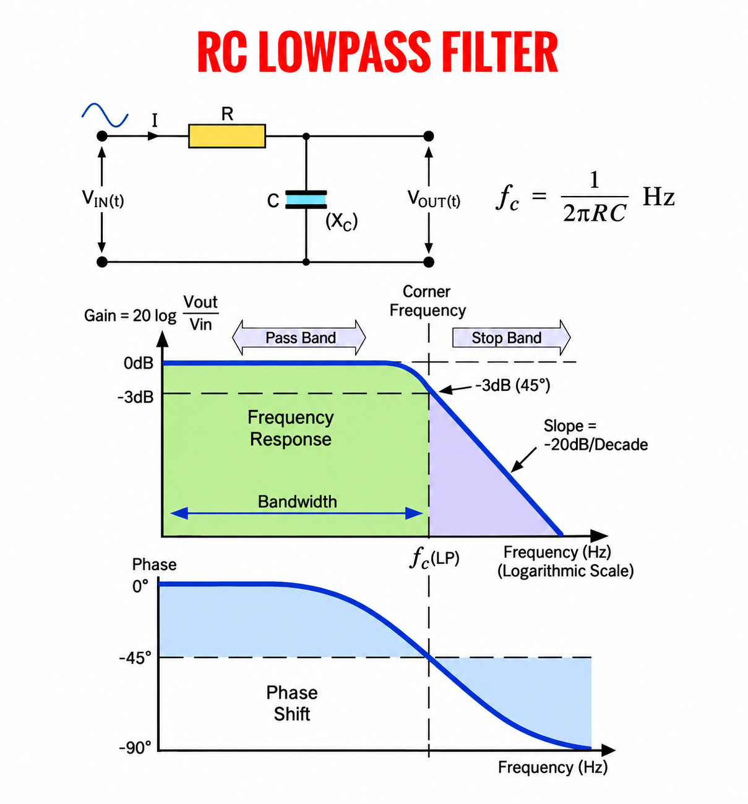
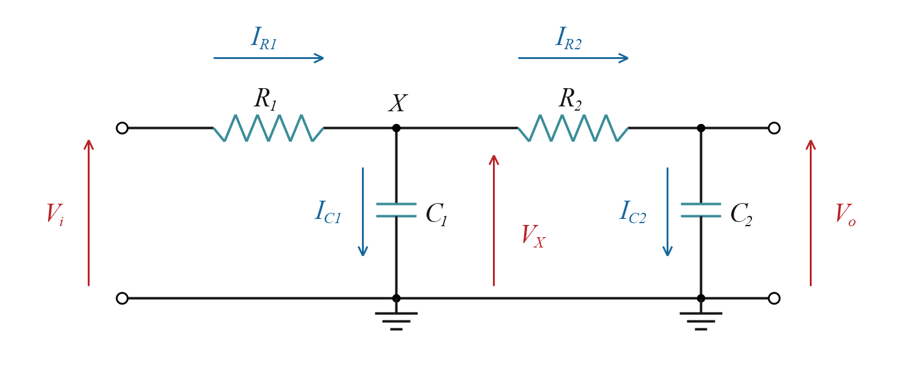
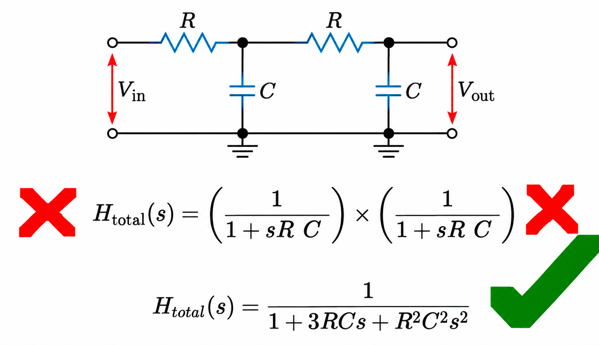
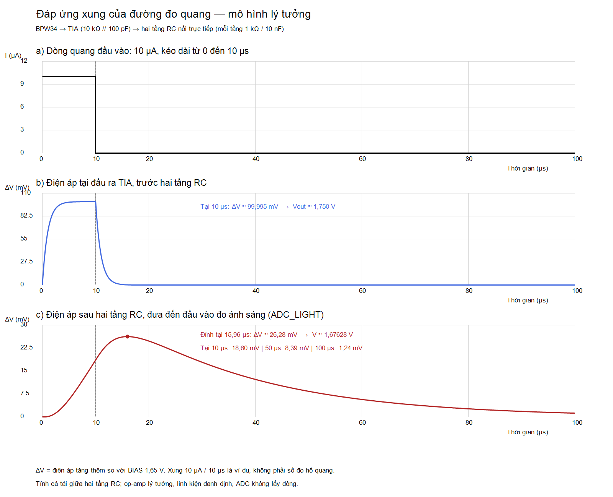

# 1. Bộ lọc thông thấp một tầng

*Hình 1. Sơ đồ mạch và đáp ứng biên độ, pha của bộ lọc thông thấp RC một tầng.*

## 1.1. Sơ đồ mạch và công thức

Mạch lọc thông thấp gồm **điện trở R nối tiếp từ đầu vào $V_i$ đến đầu ra $V_o$**, còn **tụ C nối từ $V_o$ xuống GND**. Điện áp đầu ra chính là điện áp trên tụ. Tụ có dung kháng $X_C=1/(2\pi fC)$, thể hiện mức cản trở dòng điện xoay chiều. Khi tần số tăng, dung kháng giảm, dòng qua R tăng và sụt áp trên R lớn hơn, làm điện áp đầu ra giảm. Vì vậy, mạch cho tín hiệu tần số thấp đi qua với mức suy giảm nhỏ và giảm mạnh hơn các thành phần tần số cao [1].

Khi bỏ qua trở kháng nguồn và coi đầu ra không có tải, các công thức của bộ lọc một tầng là [4]:

$$
K_1(f)=\frac{\hat V_o}{\hat V_i}
=\frac{1}{\sqrt{1+(f/f_c)^2}}
=\frac{1}{\sqrt{1+(2\pi fRC)^2}},
\qquad
f_c=\frac{1}{2\pi RC}
\tag{1}
$$

Trong đó:

- **$K_1(f)$:** tỷ số biên độ đầu ra/đầu vào tại tần số $f$, không có đơn vị; chỉ số 1 chỉ bộ lọc một tầng.
- **$f_c$:** tần số cắt, tại đó biên độ đầu ra còn 70,7% đầu vào (−3 dB), đơn vị Hz [10].
- **$V_i$, $V_o$:** điện áp đầu vào và đầu ra; $\hat V_i$, $\hat V_o$ là biên độ tương ứng, đơn vị V.
- **$f$:** tần số tín hiệu sin đầu vào, đơn vị Hz.
- **R, C:** điện trở (Ω) và điện dung (F) của bộ lọc.

## 1.2. Đồ thị thứ nhất — Biên độ

Đồ thị thứ nhất biểu diễn **độ lợi theo tần số**: trục đứng là Gain (dB), trục ngang là Frequency (Hz). Trục tần số dùng thang logarit: các mức tăng 10 lần, như 10 → 100 → 1000 Hz, cách đều nhau [10].

Từ tỷ số biên độ $K_1(f)$ ở (1), ta có độ lợi tính bằng dB là [4]:

$$
G_{\mathrm{dB}}(f)=20\log_{10}\left(\frac{\hat V_o}{\hat V_i}\right)
=20\log_{10}K_1(f)
\tag{2}
$$

Trong đó:

- **$G_{\mathrm{dB}}(f)$:** độ lợi điện áp biểu diễn bằng dB, cho biết ==mức tăng hoặc giảm biên độ điện áp đầu ra so với đầu vào tại tần số $f$; 0 dB là giữ nguyên, âm là giảm, dương là tăng.
- **$K_1(f)=\hat V_o/\hat V_i$:** tỷ số biên độ sau/trước lọc, đã giải thích ở (1).

Với bộ lọc RC một tầng đang xét, **tần số cắt $f_c$ được xác định theo quy ước −3 dB**, tại đó biên độ đầu ra còn $1/\sqrt{2}\approx70{,}7\%$ đầu vào; đây là vị trí “Corner Frequency” trong Hình 1 [10]. Thay $f=f_c$ vào (1) được $K_1(f_c)=1/\sqrt{2}$, rồi thay vào (2):

$$
G_{\mathrm{dB}}(f_c)=20\log_{10}\left(\frac{1}{\sqrt{2}}\right)
\approx-3{,}01\,\mathrm{dB}
\tag{3}
$$

Nghĩa là tại $f_c$, đầu vào biên độ 1 V cho đầu ra khoảng **0,707 V**.

Các thuật ngữ trong Hình 1 được giải thích như sau:

- **Frequency Response — đáp ứng tần số:** Cho biết bộ lọc làm thay đổi biên độ và pha ra sao ở từng tần số. Trong hình, đường cong màu xanh dương đậm ở đồ thị thứ nhất cho biết: tại mỗi tần số đầu vào, tín hiệu bị suy giảm bao nhiêu dB sau khi qua bộ lọc.
- **Pass Band — dải thông:** Vùng tần số được cho qua với mức suy giảm nhỏ; ở tần số thấp hơn nhiều so với $f_c$, $K_1\approx1$ và độ lợi gần 0 dB.
- **Corner Frequency — tần số cắt:** Mốc $f_c$ tại đó độ lợi khoảng −3 dB, tức biên độ đầu ra còn khoảng 70,7% đầu vào.
- **Bandwidth — băng thông:** Độ rộng dải thông. Với bộ lọc thông thấp trong hình, dải này tính từ DC (0 Hz) đến $f_c$, nên băng thông bằng $f_c$.
- **Stop Band — dải suy giảm:** Vùng tần số cao mà tín hiệu bị suy giảm đáng kể. Đường cong RC chuyển dần từ dải thông sang vùng này; mức suy giảm phụ thuộc vào tần số của tín hiệu đưa vào bộ lọc.
- **Slope — độ dốc:** Mức thay đổi độ lợi trên đồ thị khi tần số tăng. Với một tầng RC, ở vùng cao tần, độ dốc tiến tới −20 dB/decade.
- **Decade — khoảng tăng tần số gấp 10:** −20 dB/decade nghĩa là khi tần số tăng 10 lần trong vùng cao tần, độ lợi giảm thêm khoảng 20 dB, tương ứng tỷ số biên độ giảm còn khoảng 1/10. [6], [10]

## 1.3. Đồ thị thứ hai — Pha

Đồ thị thứ hai biểu diễn **độ lệch pha theo tần số**: trục ngang là Frequency (Hz), trục đứng là Phase Shift (độ). Với tín hiệu sin, **trễ pha** nghĩa là đỉnh sóng đầu ra xuất hiện muộn hơn đỉnh sóng đầu vào.

Với bộ lọc một tầng ở mục 1.1, độ lệch pha được tính theo [4]:

$$
\varphi(f)=-\arctan(2\pi fRC)
=-\arctan\left(\frac{f}{f_c}\right)
\tag{4}
$$

Trong đó:

- **$\varphi(f)$:** độ lệch pha của điện áp đầu ra $V_o$ so với điện áp đầu vào $V_i$ tại tần số $f$; dấu âm cho biết $V_o$ trễ pha so với $V_i$.
- **$f$, $f_c$:** tần số tín hiệu và tần số cắt, đơn vị Hz; R, C như trong (1).
- **$\arctan$:** hàm ngược của tan; chọn chế độ độ (DEG) để tính góc như trên hình.

Các mốc trên đường cong:

- **$f\ll f_c$:** pha gần 0°, đầu ra gần cùng pha với đầu vào.
- **$f=f_c$:** pha −45°, tương ứng trễ 1/8 chu kỳ.
- **$f\gg f_c$:** pha tiến tới −90°, tương ứng trễ gần 1/4 chu kỳ.

Với sóng sin có chu kỳ $T=1/f$, thời gian trễ tương ứng là $\Delta t=(|\varphi|/360^\circ)T$ [10].

# 2. Bộ lọc thông thấp hai tầng

## 2.1. Sơ đồ và ký hiệu

*Hình 2. Sơ đồ mạch bộ lọc thông thấp hai tầng.*

Mạch gồm **tầng R₁–C₁ nối trực tiếp với tầng R₂–C₂** tại nút X. Điện áp đầu ra lấy trên tụ C₂.

Trong đó:

- **$V_i$, $V_X$, $V_o$:** điện áp đầu vào, tại nút X và đầu ra, đo so với GND.
- **$I_{R1}$, $I_{R2}$:** dòng qua hai điện trở, từ trái sang phải.
- **$I_{C1}$, $I_{C2}$:** dòng từ hai nút qua tụ xuống GND.

Xét **$R_1=R_2=R$, $C_1=C_2=C$**, bỏ qua trở kháng nguồn và tải ngoài ở đầu ra. Tầng hai lấy dòng từ tầng một, làm thay đổi điện áp tại X và hàm truyền của cả mạch [2].

Mục tiêu là tìm **hàm truyền $H_2(s)=V_o(s)/V_i(s)$**, rồi tính tỷ số biên độ và tần số cắt. ==Dùng biến đổi Laplace để chuyển phương trình có đạo hàm thành phương trình đại số [5]==. Ký hiệu $s=\sigma+j\omega$ là biến tần số phức; $j^2=-1$, $\omega$ là tần số góc. Các điện áp, dòng điện viết hoa bên dưới thuộc miền Laplace, thường lược đối số $(s)$ cho gọn.

## 2.2. Hàm truyền một tầng không tải

**Quan hệ dòng–áp trong miền Laplace**

Với điện trở, $I_R=U_R/R$, trong đó $U_R$ là điện áp hai đầu theo chiều dòng điện [9]. Với tụ, $i_C=C\,du_C/dt$; dùng quy tắc biến đổi đạo hàm [5]:

$$
\mathcal{L}\left\{\frac{du_C(t)}{dt}\right\}
=sU_C(s)-u_C(0^-)
\tag{5}
$$

$\mathcal L$ là phép biến đổi Laplace; $u_C(0^-)$ là điện áp trên tụ trước thời điểm bắt đầu xét. Suy ra:

$$
I_C(s)=C\big[sU_C(s)-u_C(0^-)\big]
\tag{6}
$$

Khi lập hàm truyền, đặt điện áp ban đầu trên tụ bằng 0. Công thức (6) trở thành:

$$
I_C=sCU_C,
\qquad
Z_C(s)=\frac{U_C}{I_C}=\frac{1}{sC}
\tag{7}
$$

Trong đó, $Z_C$ là trở kháng của tụ, $U_C$ là điện áp hai đầu tụ. Các quan hệ này dùng để tính hàm truyền một tầng trước khi xét mạch hai tầng.

**Suy ra hàm truyền bằng chia áp**

Dùng chia áp với $Z_R=R$ và $Z_C=1/(sC)$ từ (7), hàm truyền một tầng đứng riêng là [4], [6, phương trình (7)]:

$$
H_1(s)=\frac{V_X(s)}{V_i(s)} =\frac{Z_C}{R+Z_C}
=\frac{1/(sC)}{R+1/(sC)}
=\frac{1}{1+sRC}
\tag{8}
$$

==$H_1(s)$ là tỷ số điện áp đầu ra so với điện áp đầu vào trong miền Laplace, với điều kiện đầu bằng 0==. Công thức (8) áp dụng khi tầng R₁–C₁ chưa nối tầng hai.

Khi nối thêm tầng hai, điều kiện không tải của tầng một không còn đúng; mục 2.3 giải thích ảnh hưởng này.

## 2.3. Ảnh hưởng tải khi nối hai tầng

*Hình 3. So sánh cách tính bỏ qua tải (×) và có xét tải giữa hai tầng (✓).*

Hàm truyền một tầng ở (8) áp dụng khi đầu ra không tải. Khi nối hai tầng như Hình 2, dòng qua R₁ chia sang **C₁ và nhánh R₂–C₂**. R₁ cấp dòng cho cả hai nhánh nên điện áp tại X khác khi tầng một đứng riêng [2]. Vì vậy, phép nhân hai hàm truyền một tầng không tải dưới đây cho kết quả sai:

$$
\frac{1}{1+sRC}\times\frac{1}{1+sRC}
=\frac{1}{1+2sRC+(sRC)^2}
\tag{9}
$$

Phép nhân **các tỷ số điện áp thực tế** vẫn đúng:

$$
\frac{V_o}{V_i}=\frac{V_X}{V_i}\times\frac{V_o}{V_X}
\tag{10}
$$

Tỷ số $V_X/V_i$ ở (8) thuộc **tầng một đứng riêng, không tải**. Khi nối tầng hai, tải làm tỷ số này thay đổi. Mục 2.4 tính trực tiếp $V_o/V_i$ cho cả mạch và xác định hai tỷ số thực tế $V_X/V_i$, $V_o/V_X$ trong (19).

## 2.4. Hàm truyền của hai tầng nối trực tiếp

**Phương trình tại hai nút của mạch nối trực tiếp**

Dùng quan hệ $I_R=U_R/R$ và $I_C=sCU_C$ từ mục 2.2, với $U_{C1}=V_X$, $U_{C2}=V_o$. Áp dụng định luật Kirchhoff: tổng dòng vào bằng tổng dòng ra [8]. Tại nút X:

$$
I_{R1}=I_{C1}+I_{R2}
\tag{11}
$$

Thay dòng qua điện trở và tụ bằng quan hệ ở trên:

$$
\underbrace{\frac{V_i-V_X}{R}}_{I_{R1}}
=\underbrace{sCV_X}_{I_{C1}}
+\underbrace{\frac{V_X-V_o}{R}}_{I_{R2}}
\tag{12}
$$

Tại đầu ra, không có tải ngoài nên dòng qua R₂ bằng dòng qua C₂:

$$
I_{R2}=I_{C2}
\qquad\Rightarrow\qquad
\frac{V_X-V_o}{R}=sCV_o
\tag{13}
$$

Hai phương trình (12), (13) là cơ sở tìm hàm truyền của cả mạch.

Từ (13), biểu diễn $V_X$ theo $V_o$:

$$
V_X-V_o=sRCV_o
\quad\Rightarrow\quad
V_X=(1+sRC)V_o
\tag{14}
$$

Từ (12), gom các hạng tử để biểu diễn $V_i$:

$$
V_i-V_X=sRCV_X+V_X-V_o
\quad\Rightarrow\quad
V_i=(2+sRC)V_X-V_o
\tag{15}
$$

Thay (14) vào (15) để loại điện áp trung gian $V_X$:

$$
V_i=\big[(2+sRC)(1+sRC)-1\big]V_o
=\big[1+3sRC+(sRC)^2\big]V_o
\tag{16}
$$

Lấy tỷ số $V_o/V_i$ từ (16), được:

$$
\boxed{H_2(s)=\frac{V_o}{V_i}
=\frac{1}{1+3sRC+(sRC)^2}}
\tag{17}
$$

Trong đó, **$H_2(s)$ là hàm truyền của cả hai tầng**, gồm tác động lên biên độ và pha. Công thức (17) tương ứng dấu ✓ trong Hình 3.

**Cơ sở đối chiếu:** Hàm truyền tổng quát của mạch RC hai tầng nối trực tiếp, viết từ tham số của TI SPRAA88A, mục 4.2, phương trình (9), (11), Hình 6, là [6]:

$$
H(s)=\frac{1}{1+s(R_1C_1+R_1C_2+R_2C_2)+s^2R_1R_2C_1C_2}
\tag{18}
$$

Thay $R_1=R_2=R$, $C_1=C_2=C$ vào (18) thu được đúng (17). Các bước (11)–(17) là phần nhóm triển khai từ định luật Kirchhoff, Ohm và biến đổi Laplace [5], [8], [9].

Từ (14), (17), hai tỷ số điện áp trong phép nhân (10) là:

$$
\frac{V_X}{V_i}=\frac{1+sRC}{1+3sRC+(sRC)^2},
\qquad
\frac{V_o}{V_X}=\frac{1}{1+sRC}
\tag{19}
$$

Nhân hai tỷ số trong (19) thu lại (17). Kết quả cho thấy phép tính (9) sai do bỏ qua tải tầng hai khi tính tỷ số từ đầu vào đến X.

## 2.5. Tỷ số biên độ và tần số cắt

**Tính biên độ tại một tần số**

Với tín hiệu sin xác lập, thay biến $s$ trong hàm truyền bằng [5], [10]:

$$
s=j\omega=j2\pi f
\tag{20}
$$

Trong đó, $f$ tính bằng Hz và $\omega=2\pi f$ tính bằng rad/s. Đặt $x=2\pi fRC$; thay (20) vào (17), dùng $j^2=-1$:

$$
H_2(j2\pi f)=\frac{1}{1-x^2+j3x}
\tag{21}
$$

Lấy độ lớn của (21), với $|a+jb|=\sqrt{a^2+b^2}$, được [5]:

$$
K_2(f)=\frac{\hat V_o}{\hat V_i}
=|H_2(j2\pi f)|
=\frac{1}{\sqrt{(1-x^2)^2+9x^2}}
\tag{22}
$$

Trong đó:

- **$K_2(f)$:** tỷ số biên độ đầu ra/đầu vào của hai tầng tại tần số $f$, không có đơn vị.
- **$\hat V_i$, $\hat V_o$:** biên độ điện áp đầu vào và đầu ra, đơn vị V.
- **$x=2\pi fRC$:** biến dùng để viết gọn, không có đơn vị.

**Tìm tần số cắt −3 dB**

Theo cùng quy ước ở phần 1, tại tần số cắt, $K_2=1/\sqrt{2}$ [6], [10]. Thay vào (22), bình phương và chuyển vế:

$$
(1-x^2)^2+9x^2=2
\quad\Rightarrow\quad x^4+7x^2-1=0
\tag{23}
$$

Đặt $y=x^2$, giải $y^2+7y-1=0$ và chọn nghiệm dương:

$$
x=\sqrt{\frac{\sqrt{53}-7}{2}}\approx0{,}3742
\tag{24}
$$

Vì $f=x/(2\pi RC)$, từ (24) suy ra:

$$
\boxed{f_{c,\mathrm{total}}=
\frac{1}{2\pi RC}\sqrt{\frac{\sqrt{53}-7}{2}}
\approx0{,}3742\,f_c}
\tag{25}
$$

Trong đó, ==**$f_{c,\mathrm{total}}$** là tần số cắt của cả hai tầng; **$f_c=1/(2\pi RC)$** là tần số cắt một tầng đứng riêng theo (1).

**Đối chiếu kết quả với công thức TI**

Chia tử và mẫu của (17) cho $(RC)^2$:

$$
H_2(s)=\frac{1}{1+3sRC+(sRC)^2}
=\frac{1/(RC)^2}{s^2+\dfrac{3}{RC}s+1/(RC)^2}
\tag{26}
$$

Dạng chuẩn bậc hai trong TI SPRAA88A, phương trình (9), là [6]:

$$
H(s)=\frac{\omega_n^2}{s^2+2\zeta\omega_n s+\omega_n^2}
\tag{27}
$$

So sánh hệ số trong (26), (27):

$$
\omega_n^2=\frac{1}{(RC)^2},\qquad
2\zeta\omega_n=\frac{3}{RC}
\quad\Rightarrow\quad
\omega_n=\frac{1}{RC},\quad\zeta=\frac{3}{2}
\tag{28}
$$

$\omega_n$ là tần số góc tự nhiên (rad/s); $\zeta$ là hệ số tắt dần, không có đơn vị. Đặt $u=\omega/\omega_n$, thay $s=j\omega$ theo (20) vào (27) rồi lấy độ lớn:

$$
|H(j\omega)|=\frac{1}{\sqrt{(1-u^2)^2+4\zeta^2u^2}}
\tag{29}
$$

Thay tham số (28) thì $u=x$, $4\zeta^2=9$, nên (29) trùng (22). Áp dụng điều kiện −3 dB vào (29):

$$
(1-u^2)^2+4\zeta^2u^2=2
\quad\Rightarrow\quad
u^4+(4\zeta^2-2)u^2-1=0
\tag{30}
$$

Giải (30) theo $u^2$, chọn nghiệm dương:

$$
u^2=1-2\zeta^2+\sqrt{4\zeta^4-4\zeta^2+2}
\tag{31}
$$

Từ (31) và $u=2\pi f/\omega_n$, được biểu thức trùng phương trình (10) của TI sau khi đổi rad/s sang Hz [6]:

$$
f_{-3\,\mathrm{dB}}=\frac{\omega_n}{2\pi}
\sqrt{1-2\zeta^2+\sqrt{4\zeta^4-4\zeta^2+2}}
\tag{32}
$$

Thay $\omega_n$, $\zeta$ từ (28) vào (32):

$$
f_{-3\,\mathrm{dB}}=\frac{1}{2\pi RC}
\sqrt{-\frac{7}{2}+\sqrt{\frac{53}{4}}}
=\frac{1}{2\pi RC}\sqrt{\frac{\sqrt{53}-7}{2}}
\tag{33}
$$

Kết quả (33) trùng (25): hệ số **0,3742** được suy ra từ hàm truyền và đối chiếu bằng công thức TI.

**Thay giá trị linh kiện của đồ án**

Với mỗi tầng **1 kΩ/10 nF**, tần số cắt một tầng theo (1) là $f_c\approx15{,}915$ kHz. Thay vào (25):

$$
f_{c,\mathrm{total}}\approx0{,}3742\times15{,}915
\approx5{,}96\,\mathrm{kHz}
\tag{34}
$$

Với linh kiện danh định, **tần số cắt tính được của cả hai tầng nối trực tiếp là 5,96 kHz**, còn một tầng đứng riêng là 15,915 kHz.

# 3. Vai trò của bộ lọc thông thấp trong đồ án

Đồ án dùng bộ lọc thông thấp ở cả hai đường đo:

- **Khối quang:** BPW34 → TIA U4A với R6–C15 → hai tầng RC → PA1 (ADC_LIGHT).
- **Khối dòng:** tín hiệu đo dòng từ U3A → một tầng R3–C12 → PA0 (ADC_CURRENT).

Bộ lọc giảm nhiễu cao tần trước ADC, đồng thời cũng làm suy giảm một phần tín hiệu cần đo. Nhóm chọn R, C và số tầng theo yêu cầu của mỗi đường đo [1], [6].

## 3.1. Suy giảm theo tần số của mạng R6–C15

Đặt $R_f=R6$, $C_f=C15$. **Dung kháng** là mức cản trở dòng điện xoay chiều của tụ, đơn vị Ω. Với tụ lý tưởng:

$$
|Z_C|=\frac{1}{2\pi fC_f}
\tag{35}
$$

Ở DC ổn định, tụ không dẫn dòng; dòng bù cho dòng quang chủ yếu qua R6. Với cách nối BPW34 trong đồ án và TIA đang hoạt động tuyến tính:

$$
V_{\mathrm{out}}\approx V_{\mathrm{BIAS}}+I_{\mathrm{ph}}R_f
\tag{36}
$$

> **$V_{\mathrm{out}}$** là điện áp tại chân 1 U4A so với GND, trước hai tầng RC; **$V_{\mathrm{BIAS}}$** là điện áp nền 1,65 V; **$I_{\mathrm{ph}}$** là dòng quang. Dòng quang tăng làm đầu ra tăng thêm xấp xỉ $I_{\mathrm{ph}}R_f$ so với BIAS [11].

Tần số tăng làm dung kháng C15 và trở kháng hồi tiếp giảm. Cùng biên độ dòng quang sẽ tạo biên độ điện áp nhỏ hơn. Mô hình TIA lý tưởng cho [11]:

$$
Z_f(s)=\frac{R_f}{1+sR_fC_f},\qquad
K_f(f)=\frac{|Z_f(j2\pi f)|}{R_f}
=\frac{1}{\sqrt{1+(2\pi fR_fC_f)^2}}
\tag{37}
$$

Trong công thức (37):

- **$Z_f(s)$:** trở kháng của R6 song song C15, đơn vị Ω; độ lớn của nó là hệ số chuyển dòng quang biến thiên thành điện áp biến thiên.
- **$K_f(f)$:** tỷ lệ biên độ điện áp so với trường hợp chỉ có R6, giữ nguyên dòng quang đầu vào; không có đơn vị. $K_f=0{,}5$ nghĩa là còn 50% biên độ. $f$ là tần số, đơn vị Hz.

Biểu thức $K_f(f)$ có cùng dạng thông thấp bậc một như (1). Với giá trị đang dùng:

$$
\tau_f=R_fC_f=10^4\times100\times10^{-12}=1\,\mathrm{\mu s},\qquad
f_{\mathrm{RC}}=\frac{1}{2\pi\tau_f}\approx159\,\mathrm{kHz}
\tag{38}
$$

Trong công thức (38):

- **$\tau_f$:** hằng số thời gian; sau khoảng này, mức tăng điện áp đạt 63,2% giá trị cuối cùng khi dòng quang tăng đột ngột rồi giữ không đổi, trong mô hình bậc một lý tưởng [3].
- **$f_{\mathrm{RC}}$:** tần số cắt của mô hình R6–C15, tại đó biên độ còn 70,7% đáp ứng thấp tần (−3 dB), cùng cách xác định ở (1).

Chọn **10 kHz và 1 MHz** để minh họa hai vùng dưới và trên mốc 159 kHz ở (38), không coi đây là tần số của chớp hồ quang.

Thay vào (37), tại **10 kHz**:

$$
K_f=\frac{1}{\sqrt{1+(2\pi\times10^4\times10^4\times100\times10^{-12})^2}}
\approx0{,}998=99{,}8\%
\tag{39}
$$

Tại **1 MHz**:

$$
K_f=\frac{1}{\sqrt{1+(2\pi\times10^6\times10^4\times100\times10^{-12})^2}}
=\frac{1}{\sqrt{1+(2\pi)^2}}
\approx0{,}1572=15{,}7\%
\tag{40}
$$

Theo (39), (40), thành phần 10 kHz còn **99,8%**, còn thành phần 1 MHz chỉ còn **15,7%** biên độ.

Nhóm chọn **R6 = 10 kΩ** để mỗi 1 µA dòng quang tạo mức tăng khoảng 10 mV theo (36). **C15 = 100 pF** hỗ trợ bù pha, hạn chế dao động [11], [13], đồng thời cho hằng số thời gian **1 µs** để hạn chế làm chậm xung. Mốc **159 kHz** mô tả đặc tính lọc của riêng mạng R6–C15 trong mô hình TIA lý tưởng.

## 3.2. Ảnh hưởng của bộ lọc đến biên độ và hình dạng xung

Hình 4 theo dõi **cùng một xung** tại ba vị trí: dòng qua cảm biến → điện áp đầu ra TIA → điện áp sau hai tầng RC. Mạch dùng R6 = 10 kΩ, C15 = 100 pF và hai tầng 1 kΩ/10 nF. Xung 10 µA/10 µs là giả định để tính minh họa.

>  ==Phần này sau đo thì lấy ảnh chụp thực nghiệm thực tế điền vào

*Hình 4. Đáp ứng tính toán của đường đo quang, từ hàm truyền (17), (37) và đáp ứng RC [3], [11].*

Ở Hình 4b–4c, trục đứng là **mức tăng điện áp so với BIAS 1,65 V**: 0 mV nghĩa là điện áp thực 1,65 V. Hai đồ thị có thang đứng khác nhau.

### Dòng quang ban đầu — Hình 4a

Dòng quang là **dòng điện một chiều dạng xung**, đi qua D1 (BPW34) từ nút chân 2 (−) U4A xuống GND, không đổi chiều [11]. Trong ví dụ, dòng giữ mức **DC 10 µA trong 10 µs** rồi về 0, nên đồ thị có dạng chữ nhật. Chọn 10 µA để khi qua R6 = 10 kΩ, mức tăng điện áp nếu duy trì đủ lâu là **100 mV**; chọn 10 µs bằng hằng số thời gian của mỗi tầng RC sau TIA để quan sát tác dụng lọc.

### Điện áp trước hai tầng RC — Hình 4b

Điện áp tại **chân 1 U4A** thay đổi theo diễn biến sau. Trong mô hình TIA lý tưởng, chân 2 được giữ gần BIAS 1,65 V [11]:

- **Trước xung:** Không có dòng quang, đầu ra ở BIAS; điện áp giữa hai đầu R6–C15 gần bằng 0.
- **Dòng quang xuất hiện:** Đầu ra cấp dòng bù qua R6 và C15. Điện áp trên tụ không thể đổi tức thời nên đầu ra tăng dần. Khi điện áp tăng, dòng qua R6 tăng, phần dòng nạp C15 giảm, khiến điện áp **ban đầu tăng nhanh, sau tăng chậm dần**. Vì tốc độ tăng thay đổi nên cạnh lên là đường congg [3].
- **Dòng quang kết thúc tại 10 µs:** C15 xả qua R6; điện áp đầu ra **ban đầu giảm nhanh, sau giảm chậm dần** về BIAS, tạo cạnh xuống cong [3].

Với hằng số thời gian **1 µs**, mức tăng đạt khoảng **63,2 mV sau 1 µs**, **95,0 mV sau 3 µs** và gần **100 mV tại 10 µs**. Do đó, Hình 4b có hai cạnh cong nhưng vẫn giữ được phần đỉnh gần phẳng trước khi xung kết thúc.

**Lý do lọc sau TIA:** Trong Hình 4b, xung dòng kéo dài **10 µs**, còn điện áp TIA chỉ cần **3 µs để đạt khoảng 95% mức tăng cuối cùng**; khi dòng ngừng, điện áp cũng giảm nhanh về BIAS. Như vậy, TIA chuyển được sự xuất hiện và kết thúc của xung dòng thành thay đổi điện áp trong thời gian ngắn. Tuy nhiên, đầu ra TIA còn có thể chứa nhiễu cao tần được khuếch đại [13]. Nhóm dùng **hai tầng 1 kΩ/10 nF** để giảm nhiễu mạnh hơn một tầng cùng R, C, đồng thời dùng tụ nhỏ nhằm hạn chế làm chậm xung điện áp này.

Công thức nạp RC gốc là $V_C(t)=V(1-e^{-t/(RC)})$, phương trình (3) trong [3]. Áp dụng cho TIA (37):

$$
\Delta V_{\mathrm{TIA}}(t)=I_{\mathrm{ph}}R_f(1-e^{-t/\tau_f}),
\qquad \tau_f=R_fC_f,\quad 0\le t\le T
\tag{41}
$$

Trong đó, **$\Delta V_{\mathrm{TIA}}$** là mức tăng điện áp tại chân 1 U4A; **$I_{\mathrm{ph}}$** là dòng quang; **$t$** tính từ lúc xung bắt đầu, **$T$** là độ rộng xung; $R_f=R6$, $C_f=C15$. $t$ và $\tau_f$ dùng cùng đơn vị; $e\approx2{,}718$. Thay số ở cuối xung: $100(1-e^{-10/1})\approx99{,}995$ mV.

### Điện áp sau hai tầng RC — Hình 4c

Tín hiệu từ chân 1 U4A đi qua R11/C17 và R12/C18 rồi đến **PA1, đầu vào đo ánh sáng của vi điều khiển (ADC_LIGHT)**. Hai tầng làm dạng xung thay đổi theo ba bước:

- **Lúc xung bắt đầu:** C17 và C18 nạp qua các điện trở nên điện áp tại PA1 tăng từ từ. Đến 10 µs, đầu ra TIA đã gần 100 mV nhưng PA1 mới tăng **18,60 mV**.
- **Khi xung dòng kết thúc:** Điện áp TIA giảm, nhưng C17 còn tích điện và tiếp tục cấp dòng qua R12 để nạp C18 trong một khoảng ngắn. Vì vậy, điện áp PA1 vẫn tăng, đạt đỉnh **26,28 mV tại 15,96 µs**, thay vì đạt đỉnh ngay tại 10 µs.
- **Sau đỉnh:** Các tụ xả dần nên điện áp giảm chậm, tạo đuôi xung. Tại 50 µs vẫn còn **8,39 mV**, tại 100 µs còn **1,24 mV** so với BIAS [3].

Các số liệu được nhóm tính bằng cách ghép hàm truyền TIA (37) với hai tầng RC (17) [6], [11]:

$$
\frac{\Delta V_{\mathrm{ADC}}(s)}{I_{\mathrm{ph}}(s)}
=\frac{R_f}{(1+s\tau_f)\,[1+3s\tau+(s\tau)^2]},
\qquad \tau=RC=10\,\mathrm{\mu s}
\tag{42}
$$

**$\Delta V_{\mathrm{ADC}}$** là mức tăng điện áp tại PA1; **$I_{\mathrm{ph}}(s)$** là dòng quang trong miền Laplace; **$\tau=RC=10$ µs** thuộc mỗi tầng RC. Đáp ứng thời gian tính từ (42) bằng biến đổi Laplace [5], có xét tải giữa hai tầng và giả sử op-amp lý tưởng, BIAS không đổi, ADC không lấy dòng.

**Kết quả sau lọc:** Trong ví dụ, đỉnh xung tại PA1 giảm từ gần **100 mV xuống 26,28 mV**, xuất hiện muộn hơn và có đuôi dài hơn. Nếu đặt ngưỡng cao hơn BIAS **30 mV**, vi điều khiển sẽ bỏ sót xung này. Ngưỡng phát hiện được đặt trên mức nhiễu và dưới đỉnh xung tại PA1 để phân biệt xung sáng với nhiễu.

**Lý do chọn hai tầng:** Hai tầng giảm nhiễu cao tần mạnh hơn một tầng, giúp hạn chế nhận nhầm nhiễu thành xung sáng [13]. Tại 100 kHz, biên độ còn **2,33%**, so với **15,7%** của một tầng cùng R, C theo (1), (22). Phép đo đồng thời tại chân 1 U4A và PA1 cho biết mức giảm nhiễu, mức giảm đỉnh và sự kéo dài đuôi xung do bộ lọc.

## 3.3. Bộ lọc một tầng của khối dòng

Khối dòng dùng **R3 = 1 kΩ** nối tiếp tín hiệu và **C12 = 100 nF** từ đầu ra lọc xuống GND, rồi đưa điện áp đến PA0 (ADC_CURRENT). Thành phần chính là **50/60 Hz**; các sóng hài ở bội số của chúng thể hiện dạng sóng méo.

Từ công thức (1), $f_c=1/(2\pi RC)$. Thay $R=10^3$ Ω và $C=100\times10^{-9}$ F được $f_c\approx1591{,}55$ Hz, tức **1,59 kHz**. Tại 60 Hz:

$$
K_1(60\,\mathrm{Hz})=\frac{1}{\sqrt{1+(60/1591{,}55)^2}}\approx0{,}99929=99{,}929\%
\tag{43}
$$

Tại 50 Hz, tính tương tự được **99,951%**. Kết quả tính cho thấy thành phần chính gần như giữ nguyên biên độ sau lọc.

Ví dụ, thành phần **500 Hz** (hài bậc 10 của 50 Hz) có tỷ lệ biên độ sau một tầng, tính từ (1):

$$
K_1(500\,\mathrm{Hz})=\frac{1}{\sqrt{1+(500/1591{,}55)^2}}
\approx0{,}9540=95{,}4\%
\tag{44}
$$

Với hai tầng nối trực tiếp cùng 1 kΩ/100 nF, (22) cho **76,7%** tại 500 Hz, thấp hơn **95,4%** của một tầng. Nhóm giữ một tầng để hạn chế suy giảm sóng hài, trong khi vẫn giảm cao tần: tại 10 kHz chỉ còn **15,7%** theo (1) [2], [6].

## 3.4. Bộ lọc thông thấp hai tầng trong khối quang

Sau TIA, **R11/C17 và R12/C18**, mỗi tầng **1 kΩ/10 nF**, nối trực tiếp trước PA1, đầu vào đo ánh sáng của vi điều khiển (ADC_LIGHT). Tần số cắt cả hai tầng là **5,96 kHz** theo (34), khác mốc 159 kHz của riêng R6–C15.

Dùng (1) và (22), **biên độ còn lại** khi mỗi tầng có cùng R, C là:

| Tần số thành phần đầu vào | Một tầng 1 kΩ/10 nF, tham khảo tính toán | Hai tầng nối trực tiếp đang dùng |
| ------------------------- | ---------------------------------------: | -------------------------------: |
| 1 kHz                     |                                    99,8% |                            98,6% |
| 10 kHz                    |                                    84,7% |                            50,5% |
| 100 kHz                   |                                    15,7% |                            2,33% |

Ví dụ tại 100 kHz, thay vào (22):

$$
x=2\pi fRC=2\pi\times10^5\times10^3\times10^{-8}\approx6{,}283,\qquad
K_2=\frac{1}{\sqrt{(1-6{,}283^2)^2+9\times6{,}283^2}}\approx0{,}0233
\tag{45}
$$

Với nhiễu sin giả định 100 mV ở 100 kHz, biên độ tính được còn **2,33 mV** sau hai tầng, so với 15,7 mV sau một tầng cùng R, C; nhỏ hơn khoảng **6,7 lần**. Các tần số trong bảng minh họa đáp ứng lọc.

Nhóm chọn **hai tầng để tăng suy giảm cao tần**, kết hợp **tụ 10 nF để hạn chế làm chậm xung**: tần số cắt cả bộ lọc là 5,96 kHz, giữ 98,6% biên độ tại 1 kHz nhưng chỉ giữ 2,33% tại 100 kHz. Sự suy giảm các thành phần cao tần cũng làm đỉnh xung thấp hơn, sườn chậm hơn và đuôi kéo dài như mục 3.2 [2], [6], [10].

## 3.5. So sánh bộ lọc quang và dòng

| Nội dung | Khối dòng | Khối quang |
|---|---|---|
| **Tín hiệu quan sát** | Thành phần chính 50/60 Hz và các sóng hài thể hiện dạng sóng méo. | Xung sáng ngắn; biên độ và thời điểm vượt ngưỡng quyết định khả năng nhận biết xung. |
| **Bộ lọc trước ADC** | Một tầng 1 kΩ/100 nF; tần số cắt khoảng **1,59 kHz**. | Hai tầng nối trực tiếp, mỗi tầng 1 kΩ/10 nF; tần số cắt toàn bộ khoảng **5,96 kHz**. |
| **Lý do chọn giá trị tụ** | Tụ 100 nF hạ tần số cắt để giảm nhiễu, trong khi thành phần 50/60 Hz vẫn giữ trên 99,9% biên độ. | Tụ 10 nF giữ tần số cắt cao hơn khối dòng, nhằm hạn chế làm chậm xung sáng. |
| **Lý do chọn số tầng** | Giữ một tầng để hạn chế suy giảm sóng hài: tại 500 Hz còn 95,4%; thêm tầng cùng R, C chỉ còn khoảng 76,7%. | Dùng hai tầng để giảm nhiễu cao tần mạnh hơn một tầng cùng R, C: tại 100 kHz còn 2,33%, so với 15,7% của một tầng. |
| **Ảnh hưởng của bộ lọc** | Các sóng hài cao suy giảm, làm thay đổi dạng sóng sau lọc. | Xung sau lọc có thể thấp hơn, chậm hơn và kéo dài hơn. |

**Giá trị R, C quyết định vùng tần số được giữ lại; số tầng quyết định thêm mức suy giảm cao tần**. Khối quang dùng tụ nhỏ kết hợp hai tầng để giữ băng thông cao hơn khối dòng và tăng suy giảm nhiễu cao tần. Khối dòng dùng tụ lớn hơn và một tầng để giảm nhiễu, đồng thời hạn chế mất sóng hài. Nhóm lựa chọn hai cấu hình dựa trên đáp ứng một tầng (1) và hai tầng (22) [1], [2], [6].

Phép đo **trước và sau lọc trên nguyên mạch hai tầng đã lắp** xác định mức giảm đỉnh, độ trễ vượt ngưỡng và phần đuôi xung. Ba kết quả này là cơ sở đặt ngưỡng phát hiện và đánh giá khả năng phân biệt hai xung gần nhau.

# Tài liệu tham khảo

[1] Analog Devices, [A Beginner’s Guide to Filter Topologies](https://www.analog.com/en/resources/technical-articles/a-beginners-guide-to-filter-topologies.html). Công thức tần số cắt và độ dốc suy giảm của bộ lọc RC một tầng.

[2] Analog Devices University Program, [Cascaded RC low pass filters – ADALM2000](https://wiki.analog.com/university/labs/cascaded_rc_adalm2000). Ảnh hưởng tải giữa các tầng RC nối trực tiếp.

[3] Analog Devices, [Transient Response of RC Circuit](https://www.analog.com/en/resources/analog-dialogue/studentzone/2019/07/25/14/46/studentzone-april-2018.html). Ý nghĩa hằng số thời gian RC.

[4] Texas Instruments, *Op Amps for Everyone Design Guide*, Rev. B, chương 16, mục First-Order Low-Pass Filter. [Đọc tài liệu](https://e2echina.ti.com/cfs-file/__key/telligent-evolution-components-attachments/00-52-01-00-00-04-59-46/OP-amp-for-everyone.pdf). Cơ sở hàm truyền và đáp ứng biên độ của bộ lọc RC một tầng.

[5] S. Boyd, Stanford EE102, [The Laplace Transform](https://web.stanford.edu/class/ee102k/laplace.pdf), trang 3–3, 3–4, 3–10 và 3–19. Số phức, biến tần số $s$, ký hiệu miền Laplace, tính tuyến tính và phép biến đổi đạo hàm. Nguồn cung cấp công cụ toán học; không trình bày riêng mạch hai tầng của đồ án.

[6] David M. Alter, Texas Instruments, [Using PWM Output as a Digital-to-Analog Converter on a TMS320F280x Digital Signal Controller](https://www.ti.com/lit/an/spraa88a/spraa88a.pdf), SPRAA88A, mục 4–4.2, trang in 8–10 (tương ứng trang PDF 8–10). Phương trình (7), (8) cho bộ lọc bậc một; phương trình (9), (11) và Hình 6 cho hàm truyền, tham số của mạch RC hai tầng nối trực tiếp. Khi hai điện trở bằng nhau và hai tụ bằng nhau, các biểu thức này cho mẫu số $1+3sRC+(sRC)^2$. Nguồn cũng trình bày định nghĩa băng thông −3 dB và độ dốc −20 dB/decade cho mỗi bậc.

[7] Duke MEMS, [RC Circuits](https://sites.duke.edu/memscapstone/rc-circuits/). Hình minh họa dạng xung đầu ra của bộ lọc RC một tầng ở các tần số khác nhau.

[8] OpenStax, *University Physics Volume 2*, [10.3 Kirchhoff’s Rules](https://openstax.org/books/university-physics-volume-2/pages/10-3-kirchhoffs-rules), mục “Kirchhoff’s First Rule”, phương trình (10.4). Cơ sở tổng dòng vào nút bằng tổng dòng ra, dùng để lập hai phương trình tại X và đầu ra.

[9] OpenStax, *University Physics Volume 2*, [9.4 Ohm’s Law](https://openstax.org/books/university-physics-volume-2/pages/9-4-ohms-law). Cơ sở $V=IR$ và cách biểu diễn dòng qua điện trở bằng chênh lệch điện áp hai đầu chia cho điện trở.

[10] University of Colorado Boulder, Physics Undergraduate Labs, [Lab 3: Filters](https://physicslabs.colorado.edu/courses/phys-3330/lab-guides/lab3/), mục “Definitions” và phần bộ lọc RC thông thấp. Cơ sở hàm truyền phức, tỷ số biên độ, pha, cách đổi sang dB và tiêu chí tần số cắt −3 dB.

[11] Hamamatsu Photonics, [Si photodiodes — Technical note](https://www.hamamatsu.com/content/dam/hamamatsu-photonics/sites/documents/99_SALES_LIBRARY/ssd/si_pd_kspd9001e.pdf), mục 1-1 “Structure”, 2-6 “Response speed” và 3-1 “Connection to an op amp”. Cấu tạo photodiode, điện dung đầu vào, chuyển dòng thành điện áp và tác dụng của tụ hồi tiếp. Biểu thức cho chiều tăng điện áp và các ví dụ số ở phần 3 được tính theo cách nối của đồ án.

[12] Vishay Semiconductors, [BPW34, BPW34S — Silicon PIN Photodiode](https://www.vishay.com/docs/81521/bpw34.pdf), bảng “Basic Characteristics”, thông số “Diode capacitance”. Căn cứ điện dung điển hình 70 pF tại VR = 0 V và 25 pF tại VR = 3 V, với tần số thử 1 MHz.

[13] Luis Orozco, Analog Devices, [Optimizing Precision Photodiode Sensor Circuit Design](https://www.analog.com/en/resources/technical-articles/optimizing-precision-photodiode-sensor-circuit-design.html), mục “AC Considerations”. Quan hệ giữa điện dung đầu vào, tụ hồi tiếp, băng thông và nhiễu TIA; không xác nhận riêng giá trị C15 = 100 pF của đồ án.
