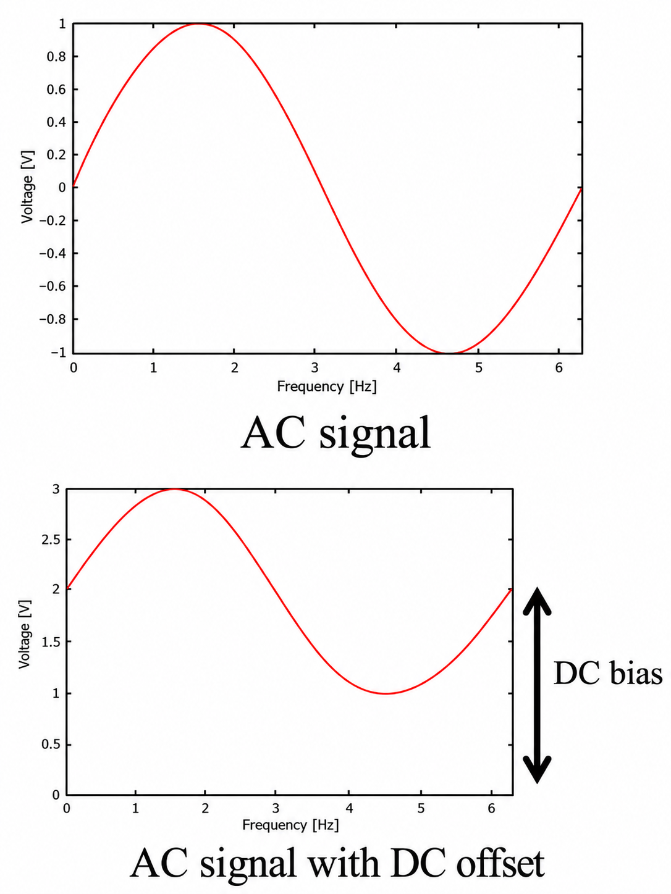

# 1. Khái niệm và tác dụng của điện áp BIAS

**Điện áp BIAS** là mức điện áp một chiều (DC) dùng để đặt điểm làm việc của mạch. Trong mạch đo tín hiệu xoay chiều, BIAS tạo mức nền để tín hiệu nằm trong dải điện áp đầu vào cho phép [1], [2]:

$$
v_{\mathrm{đo}}(t)=V_{\mathrm{BIAS}}+v_{\mathrm{tín\ hiệu}}(t)
$$

Sau khi cộng BIAS, tín hiệu dao động quanh mức nền mới, còn **biên độ và hình dạng sóng giữ nguyên**.

# 2. Ảnh hưởng của BIAS đến dạng sóng

*Hình 1. Ví dụ tín hiệu AC trước và sau khi cộng DC bias [2, trang 13].*

**Trong hình này, DC bias và DC offset cùng chỉ mức nền DC 2 V được cộng vào tín hiệu**, nên có thể hiểu tương đương [2]. “Bias” nhấn mạnh điện áp dùng để đặt điểm làm việc của mạch; “offset” nhấn mạnh mức lệch của tín hiệu so với 0 V. Vì vậy, “AC signal with DC offset” là tín hiệu AC có thêm mức nền DC, còn biên độ sóng giữ nguyên [1], [2].

Trong Hình 1, tín hiệu ban đầu từ **−1 đến +1 V**. Sau khi cộng BIAS = 2 V, tín hiệu từ **1 đến 3 V**. Với $V_H$, $V_L$ là điện áp lớn nhất và nhỏ nhất, biên độ $A$ được tính bằng:

$$
A=\frac{V_H-V_L}{2};\qquad
A_{\mathrm{trước}}=\frac{1-(-1)}{2}=1\,\mathrm{V};\qquad
A_{\mathrm{sau}}=\frac{3-1}{2}=1\,\mathrm{V}
$$

Như vậy, **biên độ vẫn là 1 V, điện áp đỉnh–đỉnh vẫn là 2 V**. Sóng dưới trông thấp hơn vì trục đứng trải từ 0 đến 3 V, còn đồ thị trên chỉ trải từ −1 đến +1 V. Sự khác biệt nằm ở thang hiển thị, không phải biên độ tín hiệu.

*Trục ngang trong ảnh ghi “Frequency [Hz]” chưa phù hợp với hình minh họa dạng sóng; không dùng nhãn này để suy tần số tín hiệu.*

# 3. Lựa chọn và tạo điện áp BIAS

**Nhóm lựa chọn đặt BIAS ở giữa dải đo dựa trên tính toán khoảng dao động của tín hiệu và hướng dẫn thiết kế mạch nguồn đơn trong AN-581 của Analog Devices** [1]. Để tín hiệu có cùng khoảng dao động về hai phía, đặt $V_{\mathrm{BIAS}}-V_{\min}=V_{\max}-V_{\mathrm{BIAS}}$; giải phương trình này thu được công thức bên dưới. Nhóm sử dụng cầu chia áp kết hợp bộ đệm để tạo mức nền, dựa trên nguyên lý chia áp [2] và cấu hình bộ đệm op-amp [3].

Để tín hiệu đối xứng có khoảng dao động bằng nhau ở hai phía, chọn BIAS tại giữa dải điện áp sử dụng được [1]:

$$
V_{\mathrm{BIAS}}=\frac{V_{\min}+V_{\max}}{2}
$$

Ví dụ, dải 0–3,3 V cho $V_{\mathrm{BIAS}}=(0+3{,}3)/2=1{,}65$ V. Biên độ tín hiệu phải được giới hạn để điện áp sau khi cộng nền không vượt dải này.

Mức nền có thể được tạo bằng cầu chia áp: R1 nối từ nguồn đến điểm giữa, R2 nối từ điểm giữa xuống GND. Khi chưa có tải [2]:

$$
V_M=V_{\mathrm{CC}}\frac{R2}{R1+R2}
$$

Với R1 = R2, mức nền bằng nửa nguồn. Nếu tải làm sụt điện áp cầu chia, dùng **bộ đệm op-amp** để hạn chế ảnh hưởng của tải [3]; tụ lọc giúp giảm nhiễu nguồn tại mức nền [1]. Mức nền ổn định giúp giảm sai lệch khi đo và khi trừ BIAS khỏi kết quả.

**Tài liệu tham khảo**

[1] Charles Kitchin, Analog Devices, [AN-581: Biasing and Decoupling Op Amps in Single Supply Applications](https://www.analog.com/en/resources/app-notes/an-581.html). Đặt điểm làm việc giữa nguồn và lọc nhiễu mức nền.

[2] Anyes Taffard, University of California, Irvine, [Voltage Divider, Capacitor, RC Circuits](https://cpb-us-e2.wpmucdn.com/sites.uci.edu/dist/b/1759/files/2017/12/Week1_VoltageDivider_Cap_RC.pdf), trang 2–3 và 13–14. Cầu chia áp, ảnh hưởng của tải và tín hiệu AC có mức lệch DC.

[3] Microchip, [MCP6001/1R/1U/2/4 — DS20001733L](https://ww1.microchip.com/downloads/aemDocuments/documents/MSLD/ProductDocuments/DataSheets/MCP6001-1R-1U-2-4-1-MHz-Low-Power-Op-Amp-DS20001733L.pdf), mục 4.7.1 “Unity Gain Buffer”. Nguyên lý sử dụng op-amp làm bộ đệm.
