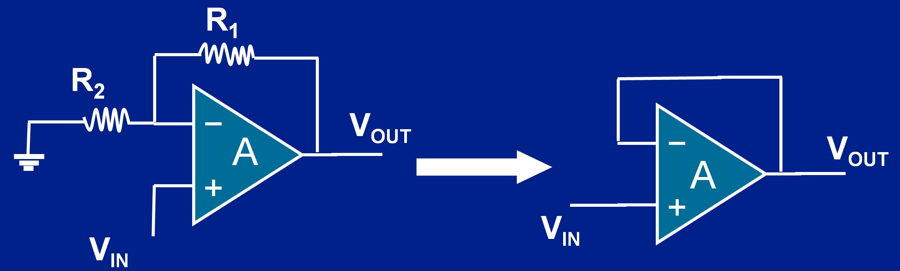

# 1. Hồi tiếp âm trong mạch đệm điện áp

Op-amp khuếch đại chênh lệch giữa điện áp chân (+) và chân (−). Trong vùng tuyến tính:

$$
V_{\mathrm{out}}=A\times(V_+-V_-)
$$

$V_{\mathrm{out}}$ là điện áp đầu ra; $V_+$ và $V_-$ là điện áp tại chân không đảo và chân đảo; $A$ là hệ số khuếch đại vòng hở (open-loop gain), tức độ lợi khi chưa có hồi tiếp. Ở tần số thấp, độ lợi này có thể đạt cỡ $10^5$–$10^6$ lần, tùy op-amp và điều kiện hoạt động. Ví dụ, MCP6002 có độ lợi DC điển hình **112 dB**, tương ứng $A=10^{112/20}\approx4\times10^5$ lần trong điều kiện thử của hãng [3]. Với độ lợi lớn như vậy, chênh lệch đầu vào nhỏ cũng có thể làm đầu ra bão hòa [1].

**Hồi tiếp âm** được thực hiện bằng cách đưa điện áp đầu ra trở về **đầu vào đảo (−)** để giảm chênh lệch với **đầu vào không đảo (+)** [1]. Cách hoạt động này được minh họa bằng mạch đệm điện áp dưới đây.

*Hình 1. Từ mạch khuếch đại không đảo (trái) đến mạch đệm điện áp (phải). Ảnh do người dùng cung cấp.*

Ở mạch bên trái, R1 đưa điện áp đầu ra về chân (−), còn R2 nối chân này xuống GND. Khi thay R1 bằng dây nối và bỏ nhánh R2, ta được mạch đệm bên phải: đầu ra nối trực tiếp về chân (−), tín hiệu $V_{\mathrm{in}}$ đưa vào chân (+) [2]. Ký hiệu $V_{\mathrm{OUT}}$ trong hình tương ứng với $V_{\mathrm{out}}$ trong công thức.

Trong mạch đệm, $V_-=V_{\mathrm{out}}$. Nếu điện áp chân (−) cao hơn chân (+), đầu ra giảm; nếu thấp hơn, đầu ra tăng. Nhờ hồi tiếp này, khi mạch ổn định và hoạt động tuyến tính, $V_-\approx V_+$ [1]. Thay $V_-=V_{\mathrm{out}}$ vào công thức op-amp:

$$
V_{\mathrm{out}}=A\times(V_+-V_{\mathrm{out}})
$$

Thu gọn được:

$$
\frac{V_{\mathrm{out}}}{V_+}=\frac{A}{1+A}\approx1
$$

Bộ đệm **giữ điện áp đầu ra gần bằng đầu vào**. Do op-amp có **trở kháng đầu vào rất lớn**, dòng từ nguồn tín hiệu đi vào chân (+) rất nhỏ; với op-amp lý tưởng, dòng này bằng 0 [1]. Dòng cấp cho tải được cung cấp từ đầu ra op-amp trong giới hạn IC, giúp hạn chế tải làm sụt điện áp của nguồn tín hiệu nối vào **chân không đảo (+)** [2].

# 2. Vai trò trong sơ đồ nguyên lý của đồ án

| Kênh                        | Cách hồi tiếp                                    | Tác dụng                                                                   |
| --------------------------- | ------------------------------------------------ | -------------------------------------------------------------------------- |
| **U3B — đệm BIAS**          | Chân 7 nối chân 6; chân 5 nhận mức giữa cầu chia | Hạn chế tải làm sụt điện áp cầu chia BIAS, giữ nền gần 1,65 V.             |
| **U3A — đệm tín hiệu dòng** | Chân 1 nối chân 2; chân 3 nhận tín hiệu          | Hạn chế đường đo phía sau ảnh hưởng tín hiệu đầu vào.                      |
| **U4B — kênh không dùng**   | Chân 7 nối chân 6; chân 5 nhận BIAS              | Giữ kênh ở trạng thái xác định, hạn chế nhiễu chéo [3].                    |
| **U4A — TIA quang**         | Điện trở và tụ hồi tiếp từ đầu ra về chân (−)    | Giữ chân (−) gần BIAS; đầu ra thay đổi để bù dòng quang qua mạng hồi tiếp. |

**U4A chuyển dòng quang của BPW34 thành điện áp.** Với cách nối trong đồ án, khi mạch hoạt động tuyến tính, dòng quang càng lớn thì điện áp đầu ra càng cao so với mức BIAS. Điện áp này qua **hai tầng lọc thông thấp** rồi tới **PA1 (ADC_LIGHT)** để bộ ADC trong MCU chuyển thành giá trị số, phục vụ nhận biết thay đổi ánh sáng.

Xem thêm: [Điện áp BIAS](Dien_ap_BIAS.md).

# Tài liệu tham khảo

[1] Analog Devices, [MT-032: Ideal Voltage Feedback Op Amp](https://www.analog.com/media/en/training-seminars/tutorials/MT-032.pdf). Nguyên lý op-amp và hồi tiếp âm.

[2] Microchip, [Voltage Follower](https://developerhelp.microchip.com/xwiki/bin/view/products/amplifiers-linear/operational-amplifier-ics/introduction/basic-configurations/closed-loop/voltage-follower/). Nguyên lý bộ đệm điện áp và quan hệ với cấu hình khuếch đại không đảo.

[3] Microchip, [MCP6001/1R/1U/2/4 — DS20001733L](https://ww1.microchip.com/downloads/aemDocuments/documents/MSLD/ProductDocuments/DataSheets/MCP6001-1R-1U-2-4-1-MHz-Low-Power-Op-Amp-DS20001733L.pdf), mục 4.5 và 4.7.1. Kênh không dùng và cấu hình đệm.
