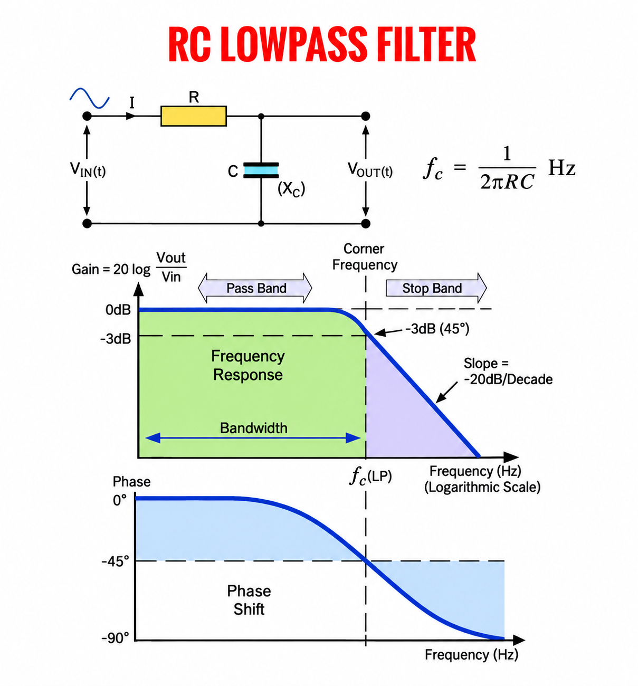
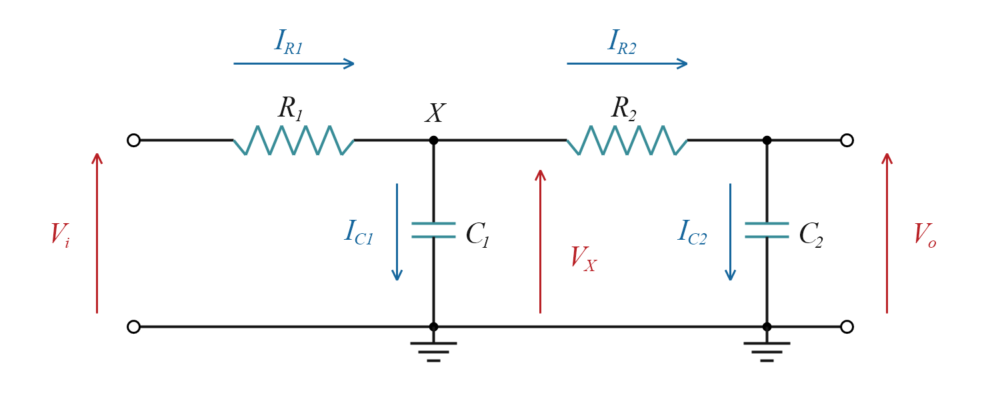
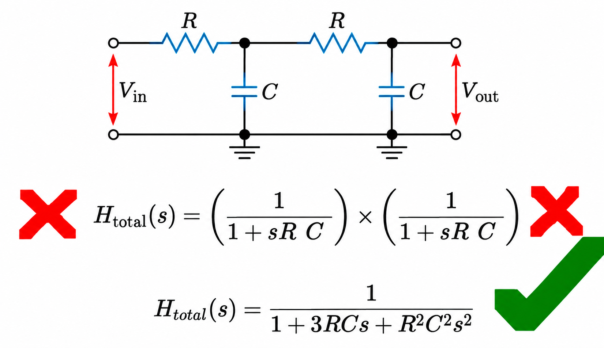
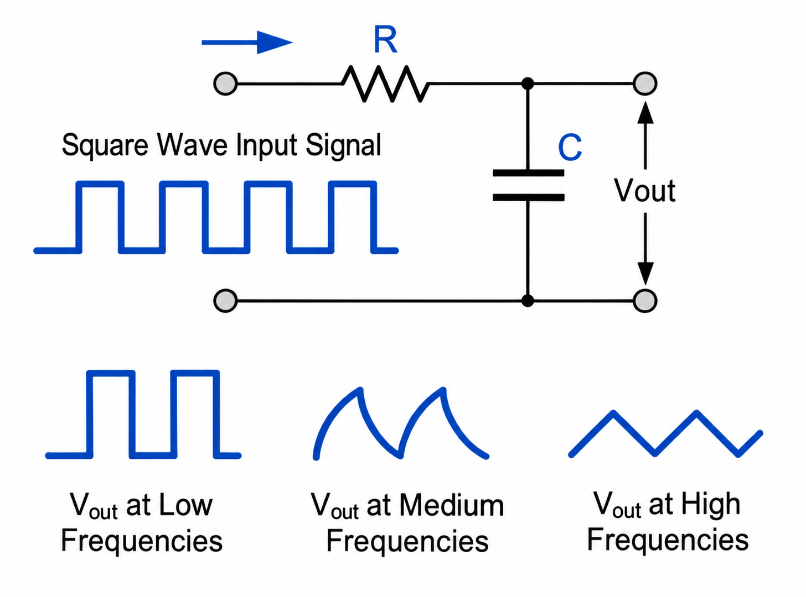
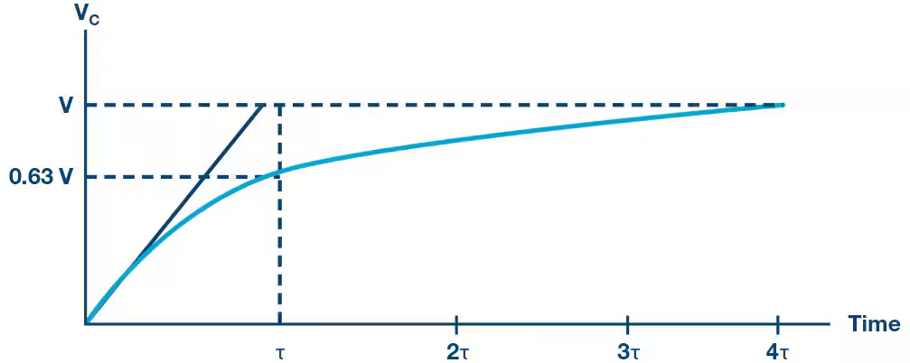
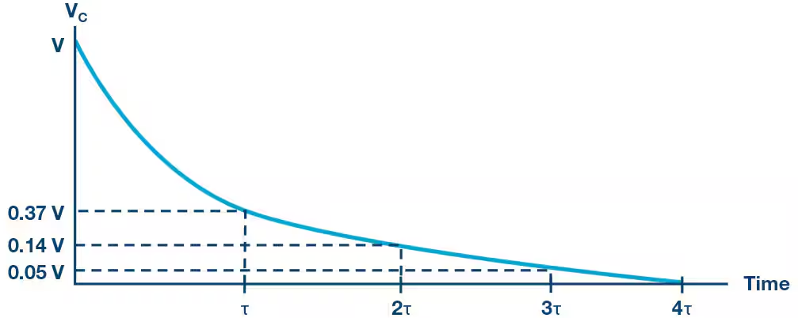

# Phụ lục — Lý thuyết bộ lọc thông thấp RC

## 1. Bộ lọc thông thấp một tầng

*Hình 1. Sơ đồ mạch và đáp ứng biên độ, pha của bộ lọc thông thấp RC một tầng.*

### 1.1. Sơ đồ mạch và công thức

Sơ đồ mạch trong hình gồm điện trở R nối tiếp và tụ C xuống GND; điện áp đầu ra được lấy trên tụ. Ký hiệu $X_C$ chỉ độ lớn dung kháng, $X_C=1/(2\pi fC)$. Ở tần số thấp, dung kháng lớn nên điện áp đầu ra gần bằng đầu vào. Khi tần số tăng, dung kháng giảm, dòng qua R và sụt áp trên R tăng, làm điện áp đầu ra giảm. Đây là nguyên lý lọc thông thấp [1].

Tỉ số biên độ điện áp đầu ra so với đầu vào được tính theo công thức sau, bỏ qua trở kháng nguồn và dòng mà mạch phía sau lấy từ đầu ra [4]:

$$
K_1(f)=\frac{\hat V_o}{\hat V_i}
=\frac{1}{\sqrt{1+(f/f_c)^2}}
=\frac{1}{\sqrt{1+(2\pi fRC)^2}},
\qquad
f_c=\frac{1}{2\pi RC}
$$

Trong đó, $\hat V_i$, $\hat V_o$ là biên độ trước và sau lọc; R tính bằng Ω, C bằng F. **$f$ là tần số của tín hiệu sin đưa vào bộ lọc**, tính bằng Hz, lấy từ tần số cài trên máy phát tín hiệu hoặc đo từ tín hiệu thực tế. Thay $f$ vào công thức để tính tỷ số biên độ tại tần số đó. 

**Tần số cắt $f_c$ (cutoff frequency)** là tần số tại đó biên độ đầu ra còn 70,7% đầu vào (−3 dB). Với bộ lọc RC một tầng, tần số càng thấp hơn $f_c$ thì biên độ càng ít suy giảm; tần số càng cao hơn $f_c$ thì biên độ càng suy giảm nhiều. Chọn R và C để đặt mốc này phù hợp với dải tần tín hiệu cần đo.

### 1.2. Đồ thị thứ nhất — Biên độ

Đồ thị thứ nhất có trục đứng là Gain (độ lợi, dB), trục ngang là Frequency (tần số, Hz). Nhãn “Logarithmic Scale” dưới trục ngang cho biết tần số được biểu diễn theo thang logarit. Với thang logarit cơ số 10, các mốc dạng $10^n$ cách đều nhau, mỗi bước tăng một đơn vị số mũ tương ứng tần số tăng 10 lần. Ví dụ cách chia thang đo: 10 → 100 → 1000 Hz, mỗi bước tăng gấp 10 và cách đều trên trục. Hình không ghi các mốc số cụ thể này. Đường cong cho biết kết quả khi thay đổi tần số của tín hiệu sin đầu vào.

**$G_{\mathrm{dB}}(f)$ là độ lợi điện áp biểu diễn bằng decibel (dB)**, cho biết biên độ điện áp đầu ra lớn hay nhỏ hơn đầu vào. Độ lợi được xác định từ tỉ số biên độ đầu ra/đầu vào $K_1(f)=\hat V_o/\hat V_i$, rồi chuyển sang đơn vị dB theo công thức [4]:

$$
G_{\mathrm{dB}}(f)=20\log_{10}\left(\frac{\hat V_o}{\hat V_i}\right)
=20\log_{10}K_1(f)
$$

Giá trị 0 dB nghĩa là biên độ đầu ra bằng đầu vào; giá trị dương là tăng, giá trị âm là giảm. Tại tần số cắt:

$$
G_{\mathrm{dB}}(f_c)=20\log_{10}\left(\frac{1}{\sqrt{2}}\right)
\approx-3{,}01\,\mathrm{dB}
$$

Ví dụ, đầu vào có biên độ 1 V thì tại $f_c$, đầu ra còn khoảng 0,707 V, tức giảm khoảng 29,3% biên độ.

- **Frequency Response — đáp ứng tần số:** Cho biết bộ lọc làm thay đổi biên độ và pha ra sao ở từng tần số. Trong hình, đường cong màu xanh dương đậm ở đồ thị thứ nhất cho biết: tại mỗi tần số đầu vào, tín hiệu bị suy giảm bao nhiêu dB sau khi qua bộ lọc.
- **Pass Band — dải thông:** Vùng tần số được cho qua với mức suy giảm nhỏ; ở tần số thấp hơn nhiều so với $f_c$, $K_1\approx1$ và độ lợi gần 0 dB.
- **Corner Frequency — tần số cắt:** Mốc $f_c$ tại đó độ lợi khoảng −3 dB, tức biên độ đầu ra còn khoảng 70,7% đầu vào.
- **Bandwidth — băng thông:** Độ rộng dải thông. Với bộ lọc thông thấp trong hình, dải này tính từ DC (0 Hz) đến $f_c$, nên băng thông bằng $f_c$.
- **Stop Band — dải suy giảm:** Vùng tần số cao mà tín hiệu bị suy giảm đáng kể. Đường cong RC chuyển dần từ dải thông sang vùng này; mức suy giảm phụ thuộc vào tần số của tín hiệu đưa vào bộ lọc.
- **Slope — độ dốc:** Mức thay đổi độ lợi trên đồ thị khi tần số tăng. Với một tầng RC, ở vùng cao tần, độ dốc tiến tới −20 dB/decade.
- **Decade — khoảng tăng tần số gấp 10:** −20 dB/decade nghĩa là khi tần số tăng 10 lần trong vùng cao tần, độ lợi giảm thêm khoảng 20 dB, tương ứng tỷ số biên độ giảm còn khoảng 1/10.

### 1.3. Đồ thị thứ hai — Pha

**Đường cong màu xanh dương đậm ở đồ thị thứ hai** cho biết điện áp đầu ra trễ pha bao nhiêu so với điện áp đầu vào tại mỗi tần số tín hiệu. Trục ngang là tần số tín hiệu đưa vào bộ lọc; trục đứng là Phase Shift (độ lệch pha), tính bằng độ.

Với tín hiệu sin, trễ pha nghĩa là đỉnh sóng đầu ra xuất hiện muộn hơn đỉnh sóng đầu vào. Do tụ cần thời gian nạp/xả, điện áp trên tụ không thay đổi tức thời theo đầu vào. Độ lệch pha được tính theo [4]:

$$
\varphi(f)=-\arctan(2\pi fRC)
=-\arctan\left(\frac{f}{f_c}\right)
$$

Trong đó, $\varphi(f)$ là độ lệch pha tại tần số đầu vào $f$; $f_c$ là tần số cắt. Khi đọc góc theo độ như trong hình, tính arctan ở chế độ độ (DEG). Dấu âm cho biết đầu ra trễ pha so với đầu vào.

Đọc đường cong từ trái sang phải:

- **Tần số thấp hơn nhiều so với $f_c$:** Đường cong gần 0°, hai sóng gần như đạt đỉnh cùng lúc.
- **Tại $f=f_c$:** Đường cong đi qua −45°. Vì một chu kỳ ứng với 360°, đầu ra trễ $45/360=1/8$ chu kỳ so với đầu vào.
- **Tần số cao hơn nhiều so với $f_c$:** Đường cong tiến tới −90°, tương ứng đầu ra trễ gần 1/4 chu kỳ. Đồng thời, biên độ đầu ra đã bị suy giảm như đồ thị thứ nhất.

Đồ thị này biểu diễn góc lệch pha theo tần số. Với một sóng sin có chu kỳ $T=1/f$, thời gian trễ tương ứng là $\Delta t=(|\varphi|/360^\circ)T$.

## 2. Bộ lọc thông thấp hai tầng

### 2.1. Sơ đồ và ký hiệu

*Hình 2. Sơ đồ mạch bộ lọc thông thấp hai tầng.*

Trong Hình 2, tầng một gồm $R_1$, $C_1$; tầng hai gồm $R_2$, $C_2$. Đầu ra tầng một là nút X, nối trực tiếp với đầu vào tầng hai. Điện áp đầu ra của cả mạch được lấy trên $C_2$.

Các ký hiệu:

- $V_i$: điện áp đầu vào; $V_X$: điện áp tại nút X; $V_o$: điện áp đầu ra. Cả ba đều lấy so với GND.
- $I_{R1}$, $I_{R2}$: dòng qua $R_1$, $R_2$ theo chiều từ trái sang phải.
- $I_{C1}$, $I_{C2}$: dòng qua $C_1$, $C_2$ theo chiều từ nút phía trên xuống GND.

Mũi tên xanh chỉ chiều dòng điện quy ước. Xét hai tầng có cùng giá trị linh kiện: $R_1=R_2=R$, $C_1=C_2=C$. Nguồn được coi là có trở kháng bằng không và đầu ra không có tải ngoài; nhánh $R_2$, $C_2$ lấy dòng từ nút X.

Mục tiêu là tìm hàm truyền $H_2(s)=V_o(s)/V_i(s)$ để tính tần số cắt của cả mạch. Ta dùng ==phép biến đổi Laplace để chuyển các phương trình có đạo hàm theo thời gian thành phương trình đại số== dễ giải hơn [5].

Trong miền thời gian, điện áp và dòng điện được viết là $v(t)$, $i(t)$. Sau biến đổi Laplace, chúng được viết là $V(s)=\mathcal{L}\{v(t)\}$, $I(s)=\mathcal{L}\{i(t)\}$; $\mathcal{L}$ là ký hiệu phép biến đổi. Biến $s=\sigma+j\omega$ là biến tần số phức, có đơn vị $\mathrm{s^{-1}}$, với $\sigma$ là phần thực, $\omega$ là tần số góc và $j^2=-1$. Các điện áp $V_i$, $V_X$, $V_o$ và dòng điện viết bằng chữ hoa trong các công thức bên dưới đều thuộc miền Laplace; đối số $(s)$ được lược bớt cho gọn.

### 2.2. Ảnh hưởng giữa hai tầng

*Hình 3. Hai tầng RC nối trực tiếp: hàm truyền toàn mạch có xét ảnh hưởng tải giữa hai tầng.*

Hình 3 đối chiếu hai biểu thức hàm truyền của mạch hai tầng RC nối trực tiếp. Biểu thức có dấu × đỏ coi mỗi tầng đều có hàm truyền của một tầng đứng riêng không tải; biểu thức có dấu ✓ xanh đã tính đến dòng mà tầng sau lấy từ tầng trước. Có thể thấy nguyên nhân của sự khác nhau này từ các dòng điện trong Hình 2.

Với một tầng RC đứng riêng và đầu ra không có tải, điện trở chỉ cấp dòng cho tụ của tầng đó. Khi ấy, hàm truyền là $1/(1+sRC)$ **(cách suy ra kết quả này được trình bày ở mục 2.3 bên dưới).**

Trong Hình 2, dòng qua $R_1$ đến nút X chia thành hai nhánh: $I_{C1}$ đi qua $C_1$, còn $I_{R2}$ đi qua $R_2$ rồi qua $C_2$. Vì $R_1$ phải cấp dòng cho cả hai nhánh, sụt áp trên $R_1$ và điện áp $V_X$ thay đổi so với khi tầng một đứng riêng. Nhánh $R_2$, $C_2$ chính là tải của tầng một; đây là ảnh hưởng tải giữa hai tầng [2].

Do đó, không thể gán $V_X/V_i=1/(1+sRC)$ cho tầng một trong mạch đã nối. Công thức có dấu × đỏ sai vì đã dùng hàm truyền của một tầng không tải cho cả hai tầng:

$$
\frac{1}{1+sRC}\times\frac{1}{1+sRC}
=\frac{1}{1+2sRC+(sRC)^2}
$$

**Phép nhân các tỷ số truyền vẫn đúng**, vì điện áp trung gian $V_X$ triệt tiêu:

$$
\frac{V_o}{V_i}=\frac{V_X}{V_i}\times\frac{V_o}{V_X}
$$

Điều cần tìm là các tỷ số thực tế khi hai tầng đã nối với nhau. Muốn vậy, ta viết phương trình dòng điện tại nút X và nút đầu ra.

### 2.3. Phương trình dòng điện

Định luật dòng điện Kirchhoff cho biết tổng dòng đi vào một nút bằng tổng dòng đi ra. Định luật này vẫn được giữ nguyên sau biến đổi Laplace, vì phép biến đổi có tính tuyến tính: biến đổi của một tổng bằng tổng các biến đổi. Ta chỉ cần đổi quan hệ dòng–áp của từng linh kiện sang miền $s$ trước khi viết phương trình nút.

**Điện trở**

Trong miền thời gian, $i_R(t)=u_R(t)/R$. Sau biến đổi Laplace, quan hệ vẫn là $I_R(s)=U_R(s)/R$, nên trở kháng của điện trở là $Z_R=R$. Điện áp $U_R$ được lấy theo chiều dòng điện quy ước.

**Tụ điện**

Quan hệ dòng–áp của tụ chứa đạo hàm: $i_C(t)=C\,du_C(t)/dt$. Ta dùng tính chất biến đổi Laplace của đạo hàm [5]:

$$
\mathcal{L}\left\{\frac{du_C(t)}{dt}\right\}
=sU_C(s)-u_C(0^-)
$$

Ở đây, $u_C(0^-)$ là điện áp trên tụ ngay trước thời điểm bắt đầu xét. Vì vậy, biến đổi phương trình của tụ cho:

$$
I_C(s)=C\big[sU_C(s)-u_C(0^-)\big]
$$

Khi lập hàm truyền, xét điều kiện đầu bằng không, tức điện áp ban đầu trên cả hai tụ bằng không. Khi đó, phần đạo hàm trở thành phép nhân với $s$:

$$
I_C=sCU_C,
\qquad
Z_C(s)=\frac{U_C}{I_C}=\frac{1}{sC}
$$

$U_C$ là điện áp trên tụ từ bản phía trên xuống GND; dòng quy ước đi vào bản phía trên. Do đó, $U_{C1}=V_X$, $U_{C2}=V_o$, nên $I_{C1}=sCV_X$ và $I_{C2}=sCV_o$. Đây là nguồn gốc các hạng tử $sC$ trong phương trình nút.

**Hàm truyền một tầng**

Ở đây, $H_1(s)$ là hàm truyền, tức tỷ số giữa biến đổi Laplace của điện áp đầu ra và đầu vào khi điều kiện đầu bằng không. Nếu chỉ xét tầng $R_1$, $C_1$ đứng riêng không tải, ta có $H_1(s)=V_X(s)/V_i(s)$. Quan hệ này không áp dụng trực tiếp khi nối thêm tầng hai.

Cũng từ hai trở kháng $Z_R=R$, $Z_C=1/(sC)$, công thức chia áp của một tầng RC không tải cho:

$$
H_1(s)=\frac{V_X(s)}{V_i(s)} =\frac{Z_C}{R+Z_C}
=\frac{1/(sC)}{R+1/(sC)}
=\frac{1}{1+sRC}
$$

Đây là công thức một tầng đã dùng ở mục 2.2. Với hai tầng nối trực tiếp, cần áp dụng các quan hệ dòng–áp trên cho cả hai nút như sau.

**Tại nút X**, dòng $I_{R1}$ đi vào chia thành $I_{C1}$ và $I_{R2}$ đi ra:

$$
I_{R1}=I_{C1}+I_{R2}
$$

Điện áp trên $R_1$ là $V_i-V_X$, trên $C_1$ là $V_X$, còn trên $R_2$ là $V_X-V_o$. Thay vào phương trình dòng điện:

$$
\underbrace{\frac{V_i-V_X}{R}}_{I_{R1}}
=\underbrace{sCV_X}_{I_{C1}}
+\underbrace{\frac{V_X-V_o}{R}}_{I_{R2}}
$$

**Tại nút đầu ra:** không có tải ngoài nên toàn bộ dòng qua $R_2$ đi qua $C_2$. Điện áp trên $R_2$ là $V_X-V_o$, còn trên $C_2$ là $V_o$:

$$
I_{R2}=I_{C2}
\qquad\Rightarrow\qquad
\frac{V_X-V_o}{R}=sCV_o
$$

Hai phương trình trên liên hệ ba điện áp $V_i$, $V_X$, $V_o$. Bước tiếp theo là loại $V_X$ để tìm quan hệ trực tiếp giữa đầu vào và đầu ra.

### 2.4. Hàm truyền

Từ phương trình tại đầu ra, nhân hai vế với R rồi chuyển vế:

$$
V_X-V_o=sRCV_o
\quad\Rightarrow\quad
V_X=(1+sRC)V_o
$$

Từ phương trình tại nút X, nhân hai vế với R và gom các hạng tử chứa $V_X$:

$$
V_i-V_X=sRCV_X+V_X-V_o
\quad\Rightarrow\quad
V_i=(2+sRC)V_X-V_o
$$

Thay $V_X=(1+sRC)V_o$ vào:

$$
V_i=\big[(2+sRC)(1+sRC)-1\big]V_o
=\big[1+3sRC+(sRC)^2\big]V_o
$$

Chia hai vế cho $V_i$ và hệ số $1+3sRC+(sRC)^2$, ta được:

$$
\boxed{H_2(s)=\frac{V_o}{V_i}
=\frac{1}{1+3sRC+(sRC)^2}}
$$

Đây là công thức có dấu ✓ xanh trong Hình 3. 

$H_2(s)$ mô tả cả tỷ số biên độ và độ lệch pha; chưa thể coi trực tiếp biểu thức này là tỷ số biên độ của tín hiệu sin. Để tính tỷ số biên độ tại một tần số cụ thể, cần thay $s=j2\pi f$ rồi lấy độ lớn, cụ thể xem ở mục 2.5.

Kết quả cũng cho thấy rõ cách nhân các tỷ số truyền cho đúng. Từ $V_X=(1+sRC)V_o$ và hàm truyền vừa tìm được:

$$
\frac{V_X}{V_i}=\frac{1+sRC}{1+3sRC+(sRC)^2},
\qquad
\frac{V_o}{V_X}=\frac{1}{1+sRC}
$$

Nhân hai tỷ số này, thừa số $1+sRC$ triệt tiêu và thu được đúng $H_2(s)$. Như vậy, tỷ số từ X đến đầu ra vẫn có dạng một tầng RC, còn tỷ số từ đầu vào đến X đã thay đổi do tải của tầng hai.

### 2.5. Tần số cắt

Sau khi có hàm truyền đúng, ta tìm tần số cắt của cả mạch: tần số mà biên độ đầu ra còn $1/\sqrt{2}\approx70{,}7\%$ đầu vào.

**Đáp ứng sin xác lập**

Với $s=\sigma+j\omega$, số mũ phức có dạng $e^{st}=e^{\sigma t}e^{j\omega t}$: phần $e^{\sigma t}$ biểu diễn tăng hoặc giảm theo hàm mũ, còn $e^{j\omega t}=\cos\omega t+j\sin\omega t$ biểu diễn dao động sin. Với mạch RC ổn định, sau khi thành phần quá độ đã tắt, đáp ứng với tín hiệu sin được tính bằng cách đánh giá hàm truyền trên trục ảo, tức $\sigma=0$ [5]:

$$
s=j\omega=j2\pi f
$$

Đây là bước **==chuyển từ hàm truyền $H_2(s)$ sang đáp ứng tần số $H_2(j2\pi f)$==**; không phải mọi bài toán Laplace đều thay $s=j2\pi f$. Phần này chỉ cần đáp ứng sin xác lập nên không cần biến đổi Laplace ngược về miền thời gian.

Đặt $x=2\pi fRC$ để viết gọn. Khi đó $sRC=jx$ và $(sRC)^2=(jx)^2=-x^2$ do $j^2=-1$. Thay vào hàm truyền:

$$
H_2(j2\pi f)=\frac{1}{1-x^2+j3x}
$$

**Tỷ số biên độ**

Với số phức $a+jb$, độ lớn là $|a+jb|=\sqrt{a^2+b^2}$. Áp dụng cho mẫu số $1-x^2+j3x$, ta có độ lớn $\sqrt{(1-x^2)^2+(3x)^2}$. Vì tử số bằng 1, tỷ số biên độ đầu ra/đầu vào là:

$$
K_2(f)=\frac{\hat V_o}{\hat V_i}
=|H_2(j2\pi f)|
=\frac{1}{\sqrt{(1-x^2)^2+9x^2}}
$$

Ở đây, $\hat V_i$, $\hat V_o$ là biên độ của hai tín hiệu sin, khác với các biến đổi Laplace $V_i(s)$, $V_o(s)$ dùng khi lập phương trình mạch.

**Điều kiện tần số cắt**

Tại tần số cắt mà mạch có độ lợi điện áp khoảng −3 dB, $K_2=1/\sqrt{2}$. Bình phương hai vế rồi chuyển vế, ta được:

$$
(1-x^2)^2+9x^2=2
\quad\Rightarrow\quad x^4+7x^2-1=0
$$

Đặt $y=x^2$, phương trình trở thành $y^2+7y-1=0$. Chọn nghiệm dương $y=(\sqrt{53}-7)/2$, rồi lấy $x=\sqrt{y}$ vì tần số cần tìm lớn hơn 0:

$$
x=\sqrt{\frac{\sqrt{53}-7}{2}}\approx0{,}3742
$$

Vì $f=x/(2\pi RC)$, tần số cắt của cả mạch là:

$$
\boxed{f_{c,\mathrm{total}}=
\frac{1}{2\pi RC}\sqrt{\frac{\sqrt{53}-7}{2}}
\approx0{,}3742\,f_c}
$$

Ở đây, $f_c=1/(2\pi RC)$ là tần số cắt của một tầng đứng riêng. Với mỗi tầng 1 kΩ/10 nF, $f_c\approx15{,}915\,\mathrm{kHz}$, còn tần số cắt của cả hai tầng nối trực tiếp là:

$$
f_{c,\mathrm{total}}\approx0{,}3742\times15{,}915
\approx5{,}96\,\mathrm{kHz}
$$

Như vậy, không thể lấy tần số cắt của một tầng làm tần số cắt của cả mạch hai tầng. Giá trị 5,96 kHz là kết quả tính theo mô hình trên, chưa phải số đo thực tế.

## 3. Khả năng giảm nhiễu và đáp ứng xung

### 3.1. Suy giảm cao tần

Phần 1 và 2 đã cho tỷ số biên độ $K_1(f)$, $K_2(f)$ của bộ lọc một tầng và hai tầng. Các tỷ số này cho biết mỗi thành phần sin còn lại bao nhiêu sau lọc. Vì vậy, bộ lọc có thể giảm nhiễu nằm ở vùng tần số bị suy giảm mạnh, nhưng cũng làm giảm các thành phần của tín hiệu có ích nếu chúng nằm trong cùng vùng đó.

**Xấp xỉ cao tần**

Đặt $x=2\pi fRC$ như ở phần 2 và giữ nguyên R, C. Với một tầng, khi $x^2\gg1$, hạng tử 1 nhỏ so với $x^2$, nên:

$$
K_1(f)=\frac{1}{\sqrt{1+x^2}}
\approx\frac{1}{x}=\frac{1}{2\pi fRC}
$$

Với hai tầng, khi $x^4\gg7x^2+1$, hạng tử $x^4$ chi phối mẫu số, nên:

$$
K_2(f)=\frac{1}{\sqrt{(1-x^2)^2+9x^2}}
=\frac{1}{\sqrt{x^4+7x^2+1}}
\approx\frac{1}{x^2}=\frac{1}{(2\pi fRC)^2}
$$

Vì R, C cố định nên các hệ số chứa $2\pi RC$ là hằng số; từ các biểu thức trên, ở vùng cao tần có $K_1(f)\propto1/f$ và $K_2(f)\propto1/f^2$ [6].
> Ký hiệu $\propto$ nghĩa là **“tỷ lệ thuận với”**.

**Mức thay đổi sau một decade**

Một decade là khoảng tần số tăng 10 lần, từ $f$ lên $10f$. Để biết tỷ số biên độ thay đổi bao nhiêu, ta so sánh đáp ứng của cùng một bộ lọc tại hai tần số này, với cả hai nằm trong vùng áp dụng xấp xỉ cao tần.

Với một tầng:

$$
\frac{K_1(10f)}{K_1(f)}
\approx\frac{1/[2\pi RC(10f)]}{1/(2\pi RCf)}
=\frac{1}{10}
$$

Với hai tầng:

$$
\frac{K_2(10f)}{K_2(f)}
\approx\frac{1/[2\pi RC(10f)]^2}{1/(2\pi RCf)^2}
=\frac{1}{100}
$$

Các hệ số chứa $2\pi RC$ triệt tiêu khi lấy tỷ số. Như vậy, $K_1(10f)$ còn khoảng $1/10$ của $K_1(f)$, còn $K_2(10f)$ còn khoảng $1/100$ của $K_2(f)$. Với cùng biên độ tín hiệu đầu vào và cả hai tần số đều thuộc vùng cao tần, khi tăng tần số từ $f$ lên $10f$, ==biên độ đầu ra của cùng bộ lọc còn khoảng $1/10$ đối với một tầng hoặc $1/100$ đối với hai tầng so với biên độ đầu ra tại $f$.==

**Độ dốc theo dB**

Theo phần 1, $G_{\mathrm{dB}}(f)=20\log_{10}K(f)$. Do đó, mức thay đổi độ lợi khi tần số tăng từ $f$ lên $10f$ là:

$$
\Delta G=G_{\mathrm{dB}}(10f)-G_{\mathrm{dB}}(f)
=20\log_{10}\frac{K(10f)}{K(f)}
$$

Gọi $\Delta G_1$ là mức thay đổi độ lợi của bộ lọc một tầng và $\Delta G_2$ là mức thay đổi độ lợi của bộ lọc hai tầng khi tần số tăng từ $f$ lên $10f$. Mỗi đại lượng là độ lợi tại $10f$ trừ độ lợi tại $f$, tính bằng dB; chỉ số 1, 2 tương ứng với số tầng của bộ lọc. Thay các tỷ số vừa tính vào:

$$
\Delta G_1 =\frac{K_1(10f)}{K_1(f)} \approx20\log_{10}\left(\frac{1}{10}\right) 
=-20\,\mathrm{dB}
$$

$$
\Delta G_2 =\frac{K_2(10f)}{K_2(f)} \approx20\log_{10}\left(\frac{1}{100}\right)
=-40\,\mathrm{dB}
$$

Vì khoảng tăng tần số đang xét là một decade, độ dốc tương ứng là **−20 dB/decade với một tầng** và **−40 dB/decade với hai tầng**. Dấu âm cho biết độ lợi giảm khi tần số tăng; đây là mức thay đổi độ lợi, không phải độ lợi cố định của bộ lọc. Ở vùng cao tần, mỗi bậc của bộ lọc thông thấp đóng góp độ dốc suy giảm −20 dB/decade, tương ứng −20 dB/decade cho bậc một và −40 dB/decade cho bậc hai [6]. Các phép tính trên suy ra quy luật đó trực tiếp từ hàm truyền của hai mạch đã xét.

Các giá trị này là độ dốc tiệm cận ở vùng cao tần, không áp dụng chính xác ngay tại tần số cắt. Gần tần số cắt hoặc khi cần tính mức suy giảm tại một tần số cụ thể, phải dùng công thức đầy đủ $K_1(f)$ hoặc $K_2(f)$.

### 3.2. Ảnh hưởng lên xung

*Hình 4. Ảnh hưởng của bộ lọc RC một tầng lên xung vuông [7].*

Các công thức biên độ và pha ở phần 1, 2 xét từng tín hiệu sin. Một xung gồm nhiều thành phần tần số; các thành phần cao tần góp phần tạo nên sườn xung nhanh. Khi qua bộ lọc thông thấp, các thành phần này bị suy giảm và thay đổi pha, nên ==xung đầu ra có thể có sườn chậm hơn, đỉnh thấp hơn và phần đuôi kéo dài hơn==. ==Vì vậy, giảm nhiễu cao tần đồng thời có thể làm thay đổi hình dạng xung cần đo.==

**Dạng xung đầu ra**

Hình 4 minh họa bộ lọc RC một tầng khi giữ nguyên R, C và thay đổi tần số lặp của xung vuông. Ở tần số thấp, mỗi mức cao/thấp kéo dài đủ lâu để tụ nạp/xả gần hoàn tất, nên đầu ra gần dạng xung vuông. Khi tần số tăng, thời gian của mỗi mức ngắn lại so với hằng số thời gian $\tau=RC$, nên đầu ra chủ yếu là các đoạn cong nạp/xả. Ở tần số cao, điện áp trên tụ chỉ tăng hoặc giảm một lượng nhỏ trong mỗi nửa chu kỳ, tạo dạng gần tam giác quanh mức điện áp trung bình. Các dạng sóng này minh họa hình dạng; mức biên độ cụ thể được tính theo thông số mạch và tín hiệu đầu vào [3], [7].

**Quá trình nạp**

*Hình 5. Quá trình nạp của tụ trong mạch RC một tầng.*

Với một tầng RC không tải, khi đầu vào tăng từ 0 lên $V$ và tụ ban đầu có điện áp bằng 0, điện áp đầu ra tăng theo đường cong nạp ở Hình 5:

$$
V_C(t)=V\left(1-e^{-t/\tau}\right),
\qquad \tau=RC,\quad t\geq0
$$

Sau một hằng số thời gian $\tau$, đầu ra đạt khoảng 63,2% mức $V$ [3]. Vì vậy, ==xung càng ngắn so với thời gian nạp, đỉnh đầu ra càng thấp so với biên độ đầu vào==.

**Quá trình xả**

*Hình 6. Quá trình xả của tụ trong mạch RC một tầng.*

Khi đầu vào chuyển về 0, tụ xả qua R theo Hình 6. Gọi $V_0$ là điện áp trên tụ lúc bắt đầu xả và tính $t$ từ thời điểm này:

$$
V_C(t)=V_0e^{-t/\tau},
\qquad \tau=RC
$$

Sau $\tau$, điện áp còn khoảng 36,8% giá trị lúc bắt đầu xả [3]. Do đó, ==đầu ra còn đuôi xung sau khi đầu vào đã kết thúc==; nếu xung kế tiếp đến sớm, điện áp còn dư làm mức nền trước xung đó tăng.

Ví dụ, một tầng 1 kΩ/10 nF có $\tau=RC=10\,\mathrm{\mu s}$. Với xung chữ nhật đơn rộng 10 µs và tụ ban đầu có điện áp bằng 0, đỉnh đầu ra chỉ đạt khoảng 63,2% biên độ đầu vào rồi giảm dần theo đường xả. Ví dụ này cho thấy ==tích $RC$ phải được xét cùng độ rộng và khoảng cách giữa các xung để đánh giá mức giữ dạng xung==.

**Ảnh hưởng của hai tầng**

Ba hình trên mô tả một tầng RC. Với hai tầng nối trực tiếp có cùng R, C ở mỗi tầng như phần 2, điện áp tại X tăng trước rồi cấp dòng qua $R_2$ để nạp $C_2$. Đầu ra trên $C_2$ vì thế thay đổi chậm hơn. Khi xét cùng một xung chữ nhật đơn, cùng biên độ đầu vào và các tụ ban đầu có điện áp bằng 0, hai tầng có các đặc điểm sau so với một tầng dùng cùng R, C:

- **Sườn xung:** hai tầng làm trơn sườn lên/xuống và kéo dài thời gian chuyển mức do ==suy giảm các thành phần cao tần mạnh hơn==, với độ dốc tiệm cận −40 dB/decade thay cho −20 dB/decade của một tầng. Điều này giúp giảm nhiễu cao tần, đồng thời ==làm thay đổi thời điểm vượt ngưỡng và độ rộng xung đo theo ngưỡng==.
- **Đỉnh xung:** với cùng xung đầu vào ngắn, hai tầng cho ==đỉnh thấp hơn và xuất hiện muộn hơn so với một tầng==, làm biên độ đo giảm và thời điểm ghi nhận đỉnh bị trễ; xung có thể ==giảm xuống dưới ngưỡng nhận biết==. Sau cạnh xuống của đầu vào, nếu điện áp trên $C_1$ vẫn cao hơn trên $C_2$, dòng qua $R_2$ tiếp tục nạp $C_2$, nên đỉnh đầu ra có thể xuất hiện sau khi xung đầu vào đã kết thúc.
- **Đuôi xung:** điện tích trong hai tụ làm đầu ra trở về mức ban đầu chậm hơn. Nếu xung kế tiếp đến khi điện áp vẫn còn dư, ==đuôi xung trước chồng lên xung sau, làm mức nền tăng==, ảnh hưởng đến phép đo biên độ từng xung và ==khiến các xung gần nhau khó phân biệt hơn==. Mức ảnh hưởng phụ thuộc vào độ rộng và khoảng cách giữa các xung. Với một mức đầu vào giữ đủ lâu, cả hai mạch đều tiến đến điện áp đầu vào theo mô hình nguồn lý tưởng, đầu ra không tải.

## Tài liệu tham khảo

[1] Analog Devices, [A Beginner’s Guide to Filter Topologies](https://www.analog.com/en/resources/technical-articles/a-beginners-guide-to-filter-topologies.html). Công thức tần số cắt và độ dốc suy giảm của bộ lọc RC một tầng.

[2] Analog Devices University Program, [Cascaded RC low pass filters – ADALM2000](https://wiki.analog.com/university/labs/cascaded_rc_adalm2000). Ảnh hưởng tải giữa các tầng RC nối trực tiếp.

[3] Analog Devices, [Transient Response of RC Circuit](https://www.analog.com/en/resources/analog-dialogue/studentzone/2019/07/25/14/46/studentzone-april-2018.html). Ý nghĩa hằng số thời gian RC.

[4] Texas Instruments, *Op Amps for Everyone Design Guide*, Rev. B, chương 16, mục First-Order Low-Pass Filter. [Đọc tài liệu](https://e2echina.ti.com/cfs-file/__key/telligent-evolution-components-attachments/00-52-01-00-00-04-59-46/OP-amp-for-everyone.pdf). Cơ sở hàm truyền và đáp ứng biên độ của bộ lọc RC một tầng.

[5] S. Boyd, Stanford EE102, [The Laplace Transform](https://web.stanford.edu/class/ee102k/laplace.pdf), trang 3–3, 3–4 và 3–19. Biến tần số phức $s$, số mũ phức và tính chất biến đổi Laplace của đạo hàm.

[6] David M. Alter, Texas Instruments, [Using PWM Output as a Digital-to-Analog Converter on a TMS320F280x Digital Signal Controller](https://www.ti.com/lit/an/spraa88a/spraa88a.pdf), SPRAA88A, mục 4–4.2, trang 8–9. Độ dốc suy giảm cao tần của bộ lọc thông thấp bậc một và bậc hai.

[7] Duke MEMS, [RC Circuits](https://sites.duke.edu/memscapstone/rc-circuits/). Hình minh họa dạng xung đầu ra của bộ lọc RC một tầng ở các tần số khác nhau.
