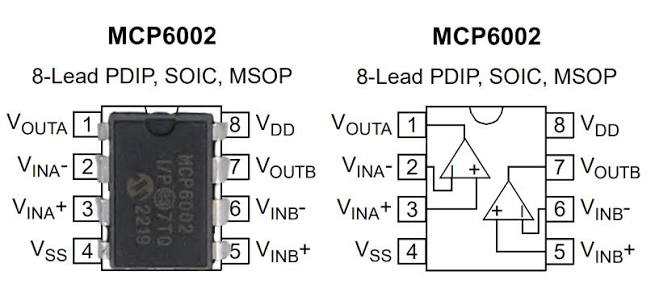
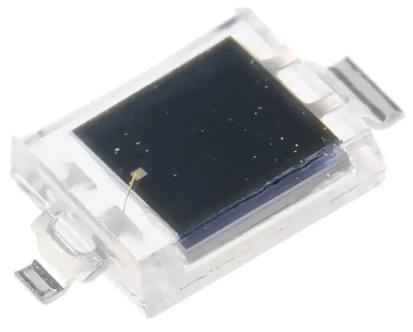
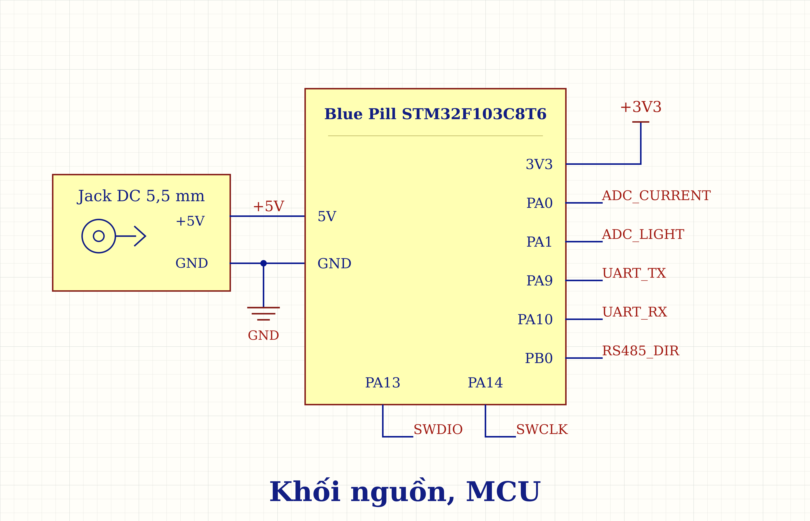
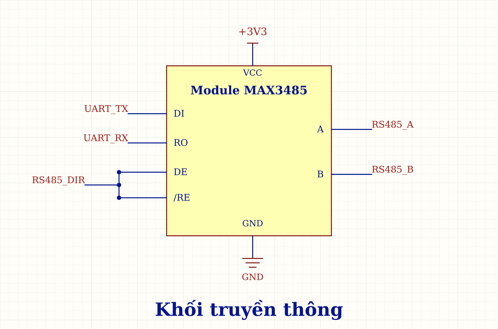
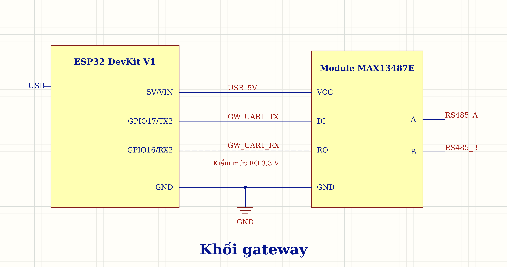

# Hướng dẫn đấu dây và kiểm thử module tại bàn

## 1. Bảng linh kiện module

### 1.1. Node

**Khối nguồn, MCU**

| Tên linh kiện/thông số | Số lượng | Dùng ở đâu | Ghi chú ngắn |
|---|---|---|---|
| Ổn áp 3,3 V trên Blue Pill | Có sẵn trên bo | Cấp MCU, AFE và MAX3485 | Có sẵn; kiểm dòng và độ nóng |
| Điện trở 10 kΩ, ưu tiên 1%, ≥0,125 W | 2 | Cầu chia BIAS | Tạo mức nền khoảng 1,65 V |
| Blue Pill STM32F103C8T6 | 1 bo | Thu ADC, xử lý và UART | Bo có sẵn nguồn, thạch anh và nút reset |

**Khối dòng**

| Tên linh kiện/thông số | Số lượng | Dùng ở đâu | Ghi chú ngắn |
|---|---|---|---|
| CT DL-CT08CL6-1000/1 | 1 | Cảm biến dòng ngoài bo | Tỷ số 1000:1; dùng lại với PCB |
| MCP6002 dòng (MCP6002-I/P, DIP-8) | 1 IC | Kênh A đệm dòng; kênh B đệm BIAS | Dùng chung IC để đệm BIAS |
| Điện trở burden 150 Ω–2 W | 1 | Song song thứ cấp CT | Đổi dòng CT thành điện áp |
| Điện trở 1 kΩ, 1%, ≥0,125 W | 1 | Lọc dòng trước PA0 | Nối giữa đầu ra đệm và PA0 |
| Tụ 100 nF (104), gốm 50 V | 1 | PA0 xuống GND | Tụ lọc tín hiệu |
| Tụ 100 nF (104), gốm 50 V | 1 | Nguồn MCP6002 dòng | Tụ nguồn riêng, sát chân 8–4 |

**Khối quang**

| Tên linh kiện/thông số | Số lượng | Dùng ở đâu | Ghi chú ngắn |
|---|---|---|---|
| BPW34 chân cắm | 1 | Cảm biến quang | Kiểm đúng hai cực A/K |
| MCP6002 quang (MCP6002-I/P, DIP-8) | 1 IC | TIA đổi dòng quang thành áp | Kênh B không nối tải ngoài |
| Điện trở hồi tiếp 10 kΩ, ưu tiên 1%, ≥0,125 W | 1 | Hồi tiếp TIA | Trở riêng của mạch quang |
| Tụ hồi tiếp 100 pF (101), ưu tiên C0G, 50 V | 1 | Hồi tiếp TIA | Song song điện trở 10 kΩ |
| Tụ 100 nF (104), gốm 50 V | 1 | Nguồn MCP6002 quang | Đặt sát chân 8–4 |
| Điện trở 1 kΩ, 1%, ≥0,125 W | 2 | Hai tầng lọc quang | Lắp cố định sau TIA |
| Tụ 10 nF (103), gốm 50 V | 2 | Hai tầng lọc quang | Mỗi tụ sau một trở, xuống GND |

**Khối truyền thông**

| Tên linh kiện/thông số | Số lượng | Dùng ở đâu | Ghi chú ngắn |
|---|---|---|---|
| Module MAX3485 3,3 V | 1 | RS485 node | Dùng nguyên bo; PA9/PA10/PB0 |

### 1.2. Gateway

Giữ nguyên bộ ESP32 + MAX13487E dạng module khi node chuyển sang PCB.

**Khối nguồn**

| Tên linh kiện/thông số | Số lượng | Dùng ở đâu | Ghi chú ngắn |
|---|---|---|---|
| Đường 5V/VBUS và ổn áp 3,3 V trên ESP32 DevKit | Có sẵn trên bo | 5 V cho MAX13487E; 3,3 V cho ESP32 | Lấy nguồn từ USB laptop |

**Khối MCU**

| Tên linh kiện/thông số | Số lượng | Dùng ở đâu | Ghi chú ngắn |
|---|---|---|---|
| ESP32-DevKitC V4, WROOM-32E tham chiếu | 1 bo | Hỏi node, kiểm bản tin và gửi USB | Bo khác cần kiểm lại chân |

**Khối truyền thông**

| Tên linh kiện/thông số | Số lượng | Dùng ở đâu | Ghi chú ngắn |
|---|---|---|---|
| Module MAX13487E hiện có | 1 module | RS485 gateway, tự chuyển chiều | Dùng nguyên bo; kiểm nhãn chân |

### 1.3. Các phần bên ngoài — nguồn, bộ tải và đồ dùng lại khi thử PCB

**Nguồn cấp ngoài, dây và đầu nối**

| Tên linh kiện/thông số | Số lượng | Dùng ở đâu | Ghi chú ngắn |
|---|---|---|---|
| Adapter cách ly 5 VDC–2 A, phích DC 5.5 mm | 1 | Cấp node module, sau đó PCB node | Nguồn cấp riêng cho node |
| Jack DC cái 5.5 mm ra cọc vít | 1 bộ | Đưa nguồn vào bàn thử | Khớp phích adapter; kiểm cỡ lỗ trong và cực tính |
| Cáp USB có dữ liệu | 1 | Gateway–laptop | Cáp Micro-B có truyền dữ liệu |
| Cáp RS485 cặp xoắn A/B + GND đi cùng | Khoảng 1 m | Node–gateway | Ưu tiên cáp RS485 120 Ω |
| Breadboard, jumper, dây cứng ngắn, header | 1 bộ | Đấu thử module và debug | Đường quang giữ dây ngắn |
| ST-Link V2 và dây SWD | 1 bộ | Nạp Blue Pill, sau đó PCB | Không nối thêm nguồn từ ST-Link |
| USB–RS485 CH340 hiện có | 1 dụng cụ | Debug module hoặc PCB | Chỉ dùng thay gateway khi debug |

**Bộ tải thử CT**

| Tên linh kiện/thông số | Số lượng | Dùng ở đâu | Ghi chú ngắn |
|---|---|---|---|
| Nguồn cách ly 12 VAC–1,5 A | 1 | Cấp tải thử CT, dùng lại khi thử PCB | Không cấp MCU hoặc ADC |
| Điện trở sứ 50 Ω–25 W | 3 | Tải sơ cấp CT | Mắc 1, 2 hoặc 3 nhánh song song |
| Dây silicone 20 AWG, cọc vít, đế chịu nhiệt | 1 bộ | Vòng tải ngoài thiết bị | Không dẫn tải qua breadboard |

**Nguồn sáng và dụng cụ đo**

| Tên linh kiện/thông số | Số lượng | Dùng ở đâu | Ghi chú ngắn |
|---|---|---|---|
| Đồng hồ DC và đồng hồ AC phù hợp dòng nhỏ | Có/mượn | Nguồn và tải module/PCB | Đo được dòng nhỏ 0,24–0,72 A |
| Oscilloscope ≥2 kênh, 2 probe | Có/mượn | Tín hiệu trước/sau lọc | Cần lưu được ảnh hoặc CSV |
| Đèn pin, tấm che, thước | 1 bộ | Quang tĩnh module/PCB | Giữ cố định khoảng cách và góc |
| LED trắng 5 mm | 1 | Nguồn sáng ngoài thiết bị | Không phải LED cảnh báo |
| Điện trở 330 Ω, ≥0,125 W | 1 | Hạn dòng LED thử | Trở riêng cho LED thử |
| Máy phát xung mức phù hợp LED | Có/mượn | Quang xung module/PCB | Kiểm dòng LED khi kích 0–3,3 V |
| Laptop, phần mềm nạp/log, USB lưu dữ liệu | 1 bộ | Lưu hồ sơ module/PCB | Kiểm tra mở và lưu được CSV |

**Linh kiện thay thử và dự phòng — không lắp đồng thời vào cấu hình nền**

| Tên linh kiện/thông số | Số lượng | Dùng ở đâu | Ghi chú ngắn |
|---|---|---|---|
| Burden 47 Ω–0,25 W, 5% | 1 | So với 150 Ω trên module | Tắt tải trước khi thay 150 Ω |
| BPW34 dự phòng | 1 | Thay cảm biến module khi hỏng | Chỉ thay BPW34 module khi hỏng |
| Điện trở Rf 100 kΩ | 1 | Khảo sát khi có phương án | Ghi giá trị thay trước khi đo |
| Tụ Cf 47 pF (470) | 1 | Khảo sát khi có phương án | Chỉ thay khi cần khảo sát |
| Tụ 10 µF (106) | 1 | Dự phòng | Để dự phòng, chưa lắp |

## 2. Hướng dẫn nối dây từng phần

### 2.1. Nhận diện hai MCP6002 DIP-8

Mỗi MCP6002 có hai kênh khuếch đại A và B trong cùng một IC. Dán tên “dòng” và “quang” lên hai IC để không nhầm khi đấu dây.

Hình bên trái là IC thật; hình bên phải là sơ đồ hai kênh bên trong. Cả hai đều nhìn **từ mặt trên**, với rãnh định hướng ở cạnh trên.

1. Đặt IC sao cho rãnh định hướng ở phía trên như hình.
2. Chân 1 ở góc trên bên trái; bên trái đếm xuống chân 4, bên phải đếm từ chân 5 lên chân 8.
3. Đối chiếu số chân và tên tín hiệu trong bảng trước khi cắm dây.

| Từ linh kiện/chân | Đến linh kiện/chân | Giải thích ngắn |
|---|---|---|
| Chân 1 | OUT A | Đầu ra kênh A |
| Chân 2 | IN− A | Đầu vào đảo A |
| Chân 3 | IN+ A | Đầu vào không đảo A |
| Chân 4 | VSS | Nối GND khi cấp một nguồn 3,3 V |
| Chân 5 | IN+ B | Đầu vào không đảo B |
| Chân 6 | IN− B | Đầu vào đảo B |
| Chân 7 | OUT B | Đầu ra B |
| Chân 8 | VDD | Nối 3V3 |

**Kiểm tra trước khi làm tiếp**

- [ ] Đã nhận đúng dấu định hướng.
- [ ] Không lấy số chân nhìn từ mặt dưới.

### 2.2. Nhận diện anode và cathode của BPW34

BPW34 là photodiode: khi nhận ánh sáng, nó sinh ra dòng điện nhỏ. Hai chân là **anode (A)** và **cathode (K)**; cần xác định đúng trước khi nối vào mạch quang.

**Đo bằng chế độ diode của đồng hồ**

1. Tháo BPW34 khỏi mạch và che tối cảm biến để ánh sáng không ảnh hưởng phép đo.
2. Cắm que đen vào COM, que đỏ vào cổng V/Ω; chọn nấc có ký hiệu diode. Nếu dùng chung nấc với đo thông mạch, chọn đúng chế độ diode.
3. Chạm hai que vào hai chân, đọc số rồi đảo chiều hai que để đo lại.

- Nếu một chiều hiện khoảng **500–800 mV** (hoặc **0,500–0,800 V**), còn chiều ngược hiện **1 hoặc OL** báo quá thang, chiều có điện áp thuận cho biết: **que đỏ chạm A, que đen chạm K**. Giá trị thực tùy đồng hồ và linh kiện.
- **Không cần có tiếng bíp.** Khi đo diode, đọc số trên màn hình để nhận biết chiều dẫn.

**Nhận diện theo chấm trắng:** với linh kiện trong ảnh, dùng phép đo trên để kiểm chân phía có chấm trắng. Nếu que đỏ đặt ở chân phía chấm trắng và que đen ở chân còn lại cho điện áp thuận, thì **phía có chấm trắng là anode**. Không dùng riêng màu chấm để kết luận cho mọi BPW34; dấu nhận diện phụ thuộc nhà sản xuất và kiểu vỏ. Ví dụ, [datasheet BPW34 của Vishay](https://www.vishay.com/docs/81521/bpw34.pdf) có dấu nhận diện cathode trên bản vẽ vỏ.

**Vai trò trong mạch TIA**

Khối quang dùng mạch **TIA (Transimpedance Amplifier — bộ khuếch đại chuyển dòng thành điện áp)**. Có thể hiểu TIA là “phiên dịch viên”: chuyển dòng điện nhỏ do BPW34 sinh ra thành mức điện áp để ADC của vi điều khiển đọc được. Trong mạch đang dùng, **A nối GND, K nối chân 2 (IN−) của MCP6002 quang**; cách hoạt động và mạng hồi tiếp được giải thích ở khối quang trong mục 2.3.

### 2.3. Nối dây node

#### Khối nguồn, MCU

- Bo Blue Pill STM32F103C8T6 được cấp 5 V qua jack DC 5,5 mm; ổn áp trên bo tạo 3,3 V, GND là mốc điện áp chung.
- PA0, PA1, PA9, PA10, PB0, PA13 và PA14 lần lượt gắn nhãn ADC_CURRENT, ADC_LIGHT, UART_TX, UART_RX, RS485_DIR, SWDIO và SWCLK để nhận diện chức năng và liên kết tín hiệu giữa các khối.

| Nhãn (chân MCU) | Ý nghĩa | Giải thích tên nhãn bằng tiếng Anh | Chân module MAX3485 liên quan |
|---|---|---|---|
| **ADC_CURRENT (PA0)** | Đọc điện áp dòng sau lọc bằng ADC. | **ADC = Analog-to-Digital Converter:** bộ chuyển đổi tương tự sang số; **Current:** dòng điện. | — |
| **ADC_LIGHT (PA1)** | Đọc điện áp quang sau hai tầng lọc bằng ADC. | **ADC = Analog-to-Digital Converter:** bộ chuyển đổi tương tự sang số; **Light:** ánh sáng. | — |
| **UART_TX (PA9)** | Phát dữ liệu tới DI module MAX3485. | **UART = Universal Asynchronous Receiver/Transmitter:** bộ thu/phát nối tiếp không đồng bộ; **TX = Transmit:** phát dữ liệu. | **DI (Driver Input):** dữ liệu từ UART TX đưa vào module. |
| **UART_RX (PA10)** | Nhận dữ liệu từ RO module MAX3485. | **UART = Universal Asynchronous Receiver/Transmitter:** bộ thu/phát nối tiếp không đồng bộ; **RX = Receive:** nhận dữ liệu. | **RO (Receiver Output):** dữ liệu từ module đưa về UART RX. |
| **RS485_DIR (PB0)** | Điều khiển DE và /RE để chọn phát hoặc nhận. | **RS = Recommended Standard:** tên gọi tiêu chuẩn; **485:** số hiệu tiêu chuẩn giao tiếp điện; **DIR = Direction:** chiều truyền dữ liệu. | **DE (Driver Enable):** cho phép truyền dữ liệu khi **chân DE ở mức HIGH (logic 1)**. **/RE (Receiver Enable):** cho phép nhận dữ liệu khi **chân /RE ở mức LOW (logic 0)**. |
| **SWDIO (PA13), SWCLK (PA14)** | Dữ liệu và xung nhịp để nạp, gỡ lỗi bằng ST-Link. | **SWDIO = Serial Wire Debug Input/Output:** đường dữ liệu vào/ra của giao diện gỡ lỗi SWD; **SWCLK = Serial Wire Clock:** đường xung nhịp của giao diện này. | — |

#### Khối dòng

**Chuyển đổi dòng điện thành điện áp (Biến dòng CT và R2)**
Biến dòng (CT) loại DL-CT08CL6-1000/1 có tỷ số biến dòng là 1000:1. Khi có dòng điện chạy qua cuộn sơ cấp, cuộn thứ cấp sẽ sinh ra một dòng điện nhỏ hơn 1000 lần. Dòng thứ cấp này đi qua điện trở gánh R2 có giá trị 150 Ω, biến đổi thành một điện áp xoay chiều:

$$I_{\mathrm{s,rms}} = \frac{I_{\mathrm{p,rms}}}{1000}$$

$$V_{\mathrm{R2,rms}} = I_{\mathrm{s,rms}} \times 150\,\Omega$$

Ví dụ, nếu dòng thứ cấp là 1 mA, điện áp sinh ra giữa hai đầu R2 sẽ là 0,15 V RMS. Vì là điện xoay chiều, giá trị này sẽ liên tục đảo chiều âm dương.

**Tạo điện áp nền 1,65 V (Cầu chia áp R4, R5)**
Bộ chuyển đổi tương tự - số (ADC) của vi điều khiển thường chỉ đo được mức điện áp dương. Để đo được tín hiệu xoay chiều từ R2 mà không bị cắt mất phần âm, tín hiệu cần được "nâng" lên một mức nền. Hai điện trở R4 và R5 (cùng giá trị 10 kΩ) tạo thành cầu chia áp từ nguồn 3,3 V:

$$V_M = 3{,}3 \times \frac{R4}{R5 + R4} = 3{,}3 \times \frac{10}{10 + 10} = 1{,}65\,\mathrm{V}$$

Mức 1,65 V này nằm ở chính giữa dải đo của ADC, cho phép tín hiệu xoay chiều dao động lên xuống quanh nó một cách an toàn.

**Ổn định mức nền bằng bộ đệm (Op-amp U3B)**
Cầu chia áp R4 và R5 có điện trở tương đương là $10\,\mathrm{k}\Omega \parallel 10\,\mathrm{k}\Omega = 5\,\mathrm{k}\Omega$. Nếu tải phía sau rút một dòng rất nhỏ, ví dụ 10 µA, điện áp nền sẽ bị sụt giảm:

$$\Delta V = 10\,\mathrm{\mu A} \times 5\,\mathrm{k}\Omega = 0{,}05\,\mathrm{V}$$

> [!NOTE] Lý do dùng Op-Amp làm bộ đệm để ngăn tải làm sụt áp cầu chia
> Trong lý thuyết, **Op-Amp lý tưởng không có dòng điện đi vào hoặc đi ra từ hai chân đầu vào (I₊ = I₋ = 0)** ==do trở kháng đầu vào của nó có giá trị **vô cùng lớn**==
> 
> Tuy nhiên, trong thực tế, Op-Amp **vẫn dẫn một lượng dòng điện cực kỳ nhỏ** (gọi là dòng phân cực đầu vào - _input bias current_), thường chỉ ở mức nano-ampere (nA) hoặc pico-ampere (pA), chứ không hoàn toàn bằng không tuyệt đối.

Để khắc phục, điện áp 1,65 V từ cầu chia được đưa vào chân không đảo (chân số 5) của Op-amp U3B. Chân đầu ra (chân số 7) được nối hồi tiếp âm trực tiếp về chân đảo (chân số 6), tạo thành một bộ đệm có hệ số khuếch đại xấp xỉ 1:

$$\frac{V_{\mathrm{out}}}{V_+} = \frac{A}{1+A} \approx 1$$

U3B giữ cho mức nền BIAS_1V65 luôn cố định ở 1,65 V, cung cấp dòng điện cần thiết cho tải mà không làm sai lệch điện áp của cầu chia ban đầu.

> [!note] Giải thích hồi tiếp âm trong mạch đệm Op-Amp
> 
> Op-amp khuếch đại sự chênh lệch điện áp giữa hai đầu vào theo công thức:
> 
> $$V_{\mathrm{out}} = A \times (V_+ - V_-)$$
> 
> Trong đó, $A$ là hệ số khuếch đại vòng hở (open-loop gain) do nhà sản xuất chế tạo, thường có giá trị cực kỳ lớn (khoảng $10^5$ đến $10^6$); $V_+$ và $V_-$ là điện áp tại chân không đảo và chân đảo.
> 
> Ở U3B, đầu ra chân 7 nối trực tiếp về chân đảo 6 nên $V_- = V_{\mathrm{out}}$. Thay vào công thức trên và thu gọn:
> 
> 
> $$V_{\mathrm{out}} = A \times (V_+ - V_{\mathrm{out}})$$
> 
> $$\frac{V_{\mathrm{out}}}{V_+} = \frac{A}{1 + A} \approx 1$$
> 
> Vì $A$ rất lớn so với 1, điện áp đầu ra gần bằng điện áp đầu vào. Khi mạch hoạt động tuyến tính và ổn định, chân 5 (+) nhận khoảng 1,65 V thì đầu ra chân 7 cũng bám theo mức này. Cách mắc đó gọi là bộ đệm điện áp (voltage follower).

**Ghép tín hiệu đo vào mức nền**
Đầu dưới của điện trở R2 được nối trực tiếp với đường BIAS_1V65. Điều này có nghĩa là điểm tham chiếu của tín hiệu đo đã được nâng lên 1,65 V so với GND. Gọi $v_{\mathrm{R2}}(t)$ là điện áp tức thời sinh ra giữa hai đầu R2, điện áp tại đầu trên của R2 sẽ là:

$$V_{\text{đầu trên R2}} \approx 1{,}65\,\mathrm{V} + v_{\mathrm{R2}}(t)$$

Nếu điện áp tức thời trên R2 là +0,10 V, đầu trên sẽ đạt 1,75 V. Nếu điện áp tức thời là -0,10 V, đầu trên sẽ giảm xuống 1,55 V. Toàn bộ tín hiệu đo luôn được đảm bảo ở mức dương.

**Đệm tín hiệu đo lường (Op-amp U3A)**
Điện áp tại đầu trên của R2 được đưa vào chân không đảo (chân số 3) của Op-amp U3A. Tương tự như U3B, U3A cũng được cấu hình làm bộ đệm tín hiệu:

$$V_{\mathrm{outA}} \approx V_{\text{đầu trên R2}} \approx 1{,}65\,\mathrm{V} + v_{\mathrm{R2}}(t)$$

Op-amp U3A đóng vai trò cách ly mạch biến dòng (CT và R2) khỏi các khối phía sau. Nó đảm bảo các bộ lọc hoặc vi điều khiển sẽ không rút dòng ngược lại làm sai lệch kết quả đo.

**Lọc nhiễu và bảo vệ nguồn (R3, C12, C13)**
Tín hiệu đầu ra từ U3A đi qua mạch lọc thông thấp gồm điện trở R3 (1 kΩ) và tụ C12 (100 nF) để loại bỏ các nhiễu tần số cao. Tần số cắt của bộ lọc này là:

$$f_c = \frac{1}{2\pi \times R3 \times C12} \approx 1{,}59\,\mathrm{kHz}$$

==Tần số đo lường chính (50 Hz hoặc 60 Hz)== sẽ dễ dàng đi qua, trong khi các tần số nhiễu lớn hơn mức 1,59 kHz sẽ bị suy giảm mạnh trước khi vào chân PA0 (nhãn ADC_CURRENT). Ngoài ra, tụ C13 (100 nF) được mắc song song với chân nguồn 3V3 của IC MCP6002 nhằm triệt tiêu các nhiễu trên đường cấp nguồn, giúp IC hoạt động với độ chính xác cao nhất.
> [!note] Lý do chọn tụ 100 nF để lọc nhiễu nguồn
> **Tụ 104 (Ký hiệu 104 = 100 nF) - Lọc nhiễu nguồn (Decoupling Capacitor)**
> Đây là giá trị **tiêu chuẩn công nghiệp*** cho tụ lọc nhiễu nguồn IC, tính toán dựa trên trở kháng của tụ đối với nhiễu cao tần:$$Z_C = \frac{1}{2\pi f C}$$**Lý do chọn 100 nF**: Nếu có nhiễu tần số cao (ví dụ 1 MHz) sinh ra từ vi điều khiển chạy trên cùng đường nguồn 3V3, trở kháng của tụ C14 sẽ rất nhỏ ($Z_C \approx 1{,}59\,\Omega$). Tụ lập tức "ngắn mạch" dải nhiễu này xuống GND, không cho nhiễu lọt vào chân cấp nguồn của U4A.

#### Khối quang

**Nhận ánh sáng và tạo dòng quang (D1 – BPW34)**

BPW34 chuyển ánh sáng thành một dòng điện nhỏ gọi là **dòng quang**. Trong cùng điều kiện phổ ánh sáng, ánh sáng càng mạnh thì dòng quang thường càng lớn.

Trong mạch, anode của D1 nối GND, cathode nối chân đảo 2 (−) của U4A. Chân không đảo 3 (+) nhận điện áp BIAS khoảng 1,65 V. Khi hồi tiếp âm hoạt động ổn định, U4A giữ chân 2 gần bằng 1,65 V. Như vậy, cathode cao hơn anode khoảng 1,65 V, tạo phân cực ngược cho photodiode.

Dòng quang có chiều quy ước từ cathode qua D1 xuống anode rồi về GND. Có thể hiểu rằng khi nhận ánh sáng, D1 lấy một dòng điện nhỏ từ điểm nối tại chân 2 xuống GND.

> [!NOTE] Bản chất dòng quang và điều kiện phân cực của BPW34
>
> - **Chiều dòng quang:** Ánh sáng được hấp thụ trong linh kiện tạo ra các cặp electron–lỗ trống. Điện trường tại vùng tiếp giáp giúp phân tách các hạt mang điện, tạo thành dòng quang $I_{\mathrm{ph}}$ có ==chiều quy ước từ cathode (K) sang anode (A)==. Khi ánh sáng thay đổi, độ lớn của thành phần dòng quang thay đổi; **chiều của thành phần này không tự đảo ngượ**c. 
>
> - **Điều kiện phân cực khi đo dòng quang:** Mạch đo thường giữ photodiode ở trạng thái không phân cực ($V_K = V_A$) hoặc phân cực ngược ($V_K > V_A$). Nếu đặt điện áp phân cực thuận từ bên ngoài, nó sẽ dẫn điện như một diode thông thường, dòng dẫn thuận tăng nhanh và có thể lấn át dòng quang (vốn chỉ ở mức microampe), làm sai lệch phép đo. 
>
> - **Dòng điện trong mạch đang dùng:** Khi U4A hoạt động tuyến tính và hồi tiếp ổn định, $V_K \approx 1{,}65\,\mathrm{V}$ tại chân 2, còn $V_A = 0\,\mathrm{V}$ tại GND. D1 vì vậy được phân cực ngược với $V_K = 1{,}65\,\mathrm{V}$ (tại chân 2) và $V_A = 0\,\mathrm{V}$ (tại GND). Khi nhận ánh sáng, dòng quang đi từ nút chân 2 qua D1 xuống GND. Đầu ra U4A cấp dòng bù qua mạng hồi tiếp để giữ điện áp tại nút này gần mức BIAS; ở trạng thái ổn định, dòng bù chủ yếu đi qua R6.

**Chuyển dòng quang thành điện áp (U4A và R6)**

U4A cùng điện trở hồi tiếp R6 tạo thành **mạch TIA (Transimpedance Amplifier — bộ khuếch đại chuyển dòng thành điện áp)**. R6 có giá trị 10 kΩ, nối từ đầu ra chân 1 về chân đảo 2.

==Đầu vào op-amp gần như không lấy dòng==. Vì vậy, khi D1 dẫn dòng quang xuống GND, đầu ra U4A phải cấp dòng bù qua R6 để giữ chân 2 gần mức 1,65 V. Dòng qua R6 tạo ra chênh lệch điện áp giữa đầu ra và chân 2: **dòng quang càng lớn thì điện áp đầu ra càng cao.**

Ở trạng thái ổn định, khi mạch chưa bão hòa, **điện áp đầu ra tại chân 1 của U4A**, ký hiệu là $V_{\mathrm{out}}$, được tính gần đúng:

$$
V_{\mathrm{out}} \approx V_{\mathrm{BIAS}} + I_{\mathrm{ph}}R6
$$

Trong đó, $V_{\mathrm{BIAS}} \approx 1{,}65\,\mathrm{V}$, $I_{\mathrm{ph}}$ là dòng quang và $R6 = 10\,\mathrm{k}\Omega$.

Ví dụ, dòng quang tăng thêm 10 µA thì điện áp tại chân 1 tăng khoảng:

$$
\Delta V_{\mathrm{out}}
\approx 10\,\mathrm{\mu A}\times10\,\mathrm{k}\Omega
=0{,}10\,\mathrm{V}
$$

Nếu ban đầu đầu ra là 1,65 V thì sau đó sẽ tăng lên khoảng 1,75 V. ADC có thể đọc sự thay đổi điện áp này để nhận biết thay đổi ánh sáng. Khi ánh sáng quá mạnh, đầu ra có thể bão hòa và không còn tăng theo công thức trên.

> [!NOTE] Đặc tính lọc thông thấp và vai trò của tụ C15 (100 pF) trong mạch TIA
> 
> **1. Phân bố dòng điện qua R6 và C15**
> 
> Khi ánh sáng không đổi, dòng quang có thành phần một chiều (DC). Khi ánh sáng biến thiên hoặc xuất hiện xung sáng, dòng quang còn có các thành phần biến thiên theo thời gian. Độ lớn trở kháng của tụ lý tưởng được tính bằng:
> 
> $$
> |Z_C| = \frac{1}{2\pi fC}
> $$
> 
> Ở trạng thái DC ổn định, $f \to 0$ nên $|Z_C| \to \infty$; C15 không dẫn dòng DC trong mô hình lý tưởng. Vì vậy, dòng cấp bù từ đầu ra chân 1 chủ yếu đi qua R6 (10 kΩ), tạo chênh lệch điện áp giữa đầu ra và chân 2. Đây là cơ sở chuyển dòng quang thành điện áp của mạch TIA.
> 
> **2. Đặc tính lọc thông thấp của mạng hồi tiếp**
> 
> Tụ C15 (100 pF) mắc song song với R6 (10 kΩ) biến toàn bộ mạch khuếch đại TIA thành một bộ lọc thông thấp (Low-pass Filter) với tần số cắt là: 
> 
> $$
> f_{\mathrm{RC}} = \frac{1}{2\pi R6\,C15}
> = \frac{1}{2\pi \times 10\,000 \times 100\times10^{-12}}
> \approx 159\,\mathrm{kHz}
> $$
> 
> - **Cho tín hiệu đo lường đi qua:** Các tín hiệu có tần số nhỏ hơn 159 kHz (bao gồm cả dòng DC và sườn xung chớp hồ quang) sẽ bị tụ C15 cản lại, buộc phải đi qua R6 và được Op-amp khuếch đại bình thường để đưa về vi điều khiển.
> - **Chặn (suy giảm) nhiễu cao tần:** Khi xuất hiện nhiễu tần số cao (lớn hơn 159 kHz), trở kháng của C15 tụt xuống rất thấp. Dòng nhiễu sẽ "đi tắt" qua tụ thay vì qua điện trở R6. Vì đi qua trở kháng nhỏ, điện áp sinh ra gần như bằng 0, khiến Op-amp không khuếch đại dải tần này. Nhờ đó, tín hiệu nhiễu bị suy giảm ở đầu ra.
> 
> **3. Vai trò của giá trị 100 pF**
> 
> - **Ảnh hưởng của điện dung đầu vào:** Về mặt vật lý, cấu tạo của cảm biến BPW34 gồm hai lớp bán dẫn đặt cạnh nhau, vô tình tạo ra một "tụ điện ảo" tàng hình bên trong linh kiện (gọi là điện dung ký sinh). Kết hợp với điện dung đầu vào op-amp và điện dung ký sinh của dây nối hoặc PCB ảnh hưởng đến đặc tính pha (tạo ra độ trễ pha) của vòng hồi tiếp. Từ đó có thể làm cho điện áp đầu ra của mạch xuất hiện dao động tắt dần sau cạnh xung (ringing) hoặc tự dao động liên tục dù ánh sáng không đổi.
> - **Vai trò của C15 = 100 pF:** 
> 	- Tụ C15 cần có điện dung **đủ lớn để hỗ trợ bù pha và hạn chế dao động trong vòng hồi tiếp**. Giá trị **100 pF** (>70pF) được chọn để tăng khả năng ổn định của mạch, đồng thời tránh làm giảm quá nhiều tốc độ đáp ứng với xung sáng. Theo [datasheet BPW34 của Vishay](https://www.vishay.com/docs/81521/bpw34.pdf), điện dung tiếp giáp điển hình là **70 pF khi không phân cực** và giảm còn **25 pF khi phân cực ngược 3 V**. Tại mức phân cực ngược **1,65 V** của mạch, datasheet không ghi giá trị cụ thể.
> 	- Ngoài ra, tụ C15 phải **đủ nhỏ để không giới hạn quá mức băng thông của mạch TIA** (không dùng các tụ như 10 nF hay 100 nF), giúp mạch đáp ứng với xung sáng ngắn (do chớp hồ quang là một xung phát sáng có tốc độ cực nhanh cỡ micro-giây). Nếu điện dung quá lớn, tần số cắt giảm, làm sườn xung chậm hơn và biên độ đỉnh suy giảm, có thể khiến vi điều khiển bỏ sót hoặc phát hiện xung trễ.
> 
> **4. Lọc tín hiệu trước ADC (R11, C17, R12 và C18)**
> 
> Điện áp đầu ra TIA đi qua hai tầng lọc thông thấp mắc nối tiếp trước khi đến ADC_LIGHT:
> 
> - Tầng thứ nhất gồm R11 = 1 kΩ và C17 = 10 nF.
> - Tầng thứ hai gồm R12 = 1 kΩ và C18 = 10 nF.
> 
> Mỗi điện trở nằm trên đường tín hiệu, còn tụ tương ứng nối từ điểm sau điện trở xuống GND. Hai tầng lọc thông thấp này làm suy giảm thành phần tần số cao, giúp giảm nhiễu trước khi ADC đọc tín hiệu.

> [!NOTE] Lý do lựa chọn hai tầng lọc thông thấp cho khối quang và so sánh với khối dòng
>
> **Khối quang:** ánh sáng xuất hiện rồi tắt trong thời gian ngắn, nên mạch cần đáp ứng nhanh để nhận biết xung. Đồng thời, mạch khuếch đại quang TIA có thể khuếch đại nhiễu mạnh ở vùng tần số cao, nên cần lọc nhiễu trước ADC [1]. Mỗi tầng dùng **1 kΩ/10 nF** để giữ đáp ứng nhanh; **hai tầng nối trực tiếp** giúp giảm nhiễu cao tần mạnh hơn một tầng cùng R, C. Tần số cắt toàn bộ khoảng **5,96 kHz**.
>
> **Khối dòng:** dòng xoay chiều chủ yếu biến thiên ở **50/60 Hz**, chậm hơn chớp sáng, nên dùng tụ lớn hơn để hạ tần số cắt và giảm nhiễu. **Một tầng 1 kΩ/100 nF**, tần số cắt khoảng **1,59 kHz**, giữ gần nguyên thành phần 50/60 Hz và hạn chế suy giảm các sóng hài cần quan sát để nhận biết dạng sóng méo. Thêm tầng cùng R, C sẽ làm các sóng hài này suy giảm nhiều hơn.
> 
> **Xem thêm:** [Phụ lục — Lý thuyết bộ lọc thông thấp RC](../Phu_luc/Ly_thuyet_bo_loc–thong_thap_RC.md): cách tính tần số cắt, độ dốc suy giảm và ảnh hưởng của bộ lọc lên xung.

**Giữ kênh còn lại ở trạng thái xác định (U4B)**

U4B không dùng để đo nhưng vẫn được cấp nguồn, nên cần giữ ổn định để hạn chế nhiễu chéo sang U4A [2]. Chân 5 (+) nối **BIAS 1,65 V**, là điện áp nền để đầu ra bám theo. Chọn mức này vì **nằm giữa nguồn 0–3,3 V**, giúp đầu vào và đầu ra ở xa hai giới hạn nguồn, đồng thời **tận dụng BIAS có sẵn**. 

Chân 7 nối về chân 6 (−) tạo **hồi tiếp âm**: đầu ra cao hơn BIAS thì op-amp kéo xuống, thấp hơn thì đẩy lên, giữ đầu ra gần 1,65 V. BIAS đặt mức cần giữ; hồi tiếp giúp đầu ra bám mức đó.

Chân 7 không nối tải ngoài hoặc nối chung với đầu ra bộ đệm BIAS của khối dòng, tránh hai đầu ra đẩy dòng qua nhau.

**Giảm nhiễu nguồn cho IC (C14)**

Tụ C14 có giá trị 100 nF, mắc giữa chân VDD (+3V3) và VSS (GND), đặt sát chân nguồn của MCP6002.

Tụ cung cấp dòng tức thời khi IC cần và giúp giảm nhiễu cao tần trên đường nguồn. Nhờ đó, điện áp cấp tại IC ít biến động hơn, hỗ trợ mạch khuếch đại hoạt động ổn định.

#### Khối truyền thông

**Vai trò và nguồn cấp**

Blue Pill gửi và nhận dữ liệu qua UART; module MAX3485 chuyển dữ liệu này sang tín hiệu RS485 trên cặp dây A/B để trao đổi với gateway. Module nhận **+3V3** và dùng **GND chung với Blue Pill** để các chân UART có cùng mốc điện áp.

**Đường phát và nhận dữ liệu**

| Nhãn (chân MCU)     | Chân module                                         | Chức năng                                                                                                                                                                                                                                                                         |
| ------------------- | --------------------------------------------------- | --------------------------------------------------------------------------------------------------------------------------------------------------------------------------------------------------------------------------------------------------------------------------------- |
| **UART_TX (PA9)**   | **DI — Driver Input:** đầu vào bộ phát              | **USART1 (Universal Synchronous/Asynchronous Receiver/Transmitter)** là bộ thu/phát nối tiếp đồng bộ hoặc không đồng bộ số 1 bên trong STM32. Trong mạch này, USART1 dùng chế độ không đồng bộ (UART), đưa dữ liệu ra chân **PA9 (TX)** rồi vào DI của module để gửi tới gateway. |
| **UART_RX (PA10)**  | **RO — Receiver Output:** đầu ra bộ thu             | Dữ liệu nhận từ gateway được module chuyển về chân nhận USART1 của Blue Pill.                                                                                                                                                                                                     |
| **RS485_DIR (PB0)** | **DE — Driver Enable** và **/RE — Receiver Enable** | Chọn chiều phát hoặc nhận của module; hai chân điều khiển nối chung vào PB0.                                                                                                                                                                                                      |

**Chọn chiều truyền bằng PB0**

Node dùng chung cặp A/B cho cả hai chiều, nên phát và nhận lần lượt. Chân **DE cho phép phát ở mức 1**, còn **/RE cho phép nhận ở mức 0**; dấu “/” cho biết chân này tác động ở mức thấp.

| Mức PB0 | Bộ phát DE | Bộ thu /RE | Trạng thái node              |
| ------- | ---------- | ---------- | ---------------------------- |
| **1**   | Bật        | Tắt        | Gửi dữ liệu tới gateway.     |
| **0**   | Tắt        | Bật        | Chờ nhận dữ liệu từ gateway. |

Khi gửi xong byte cuối, chương trình phải chờ **cờ TC (Transmission Complete)** báo UART đã phát hết cả bit kết thúc rồi mới hạ PB0 về 0. Nếu đổi sang nhận quá sớm, bộ phát bị tắt khi dữ liệu chưa ra hết, làm mất phần cuối bản tin.

**Truyền dữ liệu trên cặp A/B**

RS485 truyền dữ liệu bằng **chênh lệch điện áp giữa hai dây**, $V_{\mathrm{AB}}=V_A-V_B$. Bộ thu dựa vào chênh lệch này để khôi phục dữ liệu UART. Nối **A với A, B với B** ở gateway; dây **GND đi cùng cáp** làm mốc chung giữa hai bên. Dùng nguyên module và kiểm tra điện trở kết thúc đường truyền (termination), mạch đặt mức chờ (bias) đã tích hợp trên bo thực.

**Tốc độ truyền UART**

Cấu hình **8N1** gồm **8 bit dữ liệu, không có bit kiểm tra chẵn lẻ và 1 bit kết thúc**. Cộng thêm 1 bit bắt đầu, mỗi byte cần **10 bit truyền**. Với **115200 baud**:

$$
t_{\mathrm{byte}}=\frac{10}{115200}\approx86{,}8\,\mu\mathrm s,\qquad
D_{\mathrm{tối\ đa}}=\frac{115200}{10}=11\,520\,\mathrm{byte/s}.
$$

Đây là tốc độ tối đa lý thuyết; phần khung bản tin và thời gian đổi chiều làm lượng dữ liệu thực truyền được thấp hơn. Vì vậy, node gửi kết quả tóm tắt thường kỳ; mẫu lấy nhanh được lưu để tính toán hoặc tải riêng khi cần.

**Trước khi nối ADC:** đo nguồn, BIAS và đầu ra hai đường đo; chỉ nối khi điện áp nằm trong dải ADC. Node dùng adapter riêng; ST-Link không cấp thêm nguồn khi node đang chạy bằng adapter.

### 2.4. Nối dây gateway

**Vai trò của gateway**

Gateway gồm **ESP32 DevKit V1** và **module MAX13487E**, làm cầu nối giữa node và laptop. ESP32 gửi yêu cầu tới node, nhận kết quả đo rồi chuyển về laptop qua USB để lưu CSV. Module MAX13487E chuyển dữ liệu UART của ESP32 thành tín hiệu RS485 trên cặp A/B và chuyển tín hiệu nhận được về UART.

**Nguồn cấp và GND chung**

ESP32 nhận nguồn từ **USB laptop**. Đường **USB_5V** lấy từ chân **5V/VIN** trên bo ESP32 để cấp VCC cho module MAX13487E; cần đo điện áp tại chân này khi cắm USB và kiểm đường nguồn bo thực trước khi nối. **GND của ESP32 và module nối chung** để các tín hiệu UART có cùng mốc điện áp.

**Đường phát và nhận dữ liệu**

**UART2** là bộ thu/phát nối tiếp không đồng bộ số 2 bên trong ESP32; **GPIO17 và GPIO16** là các chân được firmware cấu hình để đưa tín hiệu phát/nhận của bộ này ra ngoài. UART2 dùng trao đổi với node qua MAX13487E, còn **UART0 dành cho đường USB về laptop**.

| Nhãn (chân ESP32) | Chân module MAX13487E | Chức năng |
|---|---|---|
| **GW_UART_TX (GPIO17/TX2)** | **DI — Driver Input:** đầu vào bộ phát | Đưa yêu cầu từ ESP32 vào module để gửi tới node. |
| **GW_UART_RX (GPIO16/RX2)** | **RO — Receiver Output:** đầu ra bộ thu | Đưa phản hồi từ node qua module về ESP32; chỉ nối sau khi xác nhận mức điện áp phù hợp GPIO 3,3 V. |

**Kiểm tra mức điện áp RO**

Nét đứt ở đường RO trong hình thể hiện **kết nối có điều kiện**. Module **MAX13487E dùng nguồn 5 V**, khác với module **MAX3485 dùng nguồn 3,3 V**.

**Tự điều khiển chiều truyền**

MAX13487E có chức năng **tự điều khiển chiều truyền**, nên ESP32 không cần chân RS485_DIR để chọn phát/nhận như phía node MAX3485. ESP32 gửi dữ liệu qua TX2 và nhận phản hồi qua RX2; hai bên vẫn trao đổi lần lượt trên cùng cặp A/B. Nếu bo thực đưa **/RE** (cho phép nhận) hoặc **/SHDN** (điều khiển tắt IC) ra header, phải xác định cách nối theo mạch bo, không áp dụng cách nối DE và /RE của MAX3485.

**Nối cặp A/B về node**

Nối **A với A, B với B**, kèm dây **GND làm mốc chung**. Dữ liệu được truyền bằng chênh lệch điện áp giữa A và B. Giữa node và gateway chỉ nối **A, B và GND**; node dùng adapter riêng, gateway dùng USB laptop.

**Tốc độ truyền và chu kỳ hỏi**

**UART2** dùng **115200 baud, 8N1**, tương tự phía node: mỗi byte gồm 1 bit bắt đầu, 8 bit dữ liệu và 1 bit kết thúc, không có bit kiểm tra chẵn lẻ. Với bản tin dài $L$ byte, thời gian phát lý tưởng là:

$$
t_{\mathrm{khung}}=\frac{10L}{115200}.
$$

Ví dụ, bản tin **20 byte cần khoảng 1,74 ms** để phát, chưa gồm thời gian node xử lý, đổi chiều và gửi phản hồi. **Chu kỳ hỏi** là khoảng thời gian giữa các lần gateway yêu cầu dữ liệu; **chu kỳ lấy mẫu ADC** là khoảng thời gian giữa các lần node đọc tín hiệu. Gateway nhận kết quả đo, không quyết định trực tiếp tốc độ lấy mẫu ADC của node.

## 3. Kiểm thử module và chốt số liệu chuyển sang PCB

Các lượt test đều chạy theo đường **node → RS485 → gateway → USB laptop**, lưu kết quả thành CSV. Ghi kèm ngày đo, firmware, giá trị linh kiện, tần số lấy mẫu thực từng kênh và điều kiện tải/ánh sáng. Các ô kết quả dưới đây để điền sau khi đo.

### 3.1. Kiểm tra trước khi test

1. Chưa bật tải 12 VAC; kiểm cực nguồn và burden CT đã kín. Giữ PA0/PA1 và RO gateway tách khỏi đầu nhận khi chưa kiểm điện áp.
2. Cấp nguồn, đo các điểm trong bảng bằng đồng hồ; dùng scope kiểm thêm sụt nguồn và dao động. Chỉ ghép đầy đủ khi điện áp phù hợp giới hạn IC/ADC/GPIO thực.
3. Cho gateway hỏi–đáp node qua RS485 ở 115200 baud, 8N1; kiểm nhận được bản tin hợp lệ và mở được CSV trước khi test cảm biến.

| Điểm cần kiểm | Cần xác nhận | Số đo thực |
|---|---|---|
| 5 V node; VCC MAX13487E từ USB | Nguồn đúng cực, đủ điện áp khi nghỉ và truyền dữ liệu | … V / … V |
| 3V3 Blue Pill, MCP6002, MAX3485 | Nguồn ổn định, không reset khi truyền | … V; thấp nhất … V |
| Điểm giữa cầu chia và BIAS | Gần nửa nguồn 3V3; đầu ra đệm không dao động | … V / … V |
| Đầu ra dòng, TIA quang, PA0/PA1 | Trong dải ADC và còn biên cho tín hiệu | Min/max … V |
| RO MAX13487E | Tương thích GPIO 3,3 V trước khi nối GPIO16 | Mức thấp/cao … V |

### 3.2. Test dòng qua RS485

1. Giữ burden 150 Ω–2 W và lọc dòng 1 kΩ/100 nF; che BPW34 để giữ điều kiện quang ổn định.
2. Đo không tải, rồi lần lượt dùng 1, 2, 3 điện trở 50 Ω–25 W mắc song song với nguồn cách ly 12 VAC. Tắt tải trước mỗi lần đổi; không để hở thứ cấp CT hoặc dẫn dòng tải qua breadboard.
3. Ở mỗi mức, đo dòng tham chiếu bằng đồng hồ AC và tín hiệu trước/sau lọc bằng scope. Thu mẫu ADC, gửi kết quả qua RS485 và lưu CSV; lặp ba lần.

Với $n$ điện trở bằng nhau $R=50\,\Omega$ mắc song song, điện trở tương đương và dòng tải được tính theo:

$$
\frac{1}{R_{\mathrm{tđ}}}=\frac{n}{R}
\quad\Rightarrow\quad
R_{\mathrm{tđ}}=\frac{50}{n}\,\Omega,
\qquad I_{\mathrm{tải}}=\frac{U_{\mathrm{tải}}}{R_{\mathrm{tđ}}}.
$$

Nếu điện áp thực trên bộ tải là **12 V RMS**, kết quả tính lý tưởng là:

| Bộ tải | Điện trở tương đương | Dòng tải tính toán (RMS) |
|---|---|---|
| 1 điện trở 50 Ω | $R_{\mathrm{tđ}}=50\,\Omega$ | $I=12/50=0{,}24\,\mathrm A$ |
| 2 điện trở 50 Ω song song | $R_{\mathrm{tđ}}=50/2=25\,\Omega$ | $I=12/25=0{,}48\,\mathrm A$ |
| 3 điện trở 50 Ω song song | $R_{\mathrm{tđ}}=50/3\approx16{,}67\,\Omega$ | $I=12/(50/3)=0{,}72\,\mathrm A$ |

Mỗi nhánh tiêu tán $P=U^2/R=12^2/50=2{,}88\,\mathrm W$; tổng công suất của ba nhánh là $3\times2{,}88=8{,}64\,\mathrm W$. Điện trở đang dùng có định mức 25 W mỗi chiếc.

Điện áp nguồn có thể sụt khi có tải và điện trở thực có sai số. Vì vậy cần ghi điện áp tải và dòng đo thực để đối chiếu, không dùng các giá trị tính thay kết quả đo.

**Cần ghi:** dòng tham chiếu, RMS dòng node, BIAS, min/max PA0, nhiễu khi không tải, clipping (bẹt/cắt đỉnh), lỗi bản tin và tên CSV.

Điền mỗi dòng cho một lượt đo; lặp bảng cho lần 2 và 3. Các ô “…” là số đo thực, không phải giá trị dự kiến.

| Điều kiện | I tham chiếu (A RMS) | I node (A RMS) | BIAS (V) | PA0 min/max (V) | Nhiễu/clipping | CRC/timeout; CSV |
|---|---|---|---|---|---|---|
| Không tải | … | … | … | … / … | … | … |
| 1 điện trở 50 Ω | … | … | … | … / … | … | … |
| 2 điện trở 50 Ω song song | … | … | … | … / … | … | … |
| 3 điện trở 50 Ω song song | … | … | … | … / … | … | … |

Ghi RMS trước/sau lọc (V) và file scope kèm từng lượt: … / …; … .

### 3.3. Test quang qua RS485

1. Giữ hồi tiếp 10 kΩ/100 pF và cả hai tầng lọc 1 kΩ/10 nF. Giữ tải dòng ở trạng thái không tải.
2. Đo lần lượt khi che BPW34, dưới ánh sáng phòng và chiếu đèn ở khoảng cách/góc cố định; lặp ba lần, ghi điện áp TIA và PA1.
3. Nếu cần đánh giá xung, kích LED qua điện trở hạn dòng 330 Ω bằng nguồn xung phù hợp; thử 1 ms rồi 100 µs. Đo xung kích, TIA và PA1 bằng scope; ghi số xung phát/nhận với ngưỡng đã chọn. Chưa có dụng cụ thì ghi “chưa thử”.
4. Trong các lượt đo, giữ RS485 hoạt động và lưu CSV, kể cả lúc thay đổi sáng/che.

**Cần ghi:** mức nền, mức sáng, nhiễu, min/max PA1, clipping, điều kiện đèn; với xung thêm độ rộng thực, số nhận/phát, độ trễ và tần số lấy mẫu. Giữ nguyên hai tầng lọc khi đo trước/sau lọc.

Lặp bảng quang tĩnh cho ba lần đo; ghi khoảng cách/góc đèn: … cm / …°.

| Điều kiện | TIA trung bình (V) | PA1 trung bình (V) | PA1 min/max (V) | Nhiễu (mVpp)/clipping | CRC/timeout; CSV |
|---|---|---|---|---|---|
| Che BPW34 | … | … | … / … | … | … |
| Ánh sáng phòng | … | … | … / … | … | … |
| Chiếu đèn cố định | … | … | … / … | … | … |

| Xung đặt | Độ rộng thực (µs) | fs PA1 (mẫu/s) | ΔV TIA/PA1 (V) | Số nhận/phát | Trễ (µs) | CRC/timeout; CSV |
|---|---|---|---|---|---|---|
| 1 ms | … | … | … / … | … / … | … | … |
| 100 µs | … | … | … / … | … / … | … | … |

Ngưỡng nhận xung và mốc đo trễ: … . Nếu chưa thử xung, ghi “chưa thử” trong bảng.

### 3.4. Test dòng và quang đồng thời qua RS485

1. Thu cả PA0 và PA1, ghi tần số lấy mẫu thực từng kênh; chạy liên tục 10 phút và lưu CSV qua gateway.
2. Thử bốn trạng thái: không tải/che, có tải/che, không tải/chiếu sáng, có tải/chiếu sáng. Đánh dấu thời điểm đổi trạng thái để kiểm hai kênh có ảnh hưởng lẫn nhau không.
3. Theo dõi nguồn, BIAS, reset, mất mẫu, CRC và timeout. Rút cáp RS485 rồi nối lại một lần; kiểm gateway báo mất kết nối và nhận lại số liệu mới, không coi dữ liệu cũ là dữ liệu đang đo.

Ghi tải đang dùng: …; thời gian chạy: … phút; fs PA0/PA1: … / … mẫu/s.

| Trạng thái | Thời điểm (s) | I node (A RMS) | PA1 trung bình (V) | 3V3/BIAS (V) | CRC/timeout/reset/mất mẫu | CSV |
|---|---|---|---|---|---|---|
| Không tải / che | … | … | … | … / … | … | … |
| Có tải / che | … | … | … | … / … | … | … |
| Không tải / chiếu sáng | … | … | … | … / … | … | … |
| Có tải / chiếu sáng | … | … | … | … / … | … | … |

| Thử liên kết | Thời điểm (s) | Trạng thái gateway | Tuổi dữ liệu (s) | Thời gian phát hiện/phục hồi (s) | CSV |
|---|---|---|---|---|---|
| Rút cáp RS485 | … | … | … | … | … |
| Nối lại cáp | … | … | … | … | … |

**CSV tóm tắt:** thời gian PC, node_id, uptime/phiên chạy, SEQ, trạng thái kết nối/tuổi dữ liệu, dòng RMS, mức quang, min/max hai kênh, cờ sự kiện, số mất mẫu và lỗi truyền. Ghi đơn vị; dòng chưa hiệu chuẩn phải ghi rõ hoặc lưu điện áp/count.

Mẫu nhanh dùng tính RMS trên node hoặc lưu thành CSV waveform riêng có chỉ số mẫu, kênh và tần số lấy mẫu. Log tóm tắt chậm không dùng để tính lại RMS hoặc chứng minh bắt được xung ngắn. Nếu dừng thu để tải waveform qua RS485, ghi khoảng mất quan sát.

### 3.5. Xử lý số liệu, kết quả và điều kiện chuyển sang PCB

Tính riêng từng lượt đo, ghi tên CSV/ảnh scope tương ứng. Các ví dụ dưới đây chỉ minh họa phép tính; điền số đo thực vào bảng kết quả phía dưới.

**Đổi ADC thành điện áp và tính RMS**

Lấy $c_i$ là mẫu ADC thứ $i$ từ **CSV waveform PA0 ở 3.2 hoặc 3.4**; $N$ là số mẫu trong cửa sổ, $V_{\mathrm{DDA}}$ là nguồn tham chiếu đo tại node ở **3.1**. Nếu CSV đã ghi volt thì dùng trực tiếp $v_i$:

$$
v_i=\frac{c_i}{4095}V_{\mathrm{DDA}},\qquad
\bar v=\frac{1}{N}\sum_{i=1}^{N}v_i,\qquad
V_{\mathrm{AC}}=\sqrt{\frac{1}{N}\sum_{i=1}^{N}(v_i-\bar v)^2}.
$$

$\bar v$ là nền trung bình; trừ nền để RMS chỉ còn phần biến thiên của tín hiệu. Dùng cửa sổ chứa nhiều chu kỳ dòng, không tính RMS từ CSV tóm tắt chậm. Ví dụ $c_i=2048$, $V_{\mathrm{DDA}}=3{,}3$ V cho $v_i\approx1{,}6504$ V; một mẫu này chưa đủ tính RMS.

**Tính dòng, hiệu chuẩn và sai số — dùng số liệu 3.2**

Lấy $I_{\mathrm{ref}}$ từ cột **I tham chiếu**, $V_{\mathrm{AC}}$ từ waveform PA0 vừa tính; $R_b=150\,\Omega$ là burden đang dùng. Với một lượt dây sơ cấp, tỷ số CT $k=1000$ đã chốt theo xác nhận người dùng:

$$
I_{\mathrm{lý\ thuyết}}\approx\frac{kV_{\mathrm{AC}}}{R_b},\qquad
S=\frac{V_{\mathrm{AC,cal}}}{I_{\mathrm{ref,cal}}},\qquad
I_{\mathrm{đo}}=\frac{V_{\mathrm{AC}}}{S},\qquad
\varepsilon_I=\frac{I_{\mathrm{đo}}-I_{\mathrm{ref}}}{I_{\mathrm{ref}}}\times100\%.
$$

Chọn một mức dòng khác 0 để tính độ nhạy $S$ (V/A), ký hiệu “cal”; giữ mức khác để kiểm sai số, không dùng cùng điểm hiệu chuẩn để chứng minh độ chính xác. Công thức lý thuyết coi độ lợi gần 1; hiệu chuẩn tại PA0 tính cả ảnh hưởng đường đo và bộ lọc trong điều kiện đã thử. Tại không tải, ghi $V_{\mathrm{AC,0}}$ làm mức nền nhiễu; không tính sai số phần trăm khi $I_{\mathrm{ref}}=0$.

Ví dụ $V_{\mathrm{AC,cal}}=0{,}108$ V, $I_{\mathrm{ref,cal}}=0{,}72$ A cho $S=0{,}15$ V/A. Ở điểm kiểm độc lập, nếu $V_{\mathrm{AC}}=0{,}0735$ V và $I_{\mathrm{ref}}=0{,}48$ A thì $I_{\mathrm{đo}}=0{,}49$ A, $\varepsilon_I\approx+2{,}08\%$.

Lấy hai giá trị **RMS trước/sau lọc** và file scope ở **3.2**, cùng cửa sổ đo:

$$
G_{\mathrm{dòng}}=\frac{V_{\mathrm{AC,sau}}}{V_{\mathrm{AC,trước}}}.
$$

$G_{\mathrm{dòng}}$ cho biết biên độ còn lại sau lọc trong điều kiện thử; không chia khi tín hiệu trước lọc bằng hoặc quá gần 0.

**Tính đáp ứng ánh sáng và xung — dùng số liệu 3.3**

Lấy $V_{\mathrm{sáng}}$, $V_{\mathrm{che}}$ từ cột **TIA trung bình**, cùng cách đặt đèn và cùng lượt thử; điện trở hồi tiếp $R_f=10\,\mathrm{k}\Omega$:

$$
\Delta V_{\mathrm{TIA}}=V_{\mathrm{sáng}}-V_{\mathrm{che}},\qquad
\Delta I_{\mathrm{quang}}\approx\frac{\Delta V_{\mathrm{TIA}}}{R_f}.
$$

Ví dụ $V_{\mathrm{sáng}}=1{,}75$ V và $V_{\mathrm{che}}=1{,}65$ V cho $\Delta V_{\mathrm{TIA}}=0{,}10$ V, $\Delta I_{\mathrm{quang}}\approx10$ µA. Chỉ dùng khi TIA chưa bão hòa; đây là thay đổi dòng quang, chưa phải độ rọi lux.

Với phép thử xung, lấy biên độ **ΔV TIA/PA1** và **số nhận/phát** từ bảng xung **3.3**; mỗi biên độ là điện áp đỉnh trừ nền tại chính điểm đo:

$$
K_{\mathrm{đỉnh}}=\frac{\Delta V_{\mathrm{PA1}}}{\Delta V_{\mathrm{TIA}}}\times100\%,\qquad
p_{\mathrm{bỏ}}=\frac{N_{\mathrm{phát}}-N_{\mathrm{nhận}}}{N_{\mathrm{phát}}}\times100\%.
$$

Ví dụ 0,08 V/0,10 V cho $K_{\mathrm{đỉnh}}=80\%$; nhận 98/100 xung cho $p_{\mathrm{bỏ}}=2\%$. Chỉ tính khi mẫu số khác 0 và các xung nhận đã ghép đúng với xung phát; ghi riêng phát hiện nhầm nếu có. Lấy độ trễ $t_d$ từ scope/bảng xung, theo mốc và ngưỡng đã ghi ở 3.3; không dùng thời gian nhận USB làm độ trễ cảm biến.

**Tính lỗi RS485 và phục hồi — dùng số liệu 3.4**

Lấy $N_{\mathrm{hỏi}}$ từ bộ đếm yêu cầu gốc của gateway và $N_{\mathrm{lỗi}}$ là số yêu cầu không có phản hồi hợp lệ trong thời hạn. Ghi hai bộ đếm này kèm CSV; lần retry không tính thành yêu cầu mới. CRC và timeout chỉ là nguyên nhân lỗi, không cộng trùng cùng một yêu cầu:

$$
p_{\mathrm{RS485}}=\frac{N_{\mathrm{lỗi}}}{N_{\mathrm{hỏi}}}\times100\%,\qquad
t_{\mathrm{mất}}=t_{\mathrm{OFFLINE}}-t_{\mathrm{rút}},\qquad
t_{\mathrm{phục\ hồi}}=t_{\mathrm{hợp\ lệ\ mới}}-t_{\mathrm{nối}}.
$$

Lấy thời điểm rút/nối từ bảng **Thử liên kết 3.4**, thời điểm báo OFFLINE/nhận dữ liệu mới từ CSV gateway, dùng cùng mốc thời gian. Ví dụ 2 yêu cầu lỗi trong 1200 yêu cầu cho $p_{\mathrm{RS485}}\approx0{,}167\%$. Ghi số reset và mất mẫu từ bộ đếm firmware ở CSV; không suy số mất mẫu ADC từ số gói RS485 bị mất.

**Bảng điền kết quả tính**

Lặp bảng cho từng lượt/điều kiện cần so sánh; đơn vị phải giống công thức. Chưa có dữ liệu thì ghi “chưa đo/chưa thử”.

| Kết quả và ký hiệu | Giá trị điền | Nguồn số liệu dùng tính |
|---|---|---|
| Dòng — điều kiện/lần đo | … / … | Bảng 3.2; CSV/ảnh: … |
| Nguồn tham chiếu $V_{\mathrm{DDA}}$ (V) | … | Số đo node ở 3.1 |
| Nền PA0 $\bar v$ (V); nhiễu không tải $V_{\mathrm{AC,0}}$ (V RMS) | … / … | Waveform PA0 có tải/không tải 3.2 |
| RMS PA0 $V_{\mathrm{AC}}$ (V) | … | Waveform 3.2 hoặc 3.4 |
| Dòng tham chiếu $I_{\mathrm{ref}}$ (A RMS) | … | Đồng hồ AC, bảng 3.2 |
| Điểm hiệu chuẩn $(I_{\mathrm{ref,cal}},V_{\mathrm{AC,cal}})$ (A; V) | … ; … | Lượt hiệu chuẩn 3.2; file: … |
| Độ nhạy $S$ (V/A) | … | Tính từ điểm hiệu chuẩn trên |
| Dòng tính được $I_{\mathrm{đo}}$ (A RMS) | … | $V_{\mathrm{AC}}/S$ ở điểm kiểm độc lập |
| Sai số $\varepsilon_I$ (%); giữ biên độ $G_{\mathrm{dòng}}$ (V/V) | … / … | Điểm kiểm và RMS scope trước/sau lọc 3.2 |
| Quang — điều kiện/lần đo | … / … | Bảng 3.3; CSV/ảnh: … |
| TIA sáng/che $(V_{\mathrm{sáng}},V_{\mathrm{che}})$ (V) | … ; … | Cột TIA trung bình 3.3 |
| Đáp ứng $\Delta V_{\mathrm{TIA}}$ (V); $\Delta I_{\mathrm{quang}}$ (µA) | … / … | Hiệu sáng–che; chia $R_f$, đổi A sang µA |
| Giữ đỉnh $K_{\mathrm{đỉnh}}$ (%) | … | Cột ΔV TIA/PA1, bảng xung 3.3 |
| Số xung $(N_{\mathrm{nhận}},N_{\mathrm{phát}})$; bỏ sót $p_{\mathrm{bỏ}}$ (%) | … ; … / … | Bảng xung 3.3 |
| Xung ngắn nhất đã thử $t_{\mathrm{xung}}$ (µs); trễ $t_d$ (µs) | … / … | Độ rộng thực, trễ và ngưỡng nhận 3.3 |
| Đồng thời — thời gian chạy $T$ (phút) | … | Phiên đo 3.4; CSV: … |
| Yêu cầu $(N_{\mathrm{hỏi}},N_{\mathrm{lỗi}})$; tỷ lệ $p_{\mathrm{RS485}}$ (%) | … ; … / … | Bộ đếm gateway và CSV 3.4 |
| Phát hiện mất liên kết $t_{\mathrm{mất}}$ (s); phục hồi $t_{\mathrm{phục\ hồi}}$ (s) | … / … | Bảng liên kết và CSV 3.4 |
| Reset $N_{\mathrm{reset}}$; mất mẫu ADC $N_{\mathrm{mất\ mẫu}}$ | … / … | Bộ đếm firmware trong phiên 3.4 |

**Bảng chốt:** điền giới hạn cần đạt theo mục tiêu đề tài trước khi kết luận; không tự xem số đo “có tín hiệu” là đạt.

| Hạng mục | Kết quả đo cần chốt | Điều kiện để chuyển sang PCB |
|---|---|---|
| Nguồn và BIAS | Điện áp min/max …; reset … | Đúng dải hoạt động, BIAS ổn định khi thu và truyền đồng thời. Nguồn PCB phải tính riêng theo IC rời. |
| Dòng | Dải đã thử … A; S … V/A; sai số lớn nhất …%; nhiễu … | Đáp ứng dải và sai số mục tiêu …; không clipping. Ghi căn cứ giữ burden 150 Ω và lọc 1 kΩ/100 nF, kiểm tải CT/công suất burden ở dòng mục tiêu. |
| Quang | Mức che/sáng …; xung ngắn nhất đã thử …; bỏ sót …%; trễ … | Phân biệt được các mức cần đo, không bão hòa trong điều kiện mục tiêu; đạt yêu cầu xung … nếu đề tài cần. Chốt hồi tiếp 10 kΩ/100 pF và hai RC cố định. |
| Đồng thời và RS485 | Thời gian chạy …; mất mẫu …; CRC/timeout …; phục hồi … | Hai kênh và truyền dữ liệu cùng hoạt động, không còn lỗi chưa giải thích; CSV có đủ dữ liệu kiểm tra. |
| Hồ sơ PCB | CSV, ảnh scope, firmware/cấu hình …; việc còn mở … | Có số liệu truy lại được và quyết định giữ/đo thêm rõ ràng trước khi khóa BOM/schematic. |

Chỉ chốt phần đã được đo trong đúng điều kiện thử: tải khoảng 0,72 A chưa xác nhận dải 5 A; đèn/LED chưa chứng minh phát hiện hồ quang thật. Phần chưa đạt mục tiêu hoặc chưa thử phải ghi rõ để đo bổ sung trước khi khóa thiết kế. Khi chuyển PCB, BPW 34 S-Z, nguồn và bố trí mạch thực vẫn cần kiểm lại sau hàn.

## Tài liệu tham khảo

[1] Luis Orozco, Analog Devices, [Optimizing Precision Photodiode Sensor Circuit Design](https://www.analog.com/en/resources/technical-articles/optimizing-precision-photodiode-sensor-circuit-design.html), mục “AC Considerations”, 2014.

[2] Microchip Technology, [MCP6001/1R/1U/2/4 — 1 MHz, Low-Power Op Amp](https://ww1.microchip.com/downloads/aemDocuments/documents/MSLD/ProductDocuments/DataSheets/MCP6001-1R-1U-2-4-1-MHz-Low-Power-Op-Amp-DS20001733L.pdf), DS20001733L, mục 4.5 “Unused Op Amps” và 4.7.1 “Unity Gain Buffer”, 2020.
