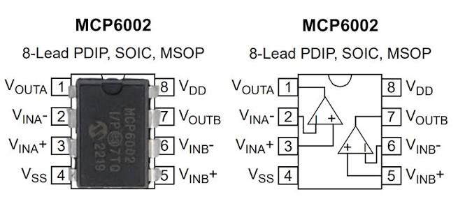
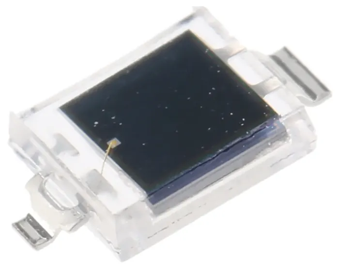
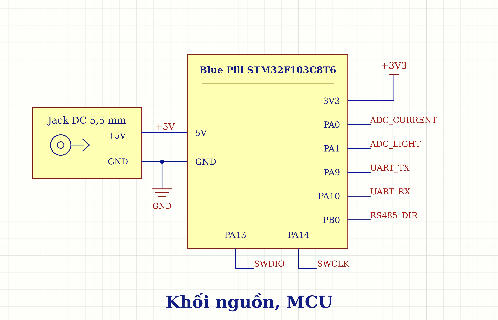
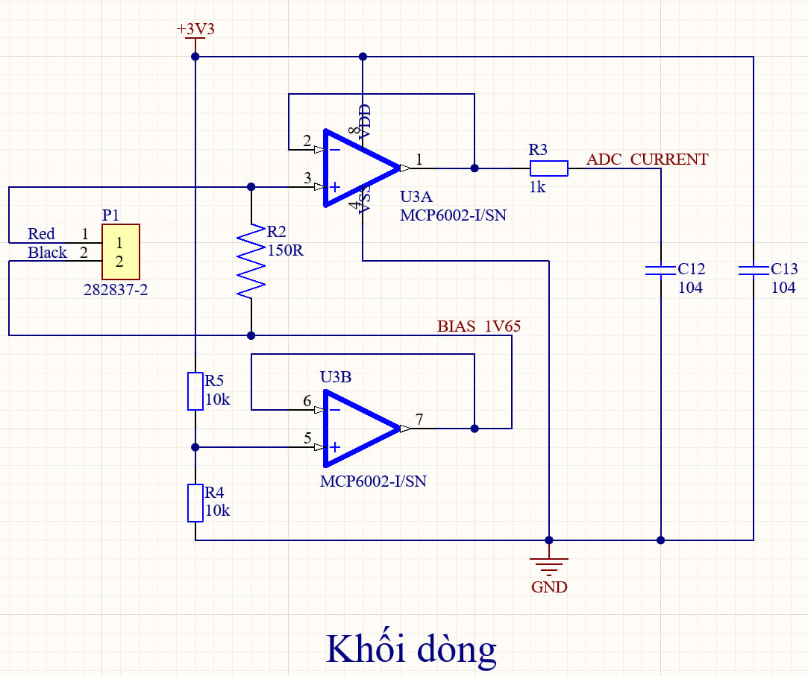
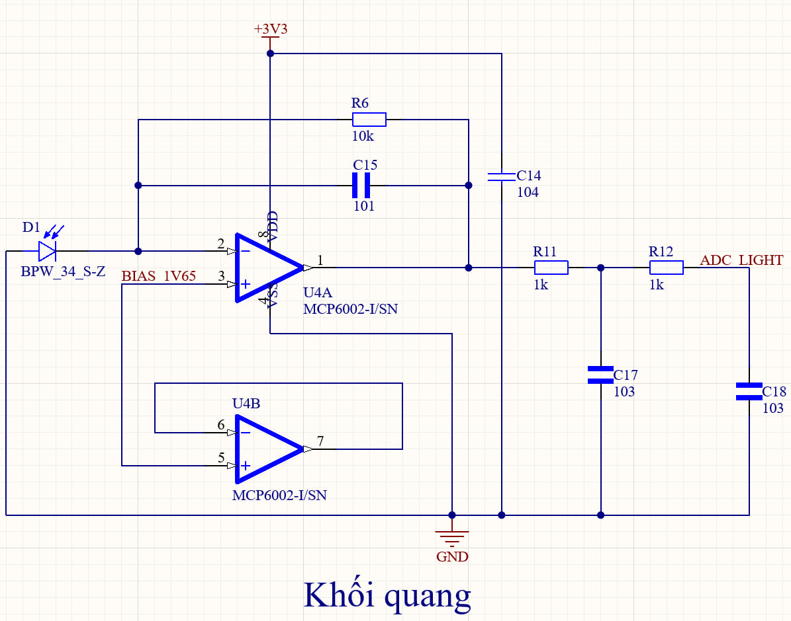
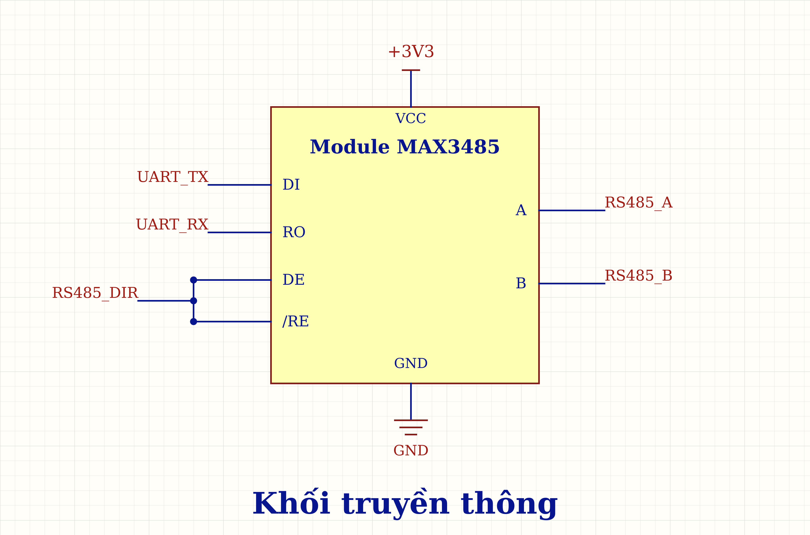
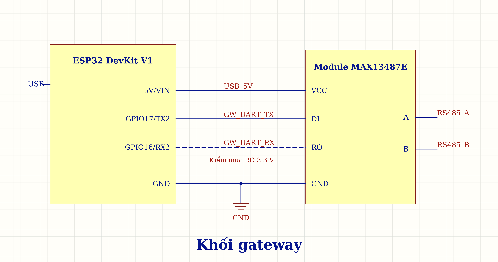

# 1. Bảng linh kiện module

## 1.1. Node

**Khối nguồn, MCU**

| Linh kiện | Số lượng | Vị trí sử dụng | Ghi chú |
| ------------------------------------ | -------------- | ----------------------- | ------------------------------------------------- |
| Ổn áp 3,3 V (Blue Pill) | Có sẵn trên bo | Cấp MCU, AFE và MAX3485 | Có sẵn trên bo |
| Điện trở 10 kΩ, 1%, ≥0,125 W | 2 | Cầu chia BIAS | Tạo mức nền khoảng 1,65 V |
| Blue Pill STM32F103C8T6 | 1 bo | Thu ADC, xử lý và UART | Tích hợp nguồn, clock, reset [5], [6] |

**Khối dòng**

| Linh kiện | Số lượng | Vị trí sử dụng | Ghi chú |
|---|---|---|---|
| CT DL-CT08CL6-1000/1 | 1 | Cảm biến dòng ngoài bo | Tỷ số 1000:1; dùng lại với PCB |
| MCP6002-I/P, DIP-8 | 1 IC | Kênh A đệm dòng; kênh B đệm BIAS | Đệm dòng và BIAS [2] |
| Điện trở 150 Ω–2 W | 1 | Song song thứ cấp CT | Đổi dòng CT thành điện áp |
| Điện trở 1 kΩ, 1%, ≥0,125 W | 1 | Lọc dòng trước PA0 | Lọc trước PA0 |
| Tụ 100 nF (104), gốm 50 V | 1 | PA0 xuống GND | Tụ lọc tín hiệu |
| Tụ 100 nF (104), gốm 50 V | 1 | Nguồn MCP6002 dòng | Sát chân 8–4 |

**Khối quang**

| Linh kiện | Số lượng | Vị trí sử dụng | Ghi chú |
|---|---|---|---|
| BPW34 chân cắm | 1 | Cảm biến quang | Đúng cực A/K [4] |
| MCP6002-I/P, DIP-8 | 1 IC | TIA đổi dòng quang thành áp | Kênh B không tải [2], [3] |
| Điện trở 10 kΩ, 1%, ≥0,125 W | 1 | Hồi tiếp TIA | Trở riêng của mạch quang |
| Tụ 100 pF (101), C0G, 50 V | 1 | Hồi tiếp TIA | Song song điện trở 10 kΩ |
| Tụ 100 nF (104), gốm 50 V | 1 | Nguồn MCP6002 quang | Đặt sát chân 8–4 |
| Điện trở 1 kΩ, 1%, ≥0,125 W | 2 | Hai tầng lọc quang | Lắp cố định sau TIA |
| Tụ 10 nF (103), gốm 50 V | 2 | Hai tầng lọc quang | Tụ lọc xuống GND |

**Khối truyền thông**

| Linh kiện | Số lượng | Vị trí sử dụng | Ghi chú |
|---|---|---|---|
| Module MAX3485 3,3 V | 1 | RS485 node | Dùng nguyên bo [7] |

## 1.2. Gateway

Giữ nguyên bộ ESP32 + MAX13487E dạng module khi node chuyển sang PCB.

**Khối nguồn**

| Linh kiện | Số lượng | Vị trí sử dụng | Ghi chú |
|---|---|---|---|
| Nguồn 5 V/3,3 V (ESP32 DevKit) | Có sẵn trên bo | 5 V cho MAX13487E; 3,3 V cho ESP32 | Nguồn USB laptop [9] |

**Khối MCU**

| Linh kiện | Số lượng | Vị trí sử dụng | Ghi chú |
|---|---|---|---|
| ESP32-DevKitC V4, WROOM-32E | 1 bo | Hỏi node, kiểm bản tin và gửi USB | Bo tham chiếu [9] |

**Khối truyền thông**

| Linh kiện | Số lượng | Vị trí sử dụng | Ghi chú |
| ------------------------ | -------- | ------------------------------ | ----------------------------------- |
| Module MAX13487E | 1 module | RS485 gateway, tự chuyển chiều | Dùng nguyên bo [8] |

## 1.3. Các phần bên ngoài — nguồn, bộ tải và đồ dùng lại khi thử PCB

**Nguồn cấp ngoài, dây và đầu nối**

| Linh kiện | Số lượng | Vị trí sử dụng | Ghi chú |
|---|---|---|---|
| Adapter cách ly 5 VDC–2 A | 1 | Cấp node module, sau đó PCB node | Nguồn riêng node; phích 5,5 × 2,1 mm |
| Jack DC cái 5,5 × 2,1 mm | 1 bộ | Đưa nguồn vào bàn thử | Ra cọc vít; đúng cực tính |
| Cáp USB có dữ liệu | 1 | Gateway–laptop | Micro-B, có dữ liệu |
| Cáp RS485 cặp xoắn và GND | Khoảng 1 m | Node–gateway | Trở kháng 120 Ω [16] |
| Breadboard, jumper, dây cứng ngắn, header | 1 bộ | Đấu thử module và debug | Đường quang giữ dây ngắn |
| ST-Link V2 và dây SWD | 1 bộ | Nạp Blue Pill, sau đó PCB | Không nối thêm nguồn từ ST-Link |
| USB–RS485 CH340 | 1 dụng cụ | Debug module hoặc PCB | Chỉ dùng debug |

**Bộ tải thử CT**

| Linh kiện | Số lượng | Vị trí sử dụng | Ghi chú |
|---|---|---|---|
| Nguồn cách ly 12 VAC–1,5 A | 1 | Cấp tải thử CT, dùng lại khi thử PCB | Không cấp MCU hoặc ADC |
| Điện trở sứ 50 Ω–25 W | 3 | Tải sơ cấp CT | 1–3 nhánh song song |
| Dây silicone 20 AWG, cọc vít, đế chịu nhiệt | 1 bộ | Vòng tải ngoài thiết bị | Không dẫn tải qua breadboard |

**Nguồn sáng và dụng cụ đo**

| Linh kiện | Số lượng | Vị trí sử dụng | Ghi chú |
|---|---|---|---|
| Đồng hồ AC/DC | Có/mượn | Nguồn và tải module/PCB | Đo được dòng nhỏ 0,24–0,72 A |
| Oscilloscope ≥2 kênh, 2 probe | Có/mượn | Tín hiệu trước/sau lọc | Lưu ảnh hoặc CSV |
| Đèn pin, tấm che, thước | 1 bộ | Quang tĩnh module/PCB | Cố định khoảng cách, góc |
| LED trắng 5 mm | 1 | Nguồn sáng ngoài thiết bị | Không phải LED cảnh báo |
| Điện trở 330 Ω, ≥0,125 W | 1 | Hạn dòng LED thử | Trở riêng cho LED thử |
| Máy phát xung | Có/mượn | Quang xung module/PCB | Kích LED 0–3,3 V |
| Laptop, phần mềm nạp/log, USB lưu dữ liệu | 1 bộ | Lưu hồ sơ module/PCB | Lưu CSV |

# 2. Thiết kế và nối dây từng phần

## 2.1. Nhận diện hai MCP6002 DIP-8

Mỗi MCP6002 có hai kênh khuếch đại A và B trong cùng một IC. Dán tên “dòng” và “quang” lên hai IC để không nhầm khi đấu dây. [2]

Hình bên trái là IC thật; hình bên phải là sơ đồ hai kênh bên trong. Cả hai đều nhìn **từ mặt trên**, với rãnh định hướng ở cạnh trên. [2]

1. Đặt IC sao cho rãnh định hướng ở phía trên như hình.
2. Chân 1 ở góc trên bên trái; bên trái đếm xuống chân 4, bên phải đếm từ chân 5 lên chân 8. [2]
3. Đối chiếu số chân và tên tín hiệu trong bảng trước khi cắm dây.

| Từ linh kiện/chân | Đến linh kiện/chân | Giải thích ngắn |
|---|---|---|
| Chân 1 | OUT A | Đầu ra kênh A |
| Chân 2 | IN− A | Đầu vào đảo A |
| Chân 3 | IN+ A | Đầu vào không đảo A |
| Chân 4 | VSS | Nối GND khi cấp một nguồn 3,3 V |
| Chân 5 | IN+ B | Đầu vào không đảo B |
| Chân 6 | IN− B | Đầu vào đảo B |
| Chân 7 | OUT B | Đầu ra B |
| Chân 8 | VDD | Nối 3V3 |

**Kiểm tra trước khi làm tiếp**

- [ ] Đã nhận đúng dấu định hướng.
- [ ] Không lấy số chân nhìn từ mặt dưới.

## 2.2. Nhận diện anode và cathode của BPW34

BPW34 là photodiode: khi nhận ánh sáng, nó sinh ra dòng điện nhỏ. Hai chân là **anode (A)** và **cathode (K)**; cần xác định đúng trước khi nối vào mạch quang. [3], [4]

**Đo bằng chế độ diode của đồng hồ**

1. Tháo BPW34 khỏi mạch và che tối cảm biến để ánh sáng không ảnh hưởng phép đo.
2. Cắm que đen vào COM, que đỏ vào cổng V/Ω; chọn nấc có ký hiệu diode. Nếu dùng chung nấc với đo thông mạch, chọn đúng chế độ diode.
3. Chạm hai que vào hai chân, đọc số rồi đảo chiều hai que để đo lại.

- Nếu một chiều hiện khoảng **500–800 mV** (hoặc **0,500–0,800 V**), còn chiều ngược hiện **1 hoặc OL** báo quá thang, chiều có điện áp thuận cho biết: **que đỏ chạm A, que đen chạm K**. Giá trị thực tùy đồng hồ và linh kiện. [13]
- **Không cần có tiếng bíp.** Khi đo diode, đọc số trên màn hình để nhận biết chiều dẫn.

**Nhận diện theo chấm trắng:** với linh kiện trong ảnh, dùng phép đo trên để kiểm chân phía có chấm trắng. Nếu que đỏ đặt ở chân phía chấm trắng và que đen ở chân còn lại cho điện áp thuận, thì **phía có chấm trắng là anode**. Không dùng riêng màu chấm để kết luận cho mọi BPW34; dấu nhận diện phụ thuộc nhà sản xuất và kiểu vỏ. Ví dụ, [datasheet BPW34 của Vishay](https://www.vishay.com/docs/81521/bpw34.pdf) có dấu nhận diện cathode trên bản vẽ vỏ. [4]

**Vai trò trong mạch TIA**

Khối quang dùng mạch **TIA (Transimpedance Amplifier — bộ khuếch đại chuyển dòng thành điện áp)**. Có thể hiểu TIA là “phiên dịch viên”: chuyển dòng điện nhỏ do BPW34 sinh ra thành mức điện áp để ADC của vi điều khiển đọc được. Trong mạch đang dùng, **A nối GND, K nối chân 2 (IN−) của MCP6002 quang**; cách hoạt động và mạng hồi tiếp được giải thích ở khối quang trong mục 2.4. [1], [3]

## 2.3. Nối dây bộ tải thử dòng

Bộ tải ngoài gồm **nguồn cách ly 12 VAC–1,5 A, điện trở sứ 50 Ω–25 W và dây dẫn**. Nó tạo dòng đi qua CT để thử khối dòng.

1. Tắt nguồn 12 VAC trước khi đấu dây. Đặt điện trở tải trên đế chịu nhiệt.
2. Nối **đầu ra thứ nhất của nguồn 12 VAC** vào một dây, luồn dây này **một lượt qua lỗ CT**, rồi nối đến một đầu điện trở 50 Ω–25 W.
3. Nối đầu còn lại của điện trở về **đầu ra thứ hai của nguồn 12 VAC**, tạo thành vòng kín. Dây về đi ngoài lỗ CT; không luồn cả dây đi và dây về cùng qua CT.
4. Nối **hai dây thứ cấp của CT** vào khối dòng node theo mục 2.4. Điện trở burden 150 Ω phải mắc kín vào thứ cấp CT trước khi bật tải; không tháo dây CT khi dòng sơ cấp đang chạy.

| Từ | Đến | Ghi chú |
|---|---|---|
| Đầu ra 1 của nguồn 12 VAC | Một đầu điện trở tải | Dây nối đi qua lỗ CT một lượt |
| Đầu còn lại của điện trở tải | Đầu ra 2 của nguồn 12 VAC | Dây về đi ngoài CT |
| Hai dây thứ cấp CT | Hai đầu burden 150 Ω của mạch dòng | Đây là đường tín hiệu về node |

Bài kiểm ở phần 3 tăng lần lượt từ **1 → 2 → 3 điện trở 50 Ω–25 W mắc song song**. Đặt dây xuyên CT **trước chỗ chia nhánh** để đo tổng dòng. **Đo tổng dòng tải bằng đồng hồ ở từng mức 1–2–3 tải để kiểm tra: dòng thực tăng thì biên độ tín hiệu CT tại PA0 cũng tăng.**

Không dẫn dòng tải qua breadboard hoặc đưa 12 VAC vào các chân nguồn/ADC của node.

> [!note] Cách đo dòng tải bằng đồng hồ vạn năng (nguồn cách ly 12 VAC)
>
> 1. Kiểm đồng hồ có chế độ **A~ (đo dòng xoay chiều)**; chỉ có V~ thì không đo trực tiếp dòng AC theo cách này được.
> 2. **Tắt nguồn tải.** Cắm que đen vào **COM**, que đỏ vào cổng **A/10A** theo hướng dẫn đồng hồ; chọn đo **A~**, thang đủ lớn hơn 0,72 A (thường bắt đầu ở thang 10 A). Không dùng cổng mA nếu giới hạn cổng thấp hơn dòng tải.
> 3. Tháo một đầu dây cấp chung khỏi đầu ra 1 của nguồn 12 VAC. Nối que đỏ vào đầu ra 1, que đen vào đầu dây vừa tháo; dùng kẹp giữ chắc. Đồng hồ lúc này nằm **nối tiếp**, toàn bộ dòng tải đi qua đồng hồ.
> 4. Đường nối: **đầu ra 1 nguồn → que đỏ → đồng hồ → que đen → dây qua CT → các tải song song → đầu ra 2 nguồn**. Không chạm hai que trực tiếp vào hai đầu nguồn khi đang chọn đo dòng, vì sẽ gây ngắn mạch.
> 5. Bật nguồn, đọc số ở đơn vị **A** và ghi vào bảng 3.3. Tuân thủ giới hạn thời gian đo ở cổng A/10A ghi trên đồng hồ; tắt nguồn trước mỗi lần thêm tải hoặc đổi thang/cổng que.
> 6. Đo xong, tắt nguồn, tháo đồng hồ và nối lại dây cấp tải. Chuyển que đỏ về cổng **V/Ω** để tránh nhầm khi đo điện áp lần sau.

## 2.4. Nối dây node

### Khối nguồn, MCU

- Bo Blue Pill STM32F103C8T6 được cấp 5 V qua jack DC 5,5 mm; ổn áp trên bo tạo 3,3 V, GND là mốc điện áp chung.
- PA0, PA1, PA9, PA10, PB0, PA13 và PA14 lần lượt gắn nhãn ADC_CURRENT, ADC_LIGHT, UART_TX, UART_RX, RS485_DIR, SWDIO và SWCLK để nhận diện chức năng và liên kết tín hiệu giữa các khối. [5], [6]

| Nhãn (chân MCU) | Ý nghĩa | Giải thích tên nhãn bằng tiếng Anh | Chân module MAX3485 liên quan |
|---|---|---|---|
| **ADC_CURRENT (PA0)** | Đọc điện áp dòng sau lọc bằng ADC. | **ADC = Analog-to-Digital Converter:** bộ chuyển đổi tương tự sang số; **Current:** dòng điện. | —  [5] |
| **ADC_LIGHT (PA1)** | Đọc điện áp quang sau hai tầng lọc bằng ADC. | **ADC = Analog-to-Digital Converter:** bộ chuyển đổi tương tự sang số; **Light:** ánh sáng. | —  [5] |
| **UART_TX (PA9)** | Phát dữ liệu tới DI module MAX3485. | **UART = Universal Asynchronous Receiver/Transmitter:** bộ thu/phát nối tiếp không đồng bộ; **TX = Transmit:** phát dữ liệu. | **DI (Driver Input):** dữ liệu từ UART TX đưa vào module.  [5], [6], [7] |
| **UART_RX (PA10)** | Nhận dữ liệu từ RO module MAX3485. | **UART = Universal Asynchronous Receiver/Transmitter:** bộ thu/phát nối tiếp không đồng bộ; **RX = Receive:** nhận dữ liệu. | **RO (Receiver Output):** dữ liệu từ module đưa về UART RX.  [5], [7] |
| **RS485_DIR (PB0)** | Điều khiển DE và /RE để chọn phát hoặc nhận. | **RS = Recommended Standard:** tên gọi tiêu chuẩn; **485:** số hiệu tiêu chuẩn giao tiếp điện; **DIR = Direction:** chiều truyền dữ liệu. | **DE (Driver Enable):** cho phép truyền dữ liệu khi **chân DE ở mức HIGH (logic 1)**. **/RE (Receiver Enable):** cho phép nhận dữ liệu khi **chân /RE ở mức LOW (logic 0)**.  [7] |
| **SWDIO (PA13), SWCLK (PA14)** | Dữ liệu và xung nhịp để nạp, gỡ lỗi bằng ST-Link. | **SWDIO = Serial Wire Debug Input/Output:** đường dữ liệu vào/ra của giao diện gỡ lỗi SWD; **SWCLK = Serial Wire Clock:** đường xung nhịp của giao diện này. | —  [5] |

### Khối dòng

**Chuyển đổi dòng điện thành điện áp (Biến dòng CT và R2)**
Biến dòng (CT) loại DL-CT08CL6-1000/1 có tỷ số biến dòng là 1000:1. Khi có dòng điện chạy qua cuộn sơ cấp, cuộn thứ cấp sẽ sinh ra một dòng điện nhỏ hơn 1000 lần. Dòng thứ cấp này đi qua điện trở gánh R2 có giá trị 150 Ω, biến đổi thành một điện áp xoay chiều:

$$I_{\mathrm{s,rms}} = \frac{I_{\mathrm{p,rms}}}{1000}$$

$$V_{\mathrm{R2,rms}} = I_{\mathrm{s,rms}} \times 150\,\Omega$$

Ví dụ, nếu dòng thứ cấp là 1 mA, điện áp sinh ra giữa hai đầu R2 sẽ là 0,15 V RMS. Vì là điện xoay chiều, giá trị này sẽ liên tục đảo chiều âm dương.

**Tạo điện áp nền 1,65 V (Cầu chia áp R4, R5)**
**ADC (Analog-to-Digital Converter — bộ chuyển đổi tương tự sang số)** bên trong vi điều khiển STM32 chuyển điện áp đầu vào thành giá trị số để chương trình xử lý. Trong mạch này, ADC đo điện áp từ 0 đến 3,3 V, không đo trực tiếp được điện áp âm. Trong khi đó, điện áp xoay chiều trên R2 có cả nửa chu kỳ dương và âm. Vì vậy, mạch dùng điện áp nền để tín hiệu thay đổi quanh 1,65 V thay vì quanh 0 V. Hai điện trở R4 và R5, cùng giá trị 10 kΩ, chia nguồn 3,3 V để tạo mức nền này: [5], [12]

**Xem thêm:** [Phụ lục — Điện áp BIAS](../Phu_luc/Dien_ap_BIAS.md).

$$V_M = 3{,}3 \times \frac{R4}{R5 + R4} = 3{,}3 \times \frac{10}{10 + 10} = 1{,}65\,\mathrm{V}$$

Mức 1,65 V nằm giữa dải đo của ADC, tạo khoảng điện áp bằng nhau ở hai phía của mức nền. Ví dụ, tín hiệu ban đầu từ −0,5 đến +0,5 V sẽ thành 1,15–2,15 V sau khi cộng mức nền. Nhờ đó, ADC đo được cả hai nửa chu kỳ, miễn là điện áp sau khi cộng nền vẫn nằm trong dải đo. [5], [12]

**Ổn định mức nền bằng bộ đệm (Op-amp U3B)**
Cầu chia áp R4 và R5 có điện trở tương đương là $10\,\mathrm{k}\Omega \parallel 10\,\mathrm{k}\Omega = 5\,\mathrm{k}\Omega$. Nếu tải phía sau tiêu thụ một dòng điện rất nhỏ, ví dụ 10 µA, điện áp nền sẽ bị sụt giảm:

$$\Delta V = 10\,\mathrm{\mu A} \times 5\,\mathrm{k}\Omega = 0{,}05\,\mathrm{V}$$

> [!NOTE] Lý do dùng Op-Amp làm bộ đệm để ngăn tải làm sụt áp cầu chia
> Trong lý thuyết, **Op-Amp lý tưởng không có dòng điện đi vào hoặc đi ra từ hai chân đầu vào (I₊ = I₋ = 0)** ==do trở kháng đầu vào của nó có giá trị **vô cùng lớn**== [11]
> 
> Tuy nhiên, trong thực tế, Op-Amp **vẫn dẫn một lượng dòng điện cực kỳ nhỏ** (gọi là dòng phân cực đầu vào - _input bias current_), thường chỉ ở mức nano-ampere (nA) hoặc pico-ampere (pA), chứ không hoàn toàn bằng không tuyệt đối. [2]

Để khắc phục, điện áp 1,65 V từ cầu chia được đưa vào chân không đảo (chân số 5) của Op-amp U3B. Chân đầu ra (chân số 7) được nối hồi tiếp âm trực tiếp về chân đảo (chân số 6), tạo thành một bộ đệm có hệ số khuếch đại xấp xỉ 1: [2], [11]

$$\frac{V_{\mathrm{out}}}{V_+} = \frac{A}{1+A} \approx 1$$

U3B giữ cho mức nền BIAS_1V65 luôn cố định ở 1,65 V, cung cấp dòng điện cần thiết cho tải mà không làm sai lệch điện áp của cầu chia ban đầu.

> [!note] Giải thích hồi tiếp âm trong mạch đệm Op-Amp
> 
> Op-amp khuếch đại sự chênh lệch điện áp giữa hai đầu vào theo công thức: [11]
> 
> $$V_{\mathrm{out}} = A \times (V_+ - V_-)$$
> 
> Trong đó, $A$ là hệ số khuếch đại vòng hở (open-loop gain) do nhà sản xuất chế tạo, thường có giá trị cực kỳ lớn (khoảng $10^5$ đến $10^6$); $V_+$ và $V_-$ là điện áp tại chân không đảo và chân đảo.
> 
> Ở U3B, đầu ra chân 7 nối trực tiếp về chân đảo 6 nên $V_- = V_{\mathrm{out}}$. Thay vào công thức trên và thu gọn:
> 
> 
> $$V_{\mathrm{out}} = A \times (V_+ - V_{\mathrm{out}})$$
> 
> $$\frac{V_{\mathrm{out}}}{V_+} = \frac{A}{1 + A} \approx 1$$
> 
> Vì $A$ rất lớn so với 1, điện áp đầu ra gần bằng điện áp đầu vào. Khi mạch hoạt động tuyến tính và ổn định, chân 5 (+) nhận khoảng 1,65 V thì đầu ra chân 7 cũng bám theo mức này. Cách mắc đó gọi là bộ đệm điện áp (voltage follower). [2], [11]
>
> **Xem thêm:** [Phụ lục — Hồi tiếp âm trong op-amp](../Phu_luc/Hoi_tiep_am_trong_op_amp.md).

**Ghép tín hiệu đo vào mức nền**
Đầu dưới của điện trở R2 được nối trực tiếp với đường BIAS_1V65. Điều này có nghĩa là điểm tham chiếu của tín hiệu đo đã được nâng lên 1,65 V so với GND. Gọi $v_{\mathrm{R2}}(t)$ là điện áp tức thời sinh ra giữa hai đầu R2, điện áp tại đầu trên của R2 sẽ là:

$$V_{\text{đầu trên R2}} \approx 1{,}65\,\mathrm{V} + v_{\mathrm{R2}}(t)$$

Nếu điện áp tức thời trên R2 là +0,10 V, đầu trên sẽ đạt 1,75 V. Nếu điện áp tức thời là -0,10 V, đầu trên sẽ giảm xuống 1,55 V. Toàn bộ tín hiệu đo luôn được đảm bảo ở mức dương.

**Đệm tín hiệu đo lường (Op-amp U3A)**
Điện áp tại đầu trên của R2 được đưa vào chân không đảo (chân số 3) của Op-amp U3A. Tương tự như U3B, U3A cũng được cấu hình làm bộ đệm tín hiệu:

$$V_{\mathrm{outA}} \approx V_{\text{đầu trên R2}} \approx 1{,}65\,\mathrm{V} + v_{\mathrm{R2}}(t)$$

Op-amp U3A làm bộ đệm giữa mạch biến dòng (CT và R2) với các khối phía sau, hạn chế dòng điện cấp cho bộ lọc và đầu vào ADC làm thay đổi điện áp đo trên R2. [2], [11]

**Lọc nhiễu và bảo vệ nguồn (R3, C12, C13)**
Tín hiệu đầu ra từ U3A đi qua mạch lọc thông thấp gồm điện trở R3 (1 kΩ) và tụ C12 (100 nF) để loại bỏ các nhiễu tần số cao. Tần số cắt của bộ lọc này là: [14]

$$f_c = \frac{1}{2\pi \times R3 \times C12} \approx 1{,}59\,\mathrm{kHz}$$

==Thành phần tín hiệu 50/60 Hz== gần như giữ nguyên biên độ sau lọc. Các thành phần nhiễu trên 1,59 kHz bị suy giảm trước khi tín hiệu vào PA0 (ADC_CURRENT); tần số càng cao, mức suy giảm càng lớn. Tụ C13 (100 nF) mắc giữa chân nguồn 3V3 và GND của MCP6002 để giảm nhiễu trên đường cấp nguồn. [14], [17]
> [!note] Lý do chọn tụ 100 nF để lọc nhiễu nguồn
> **Tụ 104 (Ký hiệu 104 = 100 nF) - Lọc nhiễu nguồn (Decoupling Capacitor)**
> **100 nF là giá trị nằm trong dải khuyến nghị của Microchip cho MCP6002.** Datasheet **MCP6001/1R/1U/2/4, DS20001733L**, mục **4.4 “Supply Bypass”**, khuyến nghị tụ lọc nguồn cục bộ **0,01–0,1 µF (10–100 nF)**, đặt cách chân nguồn không quá **2 mm** [2].
>
> Với tụ lý tưởng, độ lớn dung kháng là:
>
> $$
> |Z_C|=\frac{1}{2\pi fC}
> $$
>
> Ở 1 MHz, tụ 100 nF có dung kháng khoảng **1,59 Ω**, tạo đường có trở kháng thấp cho dòng nhiễu cao tần về GND, giúp giảm nhiễu tại chân nguồn. Trong khối dòng, tụ này là **C13**; hiệu quả thực tế còn phụ thuộc đặc tính tụ và cách đi dây.

### Khối quang

**Nhận ánh sáng và tạo dòng quang (D1 – BPW34)**

BPW34 chuyển ánh sáng thành một dòng điện nhỏ gọi là **dòng quang**. Trong cùng điều kiện phổ ánh sáng, ánh sáng càng mạnh thì dòng quang thường càng lớn. [3], [4]

Trong mạch, anode của D1 nối GND, cathode nối chân đảo 2 (−) của U4A. Chân không đảo 3 (+) nhận điện áp BIAS khoảng 1,65 V. Khi hồi tiếp âm hoạt động ổn định, U4A giữ chân 2 gần bằng 1,65 V. Như vậy, cathode cao hơn anode khoảng 1,65 V, tạo phân cực ngược cho photodiode. [3]

Dòng quang có chiều quy ước từ cathode qua D1 xuống anode rồi về GND. Có thể hiểu rằng khi nhận ánh sáng, D1 lấy một dòng điện nhỏ từ điểm nối tại chân 2 xuống GND. [3]

> [!NOTE] Bản chất dòng quang và điều kiện phân cực của BPW34
>
> - **Chiều dòng quang:** Ánh sáng được hấp thụ trong linh kiện tạo ra các cặp electron–lỗ trống. Điện trường tại vùng tiếp giáp giúp phân tách các hạt mang điện, tạo thành dòng quang $I_{\mathrm{ph}}$ có ==chiều quy ước từ cathode (K) sang anode (A)==. Khi ánh sáng thay đổi, độ lớn của thành phần dòng quang thay đổi; **chiều của thành phần này không tự đảo ngượ**c.  [3]
>
> - **Điều kiện phân cực khi đo dòng quang:** Mạch đo thường giữ photodiode ở trạng thái không phân cực ($V_K = V_A$) hoặc phân cực ngược ($V_K > V_A$). Nếu đặt điện áp phân cực thuận từ bên ngoài, nó sẽ dẫn điện như một diode thông thường, dòng dẫn thuận tăng nhanh và có thể lấn át dòng quang (vốn chỉ ở mức microampe), làm sai lệch phép đo.  [3]
>
> - **Dòng điện trong mạch đang dùng:** Khi U4A hoạt động tuyến tính và hồi tiếp ổn định, $V_K \approx 1{,}65\,\mathrm{V}$ tại chân 2, còn $V_A = 0\,\mathrm{V}$ tại GND. D1 vì vậy được phân cực ngược với $V_K = 1{,}65\,\mathrm{V}$ (tại chân 2) và $V_A = 0\,\mathrm{V}$ (tại GND). Khi nhận ánh sáng, dòng quang đi từ nút chân 2 qua D1 xuống GND. Đầu ra U4A cấp dòng bù qua mạng hồi tiếp để giữ điện áp tại nút này gần mức BIAS; ở trạng thái ổn định, dòng bù chủ yếu đi qua R6. [3]

**Chuyển dòng quang thành điện áp (U4A và R6)**

U4A cùng điện trở hồi tiếp R6 tạo thành **mạch TIA (Transimpedance Amplifier — bộ khuếch đại chuyển dòng thành điện áp)**. R6 có giá trị 10 kΩ, nối từ đầu ra chân 1 về chân đảo 2. [1], [3]

==Đầu vào op-amp gần như không lấy dòng==. Vì vậy, khi D1 dẫn dòng quang xuống GND, đầu ra U4A phải cấp dòng bù qua R6 để giữ chân 2 gần mức 1,65 V. Dòng qua R6 tạo ra chênh lệch điện áp giữa đầu ra và chân 2: **dòng quang càng lớn thì điện áp đầu ra càng cao.** [2], [3]

Ở trạng thái ổn định, khi mạch chưa bão hòa, **điện áp đầu ra tại chân 1 của U4A**, ký hiệu là $V_{\mathrm{out}}$, được tính gần đúng: [3]

$$
V_{\mathrm{out}} \approx V_{\mathrm{BIAS}} + I_{\mathrm{ph}}R6
$$

Trong đó, $V_{\mathrm{BIAS}} \approx 1{,}65\,\mathrm{V}$, $I_{\mathrm{ph}}$ là dòng quang và $R6 = 10\,\mathrm{k}\Omega$.

Ví dụ, dòng quang tăng thêm 10 µA thì điện áp tại chân 1 tăng khoảng:

$$
\Delta V_{\mathrm{out}}
\approx 10\,\mathrm{\mu A}\times10\,\mathrm{k}\Omega
=0{,}10\,\mathrm{V}
$$

Nếu ban đầu đầu ra là 1,65 V thì sau đó sẽ tăng lên khoảng 1,75 V. ADC có thể đọc sự thay đổi điện áp này để nhận biết thay đổi ánh sáng. Khi ánh sáng quá mạnh, đầu ra có thể bão hòa và không còn tăng theo công thức trên.

> [!NOTE] Vai trò của C15 và bộ lọc trước ADC_LIGHT
>
> **Điện dung của BPW34:** Cảm biến có cấu trúc bán dẫn PIN, gồm vùng P và N ở hai phía, giữa là lớp I gần như không pha tạp. Vùng nghèo ít hạt mang điện tự do ngăn cách hai phía có thể tích điện, nên cấu trúc này có điện dung tương tự tụ điện. Đây là **điện dung tiếp giáp bên trong cảm biến**[3]. Điện dung điển hình là **70 pF khi không phân cực** và **25 pF khi phân cực ngược 3 V**, ở tần số thử 1 MHz; datasheet không nêu giá trị cụ thể tại 1,65 V [4].
>
> **Lý do dùng R6–C15:**
>
> - **Điện dung đầu vào:** $C_{\mathrm{in}}$ là tổng điện dung của cảm biến, đầu vào op-amp và dây nối.
>
> - **Mạng hồi tiếp:** Khi chưa có C15, R6 và $C_{\mathrm{in}}$ tạo mạng RC thông thấp từ đầu ra về chân đảo (−). Hệ số hồi tiếp là $\beta(s)=H_1(s)=1/(1+sR6\,C_{\mathrm{in}})$, tương ứng công thức (8), mục 2.2 của [phụ lục](../Phu_luc/Bo_loc_thong_thap.md), với $R=R6$, $C=C_{\mathrm{in}}$.
>
> - **Tần số cắt và trễ pha:** $f_c=1/(2\pi R6\,C_{\mathrm{in}})$, theo công thức (1), mục 1.1. Mạng gây trễ pha theo công thức (4), mục 1.3. Đây là tần số cắt của R6–$C_{\mathrm{in}}$, khác mốc RC của R6–C15 bên dưới.
>
> - **Ringing và tự dao động:** Trễ pha của mạng cộng với trễ bên trong op-amp có thể làm đầu ra nhấp nhô sau cạnh xung (ringing) khi dự trữ pha thấp. Nguyên nhân là tương tác trong vòng hồi tiếp; mạng RC riêng lẻ không tự gây ringing. Nếu tổng trễ pha khoảng 180° và độ lợi vòng còn từ 1 trở lên, mạch có thể tự dao động dù ánh sáng không đổi [1], [3].
>
> - **Vai trò R6–C15:** R6 chuyển dòng quang thành điện áp. C15 mắc song song R6 để bù pha, giúp hạn chế dao động [1], [3].
>
> - **Chọn C15 = 100 pF:** Với **R6 = 10 kΩ**, $\tau=R6\,C15=1\,\mathrm{\mu s}$. Dùng 10 nF sẽ tăng $\tau$ lên 100 µs, làm đầu ra chậm hơn và dễ giảm biên độ xung ngắn. Đồ án chọn 100 pF để hạn chế làm chậm tín hiệu; phép tính đáp ứng nằm trong phụ lục.
>
> **C15 = 100 pF** mắc song song với **R6 = 10 kΩ** trong mạng hồi tiếp, **tạo đặc tính lọc thông thấp cho TIA** và hỗ trợ ổn định vòng hồi tiếp. Với DC và tín hiệu tần số thấp, dòng hồi tiếp chủ yếu qua R6, tạo điện áp đầu ra theo dòng quang. Khi tần số tăng, phần dòng qua C15 tăng, làm biên độ điện áp đầu ra giảm. Mốc RC của mạng R6–C15 trong mô hình TIA lý tưởng khoảng **159 kHz**, với hằng số thời gian **1 µs** [3], [4].
>
> Sau TIA, tín hiệu qua **hai tầng RC nối trực tiếp**: R11/C17 và R12/C18, mỗi tầng **1 kΩ/10 nF**, rồi tới **PA1 (ADC_LIGHT)**. Tần số cắt tính cho cả hai tầng khoảng **5,96 kHz**. Đây là bộ lọc giảm nhiễu trước ADC; C15 thuộc mạng hồi tiếp TIA, không thay thế hai tầng này [15], [17].
>
> **Xem thêm:** [Bộ lọc thông thấp](../Phu_luc/Bo_loc_thong_thap.md)

> [!NOTE] Khác biệt giữa lọc quang và lọc dòng
>
> **Khối quang** cần nhận biết xung sáng ngắn nên dùng tụ **10 nF** ở mỗi tầng để hạn chế làm chậm tín hiệu; hai tầng giúp giảm nhiễu cao tần mạnh hơn một tầng cùng R, C. **Khối dòng** chủ yếu đo thành phần **50/60 Hz**, dùng **một tầng 1 kΩ/100 nF**, tần số cắt khoảng **1,59 kHz**, để giảm nhiễu và hạn chế suy giảm các sóng hài cần quan sát [1], [14], [15], [17].
>
> **Xem thêm:** [Bộ lọc thông thấp](../Phu_luc/Bo_loc_thong_thap.md).

**Giữ kênh còn lại ở trạng thái xác định (U4B)**

U4B không dùng để đo nhưng vẫn được cấp nguồn, nên cần giữ ổn định để hạn chế nhiễu chéo sang U4A [2]. Chân 5 (+) nối **BIAS 1,65 V**, là điện áp nền để đầu ra bám theo. Chọn mức này vì **nằm giữa nguồn 0–3,3 V**, giúp đầu vào và đầu ra ở xa hai giới hạn nguồn, đồng thời **tận dụng BIAS có sẵn**. 

Chân 7 nối về chân 6 (−) tạo **hồi tiếp âm**: đầu ra cao hơn BIAS thì op-amp kéo xuống, thấp hơn thì đẩy lên, giữ đầu ra gần 1,65 V. BIAS đặt mức cần giữ; hồi tiếp giúp đầu ra bám mức đó. [11], [12]

Chân 7 không nối tải ngoài hoặc nối chung với đầu ra bộ đệm BIAS của khối dòng, tránh hai đầu ra đẩy dòng qua nhau.

**Giảm nhiễu nguồn cho IC (C14)**

Tụ C14 có giá trị 100 nF, mắc giữa chân VDD (+3V3) và VSS (GND), đặt sát chân nguồn của MCP6002. [2]

Tụ cung cấp dòng tức thời khi IC cần và giúp giảm nhiễu cao tần trên đường nguồn. Nhờ đó, điện áp cấp tại IC ít biến động hơn, hỗ trợ mạch khuếch đại hoạt động ổn định. [2]

### Khối truyền thông

**Vai trò và nguồn cấp**

Blue Pill gửi và nhận dữ liệu qua UART; module MAX3485 chuyển dữ liệu này sang tín hiệu RS485 trên cặp dây A/B để trao đổi với gateway. Module nhận **+3V3** và dùng **GND chung với Blue Pill** để các chân UART có cùng mốc điện áp. [7]

**Đường phát và nhận dữ liệu**

| Nhãn (chân MCU)     | Chân module                                         | Chức năng                                                                                                                                                                                                                                                                                        |
| ------------------- | --------------------------------------------------- | ------------------------------------------------------------------------------------------------------------------------------------------------------------------------------------------------------------------------------------------------------------------------------------------------ |
| **UART_TX (PA9)**   | **DI — Driver Input:** đầu vào bộ phát              | **USART1 (Universal Synchronous/Asynchronous Receiver/Transmitter)** là bộ thu/phát nối tiếp đồng bộ hoặc không đồng bộ số 1 bên trong STM32. Trong mạch này, USART1 dùng chế độ không đồng bộ (UART), đưa dữ liệu ra chân **PA9 (TX)** rồi vào DI của module để gửi tới gateway.  [5], [6], [7] |
| **UART_RX (PA10)**  | **RO — Receiver Output:** đầu ra bộ thu             | Dữ liệu nhận từ gateway được module chuyển về chân nhận USART1 của Blue Pill.                                                                                                                                                                                                      [5], [7]      |
| **RS485_DIR (PB0)** | **DE — Driver Enable** và **/RE — Receiver Enable** | Chọn chiều phát hoặc nhận của module; hai chân điều khiển nối chung vào PB0.                                                                                                                                                                                                       [7]           |

**Chọn chiều truyền bằng PB0**

Node dùng chung cặp A/B cho cả hai chiều, nên phát và nhận lần lượt. Chân **DE cho phép phát ở mức 1**, còn **/RE cho phép nhận ở mức 0**; dấu “/” cho biết chân này tác động ở mức thấp. [7]

| Mức PB0 | Bộ phát DE | Bộ thu /RE | Trạng thái node              |
| ------- | ---------- | ---------- | ---------------------------- |
| **1**   | Bật        | Tắt        | Gửi dữ liệu tới gateway.     |
| **0**   | Tắt        | Bật        | Chờ nhận dữ liệu từ gateway. |

Khi gửi xong byte cuối, chương trình phải chờ **cờ TC (Transmission Complete)** báo UART đã phát hết cả bit kết thúc rồi mới hạ PB0 về 0. Nếu đổi sang nhận quá sớm, bộ phát bị tắt khi dữ liệu chưa ra hết, làm mất phần cuối bản tin. [6]

**Truyền dữ liệu trên cặp A/B**

RS485 truyền dữ liệu bằng **chênh lệch điện áp giữa hai dây**, $V_{\mathrm{AB}}=V_A-V_B$. Bộ thu dựa vào chênh lệch này để khôi phục dữ liệu UART. Nối **A với A, B với B** ở gateway; dây **GND đi cùng cáp** làm mốc chung giữa hai bên. Dùng nguyên module và kiểm tra điện trở kết thúc đường truyền (termination), mạch đặt mức chờ (bias) đã tích hợp trên bo thực. [16]

**Tốc độ truyền UART**

Thời gian truyền một byte và số byte truyền tối đa trong một giây được tính theo: [6]

$$
t_{\mathrm{byte}}=\frac{N_{\mathrm{bit}}}{B},\qquad
D_{\mathrm{tối\ đa}}=\frac{B}{N_{\mathrm{bit}}}.
$$

Trong đó, $N_{\mathrm{bit}}$ là tổng số bit truyền cho một byte, gồm bit bắt đầu, dữ liệu, kiểm tra chẵn lẻ (nếu có) và bit kết thúc; $B$ là tốc độ bit (bit/s). Với UART đang dùng, 115200 baud tương ứng 115200 bit/s. $t_{\mathrm{byte}}$ tính bằng giây, còn $D_{\mathrm{tối\ đa}}$ tính bằng byte/s.

Cấu hình **8N1** gồm **8 bit dữ liệu, không có bit kiểm tra chẵn lẻ và 1 bit kết thúc**. Cộng thêm 1 bit bắt đầu, mỗi byte cần $N_{\mathrm{bit}}=1+8+0+1=10$ bit. Thay $B=115200$ bit/s: [6]

$$
t_{\mathrm{byte}}=\frac{10}{115200}\approx86{,}8\,\mu\mathrm s,\qquad
D_{\mathrm{tối\ đa}}=\frac{115200}{10}=11\,520\,\mathrm{byte/s}.
$$

Đây là tốc độ tối đa lý thuyết; phần khung bản tin và thời gian đổi chiều làm lượng dữ liệu thực truyền được thấp hơn. Vì vậy, node gửi kết quả tóm tắt thường kỳ; mẫu lấy nhanh được lưu để tính toán hoặc tải riêng khi cần.

**Trước khi nối ADC:** đo nguồn, BIAS và đầu ra hai đường đo; chỉ nối khi điện áp nằm trong dải ADC. Node dùng adapter riêng; ST-Link không cấp thêm nguồn khi node đang chạy bằng adapter. [5]

## 2.5. Nối dây gateway

**Vai trò của gateway**

Gateway gồm **ESP32 DevKit V1** và **module MAX13487E**, làm cầu nối giữa node và laptop. ESP32 gửi yêu cầu tới node, nhận kết quả đo rồi chuyển về laptop qua USB để lưu CSV. Module MAX13487E chuyển dữ liệu UART của ESP32 thành tín hiệu RS485 trên cặp A/B và chuyển tín hiệu nhận được về UART. [8]

**Nguồn cấp và GND chung**

ESP32 nhận nguồn từ **USB laptop**. Đường **USB_5V** lấy từ chân **5V/VIN** trên bo ESP32 để cấp VCC cho module MAX13487E; cần đo điện áp tại chân này khi cắm USB và kiểm đường nguồn bo thực trước khi nối. **GND của ESP32 và module nối chung** để các tín hiệu UART có cùng mốc điện áp. [9]

**Đường phát và nhận dữ liệu**

**UART2** là bộ thu/phát nối tiếp không đồng bộ số 2 bên trong ESP32; **GPIO17 và GPIO16** là các chân được firmware cấu hình để đưa tín hiệu phát/nhận của bộ này ra ngoài. UART2 dùng trao đổi với node qua MAX13487E, còn **UART0 dành cho đường USB về laptop**. [9], [10]

| Nhãn (chân ESP32) | Chân module MAX13487E | Chức năng |
|---|---|---|
| **GW_UART_TX (GPIO17/TX2)** | **DI — Driver Input:** đầu vào bộ phát | Đưa yêu cầu từ ESP32 vào module để gửi tới node.  [8], [10] |
| **GW_UART_RX (GPIO16/RX2)** | **RO — Receiver Output:** đầu ra bộ thu | Đưa phản hồi từ node qua module về ESP32; chỉ nối sau khi xác nhận mức điện áp phù hợp GPIO 3,3 V.  [8] |

**Kiểm tra mức điện áp RO**

Nét đứt ở đường RO trong hình thể hiện **kết nối có điều kiện**. Module **MAX13487E dùng nguồn 5 V**, khác với module **MAX3485 dùng nguồn 3,3 V**. [7], [8]

**Tự điều khiển chiều truyền**

MAX13487E có chức năng **tự điều khiển chiều truyền**, nên ESP32 không cần chân RS485_DIR để chọn phát/nhận như phía node MAX3485. ESP32 gửi dữ liệu qua TX2 và nhận phản hồi qua RX2; hai bên vẫn trao đổi lần lượt trên cùng cặp A/B. Nếu bo thực đưa **/RE** (cho phép nhận) hoặc **/SHDN** (điều khiển tắt IC) ra header, phải xác định cách nối theo mạch bo, không áp dụng cách nối DE và /RE của MAX3485. [8]

**Nối cặp A/B về node**

Nối **A với A, B với B**, kèm dây **GND làm mốc chung**. Dữ liệu được truyền bằng chênh lệch điện áp giữa A và B. Giữa node và gateway chỉ nối **A, B và GND**; node dùng adapter riêng, gateway dùng USB laptop. [16]

**Tốc độ truyền và chu kỳ hỏi**

Thời gian phát lý tưởng của một bản tin được tính theo: [6], [10]

$$
t_{\mathrm{khung}}=L\,t_{\mathrm{byte}}=\frac{L\,N_{\mathrm{bit}}}{B}.
$$

Trong đó, $L$ là tổng số byte của bản tin, gồm cả phần dữ liệu và các byte đóng khung; $N_{\mathrm{bit}}$ là số bit truyền cho một byte, $B$ là tốc độ bit (bit/s), còn $t_{\mathrm{khung}}$ tính bằng giây. Công thức giả sử các byte được phát liên tiếp, không có khoảng nghỉ.

**UART2** dùng **115200 baud, 8N1**, giống phía node. **8 = 8 bit dữ liệu; N (None) = không dùng bit kiểm tra chẵn lẻ; 1 = 1 bit dừng (kết thúc)**. Cộng thêm 1 bit bắt đầu, mỗi byte truyền cần tổng cộng 10 bit. Thay $N_{\mathrm{bit}}=10$ và $B=115200$ bit/s: [10]

$$
t_{\mathrm{khung}}=\frac{10L}{115200}.
$$

Với bản tin **20 byte**, thay $L=20$:

$$
t_{\mathrm{khung}}=\frac{10\times20}{115200}
\approx0{,}001736\,\mathrm{s}
\approx1{,}74\,\mathrm{ms}.
$$

Thời gian này chưa gồm thời gian node xử lý, đổi chiều và gửi phản hồi. **Chu kỳ hỏi** là khoảng thời gian giữa các lần gateway yêu cầu dữ liệu; **chu kỳ lấy mẫu ADC** là khoảng thời gian giữa các lần node đọc tín hiệu. Gateway nhận kết quả đo, không quyết định trực tiếp tốc độ lấy mẫu ADC của node.

# Tài liệu tham khảo

[1] Luis Orozco, Analog Devices, [Optimizing Precision Photodiode Sensor Circuit Design](https://www.analog.com/en/resources/technical-articles/optimizing-precision-photodiode-sensor-circuit-design.html), mục “AC Considerations”, 2014.

[2] Microchip Technology, [MCP6001/1R/1U/2/4 — 1 MHz, Low-Power Op Amp](https://ww1.microchip.com/downloads/aemDocuments/documents/MSLD/ProductDocuments/DataSheets/MCP6001-1R-1U-2-4-1-MHz-Low-Power-Op-Amp-DS20001733L.pdf), DS20001733L, mục 4.4 “Supply Bypass”, 4.5 “Unused Op Amps” và 4.7.1 “Unity Gain Buffer”, 2020.

[3] Hamamatsu Photonics, [Si photodiodes — Technical note](https://www.hamamatsu.com/content/dam/hamamatsu-photonics/sites/documents/99_SALES_LIBRARY/ssd/si_pd_kspd9001e.pdf), mục 1-1 “Structure”, 2-6 “Response speed” và 3-1 “Connection to an op amp”. Cấu tạo photodiode, điện dung tiếp giáp và ảnh hưởng đến đáp ứng mạch.

[4] Vishay Semiconductors, [BPW34, BPW34S — Silicon PIN Photodiode](https://www.vishay.com/docs/81521/bpw34.pdf). Loại photodiode và thông số điện dung của BPW34.

[5] STMicroelectronics, [STM32F103x8/STM32F103xB — DS5319](https://www.st.com/resource/en/datasheet/stm32f103c8.pdf), mục 3 “Pinouts and pin description”, bảng 5 “Medium-density STM32F103xx pin definitions” và mục “ADC characteristics”. Căn cứ PA0/PA1 là ADC12_IN0/IN1, PA9/PA10 là USART1_TX/RX ở ánh xạ mặc định, PA13/PA14 là SWDIO/SWCLK và dải chuyển đổi ADC 0 đến VREF+. Datasheet IC không xác nhận mạch nguồn riêng của từng bo Blue Pill; các nhãn tín hiệu trong tài liệu là quy ước của dự án.

[6] STMicroelectronics, [RM0008 — STM32F101xx/102xx/103xx/105xx/107xx Reference Manual](https://www.st.com/resource/en/reference_manual/rm0008-stm32f101xx-stm32f102xx-stm32f103xx-advanced-arm-based-32-bit-mcus-stmicroelectronics.pdf), chương “Universal synchronous asynchronous receiver transmitter (USART)”, mục “USART character description”, “Transmitter” và thanh ghi USART_SR, bit TC. Căn cứ các bit start/data/parity/stop và việc TC báo hoàn tất sau bit kết thúc. Thời gian 86,8 µs/byte, 1,74 ms/20 byte và giới hạn 11 520 byte/s là phép tính trong tài liệu từ cấu hình 115200 baud, 8N1 đã chọn, không phải kết quả thử trong nguồn này.

[7] Analog Devices (Maxim Integrated), [MAX3483/MAX3485/MAX3486/MAX3488/MAX3490/MAX3491 — 3.3V-Powered RS-485/RS-422 Transceivers](https://www.analog.com/media/en/technical-documentation/data-sheets/MAX3483-MAX3491.pdf), mục “General Description”, “Pin Description”, “Function Tables” và “Typical Application Circuits”. Căn cứ nguồn 3,3 V, bán song công của MAX3485, chức năng DI/RO/A/B và mức điều khiển DE, /RE. Chân PB0 điều khiển chung DE và /RE là cách nối của dự án; datasheet IC không xác nhận linh kiện phụ trợ đã tích hợp trên module thực.

[8] Analog Devices (Maxim Integrated), [MAX13487E/MAX13488E — Half-Duplex RS-485-Compatible Transceiver with AutoDirection Control](https://www.analog.com/media/en/technical-documentation/data-sheets/max13487e-max13488e.pdf), mục “General Description”, “Pin Description”, “AutoDirection Circuitry” và “Electrical Characteristics”. Căn cứ nguồn 5 V, cơ chế tự điều khiển chiều truyền và chức năng DI/RO, /RE, /SHDN của IC; không dùng để suy sơ đồ header hoặc mức RO sau mạch phụ trợ chưa xác nhận của bo module.

[9] Espressif Systems, [ESP32-DevKitC V4 Getting Started Guide](https://documentation.espressif.com/esp-dev-kits/en/latest/esp32/esp32-devkitc/user_guide.html), mục “Functional Description”, “Power Supply Options”, “Header Block” và sơ đồ bo trong “Related Documents”. Căn cứ Micro-USB, cầu USB–UART, ổn áp và chân nguồn/GPIO của **bo tham chiếu DevKitC V4** ở bảng linh kiện. Không coi bo tham chiếu này là bằng chứng mọi bo mang tên ESP32 DevKit V1 đều có cùng đường nguồn, đầu nối và sơ đồ.

[10] Espressif Systems, [ESP-IDF v5.5 — Universal Asynchronous Receiver/Transmitter (UART), ESP32](https://docs.espressif.com/projects/esp-idf/en/v5.5/esp32/api-reference/peripherals/uart.html), mục “Introduction”, “Set Communication Parameters” và “Set Communication Pins”. Căn cứ ba bộ UART, cấu hình baud/data/parity/stop và định tuyến chân bằng uart_set_pin(). GPIO17/GPIO16, việc dành UART0 cho đường laptop và lịch hỏi–đáp là cấu hình của dự án.

[11] Analog Devices, [MT-032: Ideal Voltage Feedback (VFB) Op Amp](https://www.analog.com/media/en/training-seminars/tutorials/MT-032.pdf), mục “Ideal Voltage Feedback Model” và “Basic Operation”, trang 1–2. Cơ sở trở kháng đầu vào lý tưởng, khuếch đại chênh lệch và hồi tiếp âm. Công thức bộ đệm A/(1+A) trong phần 2 được suy ra từ mô hình này; giả thiết hai đầu vào gần bằng nhau cần mạch hoạt động tuyến tính và ổn định.

[12] Charles Kitchin, Analog Devices, [AN-581: Biasing and Decoupling Op Amps in Single Supply Applications](https://www.analog.com/en/resources/app-notes/an-581.html), mục “Common Problems with Resistor Biasing” và “Decoupling the Biasing Network from the Supply”. Cơ sở đặt nền giữa nguồn bằng cầu chia áp và ảnh hưởng biến động nguồn. R4/R5 = 10 kΩ, điện áp nền 1,65 V và ví dụ dịch mức trong phần 2 là phép tính theo cấu hình dự án, không phải giá trị bắt buộc do tài liệu hãng quy định.

[13] Fluke, [How to Test Diodes with a Digital Multimeter](https://www.fluke.com/en-au/learn/blog/digital-multimeters/how-to-test-diodes), phần thao tác diode test và “Diode test analysis”. Căn cứ chiều đặt que đo, sụt áp thuận khoảng 0,5–0,8 V đối với diode silicon thông dụng và hiển thị OL khi phân cực ngược. Khoảng này chỉ hỗ trợ nhận diện chiều diode, không phải ngưỡng kiểm định riêng của BPW34; ký hiệu quá thang và tiếng bíp phụ thuộc đồng hồ.

[14] Analog Devices, [A Beginner’s Guide to Filter Topologies](https://www.analog.com/en/resources/technical-articles/a-beginners-guide-to-filter-topologies.html), phần bộ lọc thông thấp RC thụ động một cực. Cơ sở tần số cắt 1/(2πRC), suy giảm cao tần và ảnh hưởng trở kháng tải. Các giá trị 1,59 kHz, 159 kHz và tỷ lệ biên độ ở phần 2 là kết quả tính theo mô hình, không phải thông số đo được của mạch đang lắp.

[15] Analog Devices University Program, [Activity: Cascaded RC Low Pass Filters — ADALM2000](https://wiki.analog.com/university/labs/cascaded_rc_adalm2000), mục “Objective”, “Background” và sơ đồ hai tầng RC. Căn cứ ảnh hưởng tải giữa các tầng RC nối trực tiếp; nguồn này không xác nhận phép nhân hai hàm truyền RC không tải cho cấu hình không có bộ đệm giữa hai tầng.

[16] Thomas Kugelstadt, Texas Instruments, [The RS-485 Design Guide — SLLA272D](https://www.ti.com/lit/an/slla272d/slla272d.pdf), mục “Standard and Features”, “Bus Topology”, “Cable Type”, “Bus Termination” và phần nối đất. Cơ sở truyền vi sai, cáp cặp xoắn có trở kháng đặc tính khoảng 120 Ω, tham chiếu chung và termination. Không dùng các mạch ví dụ để mặc định thêm điện trở termination hoặc bias rời vào hai module đã chọn.

[17] David M. Alter, Texas Instruments, [Using PWM Output as a Digital-to-Analog Converter on a TMS320F280x Digital Signal Controller](https://www.ti.com/lit/an/spraa88a/spraa88a.pdf), SPRAA88A, tháng 9/2008; mục 4.1–4.2, trang 8–10, công thức (7)–(11), Hình 5–6; mục 5, trang 12, Hình 8–9. Cơ sở chính thức về hàm truyền, băng thông −3 dB, tải giữa các tầng RC và đáp ứng biên độ/pha. Các giá trị 1,59 kHz, 5,96 kHz và tỷ lệ giữ biên độ trong nội dung là kết quả tính khi thay R/C của mạch vào công thức, không phải số đo thực nghiệm do TI công bố.
