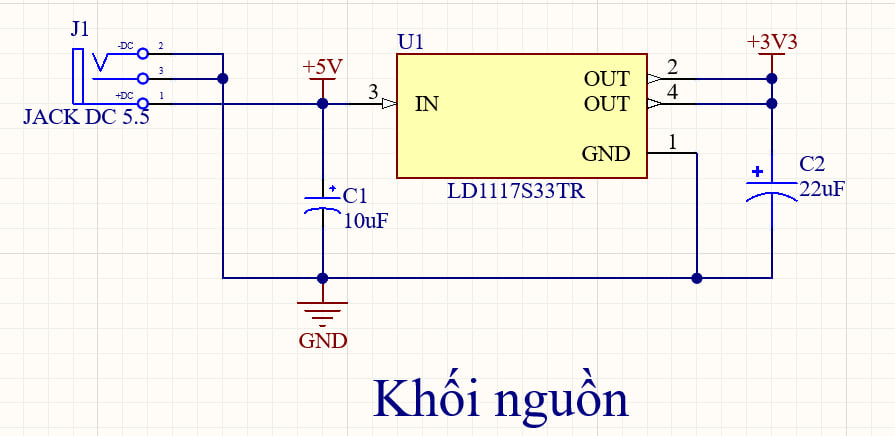
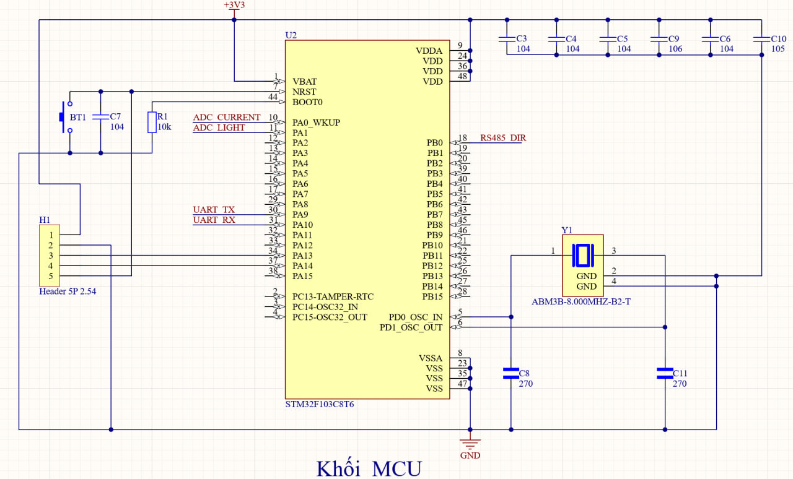
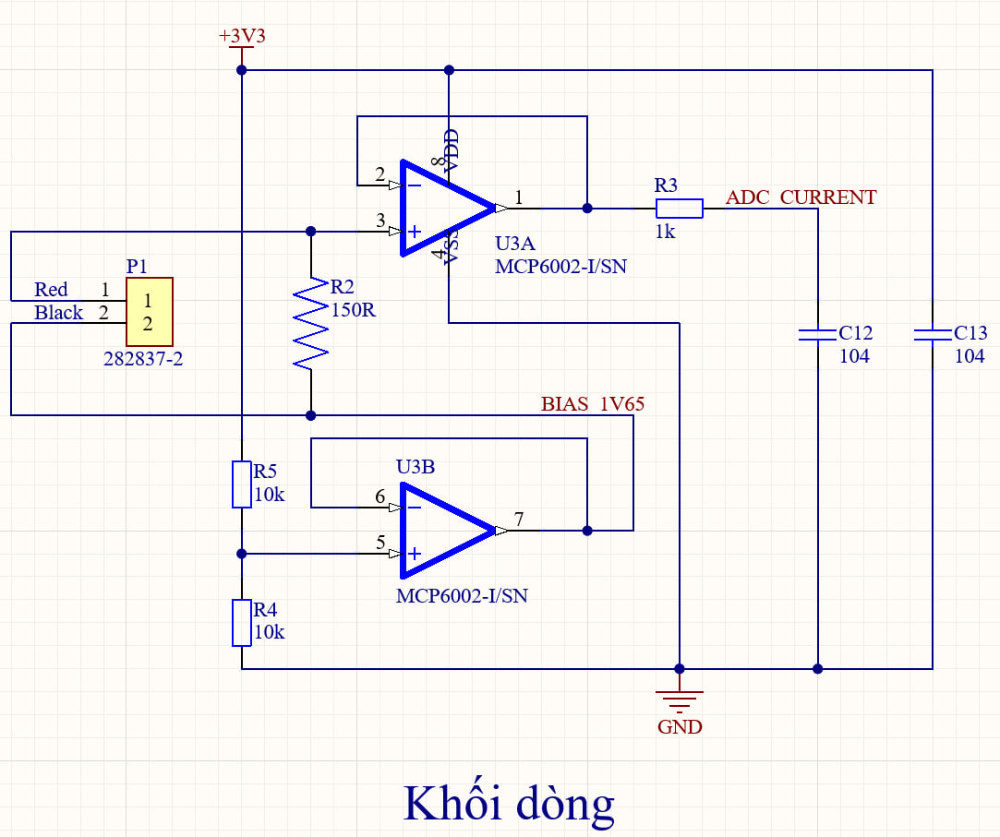
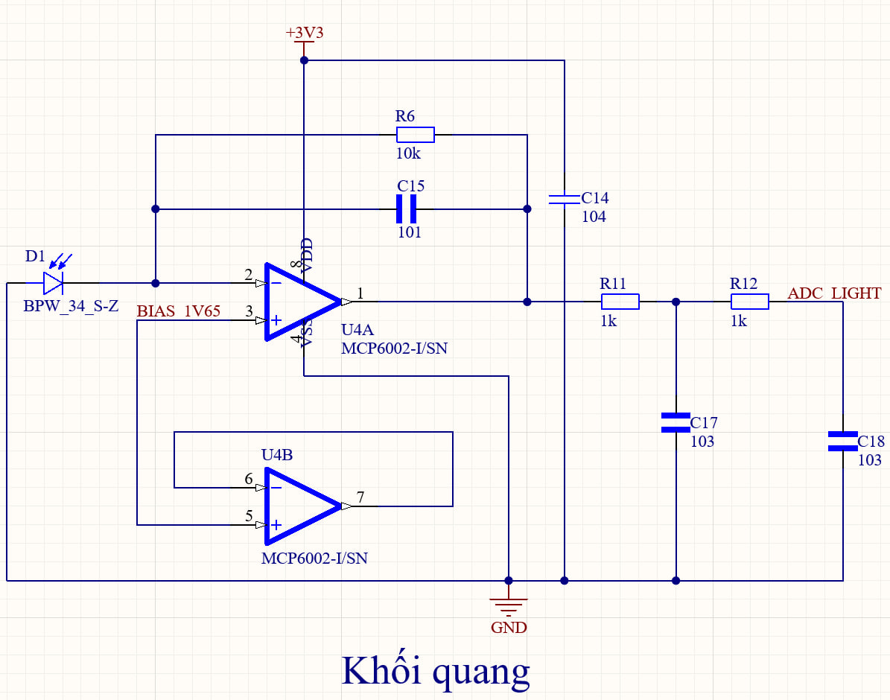
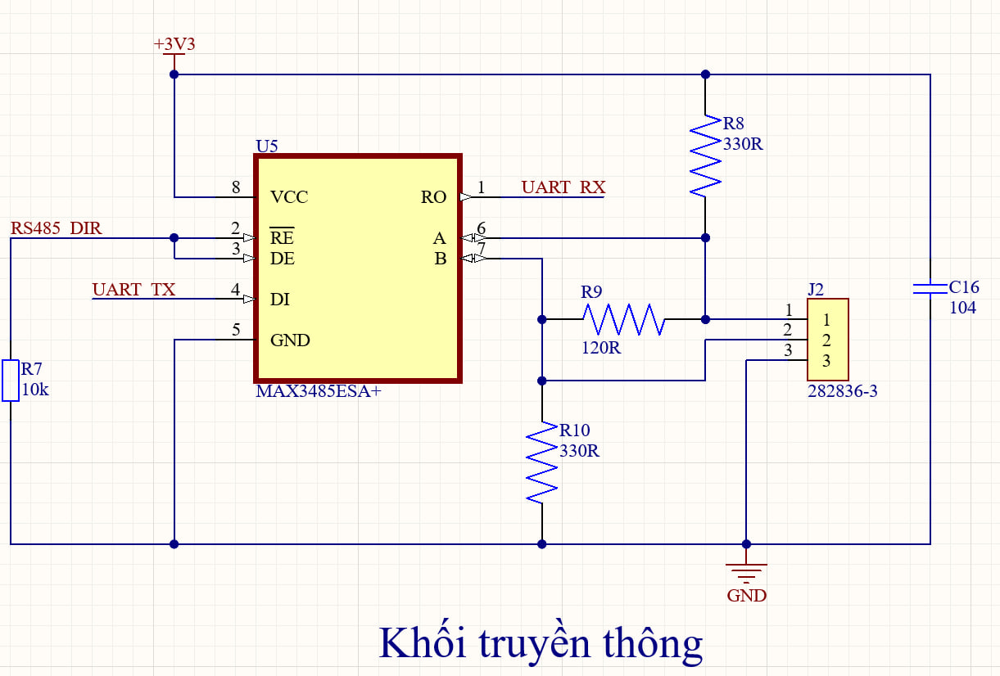

# BOM_LIST và hướng dẫn vẽ schematic PCB node

## 1. BOM chia theo khối

SL cho **một PCB**. Đây là cấu hình thiết kế ban đầu khi chưa điền kết quả test; không tuyên bố đã thử đạt hoặc đã mua đủ. Giá trị Rb/Rf/Cf/lọc đối chiếu kết quả trong [hướng dẫn kiểm thử module](../module/01_Huong_dan_test_va_kiem_thu_module.md). Khi thay giá trị, cập nhật đồng bộ file này và schematic. DNP là có vị trí trên schematic/PCB nhưng không lắp, không phải linh kiện bị bỏ quên.

Tụ gốm theo BOM mới: C9 10 µF–16 V; các tụ gốm còn lại 50 V. C1/C2 tantalum 16 V có phân cực. 0805/1206 là package hệ inch. Xác nhận **mã đặt hàng và kích thước thực**; C9 10 µF–16 V/0805 chưa có mã hãng cụ thể. Không tự đổi footprint cho vừa tên generic trên cửa hàng.

### 1.1. Khối nguồn

| Mã | Linh kiện / giá trị / mã hãng | Package | SL | Căn cứ lựa chọn / lưu ý |
|---|---|---|---:|---|
| J1 | Jack DC cái 5.5 mm, khớp adapter 5 V–2 A | THT | 1 | Phù hợp phích adapter; xác nhận lỗ tâm, chân và footprint theo jack thực |
| U1 | LDO: LD1117S33TR, 3,3 V; tới 800 mA, còn phụ thuộc nhiệt | SOT-223 | 1 | Hạ 5 V xuống 3,3 V; dòng dùng được còn phụ thuộc nhiệt |
| C1 | Tụ tantalum: 10 µF (106), 16 V | 3528, cần xác nhận mã thực | 1 | Tụ đầu vào; có phân cực |
| C2 | Tụ tantalum: 22 µF (226), 16 V; tham chiếu TAJC226M016RNJ | 6032 (C case) | 1 | Tụ đầu ra; có phân cực; chọn điện dung cao hơn mức tối thiểu 10 µF (106) nêu trong datasheet LD1117 |

### 1.2. Khối MCU

| Mã | Linh kiện / giá trị / mã hãng | Package | SL | Cơ sở lựa chọn / lưu ý |
|---|---|---|---:|---|
| U2 | MCU: STM32F103C8T6; 72 MHz; Flash 64 KB; SRAM 20 KB; 2,0–3,6 V | LQFP-48 | 1 | Có ADC 12 bit, UART, DMA và SWD để đọc cảm biến, xử lý và truyền dữ liệu |
| C3–C5 | Tụ gốm: 100 nF (104), X7R, 50 V | 0805 | 3 | Một tụ 100 nF (104) cho mỗi chân VDD MCU |
| C9 | Tụ gốm: 10 µF (106), X7R, 16 V | 0805 | 1 | Tụ nguồn tổng MCU |
| C6 | Tụ gốm: 100 nF (104), X7R, 50 V | 0805 | 1 | Lọc nguồn VDDA, phối hợp C10 1 µF (105) |
| C10 | Tụ gốm: 1 µF (105), X7R, 50 V | 0805 | 1 | Lọc nguồn VDDA phục vụ ADC |
| Y1 | Thạch anh: ABM3B-8.000MHZ-B2-T, 8 MHz; CL = 18 pF | 5,0 × 3,2 mm | 1 | Nguồn clock ngoài; có thể cấu hình PLL ×9 để đạt 72 MHz |
| C8, C11 | Tụ gốm: 27 pF (270), ±5 %, C0G, 50 V (C0805C270J5GACTU) | 0805 | 2 | Tụ tải cho đúng mã Y1 |
| R1 | Điện trở: 10 kΩ, 1 %, 0,125 W | 0805 | 1 | Kéo BOOT0 xuống để khởi động từ Flash |
| C7 | Tụ gốm: 100 nF (104), X7R, 50 V | 0805 | 1 | Tụ NRST theo cấu hình reset |
| BT1 | Nút nhấn RESET: 2 chân SMD 3 × 6 × 2,5 mm, thường hở, nhấn nhả; mã hãng chưa xác nhận | SMD 3 × 6 × 2,5 mm; pad cần đối chiếu nút thực | 1 | Khởi động lại MCU thuận tiện khi chạy thử; mã hãng và footprint cần xác nhận theo nút thực |
| H1 | Header SWD: 1×5, bước 2,54 mm | Header | 1 | Đưa ra 3V3, GND, SWDIO, SWCLK và NRST |

### 1.3. Khối dòng

| Mã | Linh kiện / giá trị / mã hãng | Package | SL | Cơ sở lựa chọn / lưu ý |
|---|---|---|---:|---|
| P1 | Terminal TE 282837-2, 2 cực, bước 5,08 mm; footprint TE_282837-2 | THT | 1 | Kết nối thứ cấp CT |
| U3 | Op-amp: MCP6002-I/SN; nguồn hãng 1,8–6,0 V; GBW điển hình 1 MHz | SOIC-8 | 1 | Cấp 3,3 V; một kênh đệm dòng, một kênh đệm BIAS |
| R2 | Điện trở: 150 Ω, 1 %, 0,125 W (CRCW0805150RFKEA) | 0805 | 1 | Burden PCB; đối chiếu với phép thử module và giới hạn tải CT trước khi chốt |
| R5, R4 | Điện trở: 10 kΩ, 1 %, 0,125 W | 0805 | 2 | Cầu chia tạo BIAS danh định 1,65 V |
| C13 | Tụ gốm: 100 nF (104), X7R, 50 V | 0805 | 1 | Tụ nguồn U3 |
| R3 | Điện trở: 1 kΩ, 1 %, 0,125 W | 0805 | 1 | Cùng C12 tạo lọc trước ADC |
| C12 | Tụ gốm: 100 nF (104), X7R, 50 V | 0805 | 1 | Phối hợp R3 tạo lọc trước ADC dòng |

### 1.4. Khối quang

| Mã | Linh kiện / giá trị / mã hãng | Package | SL | Cơ sở lựa chọn / lưu ý |
|---|---|---|---:|---|
| D1 | Photodiode: ams OSRAM BPW 34 S-Z; tên thư viện BPW_34_S-Z | SMD gullwing | 1 | Thu ánh sáng; phù hợp lắp SMD; footprint DIO_BPW_34_S-Z; kiểm đúng pad A/K |
| U4 | Op-amp: MCP6002-I/SN; nguồn hãng 1,8–6,0 V; GBW điển hình 1 MHz | SOIC-8 | 1 | IC riêng cấp 3,3 V; chuyển dòng quang thành áp, kênh còn lại không cấp tải ngoài |
| R6 | Điện trở: 10 kΩ, 1 %, 0,125 W | 0805 | 1 | Điện trở hồi tiếp; chọn ban đầu để khảo sát độ nhạy |
| C15 | Tụ gốm: 100 pF (101), ±5 %, C0G/NP0, 50 V; tham chiếu GRM2165C1H101JA01D | 0805 | 1 | Hồi tiếp song song R6 để hỗ trợ ổn định; giá trị cần kiểm chứng |
| C14 | Tụ gốm: 100 nF (104), X7R, 50 V | 0805 | 1 | Tụ nguồn U4 |
| R11, R12 | Điện trở: 1 kΩ, 1 %, 0,125 W | 0805 | 2 | Nối tiếp tạo hai tầng lọc thông thấp sau U4A, trước ADC_LIGHT |
| C17, C18 | Tụ gốm: 10 nF (103), X7R, ±10%, 50 V; GRM216R71H103KA01D | 0805 | 2 | Tụ shunt lọc; C17 tại nút R11/R12 và C18 tại ADC_LIGHT, đều xuống GND |

### 1.5. Khối truyền thông

| Mã | Linh kiện / giá trị / mã hãng | Package | SL | Cơ sở lựa chọn / lưu ý |
|---|---|---|---:|---|
| U5 | RS485: MAX3485ESA+; 3,0–3,6 V; tới 10 Mbps | SOIC-8 | 1 | Chuyển UART 3,3 V sang RS485 bán song công; 10 Mbps là khả năng IC, chưa phải baudrate hệ thống |
| C16 | Tụ gốm: 100 nF (104), X7R, 50 V | 0805 | 1 | Tụ nguồn U5 |
| R7 | Điện trở: 10 kΩ, 1 %, 0,125 W | 0805 | 1 | Kéo chung DE và /RE xuống thấp, mặc định nhận |
| J2 | Terminal TE 282836-3, 3 cực A/B/GND, bước 5,00 mm; footprint TE_282836-3 | THT | 1 | Đấu dây cáp RS485; giữ thứ tự chân A/B/GND |
| R9 | Điện trở: 120 Ω, 1 %, 0,25 W | 1206 | 1 | Kết thúc đường truyền dùng cáp 120 Ω; lắp theo vị trí đầu cuối; DNP nếu không dùng theo cấu hình bus |
| R8, R10 | Điện trở: 330 Ω, 1 %, 0,125 W; CRCW0805330RFKEA | 0805 | 2 | Lắp mạng bias tại node; kiểm mạng bias gateway trước khi ghép bus |

### 1.6. Tổng R/C để kiểm số lượng

| Giá trị/package | Vị trí | SL vị trí | Trạng thái |
|---|---|---:|---|
| R 10 kΩ/0805 | R1, R4, R5, R6, R7 | 5 | Lắp |
| R 1 kΩ/0805 | R3, R11, R12 | 3 | Lắp cố định |
| R 150 Ω/0805, 0,125 W | R2 | 1 | Burden, kiểm điều kiện dòng/CT |
| R 330 Ω/0805 | R8, R10 | 2 | Lắp mạng bias node |
| R 120 Ω/1206, 0,25 W | R9 | 1 | Lắp theo cáp và termination cuối tuyến |
| C 100 nF/0805, X7R | C3, C4, C5, C6, C7, C12, C13, C14, C16 | 9 | Lắp |
| C 10 nF/0805, X7R | C17, C18 | 2 | Lắp cố định |
| C 100 pF/0805, C0G | C15 | 1 | Giá trị TIA khảo sát |
| C 27 pF/0805, C0G | C8, C11 | 2 | Tụ tải Y1 |
| C 1 µF/0805, X7R | C10 | 1 | VDDA |
| C 10 µF/0805, X7R | C9 | 1 | Kiểm mã/package/điện dung hữu dụng |
| C tantalum 10 µF–16 V/3528 dự kiến | C1 | 1 | Kiểm mã/ESR/footprint |
| C tantalum 22 µF–16 V/6032 | C2 | 1 | Kiểm mã/ESR/footprint |

**Kiểm tổng vị trí:** U1–U5: 5 IC; R1–R12: 12 điện trở; C1–C18: 18 tụ; Y1, D1, BT1, J1, J2, H1, P1: 7 linh kiện/đầu nối khác. Tổng 42 vị trí trên bo. R8/R10 lắp theo schematic mới; R9 lắp khi node là đầu cuối bus theo cấu hình cáp. Nếu lắp cả R9 thì có 42 linh kiện, nếu R9 DNP thì có 41 linh kiện. Không cộng CT ngoài bo hoặc module gateway vào 42 vị trí. SL mua dự phòng để riêng.

### 1.7. Thiết bị ngoài PCB và phần dùng lại

| Phần | SL | Cách dùng |
|---|---:|---|
| CT DL-CT08CL6-1000/1 | 1 | Dùng lại cảm biến module, nối P1; tỷ số 1000:1 đã chốt, tải còn cần xác nhận |
| Adapter cách ly 5 V–2 A, phích DC 5.5 mm | 1 | Dùng lại, cấp J1; phích/jack đúng kích thước và cực tính |
| ST-Link V2 và dây | 1 bộ | Dùng lại, nạp H1; không cấp song song nguồn |
| ESP32 DevKit + MAX13487E + đổi mức nếu cần + cáp USB | 1 bộ | **Dùng lại nguyên bộ gateway**, vẫn cấp USB laptop |
| Cáp RS485 + GND, bias/termination gateway | 1 bộ | Dùng lại cấu hình đã thử; kiểm lại khi thay đầu node bằng PCB |
| USB–RS485 hiện có | 1 | Chỉ debug; không mua mới và không thay gateway chính |
| Blue Pill, hai MCP6002 DIP và MAX3485 module cũ | 1 bộ | Để đối chiếu/dự phòng, không cắm chồng lên node PCB |

### 1.8. Đối chiếu BOM mới xuất từ Altium

Nguồn: `D:/HUST/Tai_lieu_DH_Phong/Do_An/DATN/PCB_DATN.xlsx`, sheet đầu tiên. Đã kiểm các cột Comment, Description, Designator, Footprint, LibRef và Quantity: **42 vị trí duy nhất**, số lượng từng dòng khớp Designator.

| Nhóm | Nội dung đồng bộ |
|---|---|
| C17/C18 | 10 nF (103), X7R, ±10%, 50 V, 0805; GRM216R71H103KA01D, footprint CAPC2012X70N |
| R11/R12 | 1 kΩ/0805, mỗi tầng lọc quang một trở |
| R8/R10 | Cùng 330 Ω, 1%, 0,125 W, CRCW0805330RFKEA; footprint RESC2012X50N; lắp theo schematic mới |
| R9 | 120 Ω, 1%, 0,25 W, CRCW1206120RFKEA; footprint RESC3116X60N |
| C9 | 10 µF (106), 16 V, 0805; dùng định mức trong BOM mới |
| D1 | BPW_34_S-Z, ams OSRAM; footprint DIO_BPW_34_S-Z |
| P1 | TE 282837-2, 2 cực, bước 5,08 mm; footprint TE_282837-2 |
| J2 | TE 282836-3, 3 cực, bước 5,00 mm; footprint TE_282836-3 |
| H1 | Header 5P 2,54 mm, tên footprint XH2.54M-5; kiểm kích thước với header thực |
| J1 | JACK DC 5.5; giữ ảnh sơ đồ hiện tại, chức năng chân 3 cần đối chiếu jack thực |
| Tụ/trở generic | Khóa mã mua, điện môi/dung sai và kích thước theo bảng BOM trước khi đặt linh kiện |

Các tên footprint trên là dữ liệu xuất từ Altium; vẫn cần kiểm bản vẽ pad, cực tính và pin-to-pad với linh kiện thực. File Excel không chứa dữ liệu đo hoạt động của mạch.

### 1.9. Linh kiện bổ sung so với danh sách cũ

| Linh kiện cần bổ sung | Giai đoạn phục vụ | Số lượng mua mới | Lý do |
|---|---|---|---|
| Điện trở 1 kΩ, 1%, 0,125 W, 0805 | PCB node: R11, R12 | 2 nếu chưa có tồn kho SMD phù hợp | Hoàn thiện hai tầng lọc quang |
| Tụ 10 nF (103), X7R, 50 V, 0805 | PCB node: C17, C18 | 2 nếu chưa có tồn kho SMD phù hợp | Tụ shunt cho hai tầng lọc quang |

Linh kiện đã kê trong Excel vẫn cần kiểm tồn kho và package; linh kiện chân cắm dùng ở module không thay trực tiếp linh kiện SMD trong bảng.

## 2. Hướng dẫn vẽ schematic trong Altium

Ký hiệu `U2.30` là chân 30 của U2. Giữ Designator theo BOM mục 1; không đổi số chân trong symbol để khớp hình minh họa.

1. Tạo PCB Project, thêm Schematic Document và lưu trong dự án Altium của bạn.
2. Chọn symbol đúng mã IC/package; kiểm Pin Designator với datasheet trước khi đặt.
3. Gán Designator, Comment, giá trị, dung sai, định mức, mã hãng và footprint. Các mục chưa chốt mã ở bảng 1.8 cần được xác nhận trước khi đặt PCB.
4. Đặt năm khối nguồn, MCU, dòng/BIAS, quang và RS485; nối theo các bảng dưới đây.
5. Dùng Wire để nối điện; đặt Power Port và Net Label chạm đúng dây. Chạy Validate/ERC và kiểm netlist sau khi hoàn tất.

### 2.1. Đặt các khối và quy ước nối

Đặt các khối trên một sheet trước để dễ kiểm. Nếu tách sheet, dùng Port/Sheet Entry đúng cấu trúc dự án và kiểm net đã biên dịch; không mặc định Net Label cùng tên nối xuyên sheet.

| Khối | Linh kiện đặt theo BOM | Net liên khối |
|---|---|---|
| Nguồn | J1, U1, C1, C2 | +5V, +3V3, GND |
| MCU | U2, C3–C11, Y1, R1, BT1, H1 | ADC_CURRENT, ADC_LIGHT, UART_TX, UART_RX, RS485_DIR |
| Dòng/BIAS | U3, P1, R2–R5, C12, C13 | BIAS_1V65, ADC_CURRENT |
| Quang | U4, D1, R6, C14, C15, R11, R12, C17, C18 | BIAS_1V65, ADC_LIGHT |
| RS485 | U5, J2, R7–R10, C16 | UART_TX, UART_RX, RS485_DIR |

**Chỉ dùng sáu Net Label liên khối:** `ADC_CURRENT`, `ADC_LIGHT`, `BIAS_1V65`, `UART_TX`, `UART_RX`, `RS485_DIR`. Nguồn dùng +5V/+3V3/GND đúng loại Power Port/nhãn dự án. Dây nội bộ nối trực tiếp; `TIA_LIGHT`, `M`, `X`, `S`, `OSC_IN/OUT` trong hướng dẫn là tên mô tả điểm nối, không bắt buộc đặt thêm Net Label. Text String là chú thích, không tạo kết nối. Đặt junction tại chỗ rẽ thực sự, không nối chỉ vì hai dây cắt nhau.

Đặt đủ hai unit op-amp và chân nguồn của mỗi U3/U4 nếu thư viện tách unit. R8/R10 lắp theo schematic mới để tạo bias tại node. Trước khi ghép bus, kiểm mạng bias thực trên gateway để đánh giá tải và điện áp nghỉ của cả tuyến.

### 2.2. Vẽ nguồn J1–U1

| Chân / linh kiện | Nối trực tiếp đến |
|---|---|
| J1.1, nhãn +DC theo đầu nối thực | +5V; U1.3 IN; C1 cực + |
| J1.2, nhãn −DC theo đầu nối thực | GND; U1.1; C1 cực −; C2 cực − |
| U1.2 OUT | +3V3; C2 cực + |
| U1 tab, thường biểu diễn chân 4 trong symbol | +3V3, cùng điện với U1.2; không GND |
| C1 | 10 µF–16 V; (+) +5V, (−) GND |
| C2 | 22 µF–16 V; (+) +3V3, (−) GND |

U1 là LD1117S33TR SOT-223. Chân tab có thể được thư viện biểu diễn khác; đối chiếu pin-to-pad thay vì tự thêm chân vật lý. Giữ quy ước J1.1/2 của symbol dự án nhưng xác nhận với jack thực.

**J1.3 chưa được khóa kết nối:** bản cũ ghi nối GND nhưng chưa xác nhận tiếp điểm chuyển mạch của jack. Đánh dấu “xác nhận jack thực”, đo/tra datasheet rồi mới quyết định nối GND hay để hở. Không nối vào GND chỉ vì jack có ba chân; chưa xác nhận thì schematic chưa hoàn tất phần nguồn.

### 2.3. Vẽ MCU STM32F103C8T6, U2 LQFP-48

#### 2.3.1. Nguồn và các tụ

| Chân U2 | Tên | Nối |
|---:|---|---|
| 1 | VBAT | +3V3; không thêm pin trong cấu hình này |
| 8 | VSSA | GND |
| 9 | VDDA | +3V3; C6 và C10 xuống GND |
| 23 | VSS_1 | GND |
| 24 | VDD_1 | +3V3; C3 xuống GND |
| 35 | VSS_2 | GND |
| 36 | VDD_2 | +3V3; C4 xuống GND |
| 47 | VSS_3 | GND |
| 48 | VDD_3 | +3V3; C5 xuống GND |

C3/C4/C5/C6=100 nF; C10=1 µF. C9=10 µF từ +3V3 xuống GND. Đặt tụ ở đúng cụm nguồn trên schematic và kiểm mã/package theo BOM; không gộp ba tụ VDD thành một linh kiện.

#### 2.3.2. ADC và USART1

| Chân U2 | Chức năng | Nối bằng Net Label / dây |
|---:|---|---|
| 10 | PA0/ADC_IN0 | ADC_CURRENT — nút R3/C12 |
| 11 | PA1/ADC_IN1 | ADC_LIGHT — nút R12/C18 |
| 18 | PB0 | RS485_DIR — U5.2/U5.3/R7.1 |
| 30 | PA9/USART1_TX | UART_TX — U5.4 DI |
| 31 | PA10/USART1_RX | UART_RX — U5.1 RO |

TX là từ MCU đi DI; RX là từ RO về MCU. Không đổi UART_TX/UART_RX thành một nhãn chung.

#### 2.3.3. Thạch anh, BOOT0 và reset

| Điểm / linh kiện | Kết nối |
|---|---|
| U2.5 PD0/OSC_IN | Y1.1; đầu 1 C8 |
| U2.6 PD1/OSC_OUT | Y1.3; đầu 1 C11 |
| Y1.2/Y1.4 | GND nếu đúng chân vỏ của mã Y1 đã chọn, kiểm bản vẽ hãng |
| C8/C11 | 27 pF; đầu còn lại từng tụ → GND |
| U2.44 BOOT0 | R1.1; R1.2 → GND; R1=10 kΩ |
| U2.7 NRST | C7.1; BT1.1; H1.5, cùng một nút nối dây |
| C7.2 | GND; C7=100 nF |
| BT1.2 | GND; BT1 thường hở, nhấn nhả |

Y1=ABM3B-8.000MHZ-B2-T. Giữ chân/pad theo thư viện đúng mã. Không thêm nút BOOT. Không nối nút RESET lên +3V3; không nhầm C11 thạch anh với C7 reset. Kéo lên NRST dùng cấu hình nội của MCU theo thiết kế hiện hành, không tự bổ sung điện trở ngoài vào BOM.

#### 2.3.4. Header H1 SWD

| H1 | Nối |
|---:|---|
| 1 | +3V3, tham chiếu nguồn mạch đích |
| 2 | GND |
| 3 | U2.34 PA13/SWDIO |
| 4 | U2.37 PA14/SWCLK |
| 5 | U2.7 NRST, cùng C7.1/BT1.1 |

H1.1 là tham chiếu điện áp mạch đích nếu đầu nạp hỗ trợ VTref. Đối chiếu đầu nạp thực: không nối đầu ra nguồn ST-Link vào H1.1 khi node đang cấp adapter.

#### 2.3.5. Chân chưa dùng

| Chân | Tên |
|---|---|
| 2, 3, 4 | PC13, PC14, PC15 |
| 12–17 | PA2–PA7 |
| 19–22 | PB1, PB2/BOOT1, PB10, PB11 |
| 25–29 | PB12–PB15, PA8 |
| 32, 33 | PA11, PA12 |
| 38–43 | PA15, PB3–PB7 |
| 45, 46 | PB8, PB9 |

Không nối tất cả thành một net NC. Đặt No ERC riêng theo chính sách dự án; ghi PB2/BOOT1 là chân boot phụ cần cấu hình firmware phù hợp, không tự thêm nối/chân BOOT khác với BOM. Bảng nguồn, ADC, clock/SWD và chưa dùng phải bao phủ đủ 48 chân U2, không trùng hoặc bỏ sót.

### 2.4. Vẽ dòng và BIAS: U3, P1

| Chân / linh kiện | Nối đầy đủ |
|---|---|
| U3.8 VDD / U3.4 VSS | +3V3 / GND |
| C13 100 nF | +3V3 tại U3.8 xuống GND |
| R5 10 kΩ | R5.1 → +3V3; R5.2 → nút M |
| R4 10 kΩ | R4.1 → nút M; R4.2 → GND |
| U3.5 IN+B | Nút M, cùng R5.2/R4.1 |
| U3.6 IN−B / U3.7 OUTB | Nối chung, đặt BIAS_1V65 |
| P1.1 | CT đỏ; cùng R2.1 và U3.3 IN+A, gọi nút S |
| P1.2 | CT đen; cùng R2.2 và BIAS_1V65 |
| R2 150 Ω | Giữa P1.1 và P1.2, song song thứ cấp CT |
| U3.1 OUTA / U3.2 IN−A | Nối chung; cùng R3.1 |
| R3 1 kΩ | Đầu 1 tại U3.1; đầu 2 tại ADC_CURRENT |
| C12 100 nF | ADC_CURRENT xuống GND |
| ADC_CURRENT | U2.10 PA0 |

Đặt BIAS_1V65 tại U3.7, P1.2/R2.2 và U4.3/U4.5. Nút M trước buffer **không phải** BIAS sau buffer. Hồi tiếp U3.2 lấy ngay U3.1 **trước R3**. P1.2 về BIAS, không GND. Chữ Red/Black cạnh P1 là chú thích dây đỏ/đen của CT: đỏ vào P1.1, đen vào P1.2. CT là linh kiện ngoài PCB; không đưa đường tải 12 VAC vào schematic mạch analog.

### 2.5. Vẽ TIA quang và hai RC: U4, D1

| Chân / linh kiện | Nối đầy đủ |
|---|---|
| U4.8 VDD / U4.4 VSS | +3V3 / GND |
| C14 100 nF | +3V3 tại U4.8 xuống GND |
| U4.3 IN+A | BIAS_1V65 |
| D1.A | GND |
| D1.K | U4.2 IN−A, cùng R6.2/C15.2 |
| R6 10 kΩ | Đầu 1 → U4.1 OUTA; đầu 2 → U4.2 |
| C15 100 pF | Đầu 1 → U4.1; đầu 2 → U4.2, song song R6 |
| U4.1, gọi TIA_LIGHT | R11.1 và hồi tiếp R6.1/C15.1 |
| R11 1 kΩ | R11.1 → TIA_LIGHT; R11.2 → nút X |
| C17 10 nF | Nút X xuống GND |
| R12 1 kΩ | R12.1 → nút X; R12.2 → ADC_LIGHT |
| C18 10 nF | ADC_LIGHT xuống GND |
| ADC_LIGHT | U2.11 PA1 |
| U4.5 IN+B | BIAS_1V65 |
| U4.6 IN−B / U4.7 OUTB | Nối riêng hai chân này với nhau; OUTB không cấp tải ngoài |

D1 là BPW 34 S-Z, tên thư viện BPW_34_S-Z; dùng chân A/K theo symbol và pad đúng mã. Không nối U4.2 trực tiếp với BIAS. Không nối U4.7 với U3.7. Đường TIA_LIGHT → ADC_LIGHT đi qua R11 rồi R12, với C17/C18 xuống GND tại hai nút tương ứng. TIA_LIGHT và X chỉ là tên mô tả nút nội bộ nếu giữ quy ước sáu Net Label.

### 2.6. Vẽ RS485: U5, J2

#### 2.6.1. IC và điện trở

| Chân U5 MAX3485ESA+ | Nối |
|---:|---|
| 1 RO | UART_RX → U2.31 |
| 2 /RE | RS485_DIR; cùng U5.3/R7.1/U2.18 |
| 3 DE | RS485_DIR |
| 4 DI | UART_TX → U2.30 |
| 5 GND | GND |
| 6 A | J2.1; R9.1; R8.2 |
| 7 B | J2.2; R9.2; R10.1 |
| 8 VCC | +3V3; C16.1 |

| Linh kiện | Đầu 1 | Đầu 2 | Trạng thái |
|---|---|---|---|
| C16 100 nF | +3V3 tại U5.8 | GND | Lắp |
| R7 10 kΩ | RS485_DIR | GND | Lắp, mặc định nhận |
| R9 120 Ω | U5.6/J2.1 A | U5.7/J2.2 B | Theo cấu hình termination/cáp đã chọn ở mục 1.5 |
| R8 330 Ω | +3V3 | U5.6/J2.1 A | Lắp, kéo A lên 3V3 |
| R10 330 Ω | U5.7/J2.2 B | GND | Lắp, kéo B xuống GND |

Giữ R8/R10 trong danh sách lắp theo BOM mới; ghi lại mạng bias thực ở cả hai đầu khi thử bus. Không nối A hoặc B vào 5 V node; 5 V bias gateway nằm ngoài PCB, không đưa vào J2.

#### 2.6.2. Terminal J2 và chú thích ngoài bo

| J2 | Net nội bộ | Ghi chú cáp ngoài PCB |
|---:|---|---|
| 1 | U5.6 A | Tới A gateway MAX13487E, đối chiếu cực tính module |
| 2 | U5.7 B | Tới B gateway MAX13487E |
| 3 | GND | GND tham chiếu gateway, cấu hình thử không cách ly |

J2 chỉ có ba chân, **không có J2.5**. Cáp A/B dùng cặp xoắn; gateway giữ module cấp nguồn USB riêng. Không vẽ USB–RS485 như thiết bị nhận chính. Không đổi U5 thành MAX13487E 5 V vì gateway dùng IC đó. Việc chuyển mức UART gateway nằm ngoài schematic node.

### 2.7. Kiểm schematic trước khi xuất sang PCB

- [ ] U1–U5, R1–R12, C1–C18 và các đầu nối đúng BOM mục 1; không có Designator trùng.
- [ ] U2 đúng LQFP-48, đủ nguồn/GND; ba tụ VDD, tụ VDDA và tụ reset đúng vị trí chức năng.
- [ ] Tab U1=OUT/3V3; C1/C2 đúng cực; jack J1 đã xác nhận chân 3 trước khi coi nguồn hoàn tất.
- [ ] BT1/C7/H1.5 là reset; C11 thuộc Y1; H1 không nhầm với J2.
- [ ] U3/U4 đủ unit nguồn và hai kênh; không nối chập hai đầu ra BIAS/follower.
- [ ] CT/burden hồi BIAS; hồi tiếp U3A trước R3; U4.2 không nối BIAS trực tiếp.
- [ ] Quang đi đủ hai RC cố định; D1 đúng A/K và biến thể gullwing.
- [ ] PA9→DI, RO→PA10, PB0→DE+/RE; R7 xuống GND.
- [ ] J2=1 A, 2 B, 3 GND; R8/R10 lắp tạo bias node; đã kiểm bias gateway; R9 khớp cấu hình cáp.
- [ ] Sáu Net Label liên khối đúng tên và thực sự chạm dây; Text String không thay net.
- [ ] Pin Designator symbol khớp Pad Designator footprint; chưa biết mã/package thì đánh dấu cần xác nhận, không tự chọn gần giống.
- [ ] Compile/Validate/ERC theo phiên bản Altium; xem từng lỗi thay vì đặt No ERC để che lỗi thật.

## 3. Kiểm BOM và footprint trước khi chuyển sang PCB

| Phần cần kiểm | Điều kiện hoàn tất |
|---|---|
| BOM xuất từ Altium | Đủ 42 vị trí; có R11/R12/C17/C18; R8/R10 lắp; R9 có trạng thái lắp rõ ràng |
| R10 | Giá trị 330 Ω, package 0805; Description, LibRef, mã hãng và footprint thống nhất |
| J1 | Jack DC 5.5 mm khớp phích adapter 5 V–2 A; biết cực tính và chức năng chân chuyển mạch |
| C1/C2/C9 | Có mã mua, kích thước, định mức và cực tính; C9 chưa chốt mã thì chưa khóa footprint sản xuất |
| D1/P1/J2/H1/BT1 | Mã mua và kích thước khớp footprint; D1 đúng BPW 34 S-Z, P1 bước 5,08 mm, J2 bước 5,00 mm |
| Symbol–footprint | Mỗi Pin Designator khớp Pad Designator; kiểm tab U1, A/K D1, dấu pin 1 IC và cực tantalum |
| MCU | Bao phủ đủ 48 chân U2; các chân chưa dùng không nối chung một net |
| Kết nối liên khối | Kiểm ADC_CURRENT, ADC_LIGHT, BIAS_1V65, UART_TX, UART_RX, RS485_DIR trên netlist đã biên dịch |

Xuất BOM có các cột: **Khối, Designator, Comment/giá trị, Description, Footprint, Manufacturer Part Number, Quantity, trạng thái lắp/DNP**. Quantity của một dòng gộp phải bằng số Designator trên dòng. Thể hiện DNP bằng tham số hoặc Assembly Variant để danh sách lắp không bị tính nhầm.

Khi cập nhật sang PCB bằng Update PCB Document, đọc từng thay đổi trong ECO và kiểm pad/net sau khi thực thi. Hướng dẫn này chưa thay cho kiểm tra dự án Altium thực tế.

## 4. Nguồn đối chiếu

- [02 — Giải thích linh kiện, nguyên lý và kiểm thử PCB](02_Giai_thich_linh_kien_nguyen_ly_va_kiem_thu_PCB.md): tính toán và cách lấy số liệu kiểm chứng từng khối.

- BOM mới PCB_DATN.xlsx: đường dẫn và các vị trí đối chiếu tại mục 1.8.
- [01 — Hướng dẫn test và kiểm thử module](../module/01_Huong_dan_test_va_kiem_thu_module.md): cấu hình dòng, BIAS và hai tầng RC quang.
- [ST STM32F103x8/xB](https://www.st.com/resource/en/datasheet/stm32f103c8.pdf): pin LQFP-48; [ST LD1117](https://www.st.com/resource/en/datasheet/ld1117.pdf): pin nguồn và tab SOT-223.
- [Microchip MCP6002](https://www.microchip.com/en-us/product/MCP6002): pin SOIC-8; [ADI MAX3485](https://www.analog.com/media/en/technical-documentation/data-sheets/MAX3483-MAX3491.pdf): chân UART/bus.
- [Abracon ABM3B](https://abracon.com/Resonators/abm3b.pdf): mã Y1 và bản vẽ chân.
- [ams OSRAM BPW 34 S-Z](https://ams-osram.com/products/photodetectors/photodiodes/osram-dil-smt-bpw-34-s/): mã D1 trong BOM và schematic mới.
- [TE 282836-3](https://www.te.com/en/product-282836-3.html), [TE 282837-2](https://www.te.com/en/product-282837-2.html): đầu nối J2/P1 trong BOM mới.
