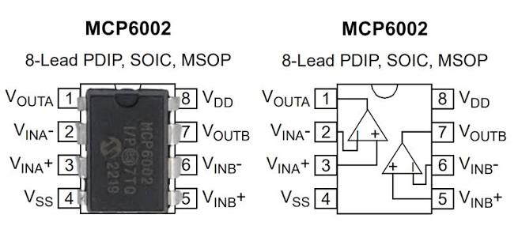
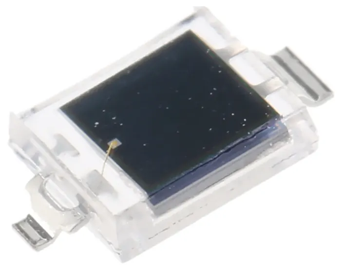
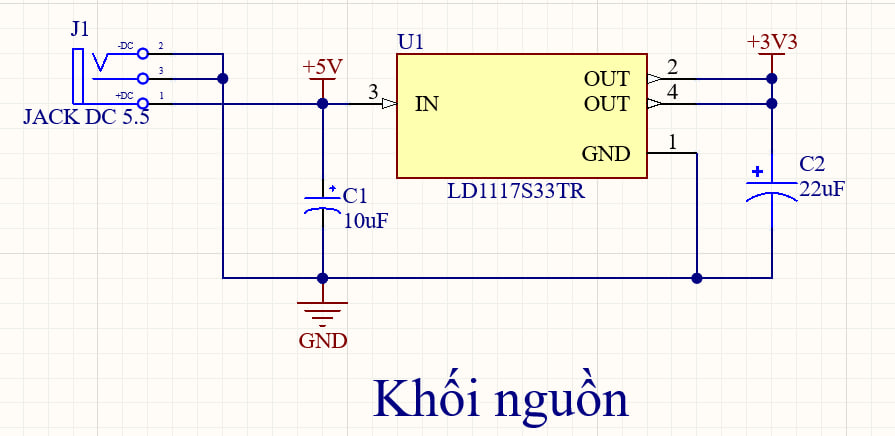
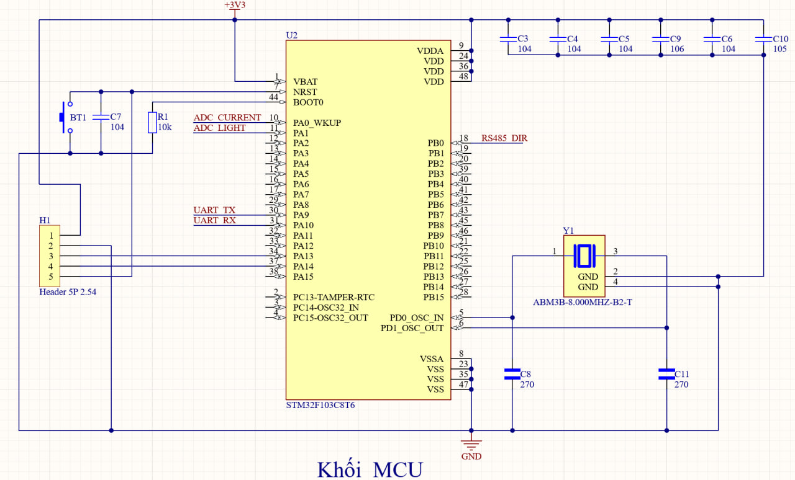
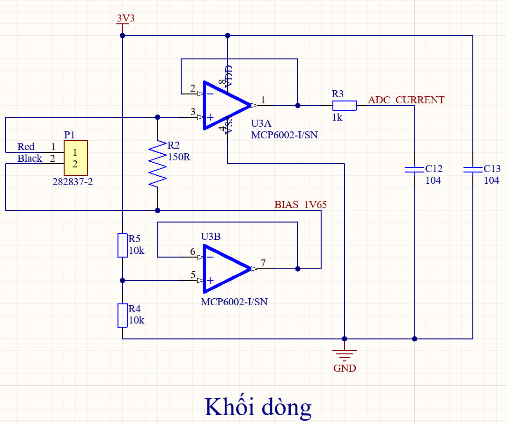
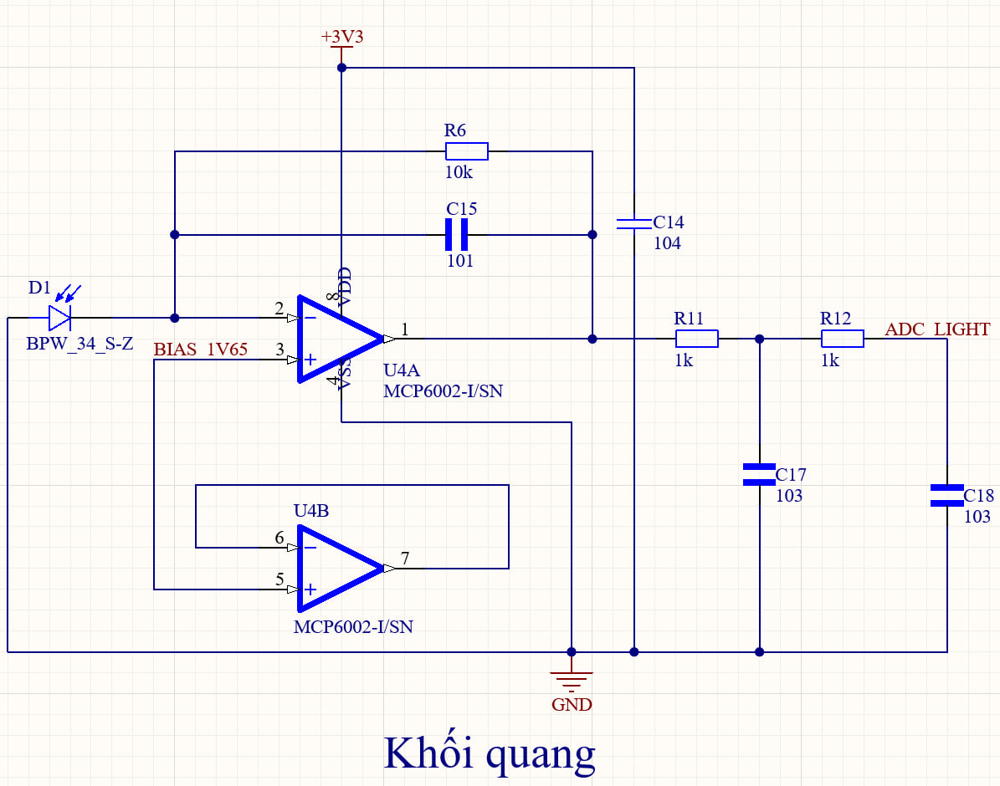
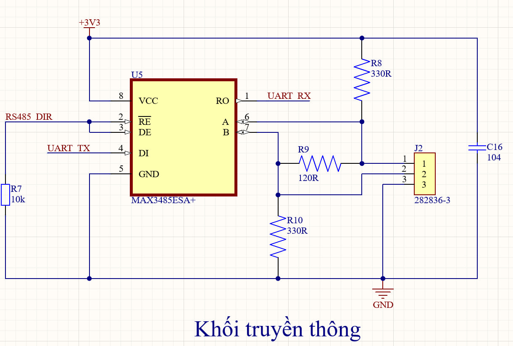
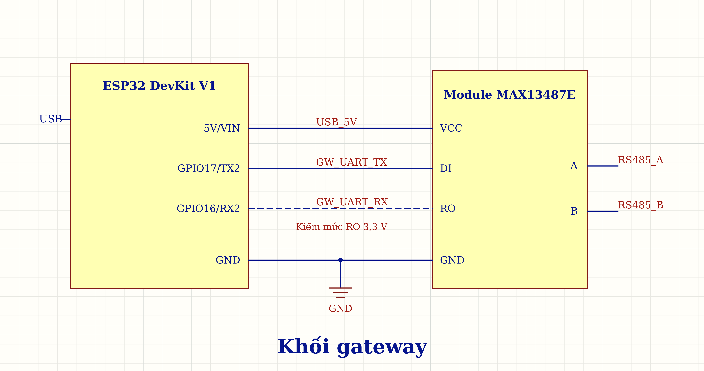

# 1. Bảng linh kiện PCB

## 1.1. Node

### 1.1.1. Khối nguồn

| Mã  | Linh kiện                | Package |  SL | Ghi chú                 |
| --- | ------------------------ | ------- | --: | ----------------------- |
| J1  | Jack DC cái 5,5 × 2,1 mm | THT     |   1 | Nhận nguồn 5 V từ adapter |
| U1  | LDO LD1117S33TR, 3,3 V   | SOT-223 |   1 | Hạ 5 V xuống 3,3 V [1]  |
| C1  | Tụ tantalum 10 µF, 16 V  | 3528    |   1 | Giảm biến động nguồn đầu vào U1; có phân cực |
| C2  | Tụ tantalum 22 µF, 16 V  | 6032    |   1 | Ổn định đầu ra 3,3 V của U1; có phân cực |

### 1.1.2. Khối MCU

| Mã | Linh kiện | Package | SL | Ghi chú |
|---|---|---|---:|---|
| U2 | STM32F103C8T6 | LQFP-48 | 1 | Đọc tín hiệu dòng, quang và trao đổi dữ liệu với gateway [2] |
| C3–C5 | Tụ gốm 100 nF (104), X7R, 50 V | 0805 | 3 | Lọc từng chân VDD |
| C9 | Tụ gốm 10 µF (106), X7R, 16 V | 0805 | 1 | Dự trữ điện tích trên nguồn MCU |
| C6 | Tụ gốm 100 nF (104), X7R, 50 V | 0805 | 1 | Giảm nhiễu nguồn analog VDDA |
| C10 | Tụ gốm 1 µF (105), X7R, 50 V | 0805 | 1 | Lọc nguồn analog VDDA cùng C6 |
| Y1 | ABM3B-8.000MHZ-B2-T, 8 MHz | 5,0 × 3,2 mm | 1 | Tạo xung clock ngoài 8 MHz |
| C8, C11 | Tụ gốm 27 pF (270), ±5%, C0G, 50 V | 0805 | 2 | Tụ tải thạch anh |
| R1 | Điện trở 10 kΩ, 1%, 0,125 W | 0805 | 1 | Kéo BOOT0 xuống GND |
| C7 | Tụ gốm 100 nF (104), X7R, 50 V | 0805 | 1 | Giảm nhiễu trên chân reset NRST |
| BT1 | Nút RESET 2 chân, 3 × 6 × 2,5 mm | SMD 3 × 6 × 2,5 mm | 1 | Nút nhấn reset, thường hở |
| H1 | Header SWD 1×5, 2,54 mm | Header | 1 | Kết nối ST-Link để nạp và gỡ lỗi chương trình |

### 1.1.3. Khối dòng

| Mã | Linh kiện | Package | SL | Ghi chú |
|---|---|---|---:|---|
| P1 | Terminal TE 282837-2, 2 cực, 5,08 mm | THT | 1 | Đầu nối CT |
| U3 | MCP6002-I/SN | SOIC-8 | 1 | Đệm tín hiệu dòng và điện áp nền 1,65 V [3] |
| R2 | Điện trở 150 Ω, 1%, 0,125 W | 0805 | 1 | Chuyển dòng thứ cấp CT thành điện áp |
| R5, R4 | Điện trở 10 kΩ, 1%, 0,125 W | 0805 | 2 | Chia nguồn 3,3 V để tạo điện áp nền 1,65 V |
| C13 | Tụ gốm 100 nF (104), X7R, 50 V | 0805 | 1 | Giảm nhiễu nguồn U3 |
| R3 | Điện trở 1 kΩ, 1%, 0,125 W | 0805 | 1 | Cùng C12 lọc nhiễu trước ADC dòng |
| C12 | Tụ gốm 100 nF (104), X7R, 50 V | 0805 | 1 | Cùng R3 lọc nhiễu trước ADC dòng |

### 1.1.4. Khối quang

| Mã | Linh kiện | Package | SL | Ghi chú |
|---|---|---|---:|---|
| D1 | BPW 34 S-Z | SMD gullwing | 1 | Chuyển ánh sáng thành dòng điện |
| U4 | MCP6002-I/SN | SOIC-8 | 1 | Chuyển dòng quang thành điện áp; kênh B không nối tải ngoài [3] |
| R6 | Điện trở 10 kΩ, 1%, 0,125 W | 0805 | 1 | Đặt hệ số chuyển dòng quang thành điện áp |
| C15 | Tụ gốm 100 pF (101), ±5%, C0G, 50 V | 0805 | 1 | Mắc song song R6, hỗ trợ ổn định mạch TIA |
| C14 | Tụ gốm 100 nF (104), X7R, 50 V | 0805 | 1 | Giảm nhiễu nguồn U4 |
| R11, R12 | Điện trở 1 kΩ, 1%, 0,125 W | 0805 | 2 | Cùng C17/C18 tạo hai tầng lọc nhiễu trước ADC quang |
| C17, C18 | Tụ gốm 10 nF (103), ±10%, X7R, 50 V | 0805 | 2 | Cùng R11/R12 tạo hai tầng lọc quang lắp cố định |

### 1.1.5. Khối truyền thông

| Mã | Linh kiện | Package | SL | Ghi chú |
|---|---|---|---:|---|
| U5 | MAX3485ESA+ | SOIC-8 | 1 | UART–RS485, nguồn 3,3 V [4] |
| C16 | Tụ gốm 100 nF (104), X7R, 50 V | 0805 | 1 | Giảm nhiễu nguồn U5 |
| R7 | Điện trở 10 kΩ, 1%, 0,125 W | 0805 | 1 | Kéo chân điều khiển xuống GND để mặc định nhận |
| J2 | Terminal TE 282836-3, 3 cực, 5 mm | THT | 1 | Đầu nối A/B/GND |
| R9 | Điện trở 120 Ω, 1%, 0,25 W | 1206 | 1 | Điện trở kết thúc đường truyền RS485 |
| R8, R10 | Điện trở 330 Ω, 1%, 0,125 W | 0805 | 2 | Kéo A lên và B xuống để tạo mức chờ cho bus |

## 1.2. Gateway

- **ESP32-DevKitC V4, WROOM-32E:** giao tiếp với node, nhận nguồn và truyền dữ liệu qua USB laptop. [11]
- **MAX13487E:** chuyển đổi UART–RS485, tự chuyển chiều; nguồn 5 V từ bo ESP32. [10]

## 1.3. Thiết bị ngoại vi và dụng cụ kiểm thử

### 1.3.1. Biến dòng CT

| Linh kiện | Số lượng | Vị trí sử dụng | Ghi chú |
|---|---|---|---|
| CT DL-CT08CL6-1000/1 | 1 | Dây tải đi qua lỗ CT; hai dây thứ cấp nối P1 | Đo dòng tải, tỷ số biến dòng 1000:1 |

### 1.3.2. Nguồn cấp ngoài, dây và đầu nối

| Linh kiện | Số lượng | Vị trí sử dụng | Ghi chú |
|---|---:|---|---|
| Adapter cách ly 5 VDC–2 A, phích 5,5 × 2,1 mm | 1 | Jack J1 của node | Cấp nguồn 5 V riêng cho node |
| Cáp USB Micro-B có dữ liệu | 1 | Giữa gateway và laptop | Cấp nguồn gateway và truyền dữ liệu |
| Cáp RS485 cặp xoắn và GND, dài khoảng 1 m | 1 | Giữa J2 của node và gateway | Truyền tín hiệu A/B và nối GND tham chiếu; trở kháng cáp 120 Ω [5] |
| Bộ ST-Link V2 và dây SWD | 1 | Giữa laptop và đầu H1 của node | Nạp và gỡ lỗi chương trình; node nhận nguồn từ adapter |
| USB–RS485 CH340 | 1 | Giữa laptop và cổng RS485 của node | Gửi, nhận bản tin để kiểm tra giao tiếp RS485 |

### 1.3.3. Bộ tải thử CT

| Linh kiện | Số lượng | Vị trí sử dụng | Ghi chú |
|---|---|---|---|
| Nguồn cách ly 12 VAC–1,5 A | 1 | Hai đầu mạch tải điện trở | Tạo dòng AC để kiểm thử CT |
| Điện trở sứ 50 Ω–25 W | 3 | Các nhánh song song của mạch tải 12 VAC | Tạo ba mức dòng thử bằng 1, 2 hoặc 3 nhánh |
| Bộ dây silicone 20 AWG, cọc vít và đế chịu nhiệt | 1 | Mạch tải 12 VAC bên ngoài node | Nối dây tải, cố định đầu nối và đỡ điện trở nóng |

### 1.3.4. Nguồn sáng và dụng cụ đo

| Linh kiện                            | Số lượng | Vị trí sử dụng                                     | Ghi chú                                                 |
| ------------------------------------ | -------: | -------------------------------------------------- | ------------------------------------------------------- |
| Đồng hồ AC/DC                        |        1 | Đường nguồn node và mạch tải 12 VAC                | Đo điện áp nguồn và dòng tải 0,24–0,72 A                |
| Oscilloscope ≥2 kênh, kèm 2 probe    |        1 | Các điểm trước và sau bộ lọc dòng, quang           | So sánh dạng sóng, đo biên độ và thời gian đáp ứng      |
| Bộ đèn pin, tấm che và thước         |        1 | Trước cảm biến BPW 34 S-Z                          | Tạo ánh sáng liên tục, che sáng và đo khoảng cách chiếu |
| LED trắng 5 mm                       |        1 | Trước cảm biến BPW 34 S-Z                          | Tạo chớp sáng ngắn để kiểm thử khối quang               |
| Điện trở 330 Ω, ≥0,125 W             |        1 | Mắc nối tiếp LED thử                               | Hạn dòng qua LED                                        |
| ESP32 DevKit tạo xung LED            |        1 | GPIO nối LED thử qua điện trở 330 Ω                | Điều chỉnh thời gian LED sáng cỡ ms và chu kỳ nháy      |
| Củ sạc USB 5 V dự phòng, kèm cáp USB |        1 | Cổng USB của ESP32 tạo xung LED                    | Cấp nguồn riêng cho bộ tạo chớp sáng                    |
| Laptop, phần mềm nạp và Excel        |        1 | Kết nối ST-Link khi nạp và gateway khi thu dữ liệu | Nạp chương trình, xem và lưu dữ liệu bằng Excel         |

# 2. Thiết kế và nối dây từng phần

## 2.1. Nhận diện hai MCP6002 DIP-8

Mỗi MCP6002 có hai kênh khuếch đại A và B trong cùng một IC. Dán tên “dòng” và “quang” lên hai IC để không nhầm khi đấu dây. [3]

Hình bên trái là IC thật; hình bên phải là sơ đồ hai kênh bên trong. Cả hai đều nhìn **từ mặt trên**, với rãnh định hướng ở cạnh trên. [3]

1. Đặt IC sao cho rãnh định hướng ở phía trên như hình.
2. Chân 1 ở góc trên bên trái; bên trái đếm xuống chân 4, bên phải đếm từ chân 5 lên chân 8. [3]
3. Đối chiếu số chân và tên tín hiệu trong bảng trước khi cắm dây.

| Từ linh kiện/chân | Đến linh kiện/chân | Giải thích ngắn |
|---|---|---|
| Chân 1 | OUT A | Đầu ra kênh A |
| Chân 2 | IN− A | Đầu vào đảo A |
| Chân 3 | IN+ A | Đầu vào không đảo A |
| Chân 4 | VSS | Nối GND khi cấp một nguồn 3,3 V |
| Chân 5 | IN+ B | Đầu vào không đảo B |
| Chân 6 | IN− B | Đầu vào đảo B |
| Chân 7 | OUT B | Đầu ra B |
| Chân 8 | VDD | Nối 3V3 |

**Kiểm tra trước khi làm tiếp**

- [ ] Đã nhận đúng dấu định hướng.
- [ ] Không lấy số chân nhìn từ mặt dưới.

## 2.2. Nhận diện anode và cathode của BPW34

BPW34 là photodiode: khi nhận ánh sáng, nó sinh ra dòng điện nhỏ. Hai chân là **anode (A)** và **cathode (K)**; cần xác định đúng trước khi nối vào mạch quang. [9], [22]

**Đo bằng chế độ diode của đồng hồ**

1. Tháo BPW34 khỏi mạch và che tối cảm biến để ánh sáng không ảnh hưởng phép đo.
2. Cắm que đen vào COM, que đỏ vào cổng V/Ω; chọn nấc có ký hiệu diode. Nếu dùng chung nấc với đo thông mạch, chọn đúng chế độ diode.
3. Chạm hai que vào hai chân, đọc số rồi đảo chiều hai que để đo lại.

- Nếu một chiều hiện khoảng **500–800 mV** (hoặc **0,500–0,800 V**), còn chiều ngược hiện **1 hoặc OL** báo quá thang, chiều có điện áp thuận cho biết: **que đỏ chạm A, que đen chạm K**. Giá trị thực tùy đồng hồ và linh kiện. [15]
- **Không cần có tiếng bíp.** Khi đo diode, đọc số trên màn hình để nhận biết chiều dẫn.

**Nhận diện theo chấm trắng:** với linh kiện trong ảnh, dùng phép đo trên để kiểm chân phía có chấm trắng. Nếu que đỏ đặt ở chân phía chấm trắng và que đen ở chân còn lại cho điện áp thuận, thì **phía có chấm trắng là anode**. Không dùng riêng màu chấm để kết luận cho mọi BPW34; dấu nhận diện phụ thuộc nhà sản xuất và kiểu vỏ. Ví dụ, [datasheet BPW34 của Vishay](https://www.vishay.com/docs/81521/bpw34.pdf) có dấu nhận diện cathode trên bản vẽ vỏ. [22]

**Vai trò trong mạch TIA**

Khối quang dùng mạch **TIA (Transimpedance Amplifier — bộ khuếch đại chuyển dòng thành điện áp)**. Có thể hiểu TIA là “phiên dịch viên”: chuyển dòng điện nhỏ do BPW34 sinh ra thành mức điện áp để ADC của vi điều khiển đọc được. Trong mạch đang dùng, **A nối GND, K nối chân 2 (IN−) của MCP6002 quang**; cách hoạt động và mạng hồi tiếp được giải thích ở khối quang trong mục 2.4. [8], [9]

## 2.3. Nối dây bộ tải thử dòng

Bộ tải ngoài gồm **nguồn cách ly 12 VAC–1,5 A, điện trở sứ 50 Ω–25 W và dây dẫn**. Nó tạo dòng đi qua CT để thử khối dòng.

1. Tắt nguồn 12 VAC trước khi đấu dây. Đặt điện trở tải trên đế chịu nhiệt.
2. Nối **đầu ra thứ nhất của nguồn 12 VAC** vào một dây, luồn dây này **một lượt qua lỗ CT**, rồi nối đến một đầu điện trở 50 Ω–25 W.
3. Nối đầu còn lại của điện trở về **đầu ra thứ hai của nguồn 12 VAC**, tạo thành vòng kín. Dây về đi ngoài lỗ CT; không luồn cả dây đi và dây về cùng qua CT.
4. Nối **hai dây thứ cấp của CT** vào khối dòng node theo mục 2.4. Điện trở burden 150 Ω phải mắc kín vào thứ cấp CT trước khi bật tải; không tháo dây CT khi dòng sơ cấp đang chạy.

| Từ | Đến | Ghi chú |
|---|---|---|
| Đầu ra 1 của nguồn 12 VAC | Một đầu điện trở tải | Dây nối đi qua lỗ CT một lượt |
| Đầu còn lại của điện trở tải | Đầu ra 2 của nguồn 12 VAC | Dây về đi ngoài CT |
| Hai dây thứ cấp CT | Hai đầu burden 150 Ω của mạch dòng | Đây là đường tín hiệu về node |

Bài kiểm ở phần 3 tăng lần lượt từ **1 → 2 → 3 điện trở 50 Ω–25 W mắc song song**. Đặt dây xuyên CT **trước chỗ chia nhánh** để đo tổng dòng. **Đo tổng dòng tải bằng đồng hồ ở từng mức 1–2–3 tải để kiểm tra: dòng thực tăng thì biên độ tín hiệu CT tại PA0 cũng tăng.**

Không dẫn dòng tải qua breadboard hoặc đưa 12 VAC vào các chân nguồn/ADC của node.

> [!note] Cách đo dòng tải bằng đồng hồ vạn năng (nguồn cách ly 12 VAC)
>
> 1. Kiểm đồng hồ có chế độ **A~ (đo dòng xoay chiều)**; chỉ có V~ thì không đo trực tiếp dòng AC theo cách này được.
> 2. **Tắt nguồn tải.** Cắm que đen vào **COM**, que đỏ vào cổng **A/10A** theo hướng dẫn đồng hồ; chọn đo **A~**, thang đủ lớn hơn 0,72 A (thường bắt đầu ở thang 10 A). Không dùng cổng mA nếu giới hạn cổng thấp hơn dòng tải.
> 3. Tháo một đầu dây cấp chung khỏi đầu ra 1 của nguồn 12 VAC. Nối que đỏ vào đầu ra 1, que đen vào đầu dây vừa tháo; dùng kẹp giữ chắc. Đồng hồ lúc này nằm **nối tiếp**, toàn bộ dòng tải đi qua đồng hồ.
> 4. Đường nối: **đầu ra 1 nguồn → que đỏ → đồng hồ → que đen → dây qua CT → các tải song song → đầu ra 2 nguồn**. Không chạm hai que trực tiếp vào hai đầu nguồn khi đang chọn đo dòng, vì sẽ gây ngắn mạch.
> 5. Bật nguồn, đọc số ở đơn vị **A** và ghi vào bảng 3.3. Tuân thủ giới hạn thời gian đo ở cổng A/10A ghi trên đồng hồ; tắt nguồn trước mỗi lần thêm tải hoặc đổi thang/cổng que.
> 6. Đo xong, tắt nguồn, tháo đồng hồ và nối lại dây cấp tải. Chuyển que đỏ về cổng **V/Ω** để tránh nhầm khi đo điện áp lần sau.

## 2.4. Thiết kế sơ đồ nguyên lý node

**Nhãn tín hiệu**

| Nhãn (chân MCU) | Ý nghĩa | Giải thích tên nhãn bằng tiếng Anh | Chân U5 MAX3485 liên quan |
|---|---|---|---|
| **ADC_CURRENT (PA0)** | Đọc điện áp dòng sau lọc bằng ADC. | **ADC = Analog-to-Digital Converter:** bộ chuyển đổi tương tự sang số; **Current:** dòng điện. | —  [2] |
| **ADC_LIGHT (PA1)** | Đọc điện áp quang sau hai tầng lọc bằng ADC. | **ADC = Analog-to-Digital Converter:** bộ chuyển đổi tương tự sang số; **Light:** ánh sáng. | —  [2] |
| **UART_TX (PA9)** | Phát dữ liệu tới DI U5 MAX3485. | **UART = Universal Asynchronous Receiver/Transmitter:** bộ thu/phát nối tiếp không đồng bộ; **TX = Transmit:** phát dữ liệu. | **DI (Driver Input):** dữ liệu từ UART TX đưa vào U5.  [2], [7], [4] |
| **UART_RX (PA10)** | Nhận dữ liệu từ RO U5 MAX3485. | **UART = Universal Asynchronous Receiver/Transmitter:** bộ thu/phát nối tiếp không đồng bộ; **RX = Receive:** nhận dữ liệu. | **RO (Receiver Output):** dữ liệu từ U5 đưa về UART RX.  [2], [4] |
| **RS485_DIR (PB0)** | Điều khiển DE và /RE để chọn phát hoặc nhận. | **RS = Recommended Standard:** tên gọi tiêu chuẩn; **485:** số hiệu tiêu chuẩn giao tiếp điện; **DIR = Direction:** chiều truyền dữ liệu. | **DE (Driver Enable):** cho phép truyền dữ liệu khi **chân DE ở mức HIGH (logic 1)**. **/RE (Receiver Enable):** cho phép nhận dữ liệu khi **chân /RE ở mức LOW (logic 0)**.  [4] |
| **SWDIO (PA13), SWCLK (PA14)** | Dữ liệu và xung nhịp để nạp, gỡ lỗi bằng ST-Link. | **SWDIO = Serial Wire Debug Input/Output:** đường dữ liệu vào/ra của giao diện gỡ lỗi SWD; **SWCLK = Serial Wire Clock:** đường xung nhịp của giao diện này. | —  [2] |

### 2.4.1. Khối nguồn

#### 2.4.1.1. Tiếp nhận nguồn 5 V (J1)

Jack J1 nhận nguồn 5 V từ adapter để cấp cho bộ ổn áp U1, tạo nguồn 3,3 V cho node. Chân 1 nối +5V; chân 2 và chân 3 nối chung GND vì hai chân này đã được kiểm tra thực tế là thông nhau trên jack sử dụng.

#### 2.4.1.2. Lọc nguồn đầu vào (C1)

C1 có điện dung 10 µF, mắc giữa +5V và GND, gần đầu vào U1. Khi tải đột ngột cần thêm dòng, tụ cấp bù trong thời gian ngắn để giảm sụt áp đầu vào.

- **Chọn 10 µF:** tham khảo khối nguồn trên bo **STEVAL-HILE1G4K1 của ST**, trang **6/8** của sơ đồ nguyên lý. Khối này dùng **U13 LD1117S33TR** hạ 5 V xuống 3,3 V và đặt **C137 10 µF** tại đầu vào để dự trữ điện tích trên đường 5 V. C1 của node chọn cùng giá trị cho chức năng này. [21]
- **Điện áp chịu đựng 16 V:** hướng dẫn dùng tụ tantalum ở tối đa 50% điện áp định mức cho nguồn 5 V dẫn đến yêu cầu $5/0{,}5=10\,\mathrm{V}$. Chọn tụ 16 V để có thêm dự phòng; 5 V chỉ bằng $5/16\times100\%=31{,}25\%$ mức định mức của tụ. [20]
- **Tantalum, kích thước 3528:** loại tụ này có giá trị 10 µF–16 V trong thân nhỏ 3,5 × 2,8 mm, thuận tiện đặt sát U1 và tiết kiệm diện tích PCB. [19]

#### 2.4.1.3. Hạ và ổn định điện áp (U1)

U1 LD1117S33TR là bộ ổn áp tuyến tính có điện áp đầu ra cố định 3,3 V. Chân 3 (IN) nhận 5 V, chân 1 nối GND và chân 2 (OUT) đưa điện áp ra đường +3V3. Mạch điều khiển bên trong U1 điều chỉnh phần tử dẫn để giữ điện áp đầu ra quanh mức 3,3 V khi nguồn vào và tải thay đổi trong phạm vi hoạt động của IC. Tab kim loại của vỏ SOT-223 nối điện với OUT. [1]

#### 2.4.1.4. Ổn định nguồn đầu ra (C2)

Tụ C2 22 µF–16 V mắc từ +3V3 xuống GND, gần chân OUT của U1. Tụ đầu ra tham gia duy trì ổn định bộ ổn áp và cung cấp điện tích khi dòng tải tăng đột ngột, giúp hạn chế sụt áp trong thời gian U1 điều chỉnh. [1] C1 và C2 đều là tụ tantalum có phân cực: cực dương nối đường nguồn tương ứng, cực âm nối GND.

#### 2.4.1.5. Phân phối nguồn 3,3 V

Sau U1, đường +3V3 cấp cho STM32F103C8T6, hai MCP6002 và MAX3485. Các tụ nguồn đặt tại từng IC hỗ trợ cấp dòng tức thời ngay gần tải. Như vậy, luồng cấp nguồn đi từ **adapter → J1 → U1 → đường +3V3 → các khối của node**, với C1 lọc tại đầu vào và C2 ổn định đầu ra U1.

#### 2.4.1.6. Công suất tỏa nhiệt trên U1

U1 hạ áp bằng phần tử dẫn tuyến tính nên phần chênh lệch điện áp giữa đầu vào và đầu ra chuyển thành nhiệt. Bỏ qua dòng tĩnh, công suất tỏa nhiệt được tính gần đúng:

$$
P_{U1}\approx(V_{\mathrm{in}}-V_{\mathrm{out}})I_{\mathrm{out}}.
$$

Với ví dụ tính tại dòng tải 0,2 A:

$$
P_{U1}\approx(5-3{,}3)\times0{,}2=0{,}34\,\mathrm{W}.
$$

Dòng tải tăng làm công suất tỏa nhiệt tăng. Diện tích đồng nối với tab OUT giúp dẫn nhiệt ra PCB. Định mức 2 A là khả năng cấp dòng của adapter; dòng trên đường +3V3 còn chịu giới hạn của U1 và điều kiện tản nhiệt.

#### 2.4.1.7. Kết nối

| Chân / linh kiện | Nối trực tiếp đến |
|---|---|
| J1.1, nhãn +DC theo đầu nối thực | +5V; U1.3 IN; C1 cực + |
| J1.2, J1.3 | GND; U1.1; C1 cực −; C2 cực − |
| U1.2 OUT | +3V3; C2 cực + |
| U1 tab, thường biểu diễn chân 4 trong symbol | +3V3, cùng điện với U1.2; không GND |
| C1 | 10 µF–16 V; (+) +5V, (−) GND |
| C2 | 22 µF–16 V; (+) +3V3, (−) GND |

**Bố trí:** đặt C1/C2 gần U1, chừa diện tích đồng tản nhiệt cho tab OUT; đường 5 V và 3V3 cấp tới các khối, GND làm mốc chung.

### 2.4.2. Khối MCU

#### 2.4.2.1. Nguồn và tụ lọc

U2 STM32F103C8T6 thu hai kênh ADC, xử lý và truyền UART. Khối MCU gồm IC, tụ nguồn, thạch anh, mạch reset và đầu nạp SWD. [2]

| Chân U2 | Tên | Nối |
|---:|---|---|
| 1 | VBAT | +3V3; không thêm pin trong cấu hình này |
| 8 | VSSA | GND |
| 9 | VDDA | +3V3; C6 và C10 xuống GND |
| 23 | VSS_1 | GND |
| 24 | VDD_1 | +3V3; C3 xuống GND |
| 35 | VSS_2 | GND |
| 36 | VDD_2 | +3V3; C4 xuống GND |
| 47 | VSS_3 | GND |
| 48 | VDD_3 | +3V3; C5 xuống GND |

C3/C4/C5, mỗi tụ 100 nF, đặt gần từng chân VDD; C9 10 µF bổ sung cho nguồn MCU. VDDA có C6 100 nF và C10 1 µF; đây là nguồn phục vụ ADC. Mỗi tụ nối từ đường nguồn tương ứng xuống GND.

#### 2.4.2.2. Tín hiệu đo và truyền dữ liệu

| Chân U2 | Chức năng | Nối bằng Net Label / dây |
|---:|---|---|
| 10 | PA0/ADC_IN0 | ADC_CURRENT — nút R3/C12 |
| 11 | PA1/ADC_IN1 | ADC_LIGHT — nút R12/C18 |
| 18 | PB0 | RS485_DIR — U5.2/U5.3/R7.1 |
| 30 | PA9/USART1_TX | UART_TX — U5.4 DI |
| 31 | PA10/USART1_RX | UART_RX — U5.1 RO |

PA0/PA1 thu tín hiệu dòng và quang; PA9/PA10/PB0 phục vụ UART và chọn chiều RS485. Tốc độ lấy mẫu phải ghi theo cấu hình và phép đo thực trên bo.

#### 2.4.2.3. Thạch anh, khởi động và reset

Y1 8 MHz tạo clock ngoài; firmware có thể cấu hình PLL ×9 để chạy 72 MHz. Hai tụ C8/C11 27 pF tạo tải cho Y1. Tải nhìn từ thạch anh phụ thuộc cả điện dung ký sinh: [2], [6]

$$
C_L\approx\frac{C_8C_{11}}{C_8+C_{11}}+C_{\mathrm{ký\ sinh}}.
$$

Với hai tụ 27 pF và ký sinh giả định 4,5 pF, tải tính khoảng 18 pF. Giá trị ký sinh này là ví dụ tính, không phải số đo PCB.

| Điểm / linh kiện | Kết nối |
|---|---|
| U2.5 PD0/OSC_IN | Y1.1; đầu 1 C8 |
| U2.6 PD1/OSC_OUT | Y1.3; đầu 1 C11 |
| Y1.2/Y1.4 | GND nếu đúng chân vỏ của mã Y1 đã chọn, kiểm bản vẽ hãng |
| C8/C11 | 27 pF; đầu còn lại từng tụ → GND |
| U2.44 BOOT0 | R1.1; R1.2 → GND; R1=10 kΩ |
| U2.7 NRST | C7.1; BT1.1; H1.5, cùng một nút nối dây |
| C7.2 | GND; C7=100 nF |
| BT1.2 | GND; BT1 thường hở, nhấn nhả |

R1 kéo BOOT0 xuống thấp để chạy chương trình trong Flash. Nhấn BT1 đưa NRST xuống GND để khởi động lại; C7 là tụ của reset, còn C11 thuộc thạch anh. Mạch dùng kéo lên NRST nội của MCU theo cấu hình hiện tại. [2]

#### 2.4.2.4. Đầu nạp SWD

| H1 | Nối |
|---:|---|
| 1 | +3V3, tham chiếu nguồn mạch đích |
| 2 | GND |
| 3 | U2.34 PA13/SWDIO |
| 4 | U2.37 PA14/SWCLK |
| 5 | U2.7 NRST, cùng C7.1/BT1.1 |

H1.1 dùng làm tham chiếu điện áp cho đầu nạp có VTref; kiểm loại ST-Link thực trước khi nối. Khi node dùng adapter, không nối thêm đầu ra nguồn của ST-Link vào 3V3.

#### 2.4.2.5. Chân chưa dùng

| Chân | Tên |
|---|---|
| 2, 3, 4 | PC13, PC14, PC15 |
| 12–17 | PA2–PA7 |
| 19–22 | PB1, PB2/BOOT1, PB10, PB11 |
| 25–29 | PB12–PB15, PA8 |
| 32, 33 | PA11, PA12 |
| 38–43 | PA15, PB3–PB7 |
| 45, 46 | PB8, PB9 |

Để riêng các chân chưa dùng, không nối chung thành một đường NC. PB2/BOOT1 là chân boot phụ, cấu hình phù hợp trong firmware. Các bảng trên bao phủ đủ 48 chân U2.

**Bố trí:** tụ nguồn sát chân IC; Y1 và C8/C11 sát chân dao động, đường ngắn; đường ADC tránh chạy sát A/B và đường xung clock.

### 2.4.3. Khối dòng

#### 2.4.3.1. Chuyển đổi dòng điện thành điện áp (Biến dòng CT và R2)
Biến dòng (CT) loại DL-CT08CL6-1000/1 có tỷ số biến dòng là 1000:1. Khi có dòng điện chạy qua cuộn sơ cấp, cuộn thứ cấp sẽ sinh ra một dòng điện nhỏ hơn 1000 lần. Dòng thứ cấp này đi qua điện trở gánh R2 có giá trị 150 Ω, biến đổi thành một điện áp xoay chiều:

$$I_{\mathrm{s,rms}} = \frac{I_{\mathrm{p,rms}}}{1000}$$

$$V_{\mathrm{R2,rms}} = I_{\mathrm{s,rms}} \times 150\,\Omega$$

Ví dụ, nếu dòng thứ cấp là 1 mA, điện áp sinh ra giữa hai đầu R2 sẽ là 0,15 V RMS. Vì là điện xoay chiều, giá trị này sẽ liên tục đảo chiều âm dương.

#### 2.4.3.2. Tạo điện áp nền 1,65 V (Cầu chia áp R4, R5)
**ADC (Analog-to-Digital Converter — bộ chuyển đổi tương tự sang số)** bên trong vi điều khiển STM32 chuyển điện áp đầu vào thành giá trị số để chương trình xử lý. Trong mạch này, ADC đo điện áp từ 0 đến 3,3 V, không đo trực tiếp được điện áp âm. Trong khi đó, điện áp xoay chiều trên R2 có cả nửa chu kỳ dương và âm. Vì vậy, mạch dùng điện áp nền để tín hiệu thay đổi quanh 1,65 V thay vì quanh 0 V. Hai điện trở R4 và R5, cùng giá trị 10 kΩ, chia nguồn 3,3 V để tạo mức nền này: [2], [14]

**Xem thêm:** [Phụ lục — Điện áp BIAS](../../Phu_luc/Dien_ap_BIAS.md).

$$V_M = 3{,}3 \times \frac{R4}{R5 + R4} = 3{,}3 \times \frac{10}{10 + 10} = 1{,}65\,\mathrm{V}$$

Mức 1,65 V nằm giữa dải đo của ADC, tạo khoảng điện áp bằng nhau ở hai phía của mức nền. Ví dụ, tín hiệu ban đầu từ −0,5 đến +0,5 V sẽ thành 1,15–2,15 V sau khi cộng mức nền. Nhờ đó, ADC đo được cả hai nửa chu kỳ, miễn là điện áp sau khi cộng nền vẫn nằm trong dải đo. [2], [14]

#### 2.4.3.3. Ổn định mức nền bằng bộ đệm (Op-amp U3B)
Cầu chia áp R4 và R5 có điện trở tương đương là $10\,\mathrm{k}\Omega \parallel 10\,\mathrm{k}\Omega = 5\,\mathrm{k}\Omega$. Nếu tải phía sau tiêu thụ một dòng điện rất nhỏ, ví dụ 10 µA, điện áp nền sẽ bị sụt giảm:

$$\Delta V = 10\,\mathrm{\mu A} \times 5\,\mathrm{k}\Omega = 0{,}05\,\mathrm{V}$$

> [!NOTE] Lý do dùng Op-Amp làm bộ đệm để ngăn tải làm sụt áp cầu chia
> Trong lý thuyết, **Op-Amp lý tưởng không có dòng điện đi vào hoặc đi ra từ hai chân đầu vào (I₊ = I₋ = 0)** ==do trở kháng đầu vào của nó có giá trị **vô cùng lớn**== [13]
> 
> Tuy nhiên, trong thực tế, Op-Amp **vẫn dẫn một lượng dòng điện cực kỳ nhỏ** (gọi là dòng phân cực đầu vào - _input bias current_), thường chỉ ở mức nano-ampere (nA) hoặc pico-ampere (pA), chứ không hoàn toàn bằng không tuyệt đối. [3]

Để khắc phục, điện áp 1,65 V từ cầu chia được đưa vào chân không đảo (chân số 5) của Op-amp U3B. Chân đầu ra (chân số 7) được nối hồi tiếp âm trực tiếp về chân đảo (chân số 6), tạo thành một bộ đệm có hệ số khuếch đại xấp xỉ 1: [3], [13]

$$\frac{V_{\mathrm{out}}}{V_+} = \frac{A}{1+A} \approx 1$$

U3B giữ cho mức nền BIAS_1V65 luôn cố định ở 1,65 V, cung cấp dòng điện cần thiết cho tải mà không làm sai lệch điện áp của cầu chia ban đầu.

> [!note] Giải thích hồi tiếp âm trong mạch đệm Op-Amp
> 
> Op-amp khuếch đại sự chênh lệch điện áp giữa hai đầu vào theo công thức: [13]
> 
> $$V_{\mathrm{out}} = A \times (V_+ - V_-)$$
> 
> Trong đó, $A$ là hệ số khuếch đại vòng hở (open-loop gain) do nhà sản xuất chế tạo, thường có giá trị cực kỳ lớn (khoảng $10^5$ đến $10^6$); $V_+$ và $V_-$ là điện áp tại chân không đảo và chân đảo.
> 
> Ở U3B, đầu ra chân 7 nối trực tiếp về chân đảo 6 nên $V_- = V_{\mathrm{out}}$. Thay vào công thức trên và thu gọn:
> 
> 
> $$V_{\mathrm{out}} = A \times (V_+ - V_{\mathrm{out}})$$
> 
> $$\frac{V_{\mathrm{out}}}{V_+} = \frac{A}{1 + A} \approx 1$$
> 
> Vì $A$ rất lớn so với 1, điện áp đầu ra gần bằng điện áp đầu vào. Khi mạch hoạt động tuyến tính và ổn định, chân 5 (+) nhận khoảng 1,65 V thì đầu ra chân 7 cũng bám theo mức này. Cách mắc đó gọi là bộ đệm điện áp (voltage follower). [3], [13]
>
> **Xem thêm:** [Phụ lục — Hồi tiếp âm trong op-amp](../../Phu_luc/Hoi_tiep_am_trong_op_amp.md).

#### 2.4.3.4. Ghép tín hiệu đo vào mức nền
Đầu dưới của điện trở R2 được nối trực tiếp với đường BIAS_1V65. Điều này có nghĩa là điểm tham chiếu của tín hiệu đo đã được nâng lên 1,65 V so với GND. Gọi $v_{\mathrm{R2}}(t)$ là điện áp tức thời sinh ra giữa hai đầu R2, điện áp tại đầu trên của R2 sẽ là:

$$V_{\text{đầu trên R2}} \approx 1{,}65\,\mathrm{V} + v_{\mathrm{R2}}(t)$$

Nếu điện áp tức thời trên R2 là +0,10 V, đầu trên sẽ đạt 1,75 V. Nếu điện áp tức thời là -0,10 V, đầu trên sẽ giảm xuống 1,55 V. Toàn bộ tín hiệu đo luôn được đảm bảo ở mức dương.

#### 2.4.3.5. Đệm tín hiệu đo lường (Op-amp U3A)
Điện áp tại đầu trên của R2 được đưa vào chân không đảo (chân số 3) của Op-amp U3A. Tương tự như U3B, U3A cũng được cấu hình làm bộ đệm tín hiệu:

$$V_{\mathrm{outA}} \approx V_{\text{đầu trên R2}} \approx 1{,}65\,\mathrm{V} + v_{\mathrm{R2}}(t)$$

Op-amp U3A làm bộ đệm giữa mạch biến dòng (CT và R2) với các khối phía sau, hạn chế dòng điện cấp cho bộ lọc và đầu vào ADC làm thay đổi điện áp đo trên R2. [3], [13]

#### 2.4.3.6. Lọc nhiễu và bảo vệ nguồn (R3, C12, C13)
Tín hiệu đầu ra từ U3A đi qua mạch lọc thông thấp gồm điện trở R3 (1 kΩ) và tụ C12 (100 nF) để loại bỏ các nhiễu tần số cao. Tần số cắt của bộ lọc này là: [16]

$$f_c = \frac{1}{2\pi \times R3 \times C12} \approx 1{,}59\,\mathrm{kHz}$$

==Thành phần tín hiệu 50/60 Hz== gần như giữ nguyên biên độ sau lọc. Các thành phần nhiễu trên 1,59 kHz bị suy giảm trước khi tín hiệu vào PA0 (ADC_CURRENT); tần số càng cao, mức suy giảm càng lớn. Tụ C13 (100 nF) mắc giữa chân nguồn 3V3 và GND của MCP6002 để giảm nhiễu trên đường cấp nguồn. [16], [18]
> [!note] Lý do chọn tụ 100 nF để lọc nhiễu nguồn
> **Tụ 104 (Ký hiệu 104 = 100 nF) - Lọc nhiễu nguồn (Decoupling Capacitor)**
> **100 nF là giá trị nằm trong dải khuyến nghị của Microchip cho MCP6002.** Datasheet **MCP6001/1R/1U/2/4, DS20001733L**, mục **4.4 “Supply Bypass”**, khuyến nghị tụ lọc nguồn cục bộ **0,01–0,1 µF (10–100 nF)**, đặt cách chân nguồn không quá **2 mm** [3].
>
> Với tụ lý tưởng, độ lớn dung kháng là:
>
> $$
> |Z_C|=\frac{1}{2\pi fC}
> $$
>
> Ở 1 MHz, tụ 100 nF có dung kháng khoảng **1,59 Ω**, tạo đường có trở kháng thấp cho dòng nhiễu cao tần về GND, giúp giảm nhiễu tại chân nguồn. Trong khối dòng, tụ này là **C13**; hiệu quả thực tế còn phụ thuộc đặc tính tụ và cách đi dây.

### 2.4.4. Khối quang

#### 2.4.4.1. Nhận ánh sáng và tạo dòng quang (D1 – BPW34)

BPW34 chuyển ánh sáng thành một dòng điện nhỏ gọi là **dòng quang**. Trong cùng điều kiện phổ ánh sáng, ánh sáng càng mạnh thì dòng quang thường càng lớn. [9], [22]

Trong mạch, anode của D1 nối GND, cathode nối chân đảo 2 (−) của U4A. Chân không đảo 3 (+) nhận điện áp BIAS khoảng 1,65 V. Khi hồi tiếp âm hoạt động ổn định, U4A giữ chân 2 gần bằng 1,65 V. Như vậy, cathode cao hơn anode khoảng 1,65 V, tạo phân cực ngược cho photodiode. [9]

Dòng quang có chiều quy ước từ cathode qua D1 xuống anode rồi về GND. Có thể hiểu rằng khi nhận ánh sáng, D1 lấy một dòng điện nhỏ từ điểm nối tại chân 2 xuống GND. [9]

> [!NOTE] Bản chất dòng quang và điều kiện phân cực của BPW34
>
> - **Chiều dòng quang:** Ánh sáng được hấp thụ trong linh kiện tạo ra các cặp electron–lỗ trống. Điện trường tại vùng tiếp giáp giúp phân tách các hạt mang điện, tạo thành dòng quang $I_{\mathrm{ph}}$ có ==chiều quy ước từ cathode (K) sang anode (A)==. Khi ánh sáng thay đổi, độ lớn của thành phần dòng quang thay đổi; **chiều của thành phần này không tự đảo ngượ**c.  [9]
>
> - **Điều kiện phân cực khi đo dòng quang:** Mạch đo thường giữ photodiode ở trạng thái không phân cực ($V_K = V_A$) hoặc phân cực ngược ($V_K > V_A$). Nếu đặt điện áp phân cực thuận từ bên ngoài, nó sẽ dẫn điện như một diode thông thường, dòng dẫn thuận tăng nhanh và có thể lấn át dòng quang (vốn chỉ ở mức microampe), làm sai lệch phép đo.  [9]
>
> - **Dòng điện trong mạch đang dùng:** Khi U4A hoạt động tuyến tính và hồi tiếp ổn định, $V_K \approx 1{,}65\,\mathrm{V}$ tại chân 2, còn $V_A = 0\,\mathrm{V}$ tại GND. D1 vì vậy được phân cực ngược với $V_K = 1{,}65\,\mathrm{V}$ (tại chân 2) và $V_A = 0\,\mathrm{V}$ (tại GND). Khi nhận ánh sáng, dòng quang đi từ nút chân 2 qua D1 xuống GND. Đầu ra U4A cấp dòng bù qua mạng hồi tiếp để giữ điện áp tại nút này gần mức BIAS; ở trạng thái ổn định, dòng bù chủ yếu đi qua R6. [9]

#### 2.4.4.2. Chuyển dòng quang thành điện áp (U4A và R6)

U4A cùng điện trở hồi tiếp R6 tạo thành **mạch TIA (Transimpedance Amplifier — bộ khuếch đại chuyển dòng thành điện áp)**. R6 có giá trị 10 kΩ, nối từ đầu ra chân 1 về chân đảo 2. [8], [9]

==Đầu vào op-amp gần như không lấy dòng==. Vì vậy, khi D1 dẫn dòng quang xuống GND, đầu ra U4A phải cấp dòng bù qua R6 để giữ chân 2 gần mức 1,65 V. Dòng qua R6 tạo ra chênh lệch điện áp giữa đầu ra và chân 2: **dòng quang càng lớn thì điện áp đầu ra càng cao.** [3], [9]

Ở trạng thái ổn định, khi mạch chưa bão hòa, **điện áp đầu ra tại chân 1 của U4A**, ký hiệu là $V_{\mathrm{out}}$, được tính gần đúng: [9]

$$
V_{\mathrm{out}} \approx V_{\mathrm{BIAS}} + I_{\mathrm{ph}}R6
$$

Trong đó, $V_{\mathrm{BIAS}} \approx 1{,}65\,\mathrm{V}$, $I_{\mathrm{ph}}$ là dòng quang và $R6 = 10\,\mathrm{k}\Omega$.

Ví dụ, dòng quang tăng thêm 10 µA thì điện áp tại chân 1 tăng khoảng:

$$
\Delta V_{\mathrm{out}}
\approx 10\,\mathrm{\mu A}\times10\,\mathrm{k}\Omega
=0{,}10\,\mathrm{V}
$$

Nếu ban đầu đầu ra là 1,65 V thì sau đó sẽ tăng lên khoảng 1,75 V. ADC có thể đọc sự thay đổi điện áp này để nhận biết thay đổi ánh sáng. Khi ánh sáng quá mạnh, đầu ra có thể bão hòa và không còn tăng theo công thức trên.

> [!NOTE] Vai trò của C15 và bộ lọc trước ADC_LIGHT
>
> **Điện dung của BPW34:** Cảm biến có cấu trúc bán dẫn PIN, gồm vùng P và N ở hai phía, giữa là lớp I gần như không pha tạp. Vùng nghèo ít hạt mang điện tự do ngăn cách hai phía có thể tích điện, nên cấu trúc này có điện dung tương tự tụ điện. Đây là **điện dung tiếp giáp bên trong cảm biến**[9]. Điện dung điển hình là **70 pF khi không phân cực** và **25 pF khi phân cực ngược 3 V**, ở tần số thử 1 MHz; datasheet không nêu giá trị cụ thể tại 1,65 V [22].
>
> **Lý do dùng R6–C15:**
>
> - **Điện dung đầu vào:** $C_{\mathrm{in}}$ là tổng điện dung của cảm biến, đầu vào op-amp và dây nối.
>
> - **Mạng hồi tiếp:** Khi chưa có C15, R6 và $C_{\mathrm{in}}$ tạo mạng RC thông thấp từ đầu ra về chân đảo (−). Hệ số hồi tiếp là $\beta(s)=H_1(s)=1/(1+sR6\,C_{\mathrm{in}})$, tương ứng công thức (8), mục 2.2 của [phụ lục](../../Phu_luc/Bo_loc_thong_thap.md), với $R=R6$, $C=C_{\mathrm{in}}$.
>
> - **Tần số cắt và trễ pha:** $f_c=1/(2\pi R6\,C_{\mathrm{in}})$, theo công thức (1), mục 1.1. Mạng gây trễ pha theo công thức (4), mục 1.3. Đây là tần số cắt của R6–$C_{\mathrm{in}}$, khác mốc RC của R6–C15 bên dưới.
>
> - **Ringing và tự dao động:** Trễ pha của mạng cộng với trễ bên trong op-amp có thể làm đầu ra nhấp nhô sau cạnh xung (ringing) khi dự trữ pha thấp. Nguyên nhân là tương tác trong vòng hồi tiếp; mạng RC riêng lẻ không tự gây ringing. Nếu tổng trễ pha khoảng 180° và độ lợi vòng còn từ 1 trở lên, mạch có thể tự dao động dù ánh sáng không đổi [8], [9].
>
> - **Vai trò R6–C15:** R6 chuyển dòng quang thành điện áp. C15 mắc song song R6 để bù pha, giúp hạn chế dao động [8], [9].
>
> - **Chọn C15 = 100 pF:** Với **R6 = 10 kΩ**, $\tau=R6\,C15=1\,\mathrm{\mu s}$. Dùng 10 nF sẽ tăng $\tau$ lên 100 µs, làm đầu ra chậm hơn và dễ giảm biên độ xung ngắn. Đồ án chọn 100 pF để hạn chế làm chậm tín hiệu; phép tính đáp ứng nằm trong phụ lục.
>
> **C15 = 100 pF** mắc song song với **R6 = 10 kΩ** trong mạng hồi tiếp, **tạo đặc tính lọc thông thấp cho TIA** và hỗ trợ ổn định vòng hồi tiếp. Với DC và tín hiệu tần số thấp, dòng hồi tiếp chủ yếu qua R6, tạo điện áp đầu ra theo dòng quang. Khi tần số tăng, phần dòng qua C15 tăng, làm biên độ điện áp đầu ra giảm. Mốc RC của mạng R6–C15 trong mô hình TIA lý tưởng khoảng **159 kHz**, với hằng số thời gian **1 µs** [9], [22].
>
> Sau TIA, tín hiệu qua **hai tầng RC nối trực tiếp**: R11/C17 và R12/C18, mỗi tầng **1 kΩ/10 nF**, rồi tới **PA1 (ADC_LIGHT)**. Tần số cắt tính cho cả hai tầng khoảng **5,96 kHz**. Đây là bộ lọc giảm nhiễu trước ADC; C15 thuộc mạng hồi tiếp TIA, không thay thế hai tầng này [17], [18].
>
> **Xem thêm:** [Bộ lọc thông thấp](../../Phu_luc/Bo_loc_thong_thap.md)

> [!NOTE] Khác biệt giữa lọc quang và lọc dòng
>
> **Khối quang** cần nhận biết xung sáng ngắn nên dùng tụ **10 nF** ở mỗi tầng để hạn chế làm chậm tín hiệu; hai tầng giúp giảm nhiễu cao tần mạnh hơn một tầng cùng R, C. **Khối dòng** chủ yếu đo thành phần **50/60 Hz**, dùng **một tầng 1 kΩ/100 nF**, tần số cắt khoảng **1,59 kHz**, để giảm nhiễu và hạn chế suy giảm các sóng hài cần quan sát [8], [16], [17], [18].
>
> **Xem thêm:** [Bộ lọc thông thấp](../../Phu_luc/Bo_loc_thong_thap.md).

#### 2.4.4.3. Giữ kênh còn lại ở trạng thái xác định (U4B)

U4B không dùng để đo nhưng vẫn được cấp nguồn, nên cần giữ ổn định để hạn chế nhiễu chéo sang U4A [3]. Chân 5 (+) nối **BIAS 1,65 V**, là điện áp nền để đầu ra bám theo. Chọn mức này vì **nằm giữa nguồn 0–3,3 V**, giúp đầu vào và đầu ra ở xa hai giới hạn nguồn, đồng thời **tận dụng BIAS có sẵn**. 

Chân 7 nối về chân 6 (−) tạo **hồi tiếp âm**: đầu ra cao hơn BIAS thì op-amp kéo xuống, thấp hơn thì đẩy lên, giữ đầu ra gần 1,65 V. BIAS đặt mức cần giữ; hồi tiếp giúp đầu ra bám mức đó. [13], [14]

Chân 7 không nối tải ngoài hoặc nối chung với đầu ra bộ đệm BIAS của khối dòng, tránh hai đầu ra đẩy dòng qua nhau.

#### 2.4.4.4. Giảm nhiễu nguồn cho IC (C14)

Tụ C14 có giá trị 100 nF, mắc giữa chân VDD (+3V3) và VSS (GND), đặt sát chân nguồn của MCP6002. [3]

Tụ cung cấp dòng tức thời khi IC cần và giúp giảm nhiễu cao tần trên đường nguồn. Nhờ đó, điện áp cấp tại IC ít biến động hơn, hỗ trợ mạch khuếch đại hoạt động ổn định. [3]

### 2.4.5. Khối truyền thông

#### 2.4.5.1. Vai trò và nguồn cấp

STM32F103C8T6 gửi và nhận dữ liệu qua UART; IC U5 MAX3485 chuyển dữ liệu này sang tín hiệu RS485 trên cặp dây A/B để trao đổi với gateway. U5 nhận **+3V3** và dùng **GND chung với STM32F103C8T6** để các chân UART có cùng mốc điện áp. [4]

#### 2.4.5.2. Đường phát và nhận dữ liệu

| Nhãn (chân MCU)     | Chân U5                                         | Chức năng                                                                                                                                                                                                                                                                                        |
| ------------------- | --------------------------------------------------- | ------------------------------------------------------------------------------------------------------------------------------------------------------------------------------------------------------------------------------------------------------------------------------------------------ |
| **UART_TX (PA9)**   | **DI — Driver Input:** đầu vào bộ phát              | **USART1 (Universal Synchronous/Asynchronous Receiver/Transmitter)** là bộ thu/phát nối tiếp đồng bộ hoặc không đồng bộ số 1 bên trong STM32. Trong mạch này, USART1 dùng chế độ không đồng bộ (UART), đưa dữ liệu ra chân **PA9 (TX)** rồi vào DI của U5 để gửi tới gateway.  [2], [7], [4] |
| **UART_RX (PA10)**  | **RO — Receiver Output:** đầu ra bộ thu             | Dữ liệu nhận từ gateway được U5 chuyển về chân nhận USART1 của STM32F103C8T6.                                                                                                                                                                                                      [2], [4]      |
| **RS485_DIR (PB0)** | **DE — Driver Enable** và **/RE — Receiver Enable** | Chọn chiều phát hoặc nhận của U5; hai chân điều khiển nối chung vào PB0.                                                                                                                                                                                                       [4]           |

#### 2.4.5.3. Chọn chiều truyền bằng PB0

Node dùng chung cặp A/B cho cả hai chiều, nên phát và nhận lần lượt. Chân **DE cho phép phát ở mức 1**, còn **/RE cho phép nhận ở mức 0**; dấu “/” cho biết chân này tác động ở mức thấp. [4]

| Mức PB0 | Bộ phát DE | Bộ thu /RE | Trạng thái node              |
| ------- | ---------- | ---------- | ---------------------------- |
| **1**   | Bật        | Tắt        | Gửi dữ liệu tới gateway.     |
| **0**   | Tắt        | Bật        | Chờ nhận dữ liệu từ gateway. |

Khi gửi xong byte cuối, chương trình phải chờ **cờ TC (Transmission Complete)** báo UART đã phát hết cả bit kết thúc rồi mới hạ PB0 về 0. Nếu đổi sang nhận quá sớm, bộ phát bị tắt khi dữ liệu chưa ra hết, làm mất phần cuối bản tin. [7]

#### 2.4.5.4. Truyền dữ liệu trên cặp A/B

RS485 truyền dữ liệu bằng **chênh lệch điện áp giữa hai dây**, $V_{\mathrm{AB}}=V_A-V_B$. Bộ thu dựa vào chênh lệch này để khôi phục dữ liệu UART. Nối **A với A, B với B** ở gateway; dây **GND đi cùng cáp** làm mốc chung giữa hai bên. R9 là điện trở kết thúc đường truyền (termination); R8/R10 tạo mức chờ (bias) trên PCB. [5]

#### 2.4.5.5. Nguyên lý

U5 MAX3485ESA+ dùng nguồn 3,3 V, đổi TX/RX của MCU thành tín hiệu RS485 trên cặp A/B. C16 100 nF giảm nhiễu nguồn ngay tại U5. PCB lắp IC và linh kiện phụ trợ riêng. [4]

PB0 điều khiển chung DE và /RE: mức thấp để nhận, mức cao để phát. R7 10 kΩ kéo đường điều khiển xuống GND để mặc định nhận khi MCU chưa điều khiển. Khi gửi xong, firmware chờ cờ TC báo UART phát hết bit dừng cuối rồi mới về nhận. [4], [7]

#### 2.4.5.6. Kết nối IC và nguồn

| Chân U5 MAX3485ESA+ | Nối |
|---:|---|
| 1 RO | UART_RX → U2.31 |
| 2 /RE | RS485_DIR; cùng U5.3/R7.1/U2.18 |
| 3 DE | RS485_DIR |
| 4 DI | UART_TX → U2.30 |
| 5 GND | GND |
| 6 A | J2.1; R9.1; R8.2 |
| 7 B | J2.2; R9.2; R10.1 |
| 8 VCC | +3V3; C16.1 |

| Linh kiện | Đầu 1 | Đầu 2 | Trạng thái |
|---|---|---|---|
| C16 100 nF | +3V3 tại U5.8 | GND | Lắp |
| R7 10 kΩ | RS485_DIR | GND | Lắp, mặc định nhận |
| R9 120 Ω | U5.6/J2.1 A | U5.7/J2.2 B | Theo vị trí cuối tuyến và cấu hình cáp thực |
| R8 330 Ω | +3V3 | U5.6/J2.1 A | Lắp, kéo A lên 3V3 |
| R10 330 Ω | U5.7/J2.2 B | GND | Lắp, kéo B xuống GND |

R8/R10 đặt mức nghỉ cho bus; R9 kết thúc đường truyền để giảm phản xạ. Giữ R8/R10 theo BOM PCB, ghi trạng thái lắp R9 theo vị trí node/cáp và mạch thực ở gateway. [5]

#### 2.4.5.7. Cáp sang gateway

| J2 | Net nội bộ | Ghi chú cáp ngoài PCB |
|---:|---|---|
| 1 | U5.6 A | Tới A gateway MAX13487E, đối chiếu cực tính module |
| 2 | U5.7 B | Tới B gateway MAX13487E |
| 3 | GND | GND tham chiếu gateway, cấu hình thử không cách ly |

Gateway gồm ESP32 và MAX13487E, nhận nguồn USB từ laptop. Không đưa 5 V lên A/B; node và gateway dùng nguồn riêng và dây GND tham chiếu đi cùng cáp. [5]

**Bố trí:** U5 gần J2; C16 sát chân nguồn; đường A/B đi cùng nhau và tránh đường ADC. Cặp xoắn dùng cho cáp ngoài bo.

**Hoàn tất thiết kế:** đối chiếu đủ 42 vị trí, cực tụ, pad A/K của D1 và pin–pad từng IC/đầu nối; xác nhận J1.3, mã/kích thước C1/C2/C9 và BT1 trước khi khóa footprint. Chạy Validate/ERC, kiểm sáu nhãn liên khối trên netlist rồi mới cập nhật PCB. BOM xuất có mã linh kiện, giá trị, footprint, số lượng và trạng thái lắp/không lắp R9.

#### 2.4.5.8. Tốc độ truyền UART

Thời gian truyền một byte và số byte truyền tối đa trong một giây được tính theo: [7]

$$
t_{\mathrm{byte}}=\frac{N_{\mathrm{bit}}}{B},\qquad
D_{\mathrm{tối\ đa}}=\frac{B}{N_{\mathrm{bit}}}.
$$

Trong đó, $N_{\mathrm{bit}}$ là tổng số bit truyền cho một byte, gồm bit bắt đầu, dữ liệu, kiểm tra chẵn lẻ (nếu có) và bit kết thúc; $B$ là tốc độ bit (bit/s). Với UART đang dùng, 115200 baud tương ứng 115200 bit/s. $t_{\mathrm{byte}}$ tính bằng giây, còn $D_{\mathrm{tối\ đa}}$ tính bằng byte/s.

Cấu hình **8N1** gồm **8 bit dữ liệu, không có bit kiểm tra chẵn lẻ và 1 bit kết thúc**. Cộng thêm 1 bit bắt đầu, mỗi byte cần $N_{\mathrm{bit}}=1+8+0+1=10$ bit. Thay $B=115200$ bit/s: [7]

$$
t_{\mathrm{byte}}=\frac{10}{115200}\approx86{,}8\,\mu\mathrm s,\qquad
D_{\mathrm{tối\ đa}}=\frac{115200}{10}=11\,520\,\mathrm{byte/s}.
$$

Đây là tốc độ tối đa lý thuyết; phần khung bản tin và thời gian đổi chiều làm lượng dữ liệu thực truyền được thấp hơn. Vì vậy, node gửi kết quả tóm tắt thường kỳ; mẫu lấy nhanh được lưu để tính toán hoặc tải riêng khi cần.

## 2.5. Thiết kế phần cứng gateway

**Vai trò của gateway**

Gateway gồm **ESP32 DevKit V1** và **module MAX13487E**, làm cầu nối giữa node và laptop. ESP32 gửi yêu cầu tới node, nhận kết quả đo rồi chuyển về laptop qua USB để lưu CSV. Module MAX13487E chuyển dữ liệu UART của ESP32 thành tín hiệu RS485 trên cặp A/B và chuyển tín hiệu nhận được về UART. [10]

**Nguồn cấp và GND chung**

ESP32 nhận nguồn từ **USB laptop**. Đường **USB_5V** lấy từ chân **5V/VIN** trên bo ESP32 để cấp VCC cho module MAX13487E; cần đo điện áp tại chân này khi cắm USB và kiểm đường nguồn bo thực trước khi nối. **GND của ESP32 và module nối chung** để các tín hiệu UART có cùng mốc điện áp. [11]

**Đường phát và nhận dữ liệu**

**UART2** là bộ thu/phát nối tiếp không đồng bộ số 2 bên trong ESP32; **GPIO17 và GPIO16** là các chân được firmware cấu hình để đưa tín hiệu phát/nhận của bộ này ra ngoài. UART2 dùng trao đổi với node qua MAX13487E, còn **UART0 dành cho đường USB về laptop**. [11], [12]

| Nhãn (chân ESP32) | Chân module MAX13487E | Chức năng |
|---|---|---|
| **GW_UART_TX (GPIO17/TX2)** | **DI — Driver Input:** đầu vào bộ phát | Đưa yêu cầu từ ESP32 vào module để gửi tới node.  [10], [12] |
| **GW_UART_RX (GPIO16/RX2)** | **RO — Receiver Output:** đầu ra bộ thu | Đưa phản hồi từ node qua module về ESP32; chỉ nối sau khi xác nhận mức điện áp phù hợp GPIO 3,3 V.  [10] |

**Kiểm tra mức điện áp RO**

Nét đứt ở đường RO trong hình thể hiện **kết nối có điều kiện**. Module **MAX13487E dùng nguồn 5 V**, khác với module **MAX3485 dùng nguồn 3,3 V**. [4], [10]

**Tự điều khiển chiều truyền**

MAX13487E có chức năng **tự điều khiển chiều truyền**, nên ESP32 không cần chân RS485_DIR để chọn phát/nhận như phía node MAX3485. ESP32 gửi dữ liệu qua TX2 và nhận phản hồi qua RX2; hai bên vẫn trao đổi lần lượt trên cùng cặp A/B. Nếu bo thực đưa **/RE** (cho phép nhận) hoặc **/SHDN** (điều khiển tắt IC) ra header, phải xác định cách nối theo mạch bo, không áp dụng cách nối DE và /RE của MAX3485. [10]

**Nối cặp A/B về node**

Nối **A với A, B với B**, kèm dây **GND làm mốc chung**. Dữ liệu được truyền bằng chênh lệch điện áp giữa A và B. Giữa node và gateway chỉ nối **A, B và GND**; node dùng adapter riêng, gateway dùng USB laptop. [5]

**Tốc độ truyền và chu kỳ hỏi**

Thời gian phát lý tưởng của một bản tin được tính theo: [7], [12]

$$
t_{\mathrm{khung}}=L\,t_{\mathrm{byte}}=\frac{L\,N_{\mathrm{bit}}}{B}.
$$

Trong đó, $L$ là tổng số byte của bản tin, gồm cả phần dữ liệu và các byte đóng khung; $N_{\mathrm{bit}}$ là số bit truyền cho một byte, $B$ là tốc độ bit (bit/s), còn $t_{\mathrm{khung}}$ tính bằng giây. Công thức giả sử các byte được phát liên tiếp, không có khoảng nghỉ.

**UART2** dùng **115200 baud, 8N1**, giống phía node. **8 = 8 bit dữ liệu; N (None) = không dùng bit kiểm tra chẵn lẻ; 1 = 1 bit dừng (kết thúc)**. Cộng thêm 1 bit bắt đầu, mỗi byte truyền cần tổng cộng 10 bit. Thay $N_{\mathrm{bit}}=10$ và $B=115200$ bit/s: [12]

$$
t_{\mathrm{khung}}=\frac{10L}{115200}.
$$

Với bản tin **20 byte**, thay $L=20$:

$$
t_{\mathrm{khung}}=\frac{10\times20}{115200}
\approx0{,}001736\,\mathrm{s}
\approx1{,}74\,\mathrm{ms}.
$$

Thời gian này chưa gồm thời gian node xử lý, đổi chiều và gửi phản hồi. **Chu kỳ hỏi** là khoảng thời gian giữa các lần gateway yêu cầu dữ liệu; **chu kỳ lấy mẫu ADC** là khoảng thời gian giữa các lần node đọc tín hiệu. Gateway nhận kết quả đo, không quyết định trực tiếp tốc độ lấy mẫu ADC của node.

# Tài liệu tham khảo

[1] STMicroelectronics, [LD1117](https://www.st.com/resource/en/datasheet/ld1117.pdf): sơ đồ chân SOT-223, tụ đầu ra và điều kiện nguồn.

[2] STMicroelectronics, [STM32F103x8/xB — DS5319](https://www.st.com/resource/en/datasheet/stm32f103c8.pdf): pin LQFP-48, nguồn, ADC, clock, boot và reset.

[3] Microchip, [MCP6001/1R/1U/2/4](https://ww1.microchip.com/downloads/aemDocuments/documents/MSLD/ProductDocuments/DataSheets/MCP6001-1R-1U-2-4-1-MHz-Low-Power-Op-Amp-DS20001733L.pdf): MCP6002 SOIC-8 và nguồn op-amp.

[4] Analog Devices, [MAX3483–MAX3491](https://www.analog.com/media/en/technical-documentation/data-sheets/MAX3483-MAX3491.pdf): MAX3485, chân DI/RO/DE và /RE, nguồn và chế độ bán song công.

[5] Texas Instruments, [The RS-485 Design Guide — SLLA272D](https://www.ti.com/lit/an/slla272d/slla272d.pdf): cáp, termination, bias và GND tham chiếu.

[6] Abracon, [ABM3B](https://abracon.com/Resonators/abm3b.pdf): mã Y1, điện dung tải và package thạch anh.

[7] STMicroelectronics, [RM0008](https://www.st.com/resource/en/reference_manual/rm0008-stm32f101xx-stm32f102xx-stm32f103xx-advanced-arm-based-32-bit-mcus-stmicroelectronics.pdf): USART, cờ TC và cấu hình clock.

[8] Luis Orozco, Analog Devices, [Optimizing Precision Photodiode Sensor Circuit Design](https://www.analog.com/en/resources/technical-articles/optimizing-precision-photodiode-sensor-circuit-design.html), mục “AC Considerations”, 2014.

[9] Hamamatsu Photonics, [Si photodiodes — Technical note](https://www.hamamatsu.com/content/dam/hamamatsu-photonics/sites/documents/99_SALES_LIBRARY/ssd/si_pd_kspd9001e.pdf), mục 1-1 “Structure”, 2-6 “Response speed” và 3-1 “Connection to an op amp”. Cấu tạo photodiode, điện dung tiếp giáp và ảnh hưởng đến đáp ứng mạch.

[10] Analog Devices (Maxim Integrated), [MAX13487E/MAX13488E — Half-Duplex RS-485-Compatible Transceiver with AutoDirection Control](https://www.analog.com/media/en/technical-documentation/data-sheets/max13487e-max13488e.pdf), mục “General Description”, “Pin Description”, “AutoDirection Circuitry” và “Electrical Characteristics”. Căn cứ nguồn 5 V, cơ chế tự điều khiển chiều truyền và chức năng DI/RO, /RE, /SHDN của IC; không dùng để suy sơ đồ header hoặc mức RO sau mạch phụ trợ chưa xác nhận của bo module.

[11] Espressif Systems, [ESP32-DevKitC V4 Getting Started Guide](https://documentation.espressif.com/esp-dev-kits/en/latest/esp32/esp32-devkitc/user_guide.html), mục “Functional Description”, “Power Supply Options”, “Header Block” và sơ đồ bo trong “Related Documents”. Căn cứ Micro-USB, cầu USB–UART, ổn áp và chân nguồn/GPIO của **bo tham chiếu DevKitC V4** ở bảng linh kiện. Không coi bo tham chiếu này là bằng chứng mọi bo mang tên ESP32 DevKit V1 đều có cùng đường nguồn, đầu nối và sơ đồ.

[12] Espressif Systems, [ESP-IDF v5.5 — Universal Asynchronous Receiver/Transmitter (UART), ESP32](https://docs.espressif.com/projects/esp-idf/en/v5.5/esp32/api-reference/peripherals/uart.html), mục “Introduction”, “Set Communication Parameters” và “Set Communication Pins”. Căn cứ ba bộ UART, cấu hình baud/data/parity/stop và định tuyến chân bằng uart_set_pin(). GPIO17/GPIO16, việc dành UART0 cho đường laptop và lịch hỏi–đáp là cấu hình của dự án.

[13] Analog Devices, [MT-032: Ideal Voltage Feedback (VFB) Op Amp](https://www.analog.com/media/en/training-seminars/tutorials/MT-032.pdf), mục “Ideal Voltage Feedback Model” và “Basic Operation”, trang 1–2. Cơ sở trở kháng đầu vào lý tưởng, khuếch đại chênh lệch và hồi tiếp âm. Công thức bộ đệm A/(1+A) trong phần 2 được suy ra từ mô hình này; giả thiết hai đầu vào gần bằng nhau cần mạch hoạt động tuyến tính và ổn định.

[14] Charles Kitchin, Analog Devices, [AN-581: Biasing and Decoupling Op Amps in Single Supply Applications](https://www.analog.com/en/resources/app-notes/an-581.html), mục “Common Problems with Resistor Biasing” và “Decoupling the Biasing Network from the Supply”. Cơ sở đặt nền giữa nguồn bằng cầu chia áp và ảnh hưởng biến động nguồn. R4/R5 = 10 kΩ, điện áp nền 1,65 V và ví dụ dịch mức trong phần 2 là phép tính theo cấu hình dự án, không phải giá trị bắt buộc do tài liệu hãng quy định.

[15] Fluke, [How to Test Diodes with a Digital Multimeter](https://www.fluke.com/en-au/learn/blog/digital-multimeters/how-to-test-diodes), phần thao tác diode test và “Diode test analysis”. Căn cứ chiều đặt que đo, sụt áp thuận khoảng 0,5–0,8 V đối với diode silicon thông dụng và hiển thị OL khi phân cực ngược. Khoảng này chỉ hỗ trợ nhận diện chiều diode, không phải ngưỡng kiểm định riêng của BPW34; ký hiệu quá thang và tiếng bíp phụ thuộc đồng hồ.

[16] Analog Devices, [A Beginner’s Guide to Filter Topologies](https://www.analog.com/en/resources/technical-articles/a-beginners-guide-to-filter-topologies.html), phần bộ lọc thông thấp RC thụ động một cực. Cơ sở tần số cắt 1/(2πRC), suy giảm cao tần và ảnh hưởng trở kháng tải. Các giá trị 1,59 kHz, 159 kHz và tỷ lệ biên độ ở phần 2 là kết quả tính theo mô hình, không phải thông số đo được của mạch đang lắp.

[17] Analog Devices University Program, [Activity: Cascaded RC Low Pass Filters — ADALM2000](https://wiki.analog.com/university/labs/cascaded_rc_adalm2000), mục “Objective”, “Background” và sơ đồ hai tầng RC. Căn cứ ảnh hưởng tải giữa các tầng RC nối trực tiếp; nguồn này không xác nhận phép nhân hai hàm truyền RC không tải cho cấu hình không có bộ đệm giữa hai tầng.

[18] David M. Alter, Texas Instruments, [Using PWM Output as a Digital-to-Analog Converter on a TMS320F280x Digital Signal Controller](https://www.ti.com/lit/an/spraa88a/spraa88a.pdf), SPRAA88A, tháng 9/2008; mục 4.1–4.2, trang 8–10, công thức (7)–(11), Hình 5–6; mục 5, trang 12, Hình 8–9. Cơ sở chính thức về hàm truyền, băng thông −3 dB, tải giữa các tầng RC và đáp ứng biên độ/pha. Các giá trị 1,59 kHz, 5,96 kHz và tỷ lệ giữ biên độ trong nội dung là kết quả tính khi thay R/C của mạch vào công thức, không phải số đo thực nghiệm do TI công bố.

[19] KYOCERA AVX, [TAJ Series — Standard and Low Profile Tantalum Capacitors](https://datasheets.kyocera-avx.com/TAJ.pdf), bảng “Standard Case Dimensions” và “Standard Tantalums Capacitance and Rated Voltage Range”. Căn cứ ứng dụng LDO, kích thước vỏ B/EIA 3528-21 và tổ hợp 10 µF–16 V ở vỏ B; dùng làm căn cứ lựa chọn loại và kích thước, không xác nhận mã hãng của tụ thực tế.

[20] KYOCERA AVX, [Voltage Derating Rules for Solid Tantalum and Niobium Capacitors](https://www.kyocera-avx.com/news/voltage-derating-rules-for-solid-tantalum-and-niobium-capacitors/) và [Technical Summary and Application Guidelines](https://www.kyocera-avx.com/docs/techinfo/TechSumAppGuide.pdf), mục 1.2.1 và phần 3 về giảm tải điện áp. Cơ sở hướng dẫn giảm tải 50% cho tụ tantalum rắn thông dụng và tính điện áp làm việc gồm DC cộng đỉnh gợn nguồn.

[21] STMicroelectronics, [STEVAL-HILE1G4K1 — Schematic diagrams](https://www.st.com/resource/en/schematic_pack/steval-hile1g4k1-schematic.pdf), trang 6/8, khối nguồn U13 LD1117S33TR: tụ C137 10 µF trên đầu vào +5V. Mạch tham khảo còn có C138 100 nF song song tại đầu vào; nguồn này làm căn cứ chọn giá trị tụ dự trữ 10 µF, không đồng nghĩa toàn bộ mạch nguồn node giống mạch tham khảo.

[22] Vishay Semiconductors, [BPW34, BPW34S — Silicon PIN Photodiode](https://www.vishay.com/docs/81521/bpw34.pdf). Loại photodiode và thông số điện dung của BPW34.
